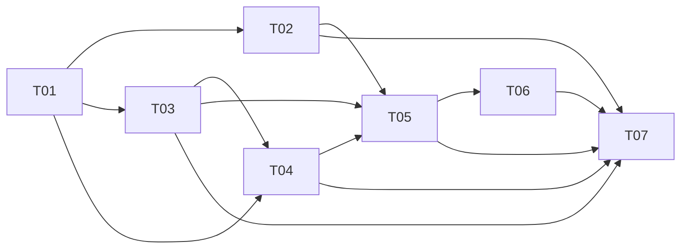

# Plan / 计划：聊天室频道与 worktree
最后修改时间: 2026-11-14 13:27:00

## Review status / 审查状态

Accepted，方案修订 4。用户已于 2026-11-14 12:59 授权直接创建交互与后端实现；沿用现有任务拆分，由主会话直接实施和集成，不自动启动其他执行会话。必要检查在临时数据库和临时 Git 仓库中执行，不操作现场数据与会话。

## Intent basis / 意图依据

- [意图](../intent/20261113-channels-worktrees.md) A01–A08；默认频道使用原目录，新增频道可选 worktree（默认不勾选），同一房间活动 Agent 会话不跨频道。本次继续完成后端实现和必要开发检查。
- 记录基线 HEAD `b4fbc85626ec743a0bffea32f73a383eda580f68`；派发前重查版本和工作区。
- 事实：`rooms.project_path` 唯一；现有所有业务资源按 room 归属；消息 ID 与 `seq` 按 room 生成；MCP 通过 `(room_id, threadId)` 查询身份；成员发现、能力和投递使用 room 的路径；现有图片存储按 room 分目录；桌面退出通知按 room 聚合。

## Technical decisions / 技术设计与决策

### 范围与身份

- 频道业务属性为名称和描述，详情只展示这两个字段。内部保留频道 ID、归属、默认标记、工作目录、worktree 创建信息和归档时间，用于路由与会话定位；不维护频道状态或创建核验流程。每活动房间有一个默认频道，默认频道不能单独归档；新频道初始化固定用户及默认话题。活动频道名称在房间内唯一，活动 worktree 目录在全服务范围唯一。
- 本版使用软归档替代物理删除频道/房间：对外 DELETE 后从活动列表隐藏，但保留频道路径、创建操作、消息与投递事实；不另建永久目录预留与释放平台。归档频道释放活动占用，保留的历史记录不授权系统重新接管其文件。新创建仍拒绝现存路径和分支。创建房间也检查其他活动频道占用，不能把活动频道 worktree 注册为新房间。工作目录创建/绑定时解析实际绝对路径及 Windows 大小写；迁移只回填现有规范路径，不依赖机器当前文件系统或 Git 可用性。
- 每个频道包含独立固定用户 `user`，Agent 成员及订阅均按 `(room_id, channel_id)` 作用域；同一房间对活动 `session_id` 保持唯一。topic/member 的名称只在频道内唯一。数据库使用复合外键或同等约束保证关联的 room/channel 一致，应用层再次校验。会话元数据可保留房间级，绑定和候选状态以频道确定。
- 存储作用域通过显式 `RoomStore.for_channel(channel_id)` 绑定到仓储实例，频道资源必填频道 ID 和工作目录。catalog 的 `projectPath` 是房间目录，`workingPath` 是执行 cwd。全局 dispatcher/观察和房间列表保持全局范围；房间归档影响所有频道。
- 消息 `seq`、ID 继续房间全局分配，跨频道出现序号间隙属正常；分页、位置与事件只返回当前频道，不能以序号连续性推断消息数量。消息、关联、发布者、引用、投递和上下文查阅记录必须属于同一频道；历史软删除记录也参与迁移和幂等判断。保留 `(room_id, publisher_id, publication_id)` 语义需处理各频道固定 `user` 重名：将唯一作用域扩展为 `(room_id, channel_id, publisher_id, publication_id)`，旧消息 ID 和已有 publication ID 不变。
- 所有频道资源入口必须显式指定频道并验证归属，默认频道同样适用；移除原房间级资源入口。带 Codex 会话上下文的调用验证会话绑定在目标频道，缺失频道直接拒绝，不从目标 ID 或最近选择推断。
- 频道资源使用 `/api/room/{room_id}/channel/{channel_id}/...`，频道工具必填 `channel_id`。Agent envelope 和 catalog 返回 `channelId` 及 `workingPath`；调用者身份按 `(room_id, channel_id, threadId)` 解析。room.projectPath 作为房间原目录，不能覆盖频道 cwd；客户端和插件统一更新到当前契约。
- `member_context`、catalog、positions、消息和队列查询、WebSocket、清空、附件引用及桌面退出通知均带频道范围。所有频道图片使用统一的频道目录和 URL，不读取房间级旧路径。桌面退出通知按频道分别构造目标与幂等键。

### 迁移与恢复

- 新增 SQL-first revision `channels_20261113` 接在 `message_deleted_20261112` 后。默认频道 ID 采用 `channel-default`（以 room_id 限定），旧数据含软删除和上下文全部回填；旧字段、seq、receipt、状态不变。复合主键使每频道都能拥有 `user`；sessions 仍是房间级元数据，不复制为多份外部会话。房间增加归档时间，目录唯一索引改为活动房间约束，频道目录活动唯一约束同时覆盖所有房间。
- 外键开启的 SQLite 下，先建全套新关联表并引用新表，复制数据，按依赖顺序删除旧表，再重命名新表并重建索引；迁移事务内必要时启用 `defer_foreign_keys`，提交前执行 `foreign_key_check`，不能在事务内切 `foreign_keys=OFF`。2026-11-13 使用 SQLite 3.50.4 内存探针验证了简化的成员→自引用消息→投递链重建及提交，2 条消息保留且无外键违例；不代表真实全表迁移已通过，T01 必须在临时库覆盖全图及失败回滚。
- rooms 的旧列级 UNIQUE 也需要重建时，新表图包含 rooms/sessions，不能让新 channels 仍引用待删除旧 rooms。复制保留现有 rowid 相对顺序及投递 FIFO，恢复 room_events 的 AUTOINCREMENT 高水位（含已删除房间留下的 sqlite_sequence），不能仅用剩余事件 MAX 值重置游标。
- 升级前停服务和 dispatcher，并备份数据库及已有图片文件；新旧服务不可混跑。恢复旧版本不能只恢复数据库：新版本期间已进入 Codex 的输入无法回滚，旧备份可能把已执行消息恢复成 pending。首选前滚修复；确需恢复时必须停投递并核对外部回执，禁止未经对账直接启动旧备份。迁移本身不调用 Git/Codex，不重投；`submitting` 按现有启动恢复为 `unknown`。

### Worktree 生命周期

- worktree 由 Relay 数据根的 `worktrees/<room-id>/<channel-id>` 管理。创建界面提供默认未勾选的“创建 Worktree”；未勾选时不执行 Git。勾选后分支为 `agent-relay/<room-id>/<channel-id>`，服务端在创建时读取当前 HEAD，不提供提交选择或预览步骤。非 Git、无有效 commit 或非仓库根目录在创建时明确报错。
- 创建请求包含 `channelId/name/description/useWorktree`，客户端先生成 ID 再提交一次。同 ID 同参数返回原频道，异参数冲突；响应未知时 GET 同一 ID 查回，不换 ID 或盲目重发。
- 创建通过依赖注入绑定已有请求事务切面，复用 `SQLAlchemyScope`，频道、固定用户、初始话题与事件一起提交。Git 创建或核对失败直接返回错误，请求事务统一回滚数据库写入，不独立预留或提交中间记录，不新增事务实现。数据库回滚不自动清理、reset 或接管 Git 产物。
- 归档拒绝仍有 submitting 的对象。归档后隐藏活动资源、停止发布和新的 claim/activation，将 pending 投递软移出；queued/unknown 保留原状态及回执。归档不删除工作目录、分支或外部队列；默认频道只能随房间归档。
- T01 提供可跨进程的操作 guard，沿用项目文件锁方式；实现使用同房间共享锁串行协调创建、归档和外部输入/activation，锁在外部写入完成或结果转为未知后才释放。不持 DB 事务等待锁或 RPC；同调用上下文可重入，其他在途操作非阻塞返回冲突。归档将 Agent 成员标为 retired 以释放活动会话唯一约束，固定用户与历史目标保留；不得复用成员 ID 或改变旧 delivery 的目标。
- 工作目录是频道的会话 cwd 校验、Codex `QueueRequest.project_path` 和 skills/MCP 发现基准；若目录被外部移动或移除则明确不可用，不自动切换或恢复会话。worktree 不复制未提交/ignored 文件；所有频道共享仓库引用，不提供 Git 层权限隔离。

## Implementation steps / 实施步骤

1. 前端频道骨架已交付；继续实现 T01–T06 后端与客户端，将创建按钮改为一次提交，内部自动准备 ID 和 HEAD 快照，移除频道 501 占位。
2. T01 交付存储契约、迁移和仓储默认频道适配，使原默认频道用例仍可运行；新频道创建入口暂不启用（A01、A05）。
3. T02 与 T03 在 T01 接受后分别交付可选 worktree 生命周期和频道应用隔离。T02 使用独立 channels 仓储，T03 消费 T01 已完成的作用域仓储，避免同时大改 persistence 公共文件（A02、A03、A07）。
4. T04 消费 T01/T03，完成会话、能力、投递和桌面通知（A04、A07）。
5. T05 整合 T02–T04，公开接口与客户端契约；T06 完成 Web（A05、A06）。
6. T07 主会话集成审查与必要开发检查，随后仅在用户授权整体验证时执行隔离环境真实链路（A01–A08）。

## Files to change / 修改范围

- T01：领域/DTO/ports 的频道契约、ORM、mapper、迁移及资源仓储的显式频道过滤。
- T02：新增 `application/channels`、Git adapter、频道仓储和请求事务依赖接线及测试；worktree 仅在 `useWorktree=true` 时参与。
- T03：rooms/messages/context 领域与应用、图片服务及对应测试；使用 T01 仓储契约，公共存储缺陷回交 T01 串行修正。
- T04：`application/members`、`capabilities`、`delivery`、`desktop`、Codex/dispatch 和对应测试；依赖 T03 的查询接口。
- T05：HTTP 路由、`interfaces/client.py`、CLI、MCP、plugin skill、接口文档及测试。
- T06：`web/src` 路由、服务、stores、频道选择及对话、草稿、i18n 与必要测试；创建对话框使用 Reka UI 展示默认未勾选的 worktree 选项，不提供基准提交输入，未勾选时不呈现 worktree 分支。
- T07：共享接线、跨层回归、README、现行设计和迁移说明；不得并行覆盖前置任务未交付文件。

## Tasks and coordination / 子任务与协调

### Coordination / 协调信息

- 方案修订：4；权威协调根：`D:\SourceCodes\mywork\agent-relay`。
- 仲裁会话：本次 SpecFlow 主会话，唯一维护分配、状态和审查；其他 worktree 的计划副本不构成权威。
- 阶段授权：用户消息 0182 明确要求直接“创建频道”并开始后端实现，覆盖此前契约限制；主会话按任务依赖直接执行。数据库/Git 开发检查使用临时资源，现场验证、Git 提交和部署不在本次执行范围。

### Task definitions / 任务定义表

| ID | 任务文档 | 直接前置任务与要求 | 预期交付与验收 | 意图验收归属 |
| --- | --- | --- | --- | --- |
| T01 | [存储与迁移](../task/20261113-channels-worktrees/T01-model-migration.md) | 无 | 频道存储契约、迁移及统一频道仓储 | A01、A05、A08 |
| T02 | [worktree 生命周期](../task/20261113-channels-worktrees/T02-worktree-lifecycle.md) | T01 已接受模型及可访问版本 | 可选 worktree 的创建、事务接线、归档和保留规则，隔离 Git 测试 | A01、A02、A07、A08 |
| T03 | [频道消息隔离](../task/20261113-channels-worktrees/T03-channel-isolation.md) | T01 已接受模型、作用域仓储与迁移版本 | 频道资源、消息、引用、队列、事件与上下文应用隔离 | A03、A05、A07、A08 |
| T04 | [会话与投递](../task/20261113-channels-worktrees/T04-session-delivery.md) | T01、T03 已接受的模型和资源查询接口及版本 | cwd、会话独占、能力、投递和退出通知 | A04、A05、A07、A08 |
| T05 | [接口与协作](../task/20261113-channels-worktrees/T05-api-clients.md) | T02、T03、T04 已接受的生命周期与服务契约及版本 | HTTP、MCP、CLI 和 skill 的显式频道契约 | A05、A06、A08 |
| T06 | [Web 频道体验](../task/20261113-channels-worktrees/T06-web.md) | T05 已接受频道 API 契约和可访问版本 | 频道创建与切换、频道级草稿和交互 | A02、A03、A06、A08 |
| T07 | [集成与交付](../task/20261113-channels-worktrees/T07-integration.md) | T02、T03、T04、T05、T06 均已接受且版本可集成 | 集成审查、必要开发检查、验证准备 | A01、A02、A03、A04、A05、A06、A07、A08 |

### Execution registry / 执行登记表

| ID | 执行状态 | 执行者 | 分配编号 | 工作基线 / 交付位置 | 仲裁结论 / 当前阻塞 |
| --- | --- | --- | --- | --- | --- |
| T01 | unassigned | 无 | 无 | 尚无交付 | 计划待接受，未授权实施 |
| T02 | unassigned | 无 | 无 | 尚无交付 | 等待 T01 接受 |
| T03 | unassigned | 无 | 无 | 尚无交付 | 等待 T01 接受 |
| T04 | unassigned | 无 | 无 | 尚无交付 | 等待 T01、T03 接受 |
| T05 | unassigned | 无 | 无 | 尚无交付 | 等待 T02、T03、T04 接受 |
| T06 | unassigned | 无 | 无 | 尚无交付 | 等待 T05 接受 |
| T07 | unassigned | 无 | 无 | 尚无交付 | 等待 T02–T06 接受 |

### DAG and integration / DAG 与集成

T02/T03 可在独立工作区并行，本次由主会话直接顺序集成，不派发子 Agent。共享 ORM、依赖注入和 fixture 由主会话统一维护。T07 不替代现场整体验证。

### Assignment history / 分配历史

| 时间 | ID | 分配编号 | 执行者 | 动作与依据 |
| --- | --- | --- | --- | --- |
| 2026-11-13 21:35:38 | 无 | 无 | 无 | 建立草案；仅记录和拆分，未分配 |
| 2026-11-13 22:10:16 | 无 | 无 | 无 | 重新评估后修订为 2；未派发，旧草案不作为实施依据 |
| 2026-11-14 12:30:00 | 无 | 无 | 主会话 | 修订为 3：worktree 改为可选且默认关闭；仅交付 Web 骨架和后端契约，未实现业务、未分配 task |
| 2026-11-14 13:27:00 | T01–T07 | local-r4 | 主会话 | 用户消息 0182 授权后端实施；修订为 4，直接集成，使用频道绑定 store 和房间级操作锁；不启动子 Agent |

## Verification plan / 检查与验证安排

- 各节点使用仓库现有 `uv run --locked pytest ...` 和前端现有测试入口进行定向检查；共享代码变更后运行 `make check`、`make test`，记录平台及失败原因。
- T01–T04 的纯规则及端口替身测试仍留在 `tests/unit`；真实临时 SQLite/Git 的专项检查放在 `tests/integration` 并显式用 pytest 执行，不把项目当前 mock 型迁移单测宣称为真实迁移。逐字段比对软删除、上下文、事件和所有投递状态/回执，检查外键、幂等及房间 seq；验证注入失败后旧库及 revision 回滚。
- 在临时 Git 仓库覆盖有提交、无 HEAD、非仓库、目录/分支冲突、Git 失败、请求事务回滚、dirty 原目录、分支与 worktree 保留；不触碰现场仓库。
- 交叉验证同名资源、跨频道引用/@/订阅/消息 ID/图片/事件/清理拒绝、重复会话绑定、频道切换草稿和旧客户端默认频道。验证响应未知和外部队列回执不重投。
- 获得整体验证授权后以隔离服务、临时数据库、临时 Git 仓库及专用 Codex 会话检查 Web 创建与切换、两频道消息路由和实际 cwd；验证记录只在真实执行后生成，记录无法覆盖项。

## Risks and recovery / 风险与恢复

- 未更新的 Agent 工具或 skill 可能忽略 channelId；作用域验证必须先于任何读写副作用，不能依赖人工勾选已升级。插件升级后按现有流程重启/重新打开会话以加载，不迁移旧 thread 的工作目录。
- Git 和 DB 不能跨资源原子提交；失败由请求事务回滚数据库写入，外部 Git 产物保留供人工检查，不自动删除或接管目录与分支。
- 文件路径别名、链接和 Windows 大小写会影响占用判断；迁移先检测冲突并报错，不能静默合并。
- 房间全局 seq 与频道事件过滤必须联合设计，否则分页和事件流可能漏消息；测试覆盖间隙与重连。

## User review notes / 用户审查记录

- 2026-11-13：用户明确默认频道占用原目录、新增频道创建 worktree，以及会话独占；本次请求仅记录和拆分。计划与 task 为 Draft，尚无分配、实现或检查证据。
- 2026-11-13 重新评估：修订 2 修正创建重放会冲突、HEAD 前进误拒绝、旧 skill 人工确认、永久预留平台、归档在途投递和 T01 无法独立检查等问题。工作树布局改为数据根；这些均为待审查方案。仅运行简化内存 SQLite 可行性探针，未执行本项目迁移、Git 写入或产品测试。
- 2026-11-14：修订 3 记录 worktree 由固定创建改为默认不勾选的可选项，并限定当前阶段只实现 Web 交互和后端契约。已完成前端频道骨架、默认频道只读投影及 501 契约接口；未实现频道持久化、worktree 创建或频道级读写，不能据此判定频道功能可用。
- 2026-11-14：用户补充 worktree 自动从当前 commit 出发，移除用户指定提交的字段及参数；创建选项使用 Reka UI。
