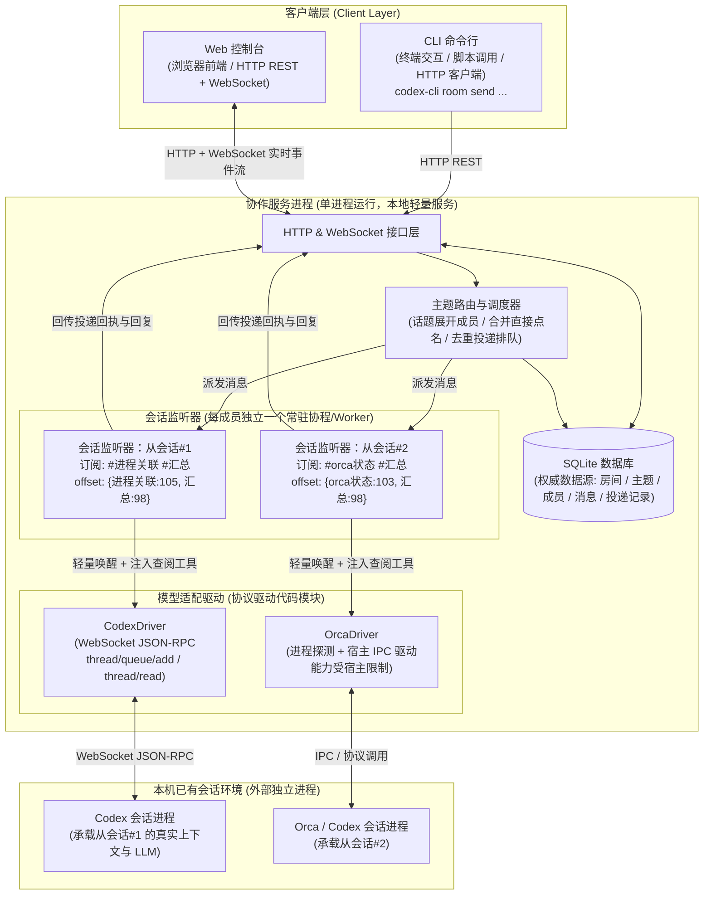
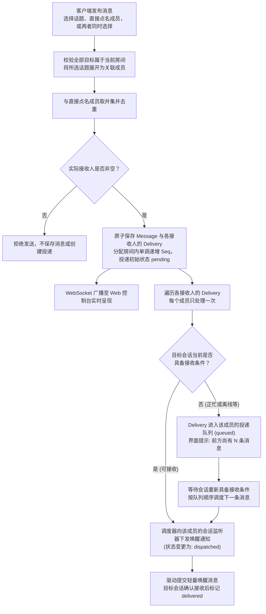
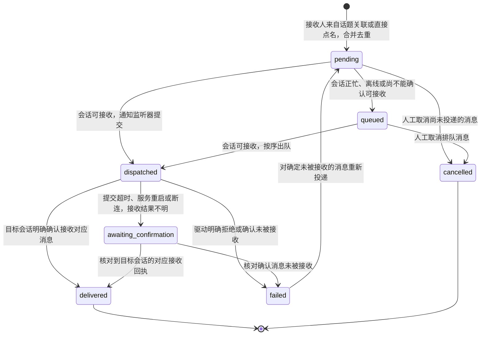
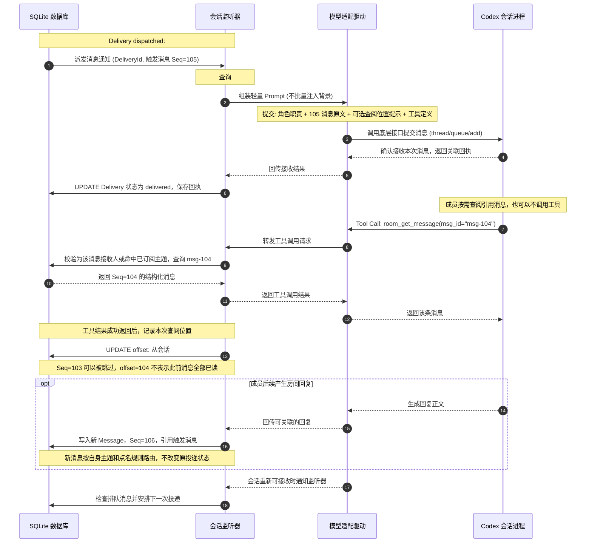
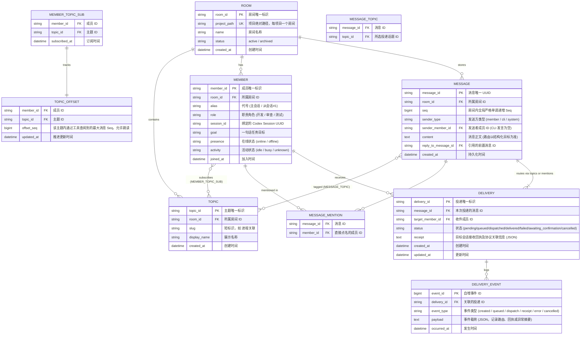

# Codex 会话聊天室协作设计
最后修改时间: 2026-11-07 09:57:47

本文记录多角色协作聊天室的架构设计与核心运行机制，供后续实施与接口对接对齐细节。

项目名称为 **Agent Relay**，代码仓库为 `agent-relay`。当前先实现正式的 Web 聊天室与 HTTP 接口，内部数据和投递暂用内存实现；本文的 SQLite、会话监听器、模型驱动与 WebSocket 按后续阶段接入。

实现状态：Web 与内存 HTTP API 已实现话题路由和 `@` 成员取并集、去重及非空校验。详情中的“@ 成员”只展示消息明确指定的成员，“分发状态”展示全部实际投递成员；分发表格与左侧列表共用头像及名称样式，已有状态时间在下方按 `HH:mm:ss` 显示，消息正文后的时间也使用相同格式。

---

## 1. 背景与目标

现有 `codex-cli` 通过点对点消息投递组织会话协作，主会话维护本地 `.codex-cli/state` 文件，从会话通过消息头解析身份与状态路径。消息记录分散在各个独立的会话 Thread 中，带来一系列协作痛点：

- **脉络割裂**：难以分辨发起者、接收者及讨论上下文关系；
- **分发状态不清**：难以判断消息应发给谁、是否排队以及是否已成功投递到目标会话；
- **运行发现局限**：虽合并了 daemon、进程及可选的 Orca 信息，但进程存活（`open`）不等于正在工作，缺少可靠的持续监听和调度中心。该结论来自原有点对点协作实践，不依赖当前仓库以外的实现文档。

**本设计目标**：
构建可持续的多会话协作系统：

1. **统一时间线与按需查阅**：共享房间讨论记录，每个成员可关注一个或多个 `#topic`，仅按需拉取相关消息，减少无关内容进入模型上下文；
2. **明确路由与轻量分发**：消息可投递到一个或多个话题，也可直接 `@` 一个或多个成员，两者可以叠加；话题展开为关联成员，与直接点名成员取并集，每条消息必须有实际接收人；
3. **真实可信的分发可观测性**：在集中看板中观测消息归属、收件成员、排队、投递及异常，分别记录“消息保存”、“会话接收”、“背景查阅”与“成员回复”。

聊天室的职责是消息路由、分发和查阅。业务任务是否完成、代码是否通过验收以及模型是否达成目标，由协作成员和使用方判断，不作为聊天室投递状态的含义。

一个服务管理多个项目聊天室，每个项目可开一个聊天室并添加若干成员。项目以规范化的绝对路径识别，主题、成员订阅、消息和投递均按房间隔离；所有房间内接口携带 `room_id`，不使用全局默认房间。Web 支持项目切换、新建聊天室、添加成员与创建主题。

本系统按协作需求独立设计，现有 `codex-cli` 与 `.codex-cli/state` 仅提供问题背景，不构成实现、存储或协议约束；不预设复用旧的 message queue，也不要求继承现有成员管理方式。

---

## 2. 系统架构与物理形态

CLI 和本地 state 作为操作入口和配置存储，不足以承担持续监听、队列调度与状态观测。系统由**独立运行的本地协作服务**负责核心工作，CLI 与 Web 控制台作为客户端：

### 2.1 物理形态与通信协议



### 2.2 组件职责对照

| 组件 | 物理形态 | 核心职责 |
| :--- | :--- | :--- |
| **协作服务** | 本地 HTTP/WS 服务进程 | 管理房间、主题、成员身份、消息及投递记录，SQLite 作为权威数据源。 |
| **主题路由与调度** | 服务内部调度模块 | 读取结构化的话题与直接点名目标，将话题展开为关联成员，与直接点名成员取并集，生成去重后的投递记录并处理排队与恢复。 |
| **会话监听器 (Listener)** | 服务内后台常驻协程（每成员一个） | 充当会话的“耳朵”：监听该成员的投递通知、维护各主题查阅位置，收到经话题路由或直接点名产生的投递时向适配驱动提交消息。 |
| **模型适配驱动 (Adapter)** | 服务内协议驱动模块（非独立进程） | 封装 Codex 底层协议（如基于 `codex app-server proxy` 的 WebSocket JSON-RPC），提交轻量唤醒消息、提供查阅工具，采集投递回执及会话可用状态。 |
| **Web 控制台** | 浏览器 Web 应用 | 展示讨论流、主题、成员面板、投递轨迹和异常，提供人工干预入口。 |
| **CLI** | 终端命令行工具 | 提供创建房间、配置主题、加入、发言、查询及等待投递回执等操作。 |
| **Codex 会话** | 本机运行的 Codex 进程 | 真正承载模型推理、对话记忆与代码执行沙箱的实体。 |

### 2.3 核心概念三层解耦

- **房间成员 (Member)**：协作身份，关联业务角色与代号；
- **会话监听器 (Listener)**：服务内的常驻后台协程，负责网络监听与状态守候；
- **模型执行 (Model Run)**：消息投递后由目标会话承载的按需推理过程，其忙闲信息仅用于安排后续投递。

会话监听器收到通知 $\neq$ 目标会话已接收消息；目标会话接收消息 $\neq$ 模型已查阅背景。聊天室跟踪这些通信事实，业务执行与验收不纳入投递生命周期。

---

## 3. 会话管理模式

| 维度 | 服务管理的会话 | 接入 Orca 等宿主的已有会话 |
| :--- | :--- | :--- |
| **创建和执行** | 服务通过受支持接口直接创建和驱动 | 依赖宿主已开放的能力 |
| **投递关联** | 记录服务投递与底层会话回执的绑定关系 | 需要宿主提供可靠的会话关联与接收依据 |
| **状态采集** | 接收投递回执及安排后续投递所需的会话状态 | 可能只能通过查询或进程状态间接推断 |
| **重连和恢复** | 服务保留投递记录并核对未决投递 | 受宿主生命周期和外部退出限制 |
| **现有工作习惯** | 需要使用新的协作入口启动 | 可以保留用户原有的终端/IDE 使用入口 |

**首版策略**：新建协作会话优先由服务直接创建与驱动；接入外部已打开会话作为补充能力，并在界面显式展示宿主的功能限制。

---

## 4. 成员与主题订阅 (Topic-based Routing)

### 4.1 成员身份

成员具有稳定身份，关联模型会话、代号（如 `主会话`、`从会话#1`）、角色（如 `开发`、`审查`、`测试`）和一句话任务目标。代号由服务分配和解析，发送身份由程序环境绑定，不可在正文中随意冒充。

### 4.2 主题 (Topic) 作为投递目标与关注域

**核心原则：成员与主题是多对多关系，投递到话题就是投递给该话题关联的成员。**

1. **多主题关注**：每个成员 / Worker 可以订阅一个或多个主题。例如前端 Worker 关注 `#前端`，后端 Worker 关注 `#后端`，测试 Worker 同时关注 `#前端` 和 `#后端`；
2. **话题展开成员**：一条消息可以选择多个话题，服务将这些话题关联的成员合并为话题接收人；命中任一所选话题即会收到投递，无需再次点名；
3. **直接点名叠加**：直接 `@` 的成员加入同一收件集合，不要求其订阅消息所选话题；消息也可以只点名成员，不选择话题；
4. **统一去重**：测试 Worker 同时命中前后端两个话题，或又被直接点名时，同一条消息仍只向该成员创建一条投递记录；
5. **选择性查阅**：接收本次消息不要求补读全部历史。成员按需选择背景，直接点名也不会自动订阅话题或获得该话题的全部历史。

```text
房间：功能开发
 ├─ #前端       ← 前端 Worker、测试 Worker 订阅
 ├─ #后端       ← 后端 Worker、测试 Worker 订阅
 └─ #汇总       ← 主会话、前端 Worker、后端 Worker、测试 Worker 订阅
```

### 4.3 交流示例

```text
房间：功能开发

主会话：#前端 页面交互约定更新，请相关成员查看。
前端Worker：@主会话 页面交互已调整，请确认。

主会话：@后端Worker 实现接口。
后端Worker：#后端 接口约定已更新，请相关成员查看。

主会话：#前端 #后端 @审查Worker 请结合页面和接口约定进行联调。
测试Worker：@前端Worker @后端Worker 发现接口字段与页面绑定不一致，请核对。

测试Worker：#汇总 测试结果和待确认问题如下……
```

`#前端` 会路由给该话题关联的主会话、前端 Worker 和测试 Worker；`@后端Worker` 只直接投递给后端 Worker。话题与点名同时选择时合并收件人，例如未订阅前后端话题的审查 Worker 也可通过直接点名收到同一条消息。测试结论由成员表达，聊天室只负责将消息路由给实际接收人。

---

## 5. 消息路由与投递机制 (Routing & Delivery)

### 5.1 话题投递与直接点名取并集

消息支持两种可以独立使用、也可以叠加的投递目标：

1. **投递到话题**：选择一个或多个话题，路由到这些话题关联的成员；当前关联关系由成员的主题订阅表达。
2. **直接 `@` 成员**：选择一个或多个具体成员，直接向其投递，不受话题订阅限制。

**最终接收人 = 所选话题关联成员的并集 ∪ 直接点名成员集合。**

| 关联所选话题 | 被直接 `@` | 行为与结果 |
| :---: | :---: | :--- |
| **✓** | **✓** | 生成 1 条投递记录，两种来源重叠时不重复投递。 |
| **✓** | **✗** | 通过话题路由生成 1 条投递记录。 |
| **✗** | **✓** | 通过直接点名生成 1 条投递记录，无需订阅所选话题。 |
| **✗** | **✗** | 该成员不是本次消息的接收人，不生成投递记录。 |

**发送校验**：话题与直接成员至少选择一项，且展开后的实际接收人必须非空。两者都未选择，或只选择了没有关联成员的话题时，拒绝发送；不保存没有接收人的消息。话题和成员均须属于当前房间，任一目标无效时拒绝整条消息，不部分保存或投递。成员忙碌或离线时仍是有效接收人，投递进入排队。

投递按 `(message_id, target_member_id)` 唯一。同一成员关联多个所选话题、被重复点名或同时命中两种目标时，都只生成一条投递记录。发送时展开并保存实际收件人快照，后续订阅变化不自动补投或撤销已有投递。

消息需分别保留“所选话题”“直接点名成员”和“实际接收人”，便于解释路由来源。直接点名消息允许没有话题；接收到一条跨订阅范围的点名消息，不会自动扩大成员对其他消息的查阅范围。

HTTP 发布消息使用 `topicIds` 指定话题、`mentionedMemberIds` 指定 `@` 成员，两组均可为空但不能同时为空。响应分别返回这两组选项，并通过 `recipientIds` 与 `deliveries` 返回发送时合并去重后的实际投递结果；客户端展示历史分发时不按当前订阅重新推算。

### 5.2 消息路由流程图



### 5.3 投递记录（Delivery）与单会话串行队列

- **消息与投递分开存储**：消息在 `Message` 表中只存一份；`Delivery` 跟踪“应发给谁、是否排队、是否成功提交到目标会话”。话题展开与直接点名合并后有 $N$ 个实际接收人，就产生 $N$ 条独立的 `Delivery`。
- **单会话串行投递**：成员连续收到话题路由或直接点名的消息时，后续消息按队列顺序等待。驱动依据会话是否可接收来安排下一次投递，默认不打断正在进行的推理与代码编辑。
- **投递回执独立成立**：目标会话确认接收本次唤醒消息后，该条投递即为 `delivered`。这不表示模型已查阅背景、已回复或已完成业务任务。
- **排队依据是会话可用性**：已收到投递回执但会话仍忙时，后续消息继续排队；不能因前一条变为 `delivered` 就认定会话空闲。
- **回复独立路由**：成员后续回复作为新的 `Message` 写入房间，并按同一主题与点名规则路由；回复不是原投递成功的必要条件。

### 5.4 投递生命周期状态机



`awaiting_confirmation` 仅表示消息接收结果未知，核对前不自动重发。已投递消息的后续执行或取消由目标会话处理，不反向改写投递成功的事实。

---

## 6. 轻量唤醒与主动查阅 (Pull 范式与防污染)

### 6.1 不按 Offset 区间批量注入背景

将 Offset 之后的聊天记录全量注入会话 Prompt，会使成员被动接收当前请求不需要的内容：

1. **信噪比下降**：即使消息来自已订阅主题，也可能包含与当前请求无关的日志、讨论或已废弃方案；
2. **上下文膨胀**：Codex 会话持有持续的 Thread 历史，批量注入无关记录会持续消耗 Token；
3. **指令角色错乱**：LLM 容易把发给其他人的指令误当作自己的任务。

因此，**唤醒时只提交本次投递的消息及必要元信息，背景由成员主动选择查阅**。无论投递来自话题路由还是直接点名，都使用同一轻量唤醒机制；成员可以跳过背景消息，也可以回查 Offset 之前的内容。

### 6.2 精简唤醒 Prompt

会话监听器唤醒模型时，提交的初始上下文保持高度精炼：

| 结构部分 | 具体内容 |
| :--- | :--- |
| **当前身份与职责** | 成员代号、角色定义与既定任务目标。 |
| **本次处理请求** | 触发本次投递的消息原文，以及所选话题和直接点名目标；仅直接点名的消息可以没有话题。 |
| **可选背景概况提示** | 可提供相关主题的查阅位置及位置之后的新增消息数量，**不注入背景正文**（例如：`#进程关联 查阅位置为 102，其后有 3 条消息，可按需查阅或跳过`）。该数量不代表必须补读的消息数。 |
| **专属查阅工具定义** | 向会话注入专用的房间消息查阅工具函数。 |

### 6.3 查阅工具与选择性阅读

适配驱动向会话暴露如下查阅工具：

- `room_get_message(msg_id)`：按 ID 读取单条特定消息（适合引用回复）；
- `room_search(topic, query, limit)`：在指定主题内按关键词检索；
- `room_list(topic, since_seq, limit)`：在指定主题内按时序分页查阅。

**查阅约定**：

- **服务端范围校验**：按主题查询时，指定主题须在该成员订阅范围内；按 ID 读取时，成员须是该消息的实际接收人，或消息至少有一个关联主题在其订阅范围内。由此可读取发给自己的无话题消息或跨订阅范围的点名消息；直接点名和引用链接均不会授予整个话题的历史查阅权限；
- **按需选择**：成员可以直接处理信息充分的本次消息，也可以查阅引用消息、搜索关键词或分页浏览。提供工具不意味着必须使用工具或补齐历史；
- **允许跳读与回查**：Offset 不限制工具查询范围，不阻止读取更早的消息，也不要求按顺序消费；
- **可选查阅记录**：可记录工具调用及实际返回的消息 ID，便于解释上下文来源，不据此评判成员是否完成业务任务。

### 6.4 分发时序图：轻量唤醒 + 主动查阅 (Pull)



### 6.5 Offset 仅记录查阅位置

- **辅助位置**：Offset 仅记录成员在某个主题中通过工具查阅到的最大消息 Seq，便于后续定位和浏览，不承担可靠投递或任务进度的职责。
- **独立维度**：系统按 **成员 × 主题** 维护独立 Offset（即 `TOPIC_OFFSET` 表）。多主题成员可以在前后端主题上保留不同查阅位置。
- **允许不连续**：读取 Seq=104 而跳过 Seq=103 是正常行为；Offset 推进到 104 不表示此前消息已全部读取。回查旧消息不会降低当前记录位置。
- **记录准则**：工具结果成功返回后，根据实际返回消息的 Seq 原子更新为 `max(原位置, 本次返回的最大 Seq)`。按主题查询只更新被查询主题；按 ID 读取多主题消息时，更新该消息关联且成员已订阅的主题。无话题消息或没有订阅交集的直接点名消息不创建主题 Offset；空结果、返回失败或没有查阅时保持原位置。
- **独立于分发**：主题订阅、点名和投递记录决定路由及分发；Offset 不参与收件人匹配、投递去重或重试，也不限制成员可查阅的历史范围。
- **展示语义**：界面可展示“查阅位置”及“位置之后的新增消息数”，不将其标为精确未读数，不要求清零或补读被跳过的消息。

---

## 7. 核心数据模型与 ER 图

SQLite 作为权威数据源，维护房间、成员的多主题订阅、消息归属、独立投递记录及分发事件。业务任务与验收状态不进入核心数据模型：



`MEMBER_TOPIC_SUB` 与 `MESSAGE_TOPIC` 分别表达成员订阅和消息所选投递话题；`MESSAGE_MENTION` 保存直接点名目标，与话题展开出的接收人区分。`DELIVERY` 保存发送时解析出的实际接收人快照，不绑定单个主题，并以 `(message_id, target_member_id)` 唯一约束保证多个话题与直接点名叠加时不重复投递。每条消息至少有一条 `Delivery`，无话题的直接点名消息没有 `MESSAGE_TOPIC` 记录。Offset 不作为投递记录的外键或调度前提。

---

## 8. 消息分发可观测性

服务日志用于后台排障；面向用户的协作事实必须以结构化事件持久化到 SQLite，使服务重启后状态依然完整可查。

### 8.1 事实边界分离

系统在展示和判断时严格区分以下事实，避免以虚假推断掩盖真实状态：

- **消息已保存**：已写入 `Message` 表，分配递增 Seq；
- **投递已创建**：已为话题关联成员与直接点名成员的并集逐人生成唯一 `Delivery` 记录；
- **监听器已接收**：服务内后台 Worker 已感知投递通知；
- **目标会话已接收**：驱动获得可关联的接收回执，将投递标记为 `delivered`；
- **背景已查阅**：成员主动调用查阅工具并成功获取了具体消息，可据此记录查阅位置；
- **成员已回应**：成员的新回复已写入房间，作为独立消息继续路由。

这些事实分别成立，不要求每条投递都经历背景查阅或回复。聊天室不据此声明业务任务已完成。

### 8.2 控制台三大核心视图

| 视图 | 展示内容 |
| :--- | :--- |
| **房间讨论视图** | 按主题标签、时间线组织消息流，展示发送者、回复关系、话题、`@` 成员和分发标记。详情的“@ 成员”标签列表只显示原消息明确指定的成员，没有 `@` 时不展示该区块；分发表格列出话题与 `@` 合并后的实际投递成员，成员样式与左侧列表一致。房间时间线也包含没有话题的 `@` 消息。 |
| **成员看板** | 成员代号、角色、Session UUID、监听器在线状态、订阅主题列表、各主题查阅位置、会话可接收状态与排队深度。 |
| **投递详情面板** | 原消息、关联主题、目标成员、排队及派发时间、目标会话接收回执、分发异常与重试记录；可附带查阅记录及关联回复。 |

### 8.3 消息展开生命周期示例

```text
11:21:03  主会话 → #进程关联 @从会话#1
          检查进程关联逻辑
11:21:03  消息已保存 (Seq: 105, Topic: #进程关联)
11:21:03  Delivery 已创建 → 从会话#1 (状态: pending)
11:21:03  监听器派发轻量唤醒 (状态: dispatched，查阅位置 102，其后有 3 条消息)
11:21:05  目标会话确认接收，保存回执 (状态: delivered)
11:21:08  [可选查阅] room_get_message(msg_id=msg-104) -> 返回 Seq=104
11:21:10  记录 从会话#1 的 #进程关联 offset = 104，不推断 Seq=103 已读
11:22:08  [后续回复] 监听器写入独立 Message (Seq: 106, Topic: #进程关联)
11:22:08  新消息按主题与点名规则路由，原 Delivery 保持 delivered
```

---

## 9. 核心设计原则对照

| 维度 | 设计选择 | 解决的对应问题与边界说明 |
| :--- | :--- | :--- |
| **架构权威** | 独立本地服务 + SQLite | 摆脱本地单个 `.codex-cli/state` 的单点故障与脆弱性，提供房间全局统一时间线。 |
| **物理形态** | 监听器为常驻协程，驱动为内部模块 | 厘清“谁在运行”：Codex 会话负责跑模型，监听器负责替它守候消息并调度，驱动负责发 JSON-RPC。 |
| **话题路由** | 话题展开为关联成员，多话题合并 | 投递到话题就向其关联成员生成投递，同一成员命中多个话题仍只投递一次。 |
| **触发机制** | 话题投递与直接点名取并集，每条消息都有实际接收人 | 允许只选话题、只点名成员或同时选择；直接点名不受主题订阅限制，接收人为空时拒绝发送。 |
| **投递设计** | 独立 Delivery 状态记录，单会话串行排队 | 消息存一份，按收件成员生成投递；会话忙碌时排队，以接收回执确认分发结果。 |
| **唤醒机制** | 本次消息直接提交，背景由工具按需拉取 (Pull) | 不批量注入 Offset 区间；即使是已订阅主题，也允许跳过与当前请求无关的内容。 |
| **Offset 定位** | 每成员 × 每主题记录查阅位置，允许跳读 | 辅助浏览，不代表此前全部已读，不参与投递、不要求补读，也不限制回查。 |
| **职责范围** | 跟踪消息保存、路由、分发、查阅及回复 | 业务执行与验收由协作成员负责；聊天室不以模型回复或执行结束判定业务任务完成。 |

---

## 10. 第一版范围与待定问题

### 10.1 第一版实施范围

- 使用现有 FastAPI + Vue 工程，后端本地端口 `9080`、前端 `9081`，容器内部端口仍为 `80`；
- 多项目聊天室，支持创建、切换项目和添加成员；开发室预置主会话、前端 Worker、后端 Worker、测试 Worker，测试 Worker 同时订阅前后端主题；
- 右上角通过 Reka UI 下拉菜单选择项目聊天室，选择器显示当前聊天室名称，左侧直接展示主题与成员；新聊天室从空成员、空主题开始，不限定角色或主题名称；
- 加载与提交共用 Spinner、加载状态和按钮组件；提交期间禁用重复操作并显示忙碌状态。操作结果通过 Reka UI Toast 统一反馈，字段校验保留在输入项附近，请求错误保留上下文与重试入口；
- 添加成员时先选择当前项目的未加入会话，再填写成员名称、输入或复用角色，并选择一个或多个关注主题；可在同一表单内创建并选中主题。成员支持后续编辑名称、角色与订阅；
- 各聊天室的主题和角色选项由 Pinia store 分别保存，供后续添加和编辑复用，切换聊天室时互不混用；
- Web 展示主题、成员订阅、消息时间线、引用与每个收件成员的投递状态，支持按主题筛选与发送消息；
- HTTP 接口采用正常业务契约，支持话题展开、直接点名叠加、实际收件成员去重及非空校验，内部暂使用内存数据；
- 当前通过结构化主题与收件成员选择器确定路由，正文中的自由文本 `#` / `@` 不单独解析；
- 发送时可只选话题、只点名成员或两者同时选择；话题关联成员与直接点名成员取并集，每条消息必须有实际接收人，忙碌或离线成员显示排队；
- SQLite、真实智能体、后台调度、CLI 与 WebSocket 后续接入，不建设业务任务状态机或强制已读机制。

前后端保持正式命名与统一接口，后续替换内部存储和投递实现，无需切换另一套页面或 API。

### 10.2 后续待明确与核验的关键问题

1. **接口能力实测核验**：核对 Codex `app-server proxy` 的消息提交、关联回执、会话可接收状态与未决投递查询能力，以及已打开外部会话的具体能力边界；
2. **发送者与自动回复路由**：发送者自身属于所选话题时，是否向自身创建投递，以及成员回复时如何选择目标以避免无意的循环投递；
3. **主题生命周期权限**：主题的创建与订阅是由主会话集中指派，还是允许各会话通过工具自主声明订阅？
4. **投递来源展示**：同一接收人同时来自多个话题与直接点名时，明确界面与事件记录中需要展示的来源明细；
5. **查阅工具规范**：确定 `room_list` 等查阅工具在具体环境（Codex JSON-RPC / MCP）下的协议标准与参数细节；
6. **服务生命周期**：协作服务的自启动、停止、重启后未决投递（`awaiting_confirmation`）的核对与干预交互细节。

在这些细节于实际原型中核实前，本文档作为整体架构与协作协议的统一共识依据。
