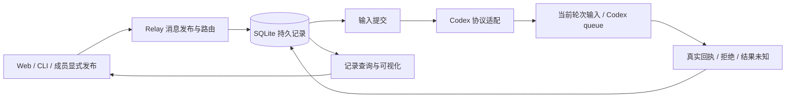
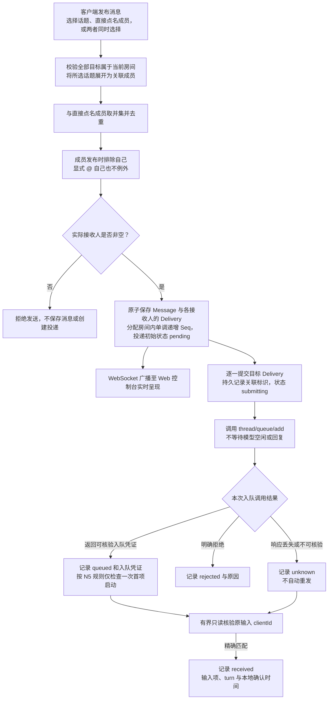
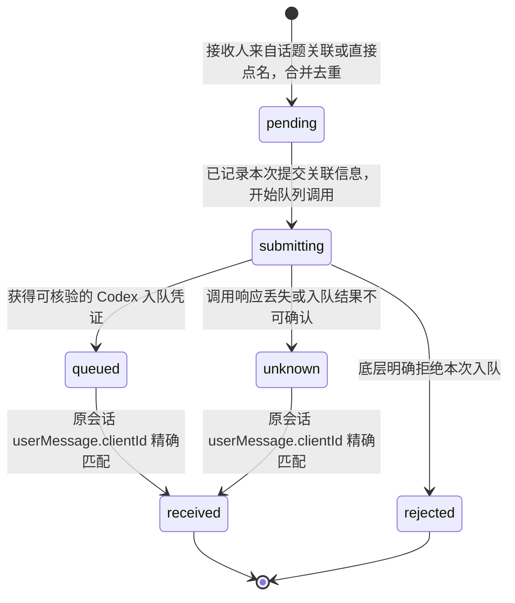
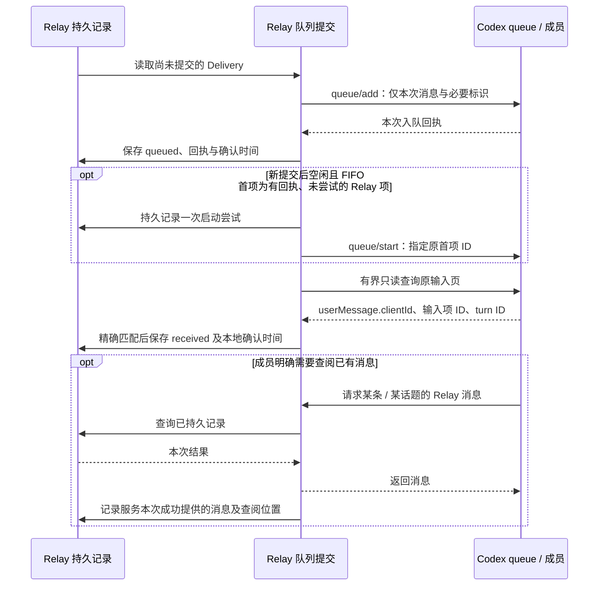
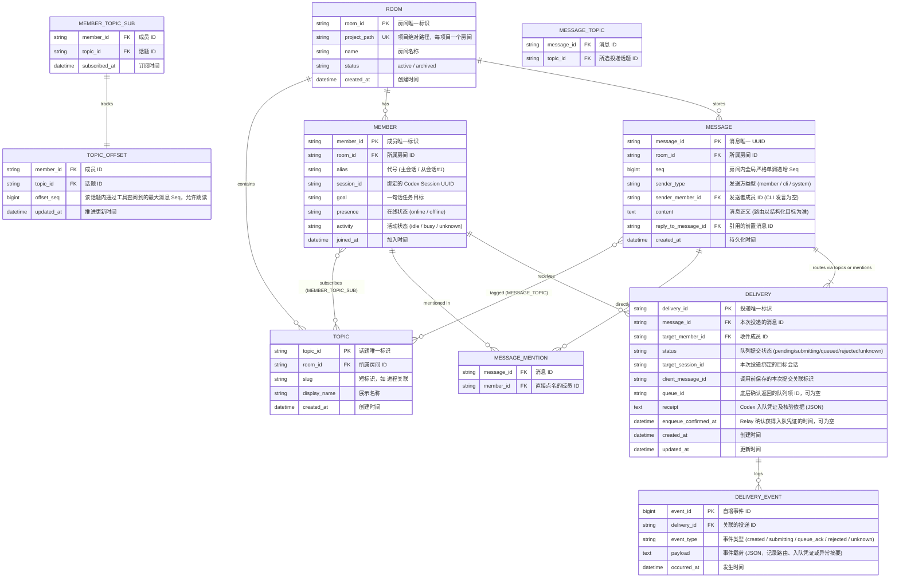

# Codex 会话聊天室协作设计
最后修改时间: 2026-11-12 09:39:00

本文记录多成员协作聊天室的架构设计与核心运行机制，供后续实施与接口对接对齐细节。

概念按[统一术语](terminology.md)命名：Topic 为话题、Session 为会话、Codex Thread 为会话的底层实现；线程专指程序并发。2026-11-07 用户确认 D03：成员发布时排除自己，排除后仍须有实际接收人。

项目名称为 **Agent Relay**，代码仓库为 `agent-relay`。当前已有 SQLite 持久资源、已有会话发现/绑定、成员显式发布/按需查阅、正式查询同步和 HTTP CLI。消息输入以[时效改进计划](../plan/20261112-timely-message-delivery.md)为当前方案；N5 保留原会话接收闭环的历史证据。

实现状态：Web 与持久 HTTP API 实现话题路由和 `@` 成员取并集、去重及非空校验。详情中的“@ 成员”只展示消息明确指定的成员，“分发状态”展示全部实际投递成员；分发表格与左侧列表共用头像及名称样式，有值的状态时间在下方按 `HH:mm:ss` 显示，消息正文后的时间也使用相同格式。

评估原则：前端是当前产品设想的原型，不作为架构和业务合理性的最终依据。Codex queue 只能确认入队；N5 通过原 userMessage.clientId 关联确认“已进入会话”，保存输入项/turn ID 和本地确认时间，不能解释为模型理解或业务完成。等待多久都不能作为重发依据。

N5 当前仅支持同一共享 daemon 中未归档的 idle/active 会话，独立存活实例可能不可达，候选禁选并给出接入办法。仅新提交后可对有真实 Relay 回执、尚未尝试的 FIFO 首项启动一次；后台只读输入核验，不自动恢复会话或反复覆盖用户中断。三种目标组合的生产 HTTP 隔离联调均已确认原输入，真实 Web 页面验收尚未完成。

2026-11-12 新消息自动按目标状态投递：active 时以最新活动轮次 ID 调用 `turn/steer`，idle 时使用原队列；用户不选择模式。steer 不新建轮次、不中断工具或代答审批。能力引用和必需 Relay Skill 在两条路径中完整保留。当前实现有单层检查，真实 steer 时效尚待用户验收，不能用旧 queue 探测代替。

接纳后统一等待历史 `userMessage.clientId` 精确匹配才记 received。steer 回执只保存 `steeredTurnId`，没有 queue ID、入队时间或队首启动事实；queue 保留原回执。响应未知不重发，参数类拒绝经一次复核确认状态变化后才允许回队列。已有积压不重投，新消息可能先于旧队列输入被看到。

发送进度显示“发送中 / 接收中 / 已接收”，失败和不确定分别显示“发送失败 / 发送待确认”；已接收不表示模型已处理或回复。待办面板包含已接纳待核验输入，清空不能撤回已送入会话的内容，原生 queue 删除只定位真实队列凭证。后台有界交替调度提交与到期观察，避免持续发送挤占接收核验。

成员输出沿用明确标记话题或接收人的路由规则。只有明确指定了 `topicIds` 或 `mentionedMemberIds` 的成员输出才进入聊天室并按通常路由校验；`turnId` 或 `final_answer` 不代替路由目标。2026-11-07 用户澄清管理持久会话是保存成员与原绑定，添加成员先按目录选择已有会话；显式发布入口由 T05 核验，见第 3 节、第 5.6 节及[能力核验](codex-integration-capabilities.md)。

用户既有[审视纠偏](20261107-architecture-review.md)继续有效：当前只负责显式消息路由、记录持久化与可视化。备份/恢复和模型输出读取后置；定向输入核验属于投递事实，不采集模型答复。成员执行权限/审批不归 Relay。撤回单读循环前置、全量接口冻结、后台工具完成核对及收件箱/发件箱建议。

---

## 1. 背景与目标

现有 `codex-cli` 通过点对点消息投递组织会话协作，主会话维护本地 `.codex-cli/state` 文件，从会话通过消息头解析身份与状态路径。消息记录分散在各个独立的会话 Thread 中，带来一系列协作痛点：

- **脉络割裂**：难以分辨发起者、接收者及讨论上下文关系；
- **分发状态不清**：难以判断消息应发给谁、是否排队以及是否已成功投递到目标会话；
- **运行发现局限**：虽合并了 daemon、进程及可选的 Orca 信息，但进程存活（`open`）不等于正在工作，缺少可靠的持续监听和调度中心。该结论来自原有点对点协作实践，不依赖当前仓库以外的实现文档。

**本设计目标**：
构建可持续的多会话协作系统：

1. **统一时间线与按需查阅**：共享房间讨论记录，每个成员可订阅一个或多个 `#topic`，仅按需拉取相关消息，减少无关内容进入模型上下文；
2. **明确路由与轻量分发**：消息可投递到一个或多个话题，也可直接 `@` 一个或多个成员，两者可以叠加；话题展开为关联成员，与直接点名成员取并集，每条消息必须有实际接收人；
3. **真实可信的分发记录**：在看板展示消息、显式目标、实际投递成员、Codex queue 结果及对应时间；成员显式发布的答复也是普通房间消息，不扫描会话输出来补出回复。

聊天室的职责是消息路由、分发和查阅。业务任务是否完成、代码是否通过验收以及模型是否达成目标，由协作成员和使用方判断，不作为聊天室投递状态的含义。

一个服务管理多个项目聊天室，每个项目可开一个聊天室并添加若干成员。项目以规范化的绝对路径识别，话题、成员订阅、消息和投递均按房间隔离；所有房间内接口携带 `room_id`，不使用全局默认房间。Web 支持项目切换、新建聊天室、添加成员与创建话题。

本系统按协作需求独立设计。`D:/SourceCodes/mywork/housekeeper/src/codex_cli` 仅用于参考会话核验、队列入队与输出关联的实现，不作为代码依赖或直接复用的模块；不继承其 `.codex-cli/state`、CLI 命令和协作消息格式。

---

## 2. 系统架构与物理形态

本地 Relay 服务保存聊天室业务记录，向实际接收成员自动选择当前轮次输入或 Codex queue，Web 与 CLI 查询同一份记录。Codex 负责输入消费和执行；Relay 不管理成员执行权限或审批，不等待模型空闲。

### 2.1 物理形态与通信



### 2.2 组件职责

| 组件 | 职责 |
| --- | --- |
| 发布与路由 | 校验话题/@，展开成员、去重、排除发布者并检查实际接收人非空，保存消息及投递 |
| 持久存储 | 保存房间、话题、成员订阅、会话绑定、消息、投递及真实结果 |
| 输入提交 | 保存 queue/steer 接纳事实并核验历史输入；无确定结果记 unknown，不自动重发 |
| Codex 驱动 | 封装原会话、活动轮次和 queue/steer 协议；连接读写方式属于内部实现 |
| Web / CLI | 操作和展示已保存记录，保持状态、数量、引用与时间的一致性 |

### 2.3 事实边界

消息保存与队列入队分别记录。queue 确认不证明模型已读、执行或回复；成员只有显式提供话题或 @ 的发布才进入聊天室。当前不建立普通输出观察、等待最终答复或后台工具完成核对组件。

当前节点操作：话题、成员普通点击仅过滤消息，悬停或键盘焦点展示编辑/删除文字，操作通过模态窗完成。成员过滤按发言人，话题过滤按所属话题。删除以 deletedAt 保留历史节点元数据，导航、订阅和新消息路由排除已删除节点；活动名称及会话绑定释放后可重新添加。成员删除不修改 Codex 会话。具体契约与检查见[节点操作计划](../plan/20261107-sidebar-node-actions.md)。

## 3. 会话发现与持久成员绑定

添加成员列出聊天室项目目录下当前 Codex 环境可见的会话，选择后填写名称和订阅。Relay 管理持久成员身份、订阅与原 thread 绑定；这不要求新建或接管会话执行。

- 通过原生 app-server proxy 连接共享 daemon，遍历所有公开来源、provider、未归档/已归档的全部元数据分页，再按规范项目路径筛选；未加载、忙碌和归档只是事实标识，不自动恢复或修改。
- 已加入会话仍列出并禁用重复加入；读取失败与空列表分别显示，支持刷新。Windows 路径按项目既有大小写/分隔符规则匹配，POSIX 保留大小写，不纳入子目录或任意路径别名。
- 加入时只读 thread/read(includeTurns=false) 核验原 ID/cwd/provider，短事务保存唯一会话绑定与成员。编辑成员名称只影响 Relay，不重命名 Codex 会话。
- 重启读取原绑定，不自动 start/resume、注入身份或发起模型推理；查询结束关闭自己的 proxy 连接，不结束共享 daemon 或成员宿主。
- T04 向原绑定会话提交 queue，结果按实际凭证记录；T05/T07 必须核验已有会话可用的发布/查阅入口。创建时动态工具探测不能作为任意已有会话能添加工具的证明。
- 显式新建会话与其他宿主作为 T12 候选保留，不作为添加已有成员的前提。

---

## 4. 成员与话题订阅 (Topic-based Routing)

### 4.1 成员身份

成员具有稳定身份，关联模型会话、代号（如 `主会话`、`从会话#1`）。代号由服务分配和解析，发送身份由程序环境绑定，不可在正文中随意冒充。

### 4.2 话题 (Topic) 作为投递目标与订阅域

**核心原则：成员与话题是多对多关系，投递到话题就是投递给该话题关联的成员。**

1. **多话题订阅**：每个成员 / Worker 可以订阅一个或多个话题。例如前端 Worker 订阅 `#前端`，后端 Worker 订阅 `#后端`，测试 Worker 同时订阅 `#前端` 和 `#后端`；
2. **话题展开成员**：一条消息可以选择多个话题，服务合并这些话题订阅成员并排除发布成员；其他成员命中任一所选话题即会收到投递，无需再次点名；
3. **直接点名叠加**：直接 `@` 的成员加入同一收件集合，不要求其订阅消息所选话题；消息也可以只点名成员，不选择话题；
4. **统一去重**：测试 Worker 同时命中前后端两个话题，或又被直接点名时，同一条消息仍只向该成员创建一条投递记录；
5. **选择性查阅**：接收本次消息不要求补读全部历史。成员按需选择背景，直接点名也不会自动订阅话题或获得该话题的全部历史。

```text
房间：功能开发
 ├─ #前端       ← 前端 Worker、测试 Worker 订阅
 ├─ #后端       ← 后端 Worker、测试 Worker 订阅
 └─ #汇总       ← 主会话、前端 Worker、后端 Worker、测试 Worker 订阅
```

### 4.3 交流示例

```text
房间：功能开发

主会话：#前端 页面交互约定更新，请相关成员查看。
前端Worker：@主会话 页面交互已调整，请确认。

主会话：@后端Worker 实现接口。
后端Worker：#后端 接口约定已更新，请相关成员查看。

主会话：#前端 #后端 @审查Worker 请结合页面和接口约定进行联调。
测试Worker：@前端Worker @后端Worker 发现接口字段与页面绑定不一致，请核对。

测试Worker：#汇总 测试结果和待确认问题如下……
```

主会话发布 `#前端` 时，按示意订阅路由给前端 Worker 和测试 Worker；即使发布者也订阅该话题，也不向自己投递。其他成员发布 `@后端Worker` 时直接投递给后端 Worker。话题与点名叠加时合并去重并排除发布成员，例如未订阅前后端话题的审查 Worker 也可通过 @ 收到同一条消息。测试结论由成员表达，聊天室负责将消息路由给实际接收人。

---

## 5. 消息路由与投递机制 (Routing & Delivery)

### 5.1 话题投递与直接点名取并集

本节描述所有写入房间并发起投递的消息，包括成员明确发布的答复。未提供路由目标的模型输出不会进入本节的消息创建流程。

消息支持两种可以独立使用、也可以叠加的投递目标：

1. **投递到话题**：选择一个或多个话题，路由到这些话题关联的成员；当前关联关系由成员的话题订阅表达。
2. **直接 `@` 成员**：选择一个或多个具体成员，直接向其投递，不受话题订阅限制。

**最终接收人 =（所选话题订阅成员的并集 ∪ 直接 @ 成员集合）− 发布成员。**

成员发布时排除自己，显式 @ 自己也不例外；控制台没有绑定成员时不做自身扣除。以下表格适用于发布成员之外的其他成员，发布成员始终不生成投递记录。

| 关联所选话题 | 被直接 `@` | 行为与结果 |
| :---: | :---: | :--- |
| **✓** | **✓** | 生成 1 条投递记录，两种来源重叠时不重复投递。 |
| **✓** | **✗** | 通过话题路由生成 1 条投递记录。 |
| **✗** | **✓** | 通过直接点名生成 1 条投递记录，无需订阅所选话题。 |
| **✗** | **✗** | 该成员不是本次消息的接收人，不生成投递记录。 |

**发送校验**：话题与直接成员至少选择一项，展开并排除发布成员后实际接收人必须非空。两者都未选、话题无订阅成员、只 @ 自己或话题只命中自己时，拒绝整条，不保存 Message/Delivery。先校验全部目标的房间与有效性，再合并去重、排除自己并检查非空；自身排除不能掩盖无效目标。成员忙碌或离线不改变路由；实际入队以底层回执为准，不将 Relay 待提交或异常显示为 Codex 已入队。

投递按 `(message_id, target_member_id)` 唯一。同一成员关联多个所选话题、被重复点名或同时命中两种目标时，都只生成一条投递记录。发送时展开并保存实际收件人快照，后续订阅变化不自动补投或撤销已有投递。

消息需分别保留“所选话题”“直接点名成员”和“实际接收人”，便于解释路由来源。直接点名消息允许没有话题；接收到一条跨订阅范围的点名消息，不会自动扩大成员对其他消息的查阅范围。

显式 @ 自己仍保留在 mentionedMemberIds 中表达当次选择，但自己不出现在 recipientIds 或 Delivery 中。此规则不等于自动协作链限制，A↔B 循环的暂停/限额仍由 D09 单独决定。

HTTP 发布消息使用 `topicIds` 指定话题、`mentionedMemberIds` 指定 `@` 成员，两组均可为空但不能同时为空。响应分别返回这两组选项，并通过 `recipientIds` 与 `deliveries` 返回发送时合并去重后的实际投递结果；客户端展示历史分发时不按当前订阅重新推算。

### 5.2 消息路由流程图



### 5.3 投递记录（Delivery）与 Codex 队列的职责

- **消息与投递分开存储**：消息只存一份；每个实际目标有一条独立 `Delivery`，记录本次向该目标队列提交的结果。
- **底层队列管理等待**：忙碌不等于不可入队。Relay 可约束同一真实会话入队调用的发起顺序，但不等待上一条消息的模型执行或回复完成后才提交下一条，也不据此承诺底层消费和输出顺序。
- **入队凭证的边界**：`thread/queue/add` 返回的 `queuedSubmission` 只证明队列接受了本次提交。保存队列项 ID、客户端消息标识与目标会话标识，不将其升级为模型已读取或已处理。
- **首项启动与接收确认**：仅新提交后检查 idle；有真实 Relay 回执且尚未尝试启动的 FIFO 首项，先持久记录一次尝试再按该项 ID 启动。后台有界核验原输入，匹配 userMessage.clientId 后保存 received；不周期性启动、不自动 resume、不覆盖用户之后的中断。
- **本地待提交与底层已入队区分**：Relay 因尚未发起调用而保留 `pending`，与 Codex 已接受的 `queued` 不同。进程运行状态、忙闲快照不替代实际入队结果，也不提供可靠的队列位置或预计等待时间。
- **不以输出判断投递**：是否回复、回复耗时及执行结果均不改变已有入队记录；当前不添加输出读取/等待流程。
- **成员输出沿用同一路由规则**：只有明确标记话题或接收人的输出才能进入房间消息创建与投递；被关联到原消息、属于最终答复或被模型生成，都不会代替明确目标。

### 5.4 投递生命周期状态机



这是当前持久投递状态机。`queued` 表示入队，`received` 表示原会话输入已匹配；queuedAt 与 receivedAt 分别保存，后者是本地确认时间，不是模型已读。没有输出不会触发 `queued → rejected / unknown`；历史暂缺也不证明拒绝或收到。首项启动尝试是独立持久事实，不新建“已执行”等业务状态。

本地事务无法与 Codex 队列原子提交。服务可能在底层已入队、但本地凭证尚未保存时退出；恢复时这类中断的 `submitting` 进入结果未知与核对流程，不按任务领取超时重新提交。客户端消息标识用于关联，不足以承诺上游去重或跨系统恰好一次。

### 5.5 超时、等待与重新提交

- **发布请求等待**：浏览器停止等待不表示消息没有保存。Relay 发布幂等与按发布标识查询用于找回结果，不意味着自动重新向 Codex 入队。
- **入队调用超时**：有必要对一次 RPC 设置技术超时，以释放连接和报告调用结果；若请求可能已经送达则记录 `unknown`，不据此自动重发。
- **入队后的等待**：Codex 消费队列与生成输出可能耗时较长且不确定，不设置“等待超时即投递失败”的业务规则。
- **不等待输出**：当前查询持久消息、入队及输入接收事实，不提供模型输出等待或据此决定重发。
- **再次发送**：明确拒绝后的再次提交由明确操作触发；已入队或结果未知时不能提供无说明的“重试发送”。本轮不承诺底层按客户端消息标识去重，也不预设底层队列项可被撤回。

### 5.6 成员输出的显式路由

用户已明确：**收窄输出收录，沿用明确标记话题或接收人的既有路由规则。** 这同样适用于答复。是否是 `final_answer`、能否关联到触发消息，都不能替代话题或接收人目标。

- 有明确话题、`@` 接收人，或同时指定时，复用现有并集、去重、目标有效性与实际接收人非空校验，写入普通房间消息并为接收成员创建 Delivery。
- 无明确目标的输出留在原会话，不写入聊天室，也不因为与某条投递匹配或处于 `final_answer` 阶段而自动显示。
- 普通内容中的 `#` / `@`、引用文本、代码和工具日志不自动解析为目标。成员须通过可校验的结构化路由字段明确表达目标。
- 成员显式发布可使用已核验工具通路，content、topicIds、mentionedMemberIds 与可选 replyToMessageId 按该功能需要定义；自有接口的请求/响应按需设计，不要求预先冻结未来接口。
- T01 已实测隔离 dynamicTools + item/tool/call 与工具重载；本机 resume/settings schema 没有给任意已有会话添加 dynamicTools 的字段。修订 9 不再以创建时工具注册为主路径前提；T05 实施前须核验已有会话的受控入口、身份绑定与稳定来源键。
- `clientId`、`turnId` 与 `phase` 只用于核验来源、完整性或可选的 `reply_to_message_id` 关联，不用于筛选是否能进房间，也不凭 turn 猜测原消息。目标明确但无法关联原消息时，仍可按目标发布，不自动填充引用关系。
- 普通过程输出不会持续写入时间线；模型有意发布的进展消息必须显式带路由目标。采用动态工具时在受控回调中发布，不等待 final_answer 或历史扫描再导入；本轮不增加独立历史读取。其他结构化承载须单独验证并保持唯一发布入口；答复也不复制原消息的其他接收目标。

这一路径继续满足进入聊天室的成员消息必须有实际接收人的要求。时间线内容与成员投递不再是两种不同数据类型：符合规则的成员输出就是正常发布消息；未显式路由的会话输出仍是会话历史，不是房间消息。

---

## 6. 轻量唤醒与主动查阅 (Pull 范式与防污染)

### 6.1 不按 Offset 区间批量注入背景

将 Offset 之后的聊天记录全量注入会话 Prompt，会使成员被动接收当前请求不需要的内容：

1. **信噪比下降**：即使消息来自已订阅话题，也可能包含与当前请求无关的日志、讨论或已废弃方案；
2. **上下文膨胀**：Codex 会话持有持续的 Thread 历史，批量注入无关记录会持续消耗 Token；
3. **指令角色错乱**：LLM 容易把发给其他人的指令误当作自己的任务。

因此，**唤醒时只提交本次投递的消息及必要元信息，背景由成员主动选择查阅**。无论投递来自话题路由还是直接点名，都使用同一轻量唤醒机制；成员可以跳过背景消息，也可以回查 Offset 之前的内容。

### 6.2 精简唤醒 Prompt

向目标队列提交时，消息上下文保持精炼；模型何时消费由 Codex 管理：

| 结构部分 | 具体内容 |
| :--- | :--- |
| **当前身份与职责** | 成员名称和会话绑定；具体任务由协作消息表达。 |
| **本次处理请求** | 触发本次投递的消息原文，以及所选话题和直接点名目标；仅直接点名的消息可以没有话题。 |
| **可选背景概况提示** | 可提供相关话题的查阅位置及位置之后的新增消息数量，**不注入背景正文**（例如：`#进程关联 查阅位置为 102，其后有 3 条消息，可按需查阅或跳过`）。该数量不代表必须补读的消息数。 |
| **专属查阅工具定义** | 向会话注入专用的房间消息查阅工具函数。 |

### 6.3 查阅工具与选择性阅读

适配驱动向会话暴露如下查阅工具：

- `room_get_message(messageId)`：按 ID 读取单条特定消息（适合引用回复）；
- `room_search(topicId, query, limit)`：在指定话题内按关键词检索；
- `room_list(topicId, afterSeq?, limit)`：在指定话题内按时序分页查阅。

**查阅约定**：

- **服务端范围校验**：按话题查询时，指定话题须在该成员订阅范围内；按 ID 读取时，成员须是该消息的实际接收人，或消息至少有一个关联话题在其订阅范围内。由此可读取本次实际接收到的无话题消息或跨订阅范围的点名消息；直接点名和引用链接均不会授予整个话题的历史查阅权限；
- **按需选择**：成员可以直接处理信息充分的本次消息，也可以查阅引用消息、搜索关键词或分页浏览。提供工具不意味着必须使用工具或补齐历史；
- **允许跳读与回查**：Offset 不限制工具查询范围，不阻止读取更早的消息，也不要求按顺序消费；
- **可选查阅记录**：可记录工具调用及实际返回的消息 ID，便于解释上下文来源，不据此评判成员是否完成业务任务。

本节查阅仅针对 Relay 已保存记录。它不引入成员执行权限管理，也不新增收件箱、发件箱、作者自查或自身投递；具体查询参数和返回随业务需要设计。

### 6.4 分发与按需查阅示例



不读取接收者普通执行输出来判断入队结果，不额外查询宿主工具 completed/success。成员若要将答复发布到聊天室，须带本次明确话题或 @，沿用普通消息发布与自身排除规则。

### 6.5 Offset 仅记录查阅位置

- **辅助位置**：Offset 仅记录成员在某个话题中通过工具查阅到的最大消息 Seq，便于后续定位和浏览，不承担可靠投递或任务进度的职责。
- **独立维度**：系统按 **成员 × 话题** 维护独立 Offset（即 `TOPIC_OFFSET` 表）。多话题成员可以在前后端话题上保留不同查阅位置。
- **允许不连续**：读取 Seq=104 而跳过 Seq=103 是正常行为；Offset 推进到 104 不表示此前消息已全部读取。回查旧消息不会降低当前记录位置。
- **记录准则**：服务本次查询成功返回后，按实际返回消息更新 `max(原位置, 本次返回的最大 Seq)`。按话题查询只记录该话题，按 ID 查询只记录相关且已订阅话题；空结果、失败或无订阅交集不推进。只表示服务提供过这些记录，不宣称模型已读，不核对宿主工具完成状态。
- **独立于分发**：话题订阅、点名和投递记录决定路由及分发；Offset 不参与收件人匹配、投递去重或重试，也不限制成员可查阅的历史范围。
- **展示语义**：界面可展示“查阅位置”及“位置之后的新增消息数”，不将其标为精确未读数，不要求清零或补读被跳过的消息。

---

## 7. 核心数据模型与 ER 图

SQLite 作为权威数据源，维护房间、成员的多话题订阅、消息归属、独立投递记录及分发事件。业务任务与验收状态不进入核心数据模型：



`MEMBER_TOPIC_SUB` 与 `MESSAGE_TOPIC` 分别表达成员订阅和消息所选投递话题；`MESSAGE_MENTION` 保存直接点名目标，与话题展开出的接收人区分。`DELIVERY` 保存发送时解析出的实际接收人快照，不绑定单个话题，并以 `(message_id, target_member_id)` 唯一约束保证多个话题与直接点名叠加时不重复投递。每条进入房间时间线的主动或成员发布消息至少有一条 `Delivery`，无话题的直接点名消息没有 `MESSAGE_TOPIC` 记录；没有显式路由目标的会话输出不建 `MESSAGE`。Offset 不作为投递记录的外键或调度前提。

`queue_id`、`client_message_id` 用于入队与历史关联；字段存在不代表底层已经承诺幂等。`enqueue_confirmed_at` 是 Relay 获取确认的本地事实，不能冒充底层队列提供的原始时间。成员通过显式发布入口提供的目标归一为 `MESSAGE_TOPIC` 与 `MESSAGE_MENTION`，随后沿用普通投递流程；一次历史读取不能直接产生房间消息或新的成员投递。

---

## 8. 消息分发可观测性

服务日志用于后台排障；面向用户的协作事实必须以结构化事件持久化到 SQLite，使服务重启后状态依然完整可查。

### 8.1 事实边界分离

系统在展示和判断时严格区分以下事实，避免以虚假推断掩盖真实状态：

- **消息已保存**：已写入 `Message` 表，分配递增 Seq；
- **投递已创建**：已为话题关联成员与直接点名成员的并集逐人生成唯一 `Delivery` 记录；
- **正在提交**：服务已记录提交关联信息并开始入队调用；
- **Codex 已入队**：驱动获得可核验的队列接受凭证，将投递标记为 `queued`；
- **普通会话输出**：不扫描、不导入，不产生房间 Message/Delivery；成员的显式发布另按正常路由保存。
- **背景已查阅**：成员主动调用查阅工具并成功获取了具体消息，可据此记录查阅位置；
- **成员已发言**：成员通过显式目标发布的消息和 Delivery 已持久化。没有路由目标的输出仍只属于会话历史。

这些事实分别成立，不要求每条投递都经历背景查阅或回复。当前没有独立“模型已接收/已读”的可靠依据，不保留一个必然经过的接收阶段。聊天室不据此声明业务任务已完成。

### 8.2 控制台三大核心视图

| 视图 | 展示内容 |
| :--- | :--- |
| **房间讨论视图** | 按话题标签、时间线组织消息流，展示发送者、回复关系、话题、`@` 成员和分发标记。详情的“@ 成员”标签列表只显示原消息明确指定的成员，没有 `@` 时不展示该区块；分发表格列出话题与 `@` 合并后的实际投递成员，成员样式与左侧列表一致。房间时间线也包含没有话题的 `@` 消息。 |
| **成员看板** | 成员身份、Session UUID、订阅与运行观察；观察来源和新鲜度应明确。队列位置或深度只有底层提供可靠数据时才展示，忙碌不等于无法入队。 |
| **投递详情面板** | 已保存的目标、队列提交结果、入队凭证与对应时间、拒绝或未知原因；可附带查阅记录与明确路由后发布的成员消息链接。不会把完整运行输出流塞入详情。当前入队/接收/回执三列不作为固定布局，应随事实和产品合理性调整。 |

### 8.3 消息展开生命周期示例

```text
11:21:03  主会话 → #进程关联 @从会话#1
          检查进程关联逻辑
11:21:03  消息已保存 (Seq: 105, Topic: #进程关联)
11:21:03  Delivery 已创建 → 从会话#1 (状态: pending)
11:21:03  向 Codex 队列提交本次消息 (状态: submitting)
11:21:05  核验 queuedSubmission，保存队列项 ID (状态: queued)
          此后由 Codex 等待并消费，不设置等待多久就重发的规则
11:21:08  [可选查阅] room_get_message(messageId=msg-104) -> 返回 Seq=104
11:21:10  记录本次服务返回的查阅位置 offset = 104，不推断 Seq=103 已读
11:22:08  [会话过程输出] 说明与工具日志留在会话，不写入房间
11:22:10  [未标目标的最终答复] 即使能关联到上面的入队消息，也不写入房间
11:23:00  [显式成员发布] 成员通过发布入口提交 #进程关联 @主会话 和答复正文
          校验明确目标后保存为普通消息，生成接收人快照并入队
```

---

## 9. 核心设计原则对照

| 维度 | 设计选择 | 解决的对应问题与边界说明 |
| :--- | :--- | :--- |
| **架构权威** | 独立本地服务 + SQLite | 集中保存房间事实，避免各会话自行维护协调状态；仍为单活本地服务，不承诺消除单点故障。 |
| **物理形态** | 本地服务内路由、队列提交与记录查询 | Codex 管理模型消费和执行；Relay 保存消息与真实提交结果，不建设输出观察或执行管理流程。 |
| **话题路由** | 话题展开为关联成员，多话题合并 | 投递到话题就向其关联成员生成投递，同一成员命中多个话题仍只投递一次。 |
| **触发机制** | 所有发布以话题投递与直接点名取并集，必须有实际接收人 | 允许只选话题、只点名成员或同时选择；直接点名不受话题订阅限制，接收人为空时拒绝发送。成员答复使用本次显式目标创建普通消息与投递，引用不继承目标。 |
| **投递设计** | 独立 Delivery 与 Codex 入队凭证 | 入队调用成功即完成投递动作；长时间无输出不改判失败、不自动重发。Relay 待提交与 Codex 已入队明确区分。 |
| **成员输出收录** | 所有进入房间的成员输出都显式指定话题或接收人 | 主动消息和答复使用同一路由校验；无目标输出留在会话，避免把完整输出流灌入时间线。 |
| **唤醒机制** | 本次消息直接提交，背景由工具按需拉取 (Pull) | 不批量注入 Offset 区间；即使是已订阅话题，也允许跳过与当前请求无关的内容。 |
| **Offset 定位** | 每成员 × 每话题记录查阅位置，允许跳读 | 辅助浏览，不代表此前全部已读，不参与投递、不要求补读，也不限制回查。 |
| **职责范围** | 跟踪消息保存、路由、分发、查阅及回复 | 业务执行与验收由协作成员负责；聊天室不以模型回复或执行结束判定业务任务完成。 |

---

## 10. 当前实现基线与待定问题

### 10.1 当前实现基线

以下记录当前原型的已有行为，不将演示数据、页面入口或表单限制直接提升为正式后端要求：

- 使用现有 FastAPI + Vue 工程，后端本地端口 `9080`、前端 `9081`，容器内部端口仍为 `80`；
- 多项目聊天室，支持创建、切换项目和添加成员；开发室预置主会话、前端 Worker、后端 Worker、测试 Worker，测试 Worker 同时订阅前后端话题；
- 右上角通过 Reka UI 下拉菜单选择项目聊天室，选择器显示当前聊天室名称，左侧直接展示话题与成员；新聊天室从空成员、空话题开始，不限定成员或话题名称；
- 加载与提交共用 Spinner、加载状态和按钮组件；提交期间禁用重复操作并显示忙碌状态。操作结果通过 Reka UI Toast 统一反馈，字段校验保留在输入项附近，请求错误保留上下文；是否可以再次执行须按操作结果判断，不能由统一错误组件自动重发；
- 添加成员时先选择当前项目的未加入会话，再填写成员名称，并选择一个或多个订阅话题；可在同一表单内创建并选中话题。成员支持后续编辑名称与订阅；
- 各聊天室的话题选项由 Pinia store 分别保存，供后续添加和编辑复用，切换聊天室时互不混用；
- Web 展示话题、成员订阅、消息时间线、引用与每个收件成员的投递状态，支持按话题筛选与发送消息；
- HTTP 接口采用正常业务契约，支持话题展开、直接点名叠加、实际收件成员去重及非空校验，内部暂使用内存数据；
- 当前通过结构化话题与收件成员选择器确定路由，正文中的自由文本 `#` / `@` 不单独解析；
- 发送时可只选话题、只点名成员或两者同时选择；话题关联成员与直接点名成员取并集，每条消息必须有实际接收人；当前内存实现按忙闲模拟状态，正式后端须以真实队列调用结果替换；
- SQLite、真实智能体、后台调度、CLI 与 WebSocket 尚未接入；设计不建设业务任务状态机或强制已读机制。

前端是当前可讨论的产品原型，页面结构和 DTO 均可依据技术事实与业务合理性修订；不为保留演示形态而虚构接收、回执或执行阶段。

### 10.2 当前实施边界与后置项

- 当前关注：持久保存消息/目标/Delivery，按固定 queue 协议提交并记录真实结果，Web/CLI 展示同一份记录。
- 不增加自投递，成员发布时继续排除自己；不新增收件箱、发件箱或作者自查需求。
- Codex 自己的执行权限、审批及执行流程不由 Relay 决定或管理。连接读写的内部实现不成为产品决策项。
- 业务接口及工具请求/返回按各功能实际需要定义，不要求预先冻结所有未来接口。
- 备份/恢复、普通会话输出读取/等待及自动关联先后置；保留历史目标与证据，不作为当前任务前置。

T01 的协议实测支持已选择的持久会话与 queue 路径，详见[能力矩阵与证据](codex-integration-capabilities.md)。它只证明列出的协议行为，不由此增加产品范围。

完整目标和任务批次见[后端总计划](../plan/20261107-backend-from-web.md)，最新审视处理见[范围修正](20261107-architecture-review.md)。目标 ID 保留，后置项明确标记，并移除对当前业务的不必要依赖。
