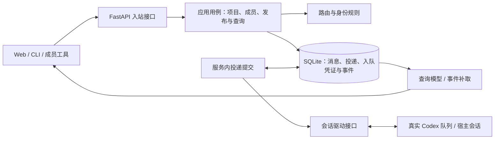

# Intent / 意图：从 Web 实现反向评估后端
最后修改时间: 2026-11-08 16:25:58

## 当前补充（修订 21，近期取舍已接受）

用户确认“我已经实测消息可以投递”，基础 Web 投递按已确认处理，不再独立安排基础验收阻断下一阶段。共享 daemon 是当前已验证前提；非共享/独立实例怎样达到同等效果保留为可选研究，**不是必须实现的目标**，不以该研究是否实现决定当前产品交付。

用户本轮确认的取舍已同步到[总计划 N6](../plan/20261107-backend-from-web.md#下一阶段安排修订-21accepted)：单次入队失败有状态、结束本次处理且不阻塞其他业务；合理组织成员/话题请求、本地事务和响应；D04 成员允许订阅零个或多个话题；运行链路集成测试晚一步。撤回修订 20 额外安排的后台状态机、诊断接口、调度改造和原队列持续核对。用户“开始实现”后已完成本批实现及开发检查，CLI 按追加要求改用 Click；交付范围与剩余原始目标继续由总计划追踪。

## 当前根本目标（修订 19）

用户已明确以下目标；此前以真实入队作为核心终点的范围不足，当前按[总计划 N5](../plan/20261107-backend-from-web.md#n5-原会话接收闭环修订-19accepted)推进：

1. 添加成员列出聊天室目录中的 Codex 会话；存活的可用，未存活的不可用。无法可靠判断存活或无法投递到运行中的独立实例时，必须明确限制、不可用原因和处理办法，不把 `notLoaded` 直接解释成离线。
2. 用户在聊天室携带话题或 @ 具体会话发送消息，目标原会话实际收到。话题与 @ 叠加仍取并集去重；有入队回执不能代替实际收到。
3. 聊天室输入的发送者是用户“我”，不是接收成员。即使话题只有一个成员，也应向该成员投递；“成员发布时排除自己”仅用于成员主动发布的另一条消息，不能作为这条用户消息未送达的解释。

完整 G01—G17、A01—A18 和 T01—T12 保留。用户后续“继续推进”授权 N5 核验与实施；修订 19 已确定同一共享 daemon 范围的可用性、仅新提交后的一次 FIFO 首项启动和原输入关联接收。生产 HTTP 三种目标均已进入原会话，基础 Web 投递本轮已获用户实测确认；不能据此宣称所有存活独立实例均可达，额外实例接入不作必交目标。

## 核心优先的既往依据（修订 12，历史）

用户纠正“不要盲目发散，我们连最核心的功能都还没实现”。完整 G01—G17、A01—A18 和 T01—T12 继续保留，但修订 11 把资源治理和重构先于真实投递的批次安排撤回。

当前基线已实现持久资源/消息、已有会话发现/绑定和节点操作。下一批 N1 直接完成发布、明确路由、原会话真实入队以及持久结果的查询/展示；仅保存 pending 不算完成。N2 紧接实现可信成员显式发布，形成协作闭环。

核心实现只纳入必要的原子发布、稳定标识/找回、目标会话快照、提交状态与回执，以及 Web 的发布和实际结果展示。零订阅、整体 SQL/Pinia 重构、观察状态展示、详细路由来源、持久事件和分页仍保留在后续任务，不先实施，也不作为核心前置。

R01—R10 的归属和修订后批次见[总计划](../plan/20261107-backend-from-web.md)。本次仅纠正计划；既往已接受交付不抹除，不做兼容适配，不新增反向测试或迁移功能测试。

## 当前补充（修订 10）

用户明确移除成员角色，并要求参考 K12 的数据访问与迁移实现。成员契约收敛为名称、会话绑定和订阅；采用根目录 SQL-first Alembic、显式迁移入口，业务数据访问只负责资源事务。角色字段目标取消，G02 其余目标保留；不增加旧库自动接入或反向测试。

## 当前成员接入纠偏（修订 9）

用户指出“添加成员应该列出聊天室所在目录的 Codex 会话”，并明确要求“纠偏”。此前把“Relay 管理持久会话”扩大解释成“必须由 Relay 新建会话”已撤回；以下为当前权威语义，后文旧实现与交付记录仅保留历史依据。

- 添加成员先发现项目目录匹配的已有 Codex 会话，再选择会话、填写成员名称/订阅并保存绑定；不隐式创建、恢复、重命名或注入已有会话，不启动模型。
- 发现涵盖当前 Codex 环境可见的全部 provider、公开来源和分页，包含未加载历史及归档记录；归档只标明事实，不自动取消归档。Windows 路径按原有大小写/分隔符规则匹配，POSIX 保留大小写，不扩展符号链接等价。
- Relay 管理持久成员身份、订阅和原会话绑定。服务重启读取这些记录，不接管原宿主执行；忙闲、加载状态只是观察事实，不决定能否路由或承诺入队。
- 前后端直接使用 sessionId 加入契约，移除 operationId 新建流程和创建状态 UI；不保留两套请求兼容或自动回退。
- T04 使用共享 daemon 的原会话 queue；T05/T07 必须对已有会话实现明确的发布/查阅入口，不能继续把创建时动态工具注册当成既定前提。动态工具隔离实测仍保留为能力证据，不宣称已支持任意宿主。


## Review status / 审查状态

修订 19 N5 契约 Accepted，T01/T02/T04 本批交付已接受；T09 基础投递与近期界面部分结合用户实测、既有 HTTP 接收证据和页面检查接受。修订 21 N6 近期方案 Accepted，新增实现尚未分配，运行集成验证后置。整体目标和 Verification 未完成，既往持久化、显式发布和查询同步等交付继续有效。

本文承接架构与业务评估，维护完整目标及任务规划依据。用户后续确认 D03 并接受术语建议，本次同步现有原型的自身排除和文案；持久后端与真实成员入口仍按任务计划推进。前端只是当前理想界面，不代表终局或业务技术设计全部合理。已确认方向、实现事实、证据与建议分别记录；最小实现只决定交付先后，全部原始目标与任务持续保留。

完整目标、分批交付、任务文档和验收映射见[后端总计划](../plan/20261107-backend-from-web.md)。当前代码仍强制成员至少一个订阅，删除却可产生零订阅成员；D04 已接受允许零个或多个订阅，纳入 N6 待实现。D05 沿用内联话题独立提交，不追写成既往已经实现。

用户已追加授权推进 T01。本轮已进行独立协议探测，证据见[Codex 接入能力核验](../design/codex-integration-capabilities.md)：本机 `0.167.0` 的隔离持久会话入队、忙碌时入队、动态工具回调和重载可行；已有工作会话只读发现。用户随后明确“采纳建议 由 Relay 管理持久会话”，D02 已接受；此决定不表示 Relay 产品功能已实现或其余产品建议一并接受。

用户既有纠偏见[审视修正](../design/20261107-architecture-review.md)：当前只负责显式消息路由、持久记录及其可视化；备份/恢复与 T06 输出观察后置，撤回修订 5 增加的执行权限管理、transport 实现门槛、全部接口冻结和收件箱/发件箱建议。当前增补依据为总方案修订 19 Accepted；定向输入接收核验不收集或发布模型输出，既有边界继续有效。

## Background and goals / 背景与目标

用户要求基于当前前端实现，反向评估架构、业务流程和交付结果，以推进后端实现。

评估基线为 `2cc4933 feat(room): add project collaboration rooms`。现有前端已覆盖项目切换、话题与成员管理、消息路由、引用、分发详情，以及统一加载、提交和 Toast 反馈。现有后端实现了内存数据与 HTTP 接口，尚无持久化、真实会话驱动、后台投递和恢复机制。

整体判断：页面用于提出和检验产品假设，正式契约由技术事实与产品合理性共同决定。下一阶段交付持久发布、目标队列入队结果记录及可视化；额外读取会话输出后置；不假设存在独立的模型接收回执，也不因等待输出较久而重发。

用户已明确：Codex queue 可以确认入队是否完成，接收者说了什么必须额外读取；入队后的等待可能很长且不确定，超时重试不应成为默认策略。`D:/SourceCodes/mywork/housekeeper/src/codex_cli` 可以且仅能作为参考，不作为本项目依赖、直接复用模块或产品约束。

成员输出沿用明确标记话题或接收人的既有路由规则。只有明确指定 `topicIds` 或 `mentionedMemberIds` 的输出才进入聊天室；turn 关联或 `final_answer` 不代替路由目标。成员通过显式发布入口表达结构化目标，发送者必须对应持久会话绑定；已有会话的具体调用入口与来源幂等由 T05 在实施前核验，不能依赖隐式新建会话。

已有总体设计见 [Codex 会话聊天室协作设计](../design/codex-session-chat-collaboration.md)。本文按页面事实补充评估，不替换其中已经明确的路由和查阅规则。

## Non-goals / 非目标

- 当前不考虑备份/恢复；不管理成员执行权限、审批和执行流程；不新增会话输出观察、后台工具完成核对、收件箱或发件箱，不要求预先冻结所有业务接口。

- 本次仅拆分和更新计划；queue、发布幂等、CLI 和事件按对应任务实施。后续协议检查不向已有工作会话发送测试消息。
- 用户最新确认范围内，仅同步[统一术语](../design/terminology.md)、已有内存路由的自身排除与对应测试；不据此宣告 T03 持久发布或 T05 真实成员发布已交付。
- 不新增“接收人预览”“直接点名”等未要求的界面概念；现有页面布局和状态列可随技术与产品评估调整。
- 不将模型运行结束、代码修改完成或测试通过纳入消息投递成功的定义。
- 不引入微服务、外部消息队列或独立角色权限系统；当前仍按本地协作服务评估。
- 话题/成员编辑、删除已按独立节点操作计划实现；本次规划处理其生命周期衔接，不追加归档或自动加入。

## Scenarios / 场景

### 1. 已有业务方向与当前约定

话题与 `@` 并集、消息必须有实际接收人等方向已有明确用户要求；项目组织、操作入口和具体呈现属于当前约定，仍可依据本轮评估修订。

1. 项目以规范化的绝对路径识别，一个项目一个聊天室；话题、成员、消息与投递按房间隔离。
2. 消息选择话题、`@` 成员，或同时选择。实际接收人为话题关联成员与直接指定成员的并集，同一成员只投递一次。**D03 已接受：成员发布时从并集中排除自己，显式 @ 自己也不例外；排除后继续实际接收人非空校验。**
3. 所有进入房间的消息必须有实际接收人，包括成员显式发布的答复。任一指定目标无效时整条拒绝；无接收人时不保存。忙碌或离线不改变路由目标，实际入队结果以 Codex 队列调用为准。答复以本次显式目标创建普通消息与实际投递，不从原消息继承目标；可选引用只表达来源关系。
4. `topicIds`、`mentionedMemberIds` 和发送时的实际接收人分别保留；订阅调整不补投、不撤回既有投递。
5. 消息正文中的自由文本 `#`、`@` 不参与路由。直接 `@` 不自动订阅话题，也不授予整个话题的历史查阅范围。
6. 控制台引用消息时，将原消息的话题和直接 `@` 带入草稿，保留已有正文。实际发送仍以提交的结构化目标为准。
7. 详情中的 `@` 仅展示明确指定的成员；分发详情展示全部实际目标。状态时间属于对应事实，有记录才展示，使用 `HH:mm:ss`；现有入队/接收/回执三列不固定为最终产品布局。
8. 加载和按钮忙碌状态反映客户端操作过程；Toast 反映该操作的结果，不能代替持久化的投递记录。
9. 成员输出须沿用显式路由：无话题和接收人目标的输出不创建房间消息，即使它与某次入队相关或处于最终答复阶段；有明确目标时由服务复用话题与 @ 的并集、去重及非空校验。
10. **D02 已纠正**：添加成员列出聊天室目录下已有 Codex 会话，选择后核验并保存绑定。Relay 持久管理成员、订阅与原会话绑定；重启读取原记录，不新建或接管会话执行。会话元数据观察与消息入队结果分别呈现。

### 2. 页面操作与后端结果对照

| 页面操作 | 当前实现事实 | 正式后端需要交付的结果 |
| --- | --- | --- |
| 创建、切换聊天室 | 内存唯一性校验；房间列表在当前前端会话中缓存 | 可恢复的项目与房间身份；新房间刷新后仍存在；其他客户端创建的房间可被重新发现 |
| 选择会话、添加成员 | 已改为共享 daemon 真实元数据发现、选择和原会话绑定 | 全部分页/provider/来源按规范目录筛选；加入时只读核验，避免重复及跨项目加入，不创建或恢复会话 |
| 新建房间后的首次发送 | 当前创建/编辑仍要求至少一个订阅，删除最后话题却会产生零订阅 | 按已接受 D04 允许先加入零订阅成员并直接 @；也可配置一个或多个话题订阅后按话题发送 |
| 成员表单内添加话题 | 点击“添加话题”立即发出独立请求，早于成员保存 | 明确取消成员表单是否保留该话题；事务边界应与交互含义一致 |
| 编辑成员订阅 | 后续路由使用新订阅，已有消息目标保持不变 | 订阅更新与发送解析具有明确事务顺序；已保存的实际投递不随查询时的订阅变化 |
| 发布消息 | 校验、路由和追加内存记录在一个进程锁内完成 | 同一事务保存消息、话题、直接指定目标、实际投递和必要事件；成功响应表示服务已持久接收 |
| 忙碌、离线时发布 | 按忙闲直接生成演示状态，没有真实调用 | 忙碌不阻止提交到底层队列；区分 Relay 尚未提交和 Codex 已确认入队，不重复管理模型等待 |
| 查看分发详情 | 从两种演示状态推导三个展示列，无真实队列凭证 | 展示实际持久记录的提交状态、回执与时间，不虚构接收/已读阶段，不增加输出观察 |
| 引用、跳转历史消息 | 当前筛选中不存在时拉取整个房间；没有单条查询 | 按 ID 定位和读取引用消息，并执行房间与成员查阅范围校验；不依赖全量历史 |
| 发布或入队调用未获得响应 | 有按钮防重，无发布结果找回机制 | 按稳定发布标识查询已有结果；入队结果未知不自动重新入队，等待输出超时不转成发送失败 |
| 观察后续状态变化 | 页面手动刷新整份快照；无事件接口 | 状态更新可被持续获取；断连后有游标补取或明确重新同步路径 |

### 3. 需要优先处理的设计缺口

#### F01：投递成功应以 Codex 入队确认为边界

- 代码依据：`src/agent_relay/room_service.py:360` 仅凭成员 `presence == available` 就写入 `delivered`，未调用真实目标会话。
- 展示依据：`web/src/domains/room/MessageDetails.vue:102` 将其标为“已入队”，接收列同时显示“未确认”，回执列显示“待回执”；时间线也把该值统计为“已入队”。
- 技术澄清：用户明确 queue 只确认入队。原设计中的“目标会话接收确认”和本评估初稿沿用的 `delivered` 终态均需修正，不能因文档或页面已有该阶段就假定底层支持。
- 影响：正式后端需要证明的是本次提交已被目标队列接受，而不是推断模型已读取或处理。
- 建议：采用能直接表达入队事实的字段；当前基于忙闲生成的演示值不作为入队凭证。本轮只持久记录本次投递动作及真实结果。

候选入队状态模型如下；具体命名仍待正式契约设计：

```text
pending → submitting → queued       获得可核验的入队凭证
                     → rejected     本次队列提交被明确拒绝
                     → unknown      响应丢失或入队凭证不可核验
unknown → queued / rejected         获得与本次提交关联的确定证据
```

`queued` 是向 Codex 队列投递的成功结果，之后可以长时间没有输出。没有输出不触发失败或未知；`unknown` 只针对入队调用本身的不确定结果，不自动重发。历史暂时没有对应记录不足以证明入队被拒绝。

#### F02：入队凭证、会话输出与房间回复是不同事实

- 当前 Delivery 只有 `id`、`targetMemberId`、`status`、`updatedAt`；接收与回执列没有独立数据。
- 技术依据：参考 `service.py:346`，入队响应验证 `queuedSubmission.id` 与 `clientUserMessageId`，返回 `processing_confirmed = False`。这是入队凭证，不是处理确认。
- 输出依据：参考 `reply.py:25`，先以 `userMessage.clientId` 找对应 `turnId`，再寻找同 turn 的 `agentMessage`；等待最终答复还检查 `phase == final_answer`。单独读取最近一条输出不能证明本次消息已有回复。
- 时间依据：可保存本次提交时间、本地确认取得入队凭证的时间、输出观察时间。未获得底层原始时间时不虚构入队发生时间，更不创建没有事实来源的 `receivedAt`。
- 展示建议：重新评估“接收状态/回执状态”是否有必要。入队结果及其凭证可以在同一投递详情解释，不要求每条消息必须产生回复。
- 已确认规则：主动发言和答复一律要求明确的话题或接收人目标；没有目标的会话输出不写入聊天室。消息继续使用 `topicIds` 与 `mentionedMemberIds` 表达目标，服务生成实际接收人与 Delivery。
- 发布入口采用 content/topicIds/mentionedMemberIds/replyToMessageId 等业务字段，沿用服务端路由校验。正文里的 #/@、引用和代码不作目标声明；已有 Codex 会话的调用入口归 T05 主线核验，不后置到 T12。
- 关联边界：`clientId` 到 `turnId` 的关联可用于可选的引用关系或来源追查，不决定是否进入聊天室。目标明确但来源关联不可靠时，可以发布但不猜 `replyToMessageId`；没有目标则不得凭关联补出目标。
- 去重：发布入口应有稳定调用或输出 ID，同一调用断连重放不应创建两条消息。若保留历史扫描用于追查，须避免对已发布的源输出二次导入。

#### F03：首版会话接入策略尚未落到操作流程

- 用户已纠正：页面必须选择项目目录下已有 Codex 会话。管理持久绑定不等于新建或接管执行；强制创建流程已撤回。
- T02 交付共享 daemon 元数据发现、只读核验和持久绑定；T04/T05 分别补实际 queue 和显式发布。额外宿主与显式新建能力仍列 T12 候选，不丢失目标。
- `available / busy / offline` 当前来自种子数据。真实忙闲、进程运行证据和是否成功入队是不同维度，不能仅凭忙碌或 `notLoaded` 判定禁止入队。
- 初次评估只阅读参考源码与相关测试。随后 T01 已在本机 `0.167.0` 隔离验证入队/历史与动态工具；已有工作会话未被投递。任意已有宿主的发布入口、多输入 turn 关系、故障重放和其他平台仍未验证。

#### F04：结果查询和观察等待不应变成超时重发

- 发布幂等解决“一个用户意图是否被保存两次”，不构成向 Codex 自动重发的理由；本轮只根据入队凭证记录投递结果，不主动读取接收者输出。
- 建议发布使用独立、持久的客户端发布标识。对相同调用方和房间，同一标识、相同请求返回原结果；同一标识但正文或目标不同应冲突。`X-Request-Id` 继续用于链路排障，不承担业务幂等语义。
- 发布调用停止等待后按标识找回已有结果。队列调用本身可以设置技术超时；如果请求可能已送达则保留 `unknown`，不自动重发。
- 已确认入队后，等待可能很长且不定，不设置默认回复截止时间来判定投递失败。当前不提供输出等待操作。
- 调用前保存目标会话与客户端消息关联标识，成功后保存队列项 ID。参考实现的关联标识不构成底层幂等保证；明确拒绝后的再次提交需要明确操作。多次尝试的数据结构在确有产品用例时设计，不先建立自动重试引擎。

#### F05：发送者身份与自动回复规则必须补齐

- 当前 Web 发布由服务统一记录为 `senderId = null`、`senderName = 控制台`，尚未实现成员身份的发言入口。
- 建议控制台保持明确的人工入口身份；成员通过绑定的会话或受控调用上下文发言，发送者不能由正文或任意请求字段冒充。
- 初次评估的解析收件人不排除发送者；本次按用户 D03 确认同步原型：成员不向自身创建投递，显式 @ 自己亦排除，之后必须仍有实际接收人。空目标整条拒绝，不保存消息或投递。
- 已选话题与显式 @ 保留为原始目标，实际接收人与 Delivery 排除发布成员。控制台没有绑定成员，不按显示名猜测并排除某个成员。A↔B 自动回应链仍由 D09 单独决定。
- 人工引用的“复制话题与 `@`”沿用已有约定；成员答复需要给出本次输出的显式目标，不直接复制原消息的全部收件目标。
- 用户已明确成员输出继续沿用话题或接收人的显式路由规则。建议用结构化发布调用携带目标，而非从任意自然语言、引用或代码片段里猜测 `#` / `@`；具体入口和成员身份绑定待 Plan 定义。

#### F06：持久化边界应覆盖事实，不只保存页面快照

- 建议 SQLite 仍作为本地单服务的权威数据源；请求处理不等待模型运行或目标会话回复。
- 显式发布的原子写入至少包含房间内序号分配、Message、话题关联、明确指定成员、唯一 Delivery、来源幂等键和必要分发事件。发布没有目标或任一目标无效时全部回滚；turn 关联不补造目标。
- 以数据库唯一约束保证 `(room_id, seq)`、`(message_id, target_member_id)` 和发布幂等键；序号单调递增，不依赖消息列表长度，也不要求业务上的连续无缺口。
- 后台提交可从持久化 Delivery 找到尚未发起的工作，内存通知只负责唤醒；已经确认入队的记录不再次提交。
- 驱动外部调用放在数据库事务之外，以短事务领取工作、再记录结果；通过领取标识或版本校验拒绝过期 Worker 覆盖较新状态。
- 数据库事务不能与外部队列入队原子提交。若 Codex 已接受、Relay 尚未保存凭证就退出，恢复时将这类中断的 `submitting` 视为结果未知并核对，不按领取超时重新提交。稳定客户端消息标识有助于关联，但没有上游去重承诺就不能声称跨系统恰好一次。
- Relay 可约束同一真实会话入队调用的发起顺序，但不等待上一条输出结束才提交下一条，也不据此承诺底层消费和输出顺序。模型消费与等待由 Codex 底层队列处理；不预设每个成员都需要一个独立的常驻监听器。

#### F07：查询与更新契约需要支持持续运行

- 当前 `snapshot()` 全量返回历史并计算统计，足以支撑演示；正式历史增长后需要有上限的时间线分页，以及单条消息/投递详情查询。
- 保持统计口径明确：现有话题筛选只过滤消息，话题数量和房间汇总仍是全房间口径；不能因引入分页而把全房间数量变为本页数量。
- 事件需要独立的稳定游标；消息 Seq 不能定位同一条 Delivery 的多次状态更新。事件提交后再通知客户端，重连后按游标补取，或明确触发重新同步。
- HTTP 写入结果、查询模型和 WebSocket 等通知要基于同一份已提交事实。发送成功后列表刷新失败，只能报告刷新失败，不撤回已经成立的发布结果。
- 房间列表与话题缓存要具备失效/刷新途径，才能看到 CLI 或其他窗口的修改。2026-11-07 用户明确移除成员角色，取消角色字段、表单和建议值缓存。

#### F08：有几项业务取舍尚未被页面明确

- 仅直接 `@` 的成员仍被要求订阅至少一个话题。投递规则本身没有这个要求；是否允许零订阅成员，应由产品取舍决定。
- 内联创建话题目前是独立提交，取消成员表单不会撤销话题。建议保留独立资源语义，避免将已经可能被其他操作使用的话题自动回滚，但应明确这属于已提交操作。
- 项目路径当前只处理绝对路径、分隔符和 Windows 大小写。接入真实会话时须确认项目标识与会话工作目录的对应方式，以及路径别名是否代表同一项目。
- 已保存的实际目标可解释“当时投给了谁”；若还要求解释“当时命中了哪个话题订阅”，应在投递创建时保存来源，不能根据后来变化的订阅反推。当前页面无需增加接收人区块。

### 4. 建议的后端职责划分



这是同一进程内的职责划分，不意味着拆成多个部署单元：

- HTTP 层处理请求、调用上下文、状态码与现有 `{ code, error, requestId }` 错误契约。
- 应用用例确定事务边界，组合路由规则与持久化；校验和目标解析始终由服务端作最终判断。
- 查询层为页面提供可解释的展示结果，前端不凭成员忙闲推测投递结果。
- 投递提交负责领取尚未提交的记录、调用队列并保存结果；单次失败有状态并结束本次处理，不阻塞其他业务。已有输入接收核验继续使用，不等待模型回复，不因等待时间触发重新入队；本期不新增原队列持续核对。后台任务由服务启动/关闭生命周期管理。
- 成员发布走身份绑定的受控入口，必须含有效话题或 @ 目标；动态工具回调直接发布。当前不读取接收会话输出，正文流、commentary 和普通工具日志不自动入房。
- 会话驱动提供真实发现/核验与可核验的入队结果，发布入口另按已有会话实际能力接入，隐藏底层协议差异；历史输出读取后置，`turnId` 和 `final_answer` 不能替代路由目标。

### 5. 目标流程与用户可见结果

1. 客户端提交内容、话题、直接指定成员、引用和发布标识；成员入口额外有程序绑定的发送身份。
2. 服务在一致的事务视图内校验、解析目标并原子保存事实。重复发布返回已有结果，不重复展开路由。
3. 事务提交后响应消息 ID、Seq、目标快照及初始投递事实。此时 Toast 可以表示“消息已发布/服务已接收”，不能表示所有成员已收到。
4. 后台提交读取尚未发起的投递，核验目标会话与接口能力，先保存本次客户端消息关联标识，再提交本次消息与必要元信息。忙碌不构成等待模型空闲的理由；明确不可连接时展示具体原因，不冒充已进入 Codex 队列。
5. 核验入队凭证后保存 `queued`、队列项 ID 与本地确认时间。底层明确拒绝记录 `rejected`；请求可能送达但结果不可确认时记录 `unknown`，不自动重发。
6. 查询或实时事件更新页面。每个目标各自有入队结果，同一消息允许部分已入队、部分尚未提交、部分拒绝或未知；已入队后等待多久都不因此改判失败。
7. 成员可按需查阅背景；查阅位置只记录已返回的背景，不承担投递进度或业务完成状态。是否查阅不影响入队成功。
8. 查询持久消息及投递记录；成员若需回复，通过带显式目标的发布入口创建普通消息。会话输出观察后置。
9. 成员输出无明确话题或 `@` 接收人时留在会话中，不建房间消息；答案阶段、关联输入消息或输出内容看似重要，都不改变这一规则。
10. 成员显式发布时服务校验身份与结构化路由目标，按既有规则展开、去重并提交实际接收人；`replyToMessageId` 可在来源明确时记录，否则不猜测。答复沿用普通路由消息，不创建隐式答复类型或暗中复制原消息目标。

## Acceptance criteria / 验收标准

以下为完整后端推进目标草案；分批推进不删除未进入首批的验收项。业务取舍确认后再接受对应实施方案：

- A01：所有发布保留并集路由、去重、排除发布成员后非空、房间隔离与历史目标快照；显式 @ 自己不产生自身投递，排除后为空整条拒绝，任一无效目标仍拒绝整条。订阅变化不改旧投递，引用不补造或继承目标；控制台无绑定成员不额外排除目标。修订 11 建议补充：节点删除只影响新发布，旧投递保留发送时成员/会话及路由来源，重新加入不改变旧记录归属。
- A02：重启后房间、成员、话题、消息与投递仍可查询；消息与投递写入故障时不存在半条业务结果，序号不会重用。
- A03：同一次发布可按持久的发布标识查询已有结果；相同标识与相同请求返回同一条消息和一组投递，同一标识的不同请求被明确拒绝。找回发布结果不会导致新的队列提交。
- A04：真实驱动保存与本次提交匹配的入队凭证；N5 还须确认消息进入绑定的目标原会话。入队与接收分别依据真实证据记录，不能用队列变空、模型忙闲或无关输出推断接收；接收不要求模型回复或业务任务完成。用户“我”向唯一订阅成员发送也必须正常投递。
- A05：同一真实会话的提交按已确定顺序进行，不等上一条输出或模型空闲；单次入队失败记录明确状态与原因，不阻塞其他目标或后续消息。已入队记录不重新提交，未知入队结果及中断的提交不会因超时或重启而自动重发。
- A06：按路径所指活动成员记录发布者，引用不越过房间或该成员业务查阅范围；本机路径不承担认证承诺。自动回复遵循已确定的自身投递与回应规则。
- A07：有界时间线查询、单条引用读取、投递详情与事件重新同步均可用；话题和发送成员在服务端组合过滤后分页，分页和筛选不改变全局统计含义。
- A08：页面各阶段状态与时间均对应真实后端事实；发布成功与后续刷新失败能分别处理；错误保留现有请求 ID 契约。
- A09：房间初始化不依赖演示候选；按项目规范目录完整列出真实 Codex 会话，已加入标明且不可重复。N5 按真实运行与接入证据区分可用/不可用，未存活不可加入，忙碌不因忙碌而禁用；无法确认或运行但不可达时明确原因与处理办法。加入前重新只读核验并原子保存原绑定，已有成员状态不能长期停留在加入快照。空态/失败分开，重启绑定不变，不创建、恢复或改写会话。成员允许订阅零个或多个话题，创建/编辑/删除最后订阅/仅 @ 接收使用同一规则。成员/话题按一次业务操作组织请求与本地事务，返回结果足够更新页面，不以额外 GET 成功作为保存成功条件；内联话题仍独立提交。活动资源操作与历史元数据区分。
- A10：成员输出通过显式发布入口进入房间；没有 `topicIds` 和 `mentionedMemberIds` 的调用不得创建消息，即使有关联 `turnId` 或 `phase == final_answer`。执行阶段信号只用于诊断，不做自动导入条件。
- A11：显式目标的成员输出沿用普通路由规则并至少生成一条实际 Delivery；没有可靠源消息关联时仍可按显式目标发布，但不能猜引用关系或从原消息补目标。
- A12：发布入口以显式 room/member 路径确定业务发送者，目标来自结构化字段，同一发布编号与请求不重复发布；路径不作为认证边界。普通输出不扫描、不导入，不自行生成额外 Message 或 Delivery。
- A13：成员能按需使用单条读取、话题分页和关键词搜索；服务端按订阅或实际接收人校验查阅范围。直接 @、引用和工具参数不扩大历史权限；入队只携带本次消息及必要元信息，不批量注入历史。
- A14：成员 × 话题的查阅位置按服务本次成功返回的消息单调记录，允许跳读与回查；空结果、失败和无订阅交集的直接 @ 不错误推进。位置不代表模型已读，不参与投递或重试，不要求宿主工具完成核对。
- A15：CLI 通过 Relay HTTP 管理房间/话题/成员、发布及查询持久记录，输出可用的机器可读结果；停止等待请求或结果找回不撤销已有发布、不自动重新入队。当前不增加会话输出等待命令。
- A16：服务自身启动、关闭和持久存储有可重复说明与检查；后台提交和连接随应用生命周期管理，不依赖演示数据或其他仓库。备份/恢复设计与演练后置，不作为本轮验收；成员执行权限和审批不属于本系统职责。
- A17：形成经核验的会话接入能力矩阵。已选本机已有 Codex 会话发现/绑定主路径必须实现；Orca 等额外宿主与显式新建等生命周期路径保留条件任务，写明支持门槛、取舍和未交付项，不能把未验证能力呈现为已支持。
- A18：Web 保留已确认的名称位置、引用复制目标、@ 展示语义、成员身份样式、时间精确到秒、状态下方换行时间和统一加载/提交/Toast 反馈；不添加接收人预览或“直接点名”区块，不显示没有事实来源的接收/回执阶段。常规节点点击仅筛选，不改变草稿路由；会话观察显示来源/时间，不宣称实时投递能力；同一房间资源使用单一可写状态。

## Workload and decomposition / 工作量与拆分

整体复杂度中高。现有路由规则已有实现与测试，成员输出也沿用该规则：只有显式路由目标才发布。当前按本机使用，成员 HTTP 路径显式携带 roomId/memberId；不引入未设计的认证系统。剩余复杂度集中在发布幂等、持久化和重启后的结果查询，而非从模型输出推测是否为回复。

**显式成员发布的成本估算（单人工作日）**

| 范围 | 粗估 | 前提与交付 |
| --- | ---: | --- |
| 发布入口可行性探测 | 1–2 日 | 在隔离环境确认现有 HTTP/命令工具能否把结构化话题/接收人字段传回本机 Relay；仅探测，不操作真实工作会话 |
| 已具备持久层与队列驱动后的完整发布能力 | 4–7 日 | 成员路径入口、既有消息路由复用、调用 ID 幂等、API/时间线对接及测试；若另需 turn 引用关联，增加约 1–3 日且受协议歧义影响 |
| 按当前仓库推进首个可用端到端切片 | 约 2–3 周 | 还要建设本仓库尚无的持久化、Codex 队列驱动及后台生命周期，再集成显式成员发布入口；协议不确定时可能增加 |

结构化显式发布复用已有路由、目标非空校验与 Delivery 模型，成本低于持续扫描并猜测输出是否为答复。主要成本是成员调用连通、发布去重与错误恢复。turn 引用关联是增强项，不是发布前提。此处为规划级估算；能力尚未在真实目标环境做端到端验证。

初次评估提出以下四个候选工作域。用户随后要求完整任务规划，具体节点已由[总计划草案](../plan/20261107-backend-from-web.md)及其任务文档承接；下表保留为工作域来源，不再作为独立执行清单：

| 候选节点 | 主要结果及范围 | 输入与初始依赖 | 可检查输出与验收归属 |
| --- | --- | --- | --- |
| C01 契约与会话能力核验 | 核验入队凭证、历史读取及受控发布入口，确定成员身份绑定和首版接入范围 | 本次评估、D07 和一个明确的目标会话环境 | 可重复的协议能力证据及契约；A04、A06、A09—A12 的前置条件 |
| C02 持久化发布与查询 | SQLite 迁移、事务、目标快照、发布幂等、分页与引用读取 | 已确定的业务规则及 C01 必要契约 | 重启、回滚、重复发布、并发路由与查询证据；A01—A03、A07 的查询部分 |
| C03 投递提交与成员发布 | 入队提交、凭证保存、中断与未知结果核对；接入显式发布调用并复用现有目标路由 | C01 + C02；D07 入口决策 | 真实入队闭环、无目标调用不发布、显式成员发布幂等及路由证据；A04—A06、A10—A12 |
| C04 事件与 Web 对接 | 更新正式 DTO、展示真实阶段时间、明确目标成员发布的消息时间线呈现、缓存刷新和断线同步 | C02 查询契约；消息发布依赖 C03 | 页面状态与持久化事实一致的端到端证据；A07—A12 |

建议先核验会话接入与受控发布入口，再以“持久发布 → 一个真实目标确认入队 → 成员通过显式目标发布答复”为第一条纵向交付。多宿主适配、复杂查阅统计和丰富人工干预后续逐步扩展。

## Questions and decisions / 问题与决策

路由等方向见“已有业务方向与当前约定”。技术上已确认：queue 仅证明入队；接收者输出须另读；入队后的不定等待不触发超时重发。以下按最新状态区分已接受方向、固定技术机制和仍待取舍事项：

**D06 已收敛**：成员输出继续沿用明确标记话题或接收人的路由规则。自然答复需要通过显式发布入口携带目标；不自动导入没有目标的 `final_answer`。无需把最终输出阶段误作消息路由依据。

**D02 已接受**：2026-11-07 用户明确“采纳建议 由 Relay 管理持久会话”。修订 9 澄清为选择已有会话并持久管理绑定；强制新建与创建时注册工具的推论撤回。D07 已有会话发布入口须由 T05 核验。其余待取舍不由本次接受代答。

| 编号 | 待明确事项 | 建议 | 影响 |
| --- | --- | --- | --- |
| D01 | 入队与输出分离后，分发详情需要显示哪些信息？ | 以真实入队结果及时间为主；凭证与异常可展开；不显示无路由目标的会话运行输出 | 技术边界已明确，具体页面布局仍待定 |
| D02 | 首选会话接入 | **已纠正并接受**：按聊天室目录选择已有 Codex 会话，Relay 持久保存成员与原绑定 | T02 交付 discover/inspect/bind；T04 使用原会话 queue，不自动新建或接管 |
| D03 | 成员自身投递 | **已接受**：成员发布时排除自己，包含显式 @ 自己；排除后继续实际接收人非空校验 | 空目标拒绝整条，显式目标保留；不代表 D09 自动链规则也已决定 |
| D04 | 只接收直接 `@` 的成员是否可以不订阅话题？ | **已接受**：成员允许订阅零个或多个话题；至少一个实际接收人的约束留在发消息处 | N6 统一服务端、Web 创建/编辑及 CLI；删除最后话题后成员仍可编辑和被 @；待实现 |
| D05 | 取消成员表单是否撤销已经创建的话题？ | 不撤销；内联创建仍是独立提交的资源操作 | 决定表单结果与事务边界 |
| D07 | 成员端如何显式发布带路由目标的输出？ | **已接受**：本机 HTTP 接口以 roomId/memberId 路径段指定业务发布者，不设计或引入认证凭证；目标结构化并保留调用幂等 | 仅按本地 Relay 使用约定，不把路径 ID 视为认证边界；不从历史或正文补造目标 |
| D08 | 是否自动关联触发消息？ | 当前只记录显式 replyToMessageId，自动由 turn 推断后置 | 不阻断发布和可视化 |
| D09 | 是否增加自动回应链限制？ | 当前按同一路由处理，不增加隐式暂停/限额/深度规则 | 候选后置，不作为 T05 前提 |
| D10 | 成员能否通过工具创建话题或修改订阅？ | 首轮仍由控制台管理，成员查阅与发布工具不自动带管理权限 | 原总体设计已有问题；影响 CLI/工具权限和话题生命周期 |
| D11 | 是否展示逐接收人的路由来源明细？ | 保存本次命中的话题与显式 @ 来源，界面按需展开，不新增收件人预览 | 影响持久快照与分发详情，不从当前订阅反推历史 |
| D12 | 服务自身启停与运行交付 | Relay 本身配置/启停沿用现有实现，运行集成测试晚一步；备份恢复后置 | 本期不新增运行诊断接口，不增加成员执行策略或审批管理 |
| D13 | 删除节点后如何处理已生成的投递？ | 建议删除只影响新发布，旧投递继续按持久目标快照处理；重新加入是新成员 | 核心投递固定实际会话快照并据此提交，资源生命周期的完整规则后续处理；仍待接受 |

工程建议中的幂等、事务、查询和事件方案仍需在 Plan 中完成可直接实施的设计。本轮不据此假定已经选定数据库访问库、驱动协议或事件传输细节。

## Risks / assumptions / 风险 / 假设

- 已有前端展示了候选操作路径与信息需求，尚未证明产品合理性或真实投递能力；现有测试通过不等于服务可在重启、断连或目标会话退出后恢复。
- 入队响应丢失或本地凭证未落库时，若外部会话不提供足够的查询证据或幂等承诺，服务只能保留未知入队结果；不能用自动重发补出成功率，也不能仅靠本地事务承诺外部队列恰好一次。
- 参考实现的 `clientId`、`turnId` 和 `final_answer` 只能辅助确认输出来源，不替代显式路由目标。所有成员输出的房间可见性和实际投递均由有效的 `topicIds` / `mentionedMemberIds` 决定。
- 成员发布路径提供业务 roomId/memberId，不承担访问控制；默认仅监听本机地址。若未来改为远程或多用户部署，访问控制须另行设计。若试图从普通正文解析 `#` / `@`，会把引用和代码误当路由；其他承载路径须有单独证据。
- 多条入队共享一个 turn 可能使 `replyToMessageId` 关系不明确；显式目标仍能决定发布路由，关联不明时应留空而非猜测。
- 话题与成员数据会由多个入口修改，前端缓存及本地预校验可能过时；服务端规则与发布事务具有最终权威。
- 暂按现有设计的本地单服务部署评估；不为尚未提出的多租户与分布式需求增加设施。

### 初次评估的检查证据

- `uv run --locked --no-sync pytest -q tests/test_room_api.py`：18 项通过。覆盖当前路由、去重、目标校验、房间隔离、成员订阅更新及项目唯一性；未覆盖真实驱动、持久化、后台调度或恢复。
- 使用独立 `TestClient(create_app(...))` 进行临时内存探查，没有操作用户当前运行服务。相同正文、目标和 `X-Request-Id` 两次发布得到 `agent-relay-msg-0007`、`agent-relay-msg-0008`，确认现有请求 ID 不构成发布幂等。
- 同一探查中，未调用任何外部会话就返回 `status = delivered`；返回的 Delivery 确实仅有四个字段，确认 F01、F02 的依据。
- 独立创建话题后，话题数量增加而成员不变；OpenAPI 中 `UpdateMember.topicIds.minItems = 1`，确认 F08 的当前行为。
- 当前房间读取接口没有分页参数；真实会话协议和宿主能力未实测。

### 技术澄清后的参考证据

仅阅读 `housekeeper` 的相关源码与测试；这些参考文件最近一次提交为 `627d2fa feat(codex-cli): discover running sessions and runtime status`，没有工作区改动。不引入依赖、不移植代码、不操作真实会话：

| 来源 | 可支持的判断 | 不能据此承诺 |
| --- | --- | --- |
| [service.py](D:/SourceCodes/mywork/housekeeper/src/codex_cli/service.py:346) 的 `send` | `thread/queue/add` 核验队列项 ID 与客户端消息标识，返回 `queued` 和 `processing_confirmed = False` | 模型已读、已处理或该标识有上游幂等保证 |
| [service.py](D:/SourceCodes/mywork/housekeeper/src/codex_cli/service.py:240) 的 `iter_items` 与 `read_latest` | 会话历史通过独立接口分页读取；最近输出只是最近输出 | 最近输出一定属于本次房间消息 |
| [reply.py](D:/SourceCodes/mywork/housekeeper/src/codex_cli/reply.py:25) 的 `_reply` 与等待逻辑 | 用客户端消息标识、turn 和输出阶段尝试关联；等待结束仍保留入队结果 | 一条提交必然独占一个 turn；所有宿主都支持同样能力 |
| [test_codex_cli.py](D:/SourceCodes/mywork/housekeeper/tests/test_codex_cli.py:923) 的入队、等待及异常测试 | 模拟 RPC 下，入队返回不依赖读取输出；无关或未完成输出不充当最终答复，未知入队结果不伪装成失败 | 当前运行环境及协议版本已通过真实端到端验证 |

上述初次文档修订未修改运行代码；后续 T01 能力实测使用隔离环境。用户确认 D03 后的原型同步与应用检查另记在最新审查记录，历史证据不作为新实现的测试结果。

### T01 隔离能力实测

2026-11-07 已按用户“开始推进 T01”完成本轮真实协议探测，范围、脚本、schema 指纹、脱敏回执及未验证项见[能力核验](../design/codex-integration-capabilities.md)。上面“未实测”的初次评估记录保留历史含义，不覆盖本节的新证据。

- CLI/daemon 为 `0.167.0`；共享 proxy 只读查询项目元数据。独立 app-server 和临时会话取得真实队列回执，active 时连续入队可用。
- 同 clientUserMessageId 返回不同 queueId，不能依赖上游幂等；queue/list 只提供当前待处理队列的正向证据，空列表不证明失败。
- dynamicTools 的回调含 threadId/turnId/callId；历史分页可读输入 clientId、工具调用和 final_answer。重新启动独立进程恢复同一测试会话后，不重新传工具定义仍能调用；原 callId 仍在历史。
- 未向已有工作会话发测试消息；测试自身待处理项已删除，测试会话已归档。没有创建 Relay 产品 Message/Delivery，也未验证产品持久化与故障恢复。
- 协议探测后的技术推荐已具体化；用户随后接受 D02，主路径与任务边界已同步。其余产品取舍留对应 task 收敛；T01 已按收窄范围接受，当前 T02 实施方案及交付已接受，不代表完整目标已完成。

## User review notes / 用户审查记录

- 2026-11-07：用户要求从当前前端反向评估架构、业务流程与结果，以推进后端；本轮范围为评估与意图梳理。
- 保留此前已明确的路由、引用目标复制、`@` 展示、分发成员样式、状态时间与统一反馈要求。
- 2026-11-07 技术澄清：前端只是当前理想界面，不代表终局或百分之百合理；应从技术事实与产品合理性解决分歧。
- 用户确认 queue 只管入队，回复需要额外读取；入队后等待可能很长且不定，超时重发不作为默认方案。旧 D01 中关于投递技术成功边界的疑问据此关闭，页面如何呈现仍待讨论。
- 用户指定 `housekeeper/src/codex_cli` 可以且仅能作为参考；本轮按此边界阅读，不复用模块或操作会话。
- 用户要求重评输出收录规则，并最新确认收窄：成员输出继续沿用明确标记话题或接收人的既有路由规则；无标记输出不入聊天室，turn 关联或 `final_answer` 不能代替目标。
- 初次收窄时 D06 已确认，D07—D09 与 D01—D05 当时仍待决策；后续 D02 的接受及 D07 主路径机制见本节最新记录。额外历史读取不再作为主路径发布载体。
- 2026-11-07 任务规划：用户要求标记全部目标与任务，最小实现仅代表首批交付；不得在后续交付时遗失最初目标。总计划按目标、验收、任务和里程碑持续追踪，未做项保留，取消须另记决策依据。补回总体设计中的话题管理权限、路由来源和服务生命周期问题 D10—D12。
- 成本估算已调整为显式成员发布路径：既有持久层和队列驱动后的能力约 4–7 单人日；按当前仓库建设端到端首片约 2–3 周。本文保持 Draft；本轮未修改业务代码，也未进入后端 Implementation。
- 2026-11-07 T01：用户授权“开始推进 T01”并要求继续；主会话独立调查，已完成本机版本、队列/工具/历史/恢复证据。未把受控会话技术推荐当作用户已接受的首版产品方向；完整目标与待取舍项继续保留。
- 2026-11-07 D02 决策：用户“采纳建议 由 Relay 管理持久会话”。该项正式接受，D07 主路径据此固定动态工具；总方案修订 3 明确 T02 创建/恢复、T04 入队、T05/T07 工具处理器及 T11 配套会话备份边界，其他产品建议未代为接受。
- 2026-11-07 D03 与术语：用户“确定自身投递规则：成员发布时排除自己”，并接受前述统一术语建议。总方案修订 4 将 Topic 统一为话题、Subscription 为订阅、Session 为会话、Codex Thread 为底层会话，线程仅用于并发；协议字段保留原名。原型已校正自身排除，显式 @ 自己也不投递，排除后为空不保存消息。D09 自动链仍待取舍。
- 2026-11-07 本轮审视：用户要求技术可行性、方案自洽优先，兼顾易用性。已补两条 pending 跨自有进程退出后恢复并进入历史的证据，未再次 add；修订 5 区分普通重启/历史恢复，前置执行档与请求处理，修正工具核对和 schema 契约。直接消息历史/作者查阅、信任边界和自动链仍保留建议；未据此接受其他 D 项或交付后端。

- 2026-11-07 14:07:21 用户纠偏：消息路由和记录可视化是当前职责。备份/恢复、输出观察先后置；成员执行权限/审批不归 Relay。单读循环回到适配器内部实现，业务接口按需定义，不增加自投递、收件箱或发件箱。修订 5 对这些范围的要求撤回，以修订 6 为准。

- 2026-11-07 14:40:48：用户“推进”后，T01 按收窄范围关闭；T02 交付 SQLite 存储部分。前述页面事实与代码行号保留为评估基线，当前实现及检查以 T02 记录为准；会话管理和真实 queue 尚未完成。

- 2026-11-07 15:27:17：用户“继续”，并追加“不做兼容或适配”。T02 直接替换旧成员创建/候选会话流程，交付持久操作、原生会话创建/原绑定恢复及必要 Web 同步；身份初始化上下文通过原生 API 保存，不发起推理。消息 queue 及工具仍归后续任务，不扩大执行权限或输出观察职责。

- 2026-11-07 16:39:33：用户明确“纠偏”，将成员加入改为按房间目录选择已有 Codex 会话；修订 9 及 T02 交付遵循该语义。管理持久绑定不意味着新建或接管执行，旧创建/动态工具主路径推论撤回。
