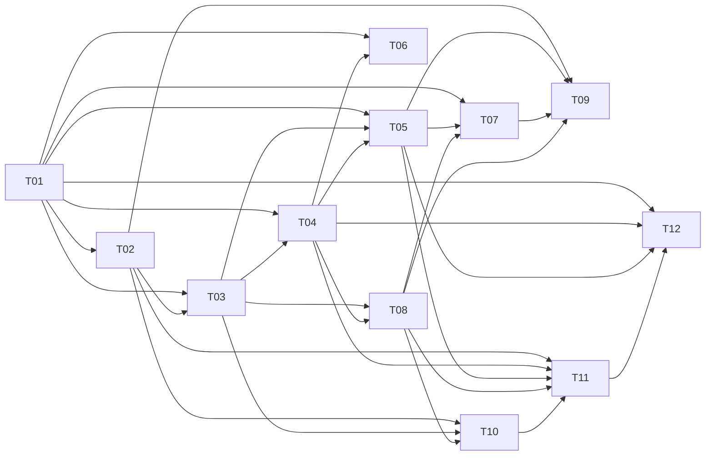

# Plan / 计划：从 Web 推进完整后端能力
最后修改时间: 2026-11-07 20:10:13

## 当前补充与执行（修订 10）

用户“移除角色”“参考 K12 数据访问层和数据迁移”授权本次 T02 收尾；后续明确“不做反向测试”。沿用 /root、T02-20261107-01，T02 accepted → running。删除角色全链路，迁移文件只保留仓库根目录 migrations/ 和 alembic.ini，revision 调用显式 SQL，Make/容器先迁移再启动；业务存储不再建库或执行迁移，不增加旧库自动接入机制。参考项目只读。

## 成员接入纠偏（修订 9，接入语义沿用）

用户最新“纠偏”授权主会话修正添加成员全流程并运行必要检查。此节取代修订 8 中强制新建会话、创建操作及独立运行时的主路径；既往交付记录保留为历史，不作为当前契约。

- GET /api/room/{roomId}/session 返回与房间规范目录匹配的真实会话列表，含名称、provider、presence、观察时间、archived 和 memberId。已加入仍列出并禁用重复选择；空列表和读取失败分别呈现。
- 原生 codex app-server proxy 连接当前共享 daemon，使用 WebSocket 字节流；thread/list 显式遍历所有公开 sourceKinds、modelProviders=[]、archived=false/true 的全部分页、useStateDbOnly=true。避免上游精确 cwd 字符串漏掉 Windows 等价路径，查询元数据后按项目既有规范规则匹配；不会递归纳入子目录。
- POST /api/room/{roomId}/member 只接受 sessionId/name/topicIds，返回 201 Member。先在短读事务校验资源，再通过 thread/read(includeTurns=false) 核对 ID/cwd/provider，最后短写事务复核唯一性与订阅并原子保存 Session/Member。RPC 失败统一安全 503；无效目录/资源 422，重复 409；不自动重发，不创建/恢复/改写用户会话。
- 删除新建操作 API、后台创建线程池、独立运行时锁、自动 resume、身份注入与创建状态展示。服务重启仅加载持久绑定；会话连接失败不换绑定。数据库版本迁移移除废弃结构、保留资源与已绑定成员；没有旧业务请求兼容。
- Web 恢复会话单选、加载/错误/空态/刷新、已加入标识和字段级必选校验。保存成员只改 Relay 名称/订阅，不重命名 Codex。
- T02 由 /root、T02-20261107-01 完成返工并经复核 accepted；检查覆盖完整分页/来源/provider、路径规则、空/失败、重复并发与跨项目拒绝、同会话持久绑定、选择与请求契约。默认 Windows npm 启动补测及修复见 T02 最新交付；T03 不在本次推进。
- T04 改为向共享 daemon 的原会话入队；T05/T07 的已有会话发布/查阅入口需在各自 Plan 补齐并实测，禁止假设任意旧会话可以新增 dynamicTools。T09/T10 使用选择会话的契约；T11 不再启动/关闭成员执行宿主；T12 保留额外宿主及显式新建会话等候选目标。

## Review status / 审查状态

Accepted（当前 T02 存储与已有会话绑定实施范围）。用户“纠偏”及刷新失败反馈授权修正 T02 的已有会话发现、选择、持久绑定与默认命令启动；T01 保留协议证据。完整台账保留；下游功能继续按各自局部方案推进，未决产品选择不冒充已接受。
2026-11-07 用户追加确认“成员发布时排除自己”并接受统一术语建议。本次窄范围同步方案已接受：在 T01 下记录 D03，统一当前文档、Web/后端文案及现有内存路由；补充自身排除/排除后空目标的行为检查。这里只对齐已有原型，不交付 T03 的持久发布或 T05 的成员工具入口，其他任务状态不变。主会话 `/root` 沿用 `T01-20261107-01`，本文和 T01 记录变更与检查。

## 先前范围修正 / 修订 8（历史）

按用户最新反馈，当前聚焦消息记录持久化、显式路由、Codex queue 入队结果及可视化。备份/恢复先后置；成员执行权限、执行审批与执行策略不归 Relay 管理。撤回修订 5 的单读循环前置、可选输出观察/后台工具完成核对、全部业务接口冻结及收件箱/发件箱建议。业务接口随相应任务按需设计。

原目标 ID 全部保留，后置项不阻断当前任务。当前没有对成员执行或输出内容另建管理流程；已接受的 Relay 管理持久会话和成员发布排除自己不变。

## Intent basis / 意图依据

- [后端评估意图](../intent/20261107-backend-from-web.md)：F01—F08、A01—A18、D01—D12。
- [总体协作设计](../design/codex-session-chat-collaboration.md)：项目、路由、轻量入队、按需查阅、Offset、可观测性与多入口方向。
- 用户最新确认：只有明确话题**或**接收人的成员输出才能路由；queue 只证明入队；不以等待输出超时触发重发。
- 用户确认 D03：成员发布时排除自己，排除后仍须有实际接收人；术语按[统一术语](../design/terminology.md)使用，业务概念与 Codex 协议名分层。
- 2026-11-07 用户接受 D02：“采纳建议 由 Relay 管理持久会话”。最新“纠偏”明确按目录发现/选择已有会话并保存原绑定；主路径使用共享 daemon，强制新建与动态工具注册前提撤回。
- 用户规划要求：最小实现不缩减总目标，必须标记全部目标与任务，保留以后扩大交付范围的依据。
- 核对基线：`2cc49330fab425940a353ab8da7fac08d763d094`；当前房间后端为内存原型。现有 `web/src/style.css` 工作区改动不属于本轮规划，也不覆盖或回退。
- T01 实测依据：[Codex 接入能力与方案建议](../design/codex-integration-capabilities.md)及其脱敏证据。已验证本机 `0.167.0` 的隔离队列/动态工具/重载，未操作已有工作会话；完整产品选择仍待收敛。
- 最新[审视修正](../design/20261107-architecture-review.md)以用户六项反馈为准；修订 5 的范围扩张已撤回。已有协议探测保留为事实，不据此增加实施范围。

## Goal ledger / 完整目标台账

“已确认”表示已有方向或规则，不表示已实现；“待取舍”表示必须保留并决策；“条件扩展”表示进入候选范围，但不承诺所有平台均可支持。T02 存储与管理会话基础已交付并经开发检查；真实入队与完整后端能力未完成，不得以局部交付替代整体验收。

| 目标 | 来源与预期结果 | 定位 / 当前事实 | 任务 | 验收 |
| --- | --- | --- | --- | --- |
| G01 项目与房间 | 一项目一房间，规范路径身份、房间隔离、创建与切换、重启恢复 | 已交付 SQLite 持久化、路径唯一性及重启检查；路径别名边界仍待真实会话核验 | T02、T09 | A02、A09、A18 |
| G02 会话与成员 | 真实发现/核验、稳定会话绑定、名称、活动来源及新鲜度、加入与编辑 | 角色字段按用户 2026-11-07 决定取消；T02 保留已有会话发现/选择/持久绑定；真实投递及成员工具仍未交付 | T01、T02、T04、T09 | A04、A06、A09、A17 |
| G03 话题与订阅 | 多话题订阅、创建与编辑、跨入口缓存一致；零订阅、内联创建取消、成员管理权限明确 | 资源和订阅已持久化；D04、D05 暂沿用当前行为，D10 待取舍 | T01、T02、T09、T10 | A01、A09 |
| G04 显式路由 | 话题或 @ 至少一项，并集去重、排除发布成员，目标全部有效且实际接收人非空；历史目标不随订阅改变 | D03 已接受；原型同步自身排除，持久发布/真实成员入口仍待交付 | T03、T05 | A01、A10—A12 |
| G05 持久发布 | 消息/路由/投递/事件原子保存、Seq、业务发布幂等和结果找回 | 现有消息/投递同事务保存；幂等、事件和结果找回仍归 T03 未交付 | T02、T03 | A02、A03、A12 |
| G06 真实入队 | 忙碌仍可提交，核验队列凭证；不等待模型空闲或上一条答复 | 未实现；用户已明确技术边界 | T01、T04 | A04、A05 |
| G07 异常与恢复 | 拒绝/未知结果如实记录，不超时重发；备份/恢复目标保留后置 | 当前只处理发布/入队结果；恢复方案本轮不做 | T04、T11 | A03—A05、A16 |
| G08 成员显式发布 | 受控身份、结构化目标、来源调用幂等；有目标才作为普通消息投递 | 显式发布与 D03 自身排除已固定；已有会话调用入口待 T05 核验，D09 后置 | T01、T05 | A06、A10—A12 |
| G09 独立输出观察 | 原历史输出读取与来源关联目标保留 | **后置**：当前不增加输出观察、扫描或等待流程，不阻断路由/可视化 | T06 | A05、A06、A10—A12 的后续扩展 |
| G10 按需查阅 | 单条、话题分页、关键词搜索，服务端查阅范围；只注入本次消息 | 原总体目标；未实现工具入口 | T01、T04、T07 | A06、A13 |
| G11 查阅位置 | 成员 × 话题 Offset、成功返回后单调推进、跳读回查、位置后数量；不解释为已读 | 原总体目标；未实现 | T07、T09 | A14 |
| G12 历史与详情 | 有界分页、引用定位、分发凭证/异常/路由来源、全局统计口径 | 当前全量快照；来源细节 D11 待取舍 | T03、T08、T09 | A07、A08 |
| G13 持续同步 | 持久事件游标、重连补取/重新同步，多窗口与 CLI 修改可见 | 未实现 | T03、T08、T09 | A07、A08 |
| G14 Web 完整体验 | 名称只在右上选择器；引用带话题和 @；明确 @ 语义；统一成员样式、秒级时间、状态下方时间、加载/提交/Toast、字号层级 | 部分原型已实现；正式接入时须防回退 | T09 | A08、A18 |
| G15 CLI 入口 | 房间、话题、成员、发布与持久记录查询；通过服务共享事实 | 原总体目标；输出观察入口后置 | T10 | A03、A15 |
| G16 本地服务交付 | 集中配置、持久存储、启动/关闭、运行诊断与部署说明；备份/恢复保留后置 | 已交付集中 DB/Codex proxy 配置及请求范围连接清理；T11 运行交付仍待完成 | T02、T11 | A02、A16 |
| G17 会话接入扩展 | 服务创建/管理会话、接入已有宿主、Orca 等驱动的能力与限制 | 已有 Codex 会话发现/绑定为 T02 主路径；显式新建会话、额外宿主等继续列 T12 条件扩展 | T01、T02、T04、T05、T12 | A17 |

候选项也必须可追踪：自动回应链限制归 T05/D09；成员自主创建话题和订阅归 T02、T07/D10；逐接收人的话题与 @ 来源归 T03、T09/D11；自动启动归 T11/D12。原设计 ER 图的归档字段不是已确认的归档/删除需求，暂保留为 T12 的产品候选，不从字段反推必做功能。

**台账维护规则**：目标 ID 不回收。新增目标补来源、任务和验收；延期记录原因与目标批次；取消记录用户决定、日期及受影响验收，不能直接删行。每个里程碑汇报必须列出已交付、仍待交付、待决策及条件扩展；任务 accepted 只接受该节点交付，整体完成须逐项核对台账。

## Technical decisions / 技术设计与决策

### 已确认约束

1. Web、CLI、成员发布复用同一个消息发布用例。目标只取 `topicIds` / `mentionedMemberIds`；引用、原消息目标、turn 和正文符号均不补造目标。
2. 发布完成是 Relay 已持久接收；投递完成是对应 Codex queue 确认入队。后续是否执行或回复不属于投递成功定义；本轮不添加输出观察流程。
3. 外部 RPC 不在数据库事务内。调用前持久保存真实目标会话、客户端消息关联标识与领取版本；响应后短事务保存可核验凭证及事件。
4. `pending → submitting → queued / rejected / unknown`。恢复中断的 submitting 为 unknown；没有可靠上游证据就保持未知。queued 和 unknown 都不因长时间无输出而重发。
5. 房间消息 Seq 与事件游标分开；订阅修改不改写旧 Delivery 或其目标会话快照。直接 @ 只赋予本条消息的接收资格，不自动订阅。
6. `housekeeper/src/codex_cli` 只作为协议行为参考；本项目独立实现，不引用、复制或依赖该目录，不沿用其状态文件和命令协议。
7. D02 按最新纠偏解释为持久管理成员与已有会话绑定。T02 只读发现/核验，T04 向共享 daemon 的原会话 queue 提交；T05/T07 在各自 Plan 内核验已有会话的显式发布/查阅入口，调用参数不能改写发送身份。
8. D03 已接受：目标全部校验后，取话题订阅成员与直接 @ 的并集，去重并移除发布成员；显式 @ 自己也不覆盖该规则。排除后为空则整条拒绝，不保存 Message/Delivery。消息保留显式目标用于解释；控制台发送无绑定成员，不从路由集合中任意扣除一人。自身排除不授予自动链截断或限额，D09 仍单独取舍。
9. 备份/恢复后置，不作为当前任务输入、实施前提或验收；不在本轮设计恢复模式。
10. Codex queue 按固定协议适配。Relay 自己的业务 API、工具参数和返回按实际功能需要设计；不要求一次冻结所有未来接口，不把 transport 内部写法提升为产品决策。成员执行权限和审批由其执行环境负责。

### 工程方案草案

以下明确当前职责与任务边界。Codex 外部协议以实测为准；各业务接口随对应功能定义和检查，不以预先设计所有扩展接口为前提。

| 范围 | 建议方案及边界 | 收敛位置 |
| --- | --- | --- |
| 服务形态 | 保持 Python/FastAPI 单服务；管理存储、会话连接和队列提交，不增加会话输出观察组件 | T02、T04、T11 |
| 数据访问 | SQLite + 标准库 `sqlite3`、SQL-first Alembic 显式迁移、外键/唯一约束与短写事务；同步 SQL 经现有同步用例或线程执行，不能阻塞事件循环；SQLAlchemy 仅用于 Alembic 迁移连接，业务数据访问不引入 ORM 或外部队列 | T02 局部设计；实现前固定 schema |
| 数据约束 | `(room_id, seq)`、`(message_id, target_member_id)`、`(room_id, caller_id, publication_id)` 唯一；同发布键规范化内容或目标不同返回 409 | T03；请求指纹含正文、排序去重目标与引用 |
| 提交调度 | 从持久 pending 领取，内存信号只唤醒；同真实会话按持久创建序约束发起顺序，不等输出；并发数集中配置 | T04；不设每成员常驻 Worker 前提 |
| 会话接入 | 原生 app-server proxy 连接共享 daemon；发现/核验只读，队列按后续 T04 提交到原 thread | D02 最新纠偏；额外宿主留 T12 |
| 成员加入 | 选择 sessionId，核对原会话 ID/cwd/provider，事务内复核名称/会话唯一性和订阅并保存绑定；重启读原记录 | T02；详细契约见本文修订 9，T09/T10 接入 |
| 成员入口 | 可信会话绑定发送者，成员显式发布复用普通路由；只设计实际需要的工具参数/返回，不预先固定所有未来工具 | T05；查阅接口按 T07 需要设计 |
| 输出读取 | **后置**：当前不扫描普通输出，不提供可选等待，不通过工具完成历史核对推进业务记录 | T06 不阻断其他任务 |
| 更新传输 | 沿用总体设计的 HTTP + WebSocket 方向；持久房间事件为权威，WebSocket 只通知，可按事件游标 HTTP 补取；保留窗口策略在接入前固定 | T08；不将消息 Seq 当事件游标 |
| 错误与时间 | 保留 `{ code, error, requestId }`；DTO camelCase，服务存 UTC；展示精确到秒。时间字段以实际事实命名，缺失则不显示 | T03—T10；不创建虚假 receivedAt |
| 会话持久性 | 保存成员与原会话绑定，沿用 D02；备份/恢复方案和演练后置 | T02 保存绑定；T11 备份/恢复部分后置 |

### 待固定的接口清单

保留 `/api/room` 现有资源前缀，以下是总计划需要覆盖的接口，不作为已发布 API：

- 房间/话题/成员：资源持久保存。GET session 查询项目目录会话；POST member 接受 sessionId/name/topicIds，返回 201 Member。重复加入 409，失败无部分绑定；成员创建操作接口移除。
- 发布：`POST /api/room/{room_id}/message` 增加 `publicationId`；相同键重放返回同一 Message，不重新路由或生成投递。增加按发布标识找回结果的查询；调用方身份由入口确定，不能把 `X-Request-Id` 当业务键。
- 查询：房间元信息与统计、`message?before_seq&limit&topic_id` 有界时间线、`message/{message_id}` 单条及投递详情。建议默认 50、最大 200；引用跳转单条读取，不为定位引用拉全量历史。
- 事件：HTTP `event?after_event_id&limit` 补取，WebSocket `events` 订阅。事件含 `eventId`、`roomId`、类型、对象 ID 与事实版本；元数据和起始游标在同一读取视图取得，避免初始化漏事件。游标过旧明确返回重新同步要求。
- 成员发布/查阅：按真实会话绑定发送者，复用业务用例；需要的 API/工具请求和返回随 T05/T07 相应功能设计，不在 T01 冻结全部未来接口。模型不能靠传入 memberId 覆盖发送身份。
- 未知结果核对：只允许按本次关联标识查询证据和展示结果；不暴露一个会自动重发 unknown 的通用 retry 接口。明确拒绝后的人工再发行为与记录在 T04 固定。

### 决策状态与接受实施方案前的剩余事项

| 决策 | 处理方式 | 阻断的任务 |
| --- | --- | --- |
| D01 分发详情布局 | 先列真实事实和文案，再接受页面方案；去掉无事实的接收/回执列是建议 | T09 |
| D02 首选会话接入 | **已接受**，用户：“采纳建议 由 Relay 管理持久会话”。主路径为按目录选择已有会话、持久绑定；不能把“管理”推导为强制创建，已有会话发布入口由 T05 核验 | 不再阻断接入方向；T02/T04/T05/T09/T12 已同步 |
| D03 自身投递 | **已接受**：成员发布排除自己，含显式 @ 自己；排除后实际目标非空，否则整条拒绝。显式选择保留，实际 Delivery 不含自己 | 不再待选；T03/T05 按规则交付 |
| D09 回应链 | 暂不增加隐式暂停/限额/链深度控制；后续如有明确需要再设计，不作为显式路由前提 | 后置，不阻断 T05 |
| D04 零订阅、D05 内联话题取消 | 保留原表单取舍，不追加作者自查、收件箱或发件箱设计 | T02、T09 |
| D07 发布入口 | 主路径为成员显式发布，可信会话绑定与结构化目标已确定；自身业务接口随需要落实，不预先冻结全部工具 | T05；已有宿主另列 T12 |
| D08 来源引用 | 当前只记录显式引用；自动由 turn 推断关联后置，不阻断消息发布 | T05、T09；自动关联留 T06 |
| D10 话题管理工具权限 | 只涉及聊天室内话题/订阅管理的业务入口；不扩展为成员执行权限、审批或安全隔离 | T02、T07、T10 |
| D11 路由来源细节 | 固定保存哪些当时命中的订阅来源以及详情是否展开；不新增收件人预览 | T03、T09 |
| D12 生命周期 | 当前只交付服务自身启停与配置；备份/恢复后置，不要求成员执行策略或审批矩阵 | T11 |

## Implementation steps / 实施顺序与里程碑

| 里程碑 | 任务与可检查成果 | 结束后仍须保留的工作 |
| --- | --- | --- |
| M0 设计收敛 | T01：能力矩阵、协议证据、身份入口、产品取舍，修订并接受 Intent/Plan/相关 task | 所有产品实现均未完成；M0 不能以“调查结束”冒充可用后端 |
| M1 持久单向投递 | T02 → T03 → T04：持久房间与已选择的原成员会话绑定、原子发布与结果找回、真实入队；拒绝/断连/崩溃证据 | 成员发布、独立输出读取、查阅工具、正式 Web、CLI、运行交付与接入扩展仍在台账 |
| M2 完整协作与 Web | T05、T07、T08 → T09：显式成员发布、已有消息查阅、持久记录查询/事件与正式页面 | T06 输出观察后置，不阻断 Web；CLI 与运行交付仍保留 |
| M3 多入口与运行交付 | T10、T11：CLI 与 Web 共用记录，服务启停/诊断；备份/恢复不在本轮 | 后置项目和 T12 条件能力仍须列明 |
| M4 条件接入扩展 | T12：按已选方向逐个形成能力证据和独立驱动；不可用项记录限制或取消依据 | 条件任务完成与否按实际选择判断；不承诺尚未证明的所有宿主能力 |

执行可以按合法依赖次序提前整合，例如 T08 契约明确后即可准备 Web；里程碑是验收范围，不是强制串行开发的日历。当前不登记并行执行者或启动其他会话。

历史“约 2–3 周”只针对条件顺利下的首条纵向切片，不是全部 G01—G17 的预算。当前仅对 T01 保留 1–2 个单人日的调查估算；M1—M3 包含的完整工作明显多于最小切片，待 M0 的协议、产品与接口确定后再分别估算。T12 按选中宿主单独估算，不能藏在首批预算内。

## Files to change / 修改范围

- 规划：本总计划、同名 Intent、原总体设计、`docs/task/20261107-backend-from-web/`，以及后续协议证据与验收文档。
- 后端候选模块：保留 `room_service.py` 为用例入口，逐步抽出 `room_routing.py`、`storage/`、`drivers/`、`delivery_service.py`、`member_tools.py`、`room_queries.py`、`room_events.py`；不先建立通用框架或改变 Greeting 领域。
- 集成点：`api.py`、`dependencies.py`、`config.py`、`room_models.py`、`routers/room.py`、异常映射、配置样例及对应测试；只按任务需要修改依赖和锁文件。
- Web：`services/roomApi.ts`、`domains/room/`、rooms store、错误归一化及相关测试；现有共享组件和时间工具继续复用。
- CLI/交付：`cli.py`、`pyproject.toml`、README、Makefile、容器与样例配置；不默认安装系统服务，不自动迁移其他仓库的会话配置。

## Tasks and coordination / 子任务与协调

### Coordination / 协调信息

- 方案修订：10。按用户反馈撤回修订 5 的范围扩张，保留 G01—G17、A01—A18 和 12 任务；T06 与备份/恢复后置，移除 T06 对 T07/T09/T10/T11 的依赖，当前 DAG 为 31 条边。其余未决取舍不据此自动接受。
- 权威协调根：`D:/SourceCodes/mywork/agent-relay`；总计划即本文。
- 仲裁会话：当前主会话 `/root`。由后续恢复此总计划的主会话统一登记和审查。
- 阶段授权：用户“移除角色”“参考 K12 数据访问层和数据迁移”及“不做反向测试”，主会话收尾 T02 并完成必要检查；只读已有工作会话元数据，原会话无消息/配置/执行变更，不创建提交。
- 方案与执行状态分开：T01 的调查方案据最新指令接受，主会话直接执行，编号 `T01-20261107-01`。T02 本次纠偏方案已接受并返工；其余任务未分配，受影响入口须在各自 Plan 补齐。

### Task definitions / 任务定义表

依赖的唯一来源是本表；所有前置均要求主会话接受可访问的实际交付，并记录可用版本。T01 的接受还必须使相应实施方案无设计缺口；不能只交一份开放问题清单即放行。

| ID | 任务文档 | 直接前置任务与要求 | 预期交付与验收 | 意图验收归属 |
| --- | --- | --- | --- | --- |
| T01 | [能力与方案收敛](../task/20261107-backend-from-web/T01-capabilities.md) | 无；限 Intent/Plan 调查，不是产品实现 | 能力证据、首选会话方式、成员入口与身份/幂等契约、待取舍项结论、完整计划修订 | A04、A06、A09—A13、A17 的前置 |
| T02 | [持久房间与会话](../task/20261107-backend-from-web/T02-durable-rooms.md) | T01：D02、项目/会话绑定及持久存储边界；D04/D05 暂沿用现有行为 | SQLite、房间/话题/订阅、真实会话发现/选择与原会话绑定；不含执行权限管理或全量接口冻结 | A02、A09、A16 基础、A17 主路径基础 |
| T03 | [原子发布与幂等](../task/20261107-backend-from-web/T03-publication.md) | T02：存储和配置；T01：D03 和发布身份边界；D11 在本任务收敛 | 原子消息/目标/Delivery/事件、发布键、结果找回和路由快照 | A01—A03、A12 |
| T04 | [真实入队与恢复](../task/20261107-backend-from-web/T04-enqueue.md) | T01：入队/回执契约；T03：持久 pending 与领取/结果接口，包含其 T02 proxy/绑定版本 | 向共享 daemon 原会话提交的队列驱动、后台提交、凭证、未知保留与崩溃恢复 | A04、A05、A16 后台部分 |
| T05 | [成员显式发布](../task/20261107-backend-from-web/T05-member-publish.md) | T01：显式入口与 D03/D07；T03：发布幂等；T04：队列集成 | 绑定成员发布带目标消息，复用普通路由与自身排除；不依赖普通输出观察 | A06、A10—A12 |
| T06 | [输出观察与来源（后置）](../task/20261107-backend-from-web/T06-output-observation.md) | T01：若后续重新选择该能力；T04：已有提交关联 | **本轮不实施**，保留历史目标与证据，不作为其他任务前置 | G09 后置扩展 |
| T07 | [按需查阅与 Offset](../task/20261107-backend-from-web/T07-context-tools.md) | T01：查阅业务边界；T05：成员身份入口；T08：已有消息查询 | 查询 Relay 已持久消息，查阅记录/位置只表达服务本次返回，不核对模型输出或理解 | A06、A13、A14 |
| T08 | [查询与事件同步](../task/20261107-backend-from-web/T08-queries-events.md) | T03：消息/事件 schema；T04：真实状态与更新事件契约 | 有界时间线、单条/详情、全局统计、HTTP 补取和 WebSocket 重连 | A07、A08 数据部分 |
| T09 | [Web 正式接入](../task/20261107-backend-from-web/T09-web.md) | T02：成员与绑定；T05：显式成员消息；T07：查阅记录；T08：查询/事件 | 持久记录、真实状态、分页/引用/时间/统一反馈；无输出观察前置 | A07—A09、A18 |
| T10 | [CLI 客户端](../task/20261107-backend-from-web/T10-cli.md) | T02：资源 API；T03：发布幂等；T08：记录查询/事件 | HTTP CLI、机器可读结果、会话发现/成员加入、发布结果找回与记录查询；不增加输出等待 | A03、A15 |
| T11 | [运行交付（备份恢复后置）](../task/20261107-backend-from-web/T11-operations.md) | T02：存储/配置；T04：提交；T05：发布入口；T08：记录事件；T10：CLI | 服务自身启停与诊断；不含成员执行权限管理、输出观察或备份恢复 | A02、A05、A16 当前部分 |
| T12 | [会话接入扩展](../task/20261107-backend-from-web/T12-session-expansion.md) | T01：能力矩阵与具体选中范围；T04：驱动契约；T05：成员身份；T11：运行约束 | 未首选会话模式/Orca 等逐项实现或记录限制；候选生命周期功能不丢失 | A17 |

### Execution registry / 执行登记表

| ID | 执行状态 | 执行者 | 分配编号 | 工作基线 / 交付位置 | 仲裁结论 / 当前阻塞 |
| --- | --- | --- | --- | --- | --- |
| T01 | accepted | /root | T01-20261107-01 | 当前工作区能力文档、脱敏证据、原型同步及检查 | 修订 7 按收窄范围接受；协议证据足以支持当前实现，未决扩展留对应任务 |
| T02 | accepted | /root | T02-20261107-01 | 基线 2cc4933 + 当前工作区；回报及真实证据见 T02 | 修订 10 已复核：角色全链路移除、根目录显式 SQL 迁移；8 项后端和 3 项前端正常流程、类型/lint/格式、Web build 及只读会话烟测通过；无迁移功能测试 |
| T03 | unassigned | 无 | 无 | 无交付 | 等待 T02、T01 |
| T04 | unassigned | 无 | 无 | 无交付 | 等待 T01、T03 |
| T05 | unassigned | 无 | 无 | 无交付 | 等待 T01、T03、T04 |
| T06 | unassigned | 无 | 无 | 无交付 | 后置，本轮不实施，不阻断其他任务 |
| T07 | unassigned | 无 | 无 | 无交付 | 等待 T01、T05、T08 |
| T08 | unassigned | 无 | 无 | 无交付 | 等待 T03、T04 |
| T09 | unassigned | 无 | 无 | 无交付 | 等待 T02、T05、T07、T08 |
| T10 | unassigned | 无 | 无 | 无交付 | 等待 T02、T03、T08 |
| T11 | unassigned | 无 | 无 | 无交付 | 等待 T02、T04、T05、T08、T10 |
| T12 | unassigned | 无 | 无 | 无交付 | 条件任务；等待 T01、T04、T05、T11 及范围选择 |

### DAG and integration / DAG 与集成

当前主线的一个合法顺序：T01 → T02 → T03 → T04 → T05 → T08 → T07 → T09 → T10 → T11；T06 后置，T12 为条件扩展。任务 ID 保留，不因后置重新编号。

共享文件 `room_models.py`、`room_service.py`、`routers/room.py`、`api.py`、`config.py` 和锁文件由主会话串行整合；任务新模块按范围写入。若将来安排多会话，先登记分配与各自可写范围，不能凭 DAG 无依赖就同时改共享文件。任务方案接受、前置交付接受与用户阶段授权齐备后才可派发；当前 T02 追加要求已复核接受，主会话串行维护任务，不启动子会话。

### Assignment history / 分配历史

| 时间 | ID | 分配编号 | 执行者 | 动作与依据 |
| --- | --- | --- | --- | --- |
| 2026-11-07 19:01:08 | T02 | T02-20261107-01 | /root | 用户报告刷新会话失败；accepted → running，沿用修订 9 修复默认 Windows 命令启动及复验，不推进下游 |
| 2026-11-07 19:05:29 | T02 | T02-20261107-01 | /root | 默认 Windows npm 启动、stdin 关闭及正常退出修复；107 后端测试、默认配置烟测、真实后端/Web 代理均通过，经 submitted 复核为 accepted |
| 2026-11-07 11:46:27 | 全部 | 无 | 无 | 建立完整任务草案；用户仅要求规划，未派发实施 |
| 2026-11-07 12:13:14 | T01 | T01-20261107-01 | /root | 用户“开始推进 T01”；接受调查方案并核对接收，进入 running，其他任务不变 |
| 2026-11-07 12:30:10 | T01 | T01-20261107-01 | /root | 核对真实队列/工具/重载证据；总方案修订 2，原调查授权与范围不变，T01 继续 running；下游不派发 |
| 2026-11-07 12:45:36 | T01 | T01-20261107-01 | /root | 用户接受 D02；复核修订 3 的管理会话主路径和任务边界，沿用原调查授权及编号继续 T01，其余任务仍 unassigned |
| 2026-11-07 13:18:03 | T01 | T01-20261107-01 | /root | 用户接受 D03/术语；复核修订 4，记录已接受的文案/原型自身排除同步与检查范围，原编号继续有效，其他任务不派发 |
| 2026-11-07 13:46:00 | T01 | T01-20261107-01 | /root | 用户要求优先审视技术可行性/方案自洽；复核修订 5，原编号继续调查与文档修正，补测仅用新建临时会话；不派发下游 |
| 2026-11-07 14:06:16 | T01 | T01-20261107-01 | /root | 用户明确收窄职责；复核修订 6，原编号仅修正文档，不新增实现、探测或工作会话操作 |

## Verification plan / 检查与验证安排

| 验收范围 | 必须取得的证据 | 主责 |
| --- | --- | --- |
| A01—A03 | 实库重启、发布断点回滚、并发发布/订阅顺序、相同键重放/冲突、历史快照 | T02、T03 |
| A04—A05 | 伪 RPC 确定性故障测试 + 隔离真实会话入队凭证；忙碌仍提交、未知不重发、接受后本地落库前崩溃 | T01、T04 |
| A06、A10—A12 | 成员绑定、跨房间/无目标拒绝、显式发布/去重、自身排除；普通输出不导入 | T05、T07 |
| A07—A09、A18 | 有界查询/统计/引用、事件重复和断线补取、游标过旧、切换房间隔离、真实初始化、状态/秒级时间/统一反馈 | T08、T09 |
| A13—A14 | 查询已持久消息、分页/关键词、跳读/回查、空结果/失败记录；不核对宿主工具完成或模型已读 | T04、T07 |
| A15—A17 | CLI 结果/取消、服务自身启停/诊断、会话绑定与选中宿主矩阵；备份恢复后置 | T02、T10、T11、T12 |

遵循现有检查入口：后端 `uv run --locked mypy src tests`、`uv run --locked ruff check .`、`uv run --locked ruff format --check .`、`uv run --locked pytest`；Web 在 `web/` 下 `corepack yarn typecheck`、`lint`、`format`、`test`、`build`。局部任务先跑相关检查，集成时用 `make check` / `make test`；不为文档改动重复执行运行测试。

整体 Verification 在本轮未开始。将来按同名 `docs/verification/20261107-backend-from-web.md` 逐项目标核对实际 diff、证据与剩余台账；条件未选项必须有明确状态，不以“最小版已交付”覆盖所有验收。

## 当前边界与限制

- Codex queue 回执只证明入队；没有回复不改写投递状态，也不自动重发。
- 外部调用不在 SQLite 事务内；已可能提交但没有确定回执时，记录 unknown，不编造成功或失败。
- 页面与后端共同替换演示状态，消息、目标、投递和时间都从持久记录读取。
- 备份/恢复、会话输出观察后置。成员执行权限/审批、安全隔离不属于当前路由职责；不增加收件箱、发件箱或自身投递。
- 原目标持续保留；接口随实际功能需要设计，后置项不挂成主线依赖。

## User review notes / 用户审查记录

- 2026-11-07：用户要求规划下一步；随后明确“虽然是最小实现，但不表示我只实现最小的”，必须标记所有目标与任务，未来扩大交付范围时能找回初始目标。
- 据此补齐 G01—G17、A13—A18 和 T01—T12，将里程碑与总范围分开；CLI、查阅/Offset、输出观察、运行交付及接入扩展均未从首批之外删去。
- 初次方案修订 1 时所有 task 为 Draft / unassigned。随后用户授权推进 T01，接受其调查方案；其他产品方案仍 Draft，不能据此启动下游实现。
- 2026-11-07 T01 阶段证据：原生 CLI/daemon `0.167.0`，共享 proxy 只读发现、隔离真实入队/active 时入队、重复客户端键不去重、动态工具回调/历史分页及重载工具均已核验。总方案修订 2，技术推荐和待确认产品选择分别记录；完整 G01—G17 与任务均保留。
- 2026-11-07 D02：用户“采纳建议 由 Relay 管理持久会话”。总方案修订 3 固定独立 app-server、持久 thread、动态工具主路径及创建/恢复/处理器/备份边界；17 个目标、18 项验收、12 个任务与原 DAG 保留，其余产品建议继续待收敛。
- 2026-11-07 12:54:57 修订检查：16 份文档、62 个本地链接、全部目标/验收/任务与修订号通过，35 条依赖与 DAG 一致且无环；diff 空白检查通过。本次只更新设计和任务文档，不重复真实协议探测或应用测试。
- 2026-11-07 D03/术语：用户确认成员发布排除自己并接受统一术语。修订 4 保存该决定，同步原型路由、Web/后端文案和测试；自己只存在于显式目标时不创建自身 Delivery，实际接收人为空则整条拒绝。17 目标、18 验收、12 任务和 35 条 DAG 依赖保留，D09 等其他取舍仍未接受。
- 2026-11-07 13:26:27 同步结果：后端 67 项/前端 51 项测试与两端类型/lint/格式检查通过；Make 在当前 PowerShell 不可用，已执行其等价命令。17 份文档、68 个本地链接、完整目标/验收/任务修订和 35 条 DAG 检查通过；已有 style.css 改动保持原指纹。该结果只验收本次已接受的原型同步，不改变 T01 running 或其他任务未交付状态。
- 2026-11-07 本轮审视：主路径技术可行，受影响方案仍须先收敛；已补待处理队列跨进程恢复的真实证据，修订 5 同步恢复模式、执行档前置、双向 RPC、工具冻结/稳定来源和后台核对。成员自发消息/直接消息历史与信任边界列为产品建议，未扩大读权限；未修改产品代码、启动下游或创建提交。
- 修订 5 检查通过：18 文档/81 本地链接、17 目标/18 验收/12 任务、35 条依赖与 Mermaid 一致且无环；新增探测脚本 Ruff/格式/Mypy/help、恢复证据断言及 diff/未跟踪文档空白检查通过。旧探测脚本和 style.css 指纹不变；本轮不重复原型应用测试，T01 继续 running。

- 2026-11-07 14:06:16 用户纠偏：按六项反馈更新修订 6。修订 5 增加的备份恢复前置、执行权限管理、单读循环架构门槛、输出观察/工具后台核对、全量业务接口冻结、收件箱/发件箱建议撤回；保留既有路由与持久会话决定，移除四条 T06 出边。

### 修订 7 实施登记

- 2026-11-07 14:33:27：T01 的调查与收窄边界经主会话复核接受，编号不变；T02 分配 /root，编号 T02-20261107-01，用户授权为“推进”。
- 当前 T02 存储部分：SQLite 版本化迁移，房间/话题/成员/订阅/会话记录和现有消息/投递按实体保存；保留 DTO 快照字段，正式发布幂等、事件、调度由 T03/T04 补齐。每次用例从同一事务读取当前数据，写入只更新改变的实体，避免跨实例缓存覆盖。
- 生产空库启动，不自动生成演示房间或会话；演示资源只在测试夹具提供。新 Delivery 为 pending（待提交），不能按 presence 生成入队成功。Web 仅补对应状态显示。
- D04/D05 暂沿用当前行为，不将建议写成接受；T02 会话运行时与创建操作仍为待交付，不据存储部分放行完整下游。

- 2026-11-07 14:40:48：T02 存储部分审查通过。后端 78 项测试、Mypy/Ruff/格式检查；前端 52 项测试、类型/lint/格式检查通过。包含跨进程持久化、同库多实例可见、并发序号/路径冲突、中途 SQL 失败原子回滚和未知迁移版本拒绝。T02 保持 running，未放行完整下游；下一步为管理会话运行时及成员创建/找回/原会话恢复。

- 2026-11-07 14:42:53：Web `corepack yarn build`（web 工作目录、项目指定 Yarn）通过。文档检查通过：18 份文档、78 个本地链接/锚点、17 目标、18 验收、12 任务修订 7、31 条 DAG 边一致且无环。`git diff --check` 通过；未执行 Docker 构建、真实 Codex 会话创建或入队验证。

### 修订 8：管理会话实施

- 2026-11-07 14:52:21：用户“继续”，沿用 /root、T02-20261107-01；追加“不做兼容或适配”。直接替换旧成员创建及候选会话流程，不保留旧 sessionId 请求或候选会话接口。当前 T02 会话局部方案接受并执行，Web 同步必要创建入口/结果显示，T09 其他目标仍未交付。
- POST /api/room/{room_id}/member 接受 operationId/name/role/topicIds，返回 202 创建操作；GET /member-operation/{operation_id} 找回同一记录。先提交记录，再由服务持有的后台工作执行原生 app-server thread/start，HTTP 断开不取消。结果 ready/rejected/unknown 可查询，重复操作找回，相同键变更参数 409。
- 单一托管运行时持有数据库旁的 OS 文件锁，防止同一持久库的两个进程同时恢复/创建。无托管数据时空启动不创建 Codex 进程；外部 RPC 不持有 DB 事务。中断 provisioning 仅标 unknown，不重试 start。
- SQLite schema 2 增加 member_operations 及托管 thread 唯一性，复用资源事务原子保存操作/真实会话/成员。恢复只操作已保存绑定，校验 cwd/provider/工具清单指纹；失败保留原绑定和安全诊断。
- 注册表只包含实际工具定义/处理器；当前 T02 默认无业务工具，不冻结未来 schema。未来扩展旧会话工具的限制在 T05 解决，不能声称空工具会话已具备成员发布能力。
- 配置为 Codex 原生命令列表和 RPC 超时，继承执行环境现有配置，不新增执行权限或审批策略。测试使用协议子进程 fixture 和自建空会话，不 queue/add 或 turn/start。

- 2026-11-07 15:27:17：T02 从 running 经提交记录复核为 accepted。107 项后端/56 项前端测试、两端检查和 Web build 通过；真实产品烟测确认创建后新进程恢复同一测试 thread，未触发模型推理。直接替换旧成员接口与 Web 会话选择，无旧请求兼容。下一节点为 T03，不据此完成其他目标或整体 Verification。
- 原生创建补充：thread/start 后保存 ID，再通过 thread/inject_items 持久化真实成员身份上下文及 thread/name/set 设置名称；不启动 turn 或提交 queue。协议初始化与消息路由分开；初始化中断仍保留 unknown。

- 2026-11-07 15:29:16：最终文档/证据检查通过：18 文档、82 个本地链接与锚点、17 目标、18 验收、12 任务修订 8、31 条 DAG 边一致且无环；真实证据断言和对应源文件指纹一致。既有 style.css 指纹不变，git diff --check 通过；未创建提交或运行 Docker 构建。

### 修订 9：已有会话加入纠偏

- 2026-11-07 16:39:33：用户“当前添加成员是什么逻辑，不应该是将聊天室所在目录的 codex 会话都列出来吗”，随后“纠偏”。撤回“管理持久会话必然新建”的错误推论；原 G01—G17/A01—A18/T01—T12 保留，显式新建和其他宿主作为 T12 候选，已有 Codex 会话加入回到主线。
- T02 沿用 /root、T02-20261107-01，从 accepted 退回 running；完成前后端/配置/存储清理及下游前提修订后，按实际 diff、97 后端/56 前端测试、两端类型/lint/格式、Web build 和真实只读烟测复核为 accepted。具体证据见 T02。
- 原 API operationId/后台创建/恢复/身份注入及创建状态全部移除；新契约为 GET session 与 POST sessionId/name/role/topicIds → 201 Member，无兼容或自动回退。共享 proxy 只读发现/核验，不接管原执行。
- T04 原会话 queue、T05/T07 已有会话入口须按最新契约设计/验证；本次未开始 T03 或整体 Verification，未创建提交。

- 2026-11-07 16:41:48：文档与交付证据复核通过：18 份文档、83 个本地链接/锚点，17 目标、18 验收、12 任务修订 9、31 条 DAG 边一致且无环；本次烟测源文件指纹匹配，原 style.css 未变，git diff --check 通过。

- 2026-11-07 19:05:29：用户报告刷新会话失败，日志确认默认 codex 解析为 npm codex.cmd 后被驱动拒绝；先前指定原生绝对路径的烟测漏验默认配置。T02 沿用原编号完成官方 npm Node 入口启动及标准输入关闭修复，107 项后端测试与 Mypy/Ruff/格式通过，默认配置烟测重新生成当前源码证据。运行中后端和 Web 代理均返回 200、本项目 2 条会话，结束后无残留 proxy。T02 经复核 accepted，其他节点与整体 Verification 状态不变。

### 修订 10：移除角色与显式 SQL 迁移

- 2026-11-07 19:41:39：用户明确取消角色字段，G02 其他目标不变；完整 17 目标、18 验收、12 任务与 31 条依赖边保留。T02 沿用原编号返工，T09/T10 成员请求同步删除 role。
- 参考 K12 的根目录 migrations/、薄 Alembic revision 与独立 SQL；应用启动不执行迁移。迁移入口只运行 upgrade head，不扫描旧结构、自动 stamp 或保留旧库适配参数。
- 包内迁移目录及旧库接入参数属于实施时擅自添加，已按用户反馈撤掉；不新增反向测试。

- 用户追加明确：不为数据迁移功能做单元测试。已删除迁移功能测试，不以新增集成测试替代；业务测试中的数据库初始化仅为测试准备。迁移结果核对使用本次实际本地执行记录。

- 2026-11-07 19:46:18：T02 running → submitted → accepted。最终检查：Mypy 40 个源文件、Ruff check/format 66 个文件；Web typecheck/lint/format/build 通过。按用户要求不新增反向测试、不保留迁移功能测试，仅运行 8 项后端正常流程和 3 项前端正常流程，均通过。默认配置只读烟测找到 2 个项目会话，临时库绑定和新进程原绑定通过；实际本地库已迁移到 remove_member_role，原 1 房间、1 话题保留，外键核对为空。当前 9080/9081 未监听，未启动新服务做 HTTP 复验；未构建 Docker，不推进 T03 或整体 Verification。详见 T02 最新交付。

- 2026-11-07 20:10:13：用户追加话题和成员节点的编辑、删除模态窗及普通点击过滤；按[独立局部计划](20261107-sidebar-node-actions.md)实施现有 G02/G03/G14 的节点交互，不推进 T09 的分页/事件/正式投递状态，也不变更其任务依赖。活动节点管理和历史保留具体契约以该计划为准。
