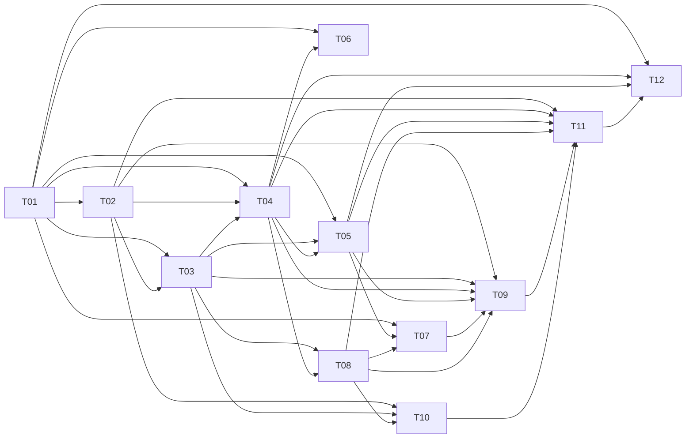

# Plan / 计划：从 Web 推进完整后端能力
最后修改时间: 2026-11-08 22:41:18

## 当前进度：CLI/MCP 协作接入与 Codex 安装入口已实现（修订 27，局部 Accepted）

既有稳定功能已提交为 `e40d313`。T10 与 [T13 MCP](../task/20261107-backend-from-web/T13-mcp.md) 共用 HTTP 客户端，覆盖全部 23 项客户端业务操作。CLI 从执行环境、MCP 从每次调用的 threadId 自动确定会话，再按 roomId 查询自身成员；成员无需填写自己的身份。投递正文只包含 roomId、发送者和正文，原生 skill 输入使用 Codex 实际发现的插件名称及路径；skill 通过普通显式路由消息组织认领、进度、求助/交接和结果，不增加任务引擎。

按用户要求新增 `make install`：预检 Codex 插件 → `uv tool install --editable . --force` → CLI 帮助检查 → 原生安装/刷新 MCP 与 skill。`plugins/agent-relay/` 是唯一插件源码，使用本地 marketplace，不建立独立 skill 镜像。已实际安装并重复刷新，Codex 原生插件 MCP connected、23 工具及唯一 skill 均可发现。164 项后端测试、Mypy（src/tests/受影响探测）、Ruff/格式、锁文件检查通过；真实隔离会话通过 MCP 自动识别自身、发布认领和进度并引用原消息，两条均匹配接收会话输入。CLI 自动身份也已核验。用户开发服务器、原库和工作会话未用于测试；本批变更尚未提交，其他整体目标状态不变。

### R03 与 request 事务收口（修订 25，已完成）

按用户要求，本轮完成 R03，不移入下阶段。参考 k12-delivery-os，在 request 切面统一管理 HTTP 写事务：首次写入开始，同请求依赖复用连接，响应序列化完成且发送响应头前提交，错误或异常回滚；添加成员的外部 Codex 核验仍在事务外，后台投递使用独立短事务。移除全库装载/比较入口，资源用例只加载当前房间资源，发布及找回按房间、发布者、发布编号定向查询；消息和投递直接插入，事件保持同事务。105 项相关后端测试、Mypy（src/tests）、Ruff 和格式检查通过，详见 T02/T03。本轮没有前端变更；整体验收核对随每轮工作进行，不另设开发任务。

### 既有 T11 本机与浏览器验收（修订 24，局部 Accepted）

用户“自行组织集成测试”，并明确“不考虑容器下的测试”。T11-20261108-N7 已完成真实 HTTP/Click CLI/临时 SQLite/自有共享 Codex 会话的本机运行验证，正常启停和重开记录一致。随后完成真实浏览器及消息接收闭环复验：页面发给 A、A 显式发布并 @ B、原页面实时显示、B 给出关联最终回复；成员/话题操作和创建/编辑弹窗也通过浏览器复验。T11 本机运行与界面链路部分 accepted；整体后端目标仍未全部完成。未启停用户开发服务器、操作用户原库或工作会话、运行容器测试；备份恢复、诊断接口和跨宿主适配不纳入。具体结果见 [T11](../task/20261107-backend-from-web/T11-operations.md)、[运行证据](../design/evidence/20261108-relay-t11-runtime.json)、[浏览器证据](../design/evidence/20261108-relay-browser.json) 和[接收闭环证据](../design/evidence/20261108-relay-receive.json)。

本轮浏览器及消息接收验收通过，原两项发现均已关闭：T09 创建/独立编辑弹窗固定操作区，六张候选卡片及按钮可见性复验通过；T11 三个 HTTP 入口统一使用 SelectorEventLoop，浏览器保持连接时正常关服耗时 0.203 秒，连接/任务归零且无关闭错误。另补齐页面发送 → 自有会话 A 实际成员发布并 @ B → 原页面自动显示 → B 最终确认，逐条匹配原输入及最终输出 turnId；普通模型输出未进入聊天室。首轮测试沙箱助手启动失败单独保留，修正自有测试环境后独立用例通过。所有自有服务、会话和浏览器已清理，证据见[接收闭环复验](../design/evidence/20261108-relay-receive.json)。N6、T11 本机运行和本轮浏览器接收闭环已完成；整体 Verification 未完成，下一批应从未交付目标中重新排序，不把已完成的 N6 继续列作下一阶段。

## N6 阶段安排（修订 21，已交付）

用户本轮明确四项取舍：入队失败记录状态并结束本次处理，不阻塞业务；合理组织成员/话题请求和本地事务；成员允许订阅零个或多个话题；运行链路集成测试后置。修订 21 据此收窄修订 20 草案，用户“开始实现”授权 N6 两批串行实施；当前两批已完成实现、必要开发检查和局部接受。原任务 ID、修订 19 已接受契约及既往局部交付继续有效。依据见[当前架构审视](../design/20261107-architecture-review.md#当前审视核心协作链路收口2026-11-08)。

用户本轮补充：“我已经实测消息可以投递。”据此确认基础 Web 投递链路已可用，结合已有 HTTP 原输入证据和近期页面检查，接受 T09/N5 核心投递与本轮界面部分；不再安排单独的基础投递验收，也不据此声称用户逐项测试过全部组合。受后续修改影响的正常流程随相应任务回归即可。

N6 投递失败处理与成员/话题操作整理已完成；本轮追加的 R03/request 事务收口结果见顶部修订 25。其余开发范围从完整目标台账与待取舍项中确定优先级。共享 daemon 是当前已验证前提；非共享/独立实例达到同等效果仅列可选研究，不是必须实现的目标。

| 顺序 / 原任务 | 本阶段主要结果 | 明确纳入 | 退出条件 |
| --- | --- | --- | --- |
| 1 / T04，T09 展示 | 单次入队失败有状态，后续业务继续 | R11 按单条投递处理异常，沿用 rejected/unknown 和原因；核对现有查询与页面展示；单条失败不使整个提交循环退出 | 发布不等待投递完成；失败结束本次提交，不卡住其他目标或后续消息；成功、明确拒绝和结果未知如实展示，不自动重发 |
| 2 / T02 → T09 | 成员/话题一次业务操作有合理请求、事务与返回结果 | R12 添加成员一次提交原会话、名称和订阅；外部会话核验在事务外，相关资源写入在短事务内原子保存；话题操作及订阅清理同样按业务操作提交，返回足够更新页面的结果 | 页面按成功响应完成保存和更新；额外 metadata 读取不是写入成功的条件；内联话题仍独立创建，取消成员表单不撤销已创建话题 |
| 3 / T02 → T09/T10，与资源操作一并整理 | 成员允许订阅零个或多个话题 | D04 已接受，允许 topicIds=[]；保留名称、原会话绑定和加入可用性检查；Web 订阅可选，CLI --topic-id 可省略 | 无话题可加入可用成员并直接 @；删除最后订阅话题后仍可改名、保存和被 @；服务端、创建/独立编辑、CLI 同口径 |
| 后置 / T11 | 运行链路集成验证与必要运行说明 | 上述功能完成后，用隔离环境串联启动、添加资源、发送、关闭和重开查询；说明当前共享 daemon 支持范围 | 验证同一份记录及投递链路可用；不作为前三项前置，不新增运行诊断接口或部署能力 |

本表沿用原任务，仅安排当前部分。基础投递已获用户确认；后续修改做相应正常流程检查，完整运行集成验证晚一步，不反向增加前置依赖。近期方案接受与产品实现完成分别登记。

### CLI 技术修正（修订 22，Accepted）

用户实施中明确“cli 用 click”。T10 改用 Click 的 group/command/option/argument 声明命令，移除 argparse；Click 列为直接依赖，复用锁内已有版本。HTTP 仍使用 urllib，既有命令名、JSON/退出码、环境变量优先级和未知结果不重发保持原契约。沿 T10-20261108-N6 编号实施并复验，其他 N6 任务范围及 DAG 不变。

### 下一步开发目标与完成条件

开发基线为 `a71d1862164ea87164fde92709247dc6cd0da07d`（`feat(relay): deliver messages to Codex sessions`）。本轮已提交现有功能；提交前后端 153 项、前端 69 项测试通过，后端 mypy/Ruff、前端类型/lint/格式及生产构建通过，暂存区空白检查通过。当前环境无 make，实际执行对应 Makefile 的命令；没有重做真实 Codex 投递或完整运行集成验证。

本轮交付目标：**让失败投递独立结束，让成员和话题的保存结果直接用于页面更新，并使零个或多个订阅的规则贯通后端、Web、CLI。** 两批已按顺序完成，结果见文末 N6 交付；后续 T11 本机验证结果以顶部修订 23 和 T11 交付为准。

| 实施批次与原任务 | 具体开发事项 | 完成后可见效果与验收 |
| --- | --- | --- |
| 第一批：T04 → T09，投递失败收尾 | 检查从领取、单条处理到 future 回收的异常范围；明确拒绝或结果未知时保存对应状态、原因和时间，结束本次提交并释放占用；将失败事实接入既有查询与展示 | 单条失败不退出整个提交循环，其他目标与后续消息可继续；对应详情显示已拒绝/结果未知及原因；聊天室可继续发布和管理资源；已入队不降为失败，不自动重发 |
| 第二批：T02 → T09/T10，资源操作与零订阅一并整理 | 核对成员和话题各业务请求的事务边界，补齐页面需要的返回结果；Web 直接应用成功响应，移除将后续 metadata GET 作为保存完成条件的串联；允许 topicIds=[]，同步两种成员弹窗、共享订阅字段和 CLI 可省略 --topic-id | 无话题时可加入可用成员并直接 @；可编辑为零个、一个或多个订阅；删除最后话题后成员仍可编辑和接收直接 @；资源保存成功即更新页面，无需重复写入；内联话题仍独立创建 |

第二批复用已有原子保存能力，只修正实际缺口；不以本次整理为由整体改写存储层。成员创建仍在数据库事务外核验 Codex 会话，在短写事务内保存绑定和订阅；编辑弹窗只展示原绑定，不发现或刷新候选会话。创建/编辑订阅从至少一项改为零项以上，无需新增数据库迁移。

每批完成后运行受影响的现有正常流程检查、类型/lint/格式检查；涉及前端时检查构建。异常隔离和不重发通过实现审查核对，不新增反向、故障注入或迁移功能测试。T11 的完整运行链路集成验证晚一步；共享 daemon 以外的同效接入继续仅作可选研究。完整目标台账和 DAG 不变。

### 本阶段已确认的取舍与技术约束

1. **D04 已接受零订阅。** 成员可以订阅零个或多个话题，只被 @ 也成立；发消息仍需话题或 @，且至少产生一个实际接收人。
2. **共享 daemon 是当前支持范围。** 不能可靠判定的独立实例继续列出、禁选并说明接入办法；不承诺当前实现能够向所有存活实例投递。成员状态仍是最后观察，编辑只展示已有记录。
3. **一次失败结束本次处理。** 沿用现有 rejected/unknown：明确拒绝与无法确认结果分别记录，不因失败、超时或没有模型回复而重发。单条异常不阻塞其他投递；已有原输入接收核验继续使用。
4. **按本地业务组织资源操作。** 成员、会话绑定和订阅的关联写入同事务；外部 RPC 不持数据库事务。写接口返回足够更新页面的结果，不将写入和额外 GET 拼成一个成败不明的保存操作。
5. **成员路径是业务上下文。** 当前无认证设计，roomId/memberId 路径不承担不可冒充身份承诺。清理有效文档中的相反表述，不恢复 Bearer 或另建权限系统。

### 完整目标继续保留

| 剩余范围 | 原归属 | 本阶段之后的处理 |
| --- | --- | --- |
| 逐接收人的历史话题/@ 命中来源 | T03/T09，D11 | 待产品取舍；不从当前订阅反推历史 |
| 成员自行管理话题/订阅、自动回应链限制 | T02/T07/T10 的 D10、T05 的 D09 | 保留候选，不默认纳入 N6 |
| 独立输出观察、turn/final_answer 自动关联 | T06，G09/D08 | 后置；不自动导入普通输出，不阻断显式协作 |
| 备份/恢复 | T11，G07/G16 对应部分 | 按用户要求后置，不与本机运行交付混为一项 |
| 非共享 daemon / Orca 独立实例的同等投递效果 | T01/T12，G17 | 用户明确可研究、非必须实现：先查真实实例是否暴露发现/定向入队/接收核对入口，形成可行性与限制结论；没有可靠入口就记录限制，不承诺适配 |
| 显式创建/管理会话、跨容器宿主连接 | T12，G17 | 条件扩展，选定能力并取得协议证据后单独设计；当前不实施 |

修订 20 额外建议的后台运行状态机、诊断接口、公平调度改造和 unknown 原队列持续核对撤出本期必做，不作为交付门槛。保留既有真实入队与接收事实，不扩建可靠队列平台。全部 G01—G17/A01—A18 继续按下方台账追踪，不能以 N6 完成宣称全部目标完成。

## 当前已接受主线（修订 19，优先完成原会话实际接收）

当前目标：**添加成员按真实可用性选择目录中的 Codex 会话；用户“我”带话题或 @ 发送，目标原会话实际收到。** 只有一个订阅成员也必须投递；自身排除只适用于成员主动发布，不能把接收者当成用户消息的发送者。

N1—N4 已交付的发布、路由、持久记录、真实入队、成员接口、查询同步和 CLI 保留。N5 已实现共享 daemon 范围的可用性判断、一次首项启动与原输入接收确认；已有隔离 HTTP 原输入证据，用户本轮实测确认 Web 消息可投递，基础核心链路及近期界面部分已接受。完整目标仍按台账保留，以下旧批次记录只表示当时交付范围。

## N5 原会话接收闭环（修订 19，Accepted）

用户已确定目标，并要求“梳理下一步任务，在任务中解决问题”，随后“继续推进”授权实施与必要检查。T01 已核验并收敛技术选择；T02/T04 本批交付已接受，T09 核心投递和近期界面部分由用户实测与既有证据接受。沿用原任务和完整目标。

2026-11-08 用户“继续推进”，授权按本批顺序开展必要核验、方案收敛和实现。/root 接收 T01-20261108-N5，先完成接入与消费核验；T02/T04/T09 在前置方案收敛和接受后继续，不为常规实现选择重复请求确认。开发服务器由用户管理。

### N5 已收敛实施契约

T01 的[自有会话证据](../design/evidence/20261108-codex-delivery.json)确认：active 可入队；用户中断后原队列保留且状态为 idle；启动原 FIFO 首项后两条消息按顺序进入原会话，`userMessage.clientId` 匹配客户端标识。官方 app-server 文档只说明运行发现与历史读取，实验性 queue 行为以本机 0.167.0 schema 和实测为准。该证据不追认此前工作会话停滞的具体原因。

- 本批支持同一共享 daemon 承载的已有会话。目录发现合并 `thread/list` 与 `thread/loaded/list` 的实际运行记录；idle/active 且未归档才可加入，忙碌可用。其他记录仍列出并禁选，明确“未接入当前消息通道，可能未运行或在独立实例中运行”及共享模式恢复办法；systemError 显示状态异常。无法仅凭共享协议保证任意存活独立实例可用，限制公开保留，不增加宿主适配。
- 候选刷新、手动刷新聊天室和加入前读取真实状态；刷新将原成员/会话的观察及时间一起保存，普通持久事件查询不发起外部 RPC。投递后台核验只跟踪尚未确认接收的输入，不用观察时间冒充接收。
- 新消息确认入队后，检查同一原会话当前是否空闲及队列首项。首项属于有真实回执的 Relay 投递且尚无启动尝试时，先持久记录一次尝试，再以该首项 ID 调用 queue/start；忙碌、未加载、外部队列首项或启动结果不明均不循环启动。不得越过其他队列项，不自动 resume，也不因后续用户中断反复启动；等待时保留入队事实与原因。新消息可以触发尚未尝试的 Relay 首项，既有消息不会重新 add。
- 后台按原会话有界读取输入历史页：每轮读取最新页，并逐步补查较早页；只保留目标 userMessage 的稳定客户端关联，忽略所有助手输出。匹配后保存输入项 ID、turn ID 和本地接收确认时间，记 received；queued 与 unknown 都可通过真实输入证据确认收到，历史暂缺保持原事实。
- DTO 增加候选 usable/unavailableReason，以及投递 queuedAt、receivedAt、receivedItemId、receivedTurnId、activationAttemptedAt 和必要等待说明；received 表示已确认进入原会话，不表示模型理解或任务完成。新增事实保存于已有 JSON payload，不引入新存储或旧接口适配。时间只在事实存在时展示。

T02/T04/T09 据此进入实现，编号分别为 T02-20261108-N5、T04-20261108-N5、T09-20261108-N5，由 /root 串行整合。协议竞态或明确用户中断后的停滞保留真实等待状态，用户可在原 Codex 继续；本批不承诺撤销用户中断后仍强制执行。

| 顺序 / 任务 | 主要结果 | 在任务中解决的问题 | 本批完成条件 |
| --- | --- | --- | --- |
| 1 / [T01](../task/20261107-backend-from-web/T01-capabilities.md) | 收敛可实施的会话接入与队列消费方案 | 如何确认运行及原会话身份；共享 daemon 与 Orca 独立实例的可达边界；为何已加载空闲仍可能不消费；`queue/start` 的触发、顺序、竞态和用户中断语义 | 给出真实证据、支持范围、限制与处理办法，固定 T02/T04/T09 所需契约；不能只留下待调查清单 |
| 2 / [T02](../task/20261107-backend-from-web/T02-durable-rooms.md) | 可用会话才可加入，成员状态持续反映真实观察 | 当前只有“已加入”禁选，历史会话也可加入；加入快照陈旧；`notLoaded` 不能说明进程已死 | 前后端共用可用性判断，加入时重新核验；未存活不可用，忙碌仍可用；无法确认或运行但不可达时有准确原因和处理办法 |
| 3 / [T04](../task/20261107-backend-from-web/T04-enqueue.md) | 已路由消息进入绑定的目标原会话，并记录证据 | 只有 queue/add、没有接收确认；已入队但未开始消费如何处理；如何避免重复提交和越过原队列 | 按 T01 确定的消费方案实现；以本次输入关联确认原会话收到，入队与接收事实分开，未知或等待均不自动重新 add |
| 4 / [T09](../task/20261107-backend-from-web/T09-web.md) | Web 操作、状态和真实收件结果一致 | 候选禁选与原因、已有成员刷新、入队/接收文案、用户与成员身份表达、真实页面验收 | 通过 Web 添加真实可用会话，分别按话题、@、两者叠加发送，原会话收到且重复目标只有一份；单成员话题的人类消息正常送达 |

接收核验优先使用目标 `userMessage.clientId` 与 Delivery 的稳定 `clientMessageId` 关联，保存原会话/输入项/turn 等必要证据；具体字段和时间语义由 T01 核实。队列空了不能单独证明收到，`final_answer` 不是接收前提；不把模型过程输出自动放进聊天室。

当前已知约束是共享 daemon 的 queue 不能保证任意独立存活实例收到。T01 已根据空闲停滞和正常自动消费两类证据，确定上述一次首项启动机制；不能推出“总会自动消费”或“每次无条件 start”。独立实例的接入限制和处理办法在候选原因及 README 中明确保留。

N5 验收包含空闲及忙碌会话、已有待消费队列、成员运行状态变化后的刷新和重新加入核验；在自有临时会话中完成正常端到端流程。状态变化与消费竞态采用必要协议核验和实现审查，不新增反向、故障注入或迁移功能测试。用户工作会话不承担测试，开发服务器仍由用户管理。

N5 的验收依据现包含用户实际投递确认、已有真实 HTTP 路由/入队/原输入关联及近期界面检查。排除发送者只作用于真正的成员发布，任何接收成员的自然语言解释都不能改写已保存的发送者与投递事实。未逐项重演的场景随受影响修改回归，不单独阻断接续 T11；完整目标的其余未交付项仍保留原归属。

### 原 N1—N4 批次依据

用户指出“不要盲目发散，我们连最核心的功能都还没实现”。修订 11 把资源治理、数据访问整体改造、Web 状态重构与核心发布放在同一前置批次，却把真实入队推后，顺序不当。本节取代修订 11 的批次安排；完整目标和问题归属保留，纳入台账不等于近期实施或核心链路前置。

当前先交付：**发布消息 → 明确路由 → 原会话真实入队 → 持久保存并展示真实结果**。随后直接补齐成员带显式目标发布，形成核心协作闭环。每段只修改这条链路必需的接口、存储和页面，不先完成全部评估建议。

用户“开始推进”授权实施 N1；核心发布、真实入队、Web 最小接入方案已接受，主会话直接串行整合。既有 T01/T02 和节点操作交付继续有效；后续增补保持原状态。D04 零订阅等周边取舍不阻塞核心投递。

N1/N2 的发布/入队及成员发布、N3 查询同步/成员查阅、T05/T07 接口校正及 N4 T10 HTTP CLI 已交付，详见文末记录；这些局部交付不替代 N5 的可用性与实际接收验收。T09 其他取舍和 D04 零订阅继续保留台账。

### 完整任务目标与既往交付批次（N1—N4）

本表保留既往阶段范围；当前待实施部分与顺序以顶部修订 21 为准。

| 任务 | 完整目标与完成边界 | 下一批 N1 纳入实现的部分 | N1 后仍需交付 |
| --- | --- | --- | --- |
| T01 能力与方案依据 | 保存真实能力边界和已确认决定，支持对应功能实施 | 使用既有 queue 协议和会话绑定证据 | 对应功能实施前补必要局部核验，不重开整体调查 |
| T02 聊天室资源与成员生命周期 | 房间、话题、成员、订阅及原会话绑定持久一致；活动资源管理与历史引用有明确边界 | 使用现有已交付资源与绑定，不先重开生命周期/存储改造 | 零订阅、观察展示、资源访问改进等保留后续，不作为 T03/T04 前置 |
| T03 原子消息发布 | 一次发布原子保存消息、路由来源、目标会话快照、投递、事件和幂等键，响应丢失后可找回 | 发布/路由原子保存、稳定发布标识及找回、实际成员与会话快照、pending 投递和 T04 必需的定向读写 | 逐接收人路由解释、持久事件及剩余访问优化保留后续，不要求全部交付才接真实队列 |
| T04 真实单向投递 | 已持久发布能提交到原会话队列，真实回执可查，未知不重发 | 本批直接实现 queue 调用、持久提交状态/凭证、必要后台提交与启停；不等待接收者输出 | 后续完善只读核对等任务剩余部分，已确认入队与 unknown 均不自动重发 |
| T05 成员显式发布 | 本机成员 HTTP 路径显式指定 roomId/memberId，发布带目标消息并复用路由、幂等和自身排除 | 不阻塞 N1；入口随本任务开展，不新增认证凭证 | 紧接 N1 在 N2 完成成员发布和真实投递；先于分页、事件和查阅位置 |
| T08 有界查询与持续同步 | 全房间一致查询、分页、单条引用、全局统计和持久事件补取可用 | 不纳入 N1，不作为真实入队前置 | N3 再做分页、组合筛选、引用和事件；届时接入 T03 持久事件写入 |
| T09 Web 完整协作体验 | 浏览、编辑、发布、状态、历史、同步和查阅位置均对应持久事实，统一反馈不回退 | 仅接正式发布/找回、实际投递状态/时间；修正会改变发送目标的筛选联动；沿用明确刷新查询结果 | N2 显示成员发布；N3 再做状态源重构、观察展示、表单改进、分页/引用/同步和查阅位置 |
| T07 按需查阅与位置 | 成员按范围读取已有消息，记录服务成功返回的位置，不解释为已读 | 不纳入 N1 | N3 实现查阅入口、分页/搜索和成员×话题位置；复用 T05 身份和 T08 查询 |
| T10 HTTP CLI | CLI 与 Web 共用资源、发布、找回和查询事实 | 不纳入 N1 | N4 交付保留；N6 已贯通零订阅与资源响应，并按用户要求改用 Click |
| T11 服务运行交付 | Relay 配置、启停、连接及提交任务可诊断、记录持久可查 | 不纳入 N1；T04 自身仍须交付提交器生命周期 | N4 整合可重复运行说明与检查；备份/恢复继续后置 |
| T06 输出观察 | 保留历史目标；用户重新选择后才定义能力 | 后置 | 不扫描输出、不等待 final_answer、不阻断当前主线 |
| T12 会话接入扩展 | 额外宿主和显式新建会话按选择逐项交付或记录限制 | 条件扩展 | 原目标不删除；没有证据的接入方式不标已支持 |

N1 的结束条件是通过现有 Web 发布的消息真实进入目标原会话队列，刷新后能查询匹配凭证和实际状态；仅保存 pending 不算交付。N2 紧接实现成员显式发布，形成双向协作。任务按实际完成部分验收，完整目标继续保留；不以实现核心为由删掉剩余目标，也不以保留目标为由把全部任务提前实施。

### 本次评估问题的归属与验收

| 问题 | 任务归属 | 纳入批次 | 可检查结果 |
| --- | --- | --- | --- |
| R01 话题筛选暗改发送目标 | T09；A18 | N1 | 点击话题/成员和跳转引用仅改变浏览范围；不随正文是否为空改变草稿目标；显式引用操作仍按既有规则回填目标 |
| R02 删除产生零订阅，表单却拒绝保存 | T02/T09/T10；A09 | N6 已交付 | 允许零个或多个订阅，统一创建/编辑/删除与 CLI；消息的实际接收人非空校验保持不变 |
| R03 每个事务装载全库并复制比较 | T02/T03；A02/A07 | 本轮已完成，修订 25 | 删除全库装载/比较入口；资源只加载本房间资源，发布/找回定向查询；HTTP 写事务归 request 切面，后台短事务独立 |
| R04 删除与既有 pending 语义未定 | T02/T03/T04；A01/A05/A09 | N1 只落实实际目标快照及提交所需规则 | 旧 Delivery 不按当前订阅重算、不改投重新加入的成员；生命周期其余工作保留后续 |
| R05 已有会话可信发布入口未核验 | T05；A06/A10—A12 | N2 的局部方案与实现，先于查询扩展 | 明确入口、受控身份和稳定调用键后实现显式成员发布；不靠自报 sender 或输出扫描 |
| R06 陈旧会话状态被当成实时能力 | T01/T02/T09；A08/A09/A18 | N5 | 真实可用性、加入时核验、成员状态刷新和不可用原因纳入核心；不以 notLoaded 判死，不以加入快照承诺可接收 |
| R07 queued/delivered 旧语义及无依据的接收/回执列 | T03/T04/T09；A04/A08/A18 | N1 与真实入队一并交付 | 统一 pending/submitting/queued/rejected/unknown；queued 为已入队；详情展示真实投递事实和有值的秒级时间 |
| R08 任务仍引用创建操作、operationId 和旧接口兼容 | 全部受影响 task | 本次规划更新 | 当前方案只描述已有会话绑定；历史记录明确保留为历史；无旧业务请求/旧 Web 兼容实现和迁移功能测试 |
| R09 Web 房间状态分散并手工双写 | T09；A08/A09 | 后续 | 保留单一状态来源目标；N1 沿用现有加载/刷新，不先重构 Pinia 和全部资源更新 |
| R10 成员筛选只筛前端已加载数组 | T08/T09；A07/A18 | N3，N1 保持现有完整快照查询 | 分页时 topicId 与 sender memberId 在服务端组合过滤后再分页；全局统计不受筛选/页数影响，不把当前页当全部历史 |
| R11 单条异常可能退出整个提交循环 | T04/T09；A04/A05 | N6 已交付 | 本次失败有状态和原因，其他目标及后续消息继续处理；不增加后台运行状态机或诊断接口 |
| R12 写入与刷新失败混淆 | T02/T09；A08/A09 | N6 已交付 | 成员/话题写入与返回 metadata 同事务；页面依据成功响应更新，不依赖额外 GET 才判保存成功 |
| R13 核验调度饥饿及全量未确认扫描 | T04；A04/A05/A16 | 审查建议，撤出本期必做 | 保留观察结果，后续确有需要再决定调度改造，不扩展当前任务 |
| R14 unknown 缺少原队列只读证据核对 | T04；A04/A05 | 审查建议，撤出本期必做 | 现有 unknown 如实保留、已有输入核验继续使用；不要求本期新增 queue/list 持续核对 |
| R15 容器说明超过投递支持事实 | T11/T12；A16/A17 | 共享 daemon 支持范围已明确；适配未选中 | 准确说明当前共享 daemon 支持范围，不把 HTTP 启动当成已支持投递，不增加容器连接桥 |

### 既往 N1 实施顺序与退出条件（历史）

1. T03 只收敛核心发布需要的请求、幂等和目标/Delivery 契约，直接使用 T02 已接受的资源与绑定；D04、D11、资源整体改造不作前置。
2. T03 保存可供提交的消息、实际成员/会话和 pending；随即接 T04，调用原会话 queue，持久保存可核验回执或明确的 rejected/unknown，不因超时自动重发。
3. T09 仅接发布/找回及真实状态、秒级时间，修正会误改发送目标的筛选联动；用现有明确刷新展示结果，不先重构状态管理或建设事件系统。
4. N1 按三种目标组合、并集去重、真实入队凭证及持久查询验收；没有回复不改变入队成功。随后 N2 直接推进 T05 成员显式发布/自身排除/T09 成员消息，核心协作完成前不先做分页和同步扩展。

资源、发布和 Web 用例检查使用项目已有入口，只覆盖本次实现需要的正常业务流程；不新增反向测试，不为数据迁移功能写单元或替代集成测试。迁移仍为根目录显式 SQL，实际执行结果另记。本次按用户“开始推进”进入 N1 实施和必要开发检查。

## 当前补充与执行（修订 10）

用户“移除角色”“参考 K12 数据访问层和数据迁移”授权本次 T02 收尾；后续明确“不做反向测试”。沿用 /root、T02-20261107-01，T02 accepted → running。删除角色全链路，迁移文件只保留仓库根目录 migrations/ 和 alembic.ini，revision 调用显式 SQL，Make/容器先迁移再启动；业务存储不再建库或执行迁移，不增加旧库自动接入机制。参考项目只读。

## 成员接入纠偏（修订 9，接入语义沿用）

用户最新“纠偏”授权主会话修正添加成员全流程并运行必要检查。此节取代修订 8 中强制新建会话、创建操作及独立运行时的主路径；既往交付记录保留为历史，不作为当前契约。

- GET /api/room/{roomId}/session 返回与房间规范目录匹配的真实会话列表，含名称、provider、presence、观察时间、archived 和 memberId。已加入仍列出并禁用重复选择；空列表和读取失败分别呈现。
- 原生 codex app-server proxy 连接当前共享 daemon，使用 WebSocket 字节流；thread/list 显式遍历所有公开 sourceKinds、modelProviders=[]、archived=false/true 的全部分页、useStateDbOnly=true。避免上游精确 cwd 字符串漏掉 Windows 等价路径，查询元数据后按项目既有规范规则匹配；不会递归纳入子目录。
- POST /api/room/{roomId}/member 只接受 sessionId/name/topicIds，返回 201 Member。先在短读事务校验资源，再通过 thread/read(includeTurns=false) 核对 ID/cwd/provider，最后短写事务复核唯一性与订阅并原子保存 Session/Member。RPC 失败统一安全 503；无效目录/资源 422，重复 409；不自动重发，不创建/恢复/改写用户会话。
- 删除新建操作 API、后台创建线程池、独立运行时锁、自动 resume、身份注入与创建状态展示。服务重启仅加载持久绑定；会话连接失败不换绑定。数据库版本迁移移除废弃结构、保留资源与已绑定成员；没有旧业务请求兼容。
- Web 恢复会话单选、加载/错误/空态/刷新、已加入标识和字段级必选校验。保存成员只改 Relay 名称/订阅，不重命名 Codex。
- T02 由 /root、T02-20261107-01 完成返工并经复核 accepted；检查覆盖完整分页/来源/provider、路径规则、空/失败、重复并发与跨项目拒绝、同会话持久绑定、选择与请求契约。默认 Windows npm 启动补测及修复见 T02 最新交付；T03 不在本次推进。
- T04 改为向共享 daemon 的原会话入队；T05/T07 的已有会话发布/查阅入口需在各自 Plan 补齐并实测，禁止假设任意旧会话可以新增 dynamicTools。T09/T10 使用选择会话的契约；T11 不再启动/关闭成员执行宿主；T12 保留额外宿主及显式新建会话等候选目标。

## Review status / 审查状态

修订 21 N6 与修订 22 Click 修正已实现并局部接受；修订 23 T11 本机运行链路已验证；修订 24 补齐真实浏览器消息接收闭环并关闭 UI-01/RUN-01，T11 当前已接受范围扩展到本机及浏览器正常链路。整体 G01—G17/A01—A18 的 Verification 未完成。修订 19 N5 契约与用户实测基础投递接受继续有效；非共享 daemon 同效接入仍为可选研究。

自身排除和统一术语的既往接受记录保留；当前以控制台用户/成员发布的实际身份区分发送者，用户消息不能排除接收成员。

## 先前范围修正 / 修订 8（历史）

按用户最新反馈，当前聚焦消息记录持久化、显式路由、Codex queue 入队结果及可视化。备份/恢复先后置；成员执行权限、执行审批与执行策略不归 Relay 管理。撤回修订 5 的单读循环前置、可选输出观察/后台工具完成核对、全部业务接口冻结及收件箱/发件箱建议。业务接口随相应任务按需设计。

原目标 ID 全部保留，后置项不阻断当前任务。当前没有对成员执行或输出内容另建管理流程；已接受的 Relay 管理持久会话和成员发布排除自己不变。

## Intent basis / 意图依据

- [后端评估意图](../intent/20261107-backend-from-web.md)：F01—F08、A01—A18、D01—D13；D13 为本次删除后旧投递的待审查建议。
- [总体协作设计](../design/codex-session-chat-collaboration.md)：项目、路由、轻量入队、按需查阅、Offset、可观测性与多入口方向。
- 用户最新确认：只有明确话题**或**接收人的成员输出才能路由；queue 只证明入队；不以等待输出超时触发重发。
- 用户确认 D03：成员发布时排除自己，排除后仍须有实际接收人；术语按[统一术语](../design/terminology.md)使用，业务概念与 Codex 协议名分层。
- 2026-11-07 用户接受 D02：“采纳建议 由 Relay 管理持久会话”。最新“纠偏”明确按目录发现/选择已有会话并保存原绑定；主路径使用共享 daemon，强制新建与动态工具注册前提撤回。
- 用户规划要求：最小实现不缩减总目标，必须标记全部目标与任务，保留以后扩大交付范围的依据。
- 初次评估基线：`2cc49330fab425940a353ab8da7fac08d763d094`，当时房间后端为内存原型。本次修订核对基线为 `cae9d90`，资源及消息已持久保存，已有会话发现/绑定和节点操作已实现，真实队列仍未交付。保留 `web/src/style.css` 现有内容。
- T01 实测依据：[Codex 接入能力与方案建议](../design/codex-integration-capabilities.md)及其脱敏证据。已验证本机 `0.167.0` 的隔离队列/动态工具/重载，未操作已有工作会话；完整产品选择仍待收敛。
- 最新[审视修正](../design/20261107-architecture-review.md)以用户六项反馈为准；修订 5 的范围扩张已撤回。已有协议探测保留为事实，不据此增加实施范围。

## Goal ledger / 完整目标台账

“已确认”表示已有方向或规则，不表示已实现；“待取舍”表示必须保留并决策；“条件扩展”表示进入候选范围，但不承诺所有平台均可支持。持久资源、真实入队和共享 daemon 原输入接收已分批交付；完整 Web 端到端验收及剩余能力未完成，不得以局部交付替代整体验收。

| 目标 | 来源与预期结果 | 定位 / 当前事实 | 任务 | 验收 |
| --- | --- | --- | --- | --- |
| G01 项目与房间 | 一项目一房间，规范路径身份、房间隔离、创建与切换、重启恢复 | 已交付 SQLite 持久化、路径唯一性及重启检查；路径别名边界仍待真实会话核验 | T02、T09 | A02、A09、A18 |
| G02 会话与成员 | 按目录发现/核验，存活可用、未存活不可用；稳定绑定、活动来源及新鲜度、加入/编辑/删除 | N5 已补齐共享 daemon 可用性、加入复核和观察刷新；基础 Web 投递已获用户实测确认；未接入/归档等禁选并说明，独立实例可达性仅作可选研究 | T01、T02、T04、T09 | A04、A06、A09、A17 |
| G03 话题与订阅 | 零个或多个话题订阅、创建/编辑/删除、跨入口缓存一致；内联创建取消、成员管理权限明确 | N6 已贯通零订阅、资源事务响应及 Web/CLI；D05 沿用独立创建，D10 待取舍 | T01、T02、T09、T10 | A01、A09 |
| G04 显式路由 | 话题或 @ 至少一项，并集去重、排除发布成员，目标全部有效且实际接收人非空；历史目标不随订阅改变 | N1/N2 已交付控制台及成员路径发布、路由与自身排除 | T03、T05 | A01、A10—A12 |
| G05 持久发布 | 消息/路由/投递/事件原子保存、Seq、业务发布幂等和结果找回 | N1/N2 已交付消息/投递原子保存、发布者域幂等及找回；N3 已接入原事务持久事件，详细路由来源仍待取舍 | T02、T03 | A02、A03、A12 |
| G06 真实投递与接收 | 忙碌仍可提交，核验队列凭证，保证消息进入目标原会话并留有接收证据；不等待模型答复 | N5 三种目标组合的生产 HTTP 联调均 received；用户已实测 Web 可投递。N6 只整理单次入队失败状态和隔离，不重开基础链路验收 | T01、T04、T09 | A04、A05 |
| G07 异常与恢复 | 拒绝/未知结果如实记录，不超时重发；单次失败不阻塞其他业务；备份/恢复目标保留后置 | N6 已补失败收尾、单任务异常隔离和状态展示；原输入核验保留，备份恢复仍后置 | T04、T09、T11 | A03—A05、A16 |
| G08 成员显式发布 | 显式成员路径、结构化目标、来源调用幂等；有目标才作为普通消息投递 | N2 已交付定向 HTTP 发布/找回，roomId/memberId 由路径指定，publicationId 由调用方为发布意图生成；D09 后置 | T01、T05 | A06、A10—A12 |
| G09 独立输出观察 | 原历史输出读取与来源关联目标保留 | **后置**：当前不增加输出观察、扫描或等待流程，不阻断路由/可视化 | T06 | A05、A06、A10—A12 的后续扩展 |
| G10 按需查阅 | 单条、话题分页、关键词搜索，服务端查阅范围；只注入本次消息 | N3 已交付显式成员路径目录/查阅入口、字面关键词与双向有界分页、范围校验和实际提供记录 | T01、T04、T07 | A06、A13 |
| G11 查阅位置 | 成员 × 话题 Offset、成功返回后单调推进、跳读回查、位置后数量；不解释为已读 | N3 已交付单调位置、位置后新增及 Web 持久事件展示，不参与路由或分发 | T07、T09 | A14 |
| G12 历史与详情 | 有界分页、引用定位、分发凭证/异常/路由来源、全局统计口径 | N3 已交付组合筛选、有界分页、跨页引用与全房间统计；真实凭证/异常沿用 N1；来源细节 D11 待取舍 | T03、T08、T09 | A07、A08 |
| G13 持续同步 | 持久事件游标、重连补取/重新同步，多窗口与 CLI 修改可见 | N3 已交付事务持久事件、HTTP 补取、WebSocket 和 Web 同步；N4 CLI 修改复用同一 API/事件，事件按游标补取 | T03、T08、T09 | A07、A08 |
| G14 Web 完整体验 | 名称只在右上选择器；引用带话题和 @；明确 @ 语义；统一成员样式、秒级时间、状态下方时间、加载/提交/Toast、字号层级 | N5/N6 核心已交付；浏览器正常路由、接收与显式回复闭环已验证；创建/编辑弹窗布局和 UI-01 已修复。全目标及全部 A08/A18 仍未逐项 Verification | T09 | A08、A18 |
| G15 CLI 入口 | 房间、话题、成员、发布与持久记录查询；通过服务共享事实 | N4 命令保留；N6 改用 Click，已同步零订阅与资源响应；稳定 JSON/退出码与不重发保持；输出观察入口后置 | T10 | A03、A15 |
| G16 本地服务交付 | 集中配置、持久存储、启动/关闭、运行诊断与部署说明；备份/恢复保留后置 | T11 本机 HTTP/CLI/投递、重开一致性及浏览器保持连接时正常关闭均已验证；支持同一共享 daemon。不新增诊断接口，备份恢复仍后置；G16/A02/A16 全项未整体验收 | T02、T11 | A02、A16 |
| G17 会话接入扩展 | 服务创建/管理会话、接入已有宿主、Orca 等驱动的能力与限制 | 已有 Codex 会话发现/绑定为 T02 主路径；显式新建会话、额外宿主等继续列 T12 条件扩展 | T01、T02、T04、T05、T12 | A17 |

候选项也必须可追踪：自动回应链限制归 T05/D09；成员自主创建话题和订阅归 T02、T07/D10；逐接收人的话题与 @ 来源归 T03、T09/D11；自动启动归 T11/D12。原设计 ER 图的归档字段不是已确认的归档/删除需求，暂保留为 T12 的产品候选，不从字段反推必做功能。

**台账维护规则**：目标 ID 不回收。新增目标补来源、任务和验收；延期记录原因与目标批次；取消记录用户决定、日期及受影响验收，不能直接删行。每个里程碑汇报必须列出已交付、仍待交付、待决策及条件扩展；任务 accepted 只接受该节点交付，整体完成须逐项核对台账。

## Technical decisions / 技术设计与决策

### 已确认约束

1. Web、CLI、成员发布复用同一个消息发布用例。目标只取 `topicIds` / `mentionedMemberIds`；引用、原消息目标、turn 和正文符号均不补造目标。
2. 发布完成是 Relay 已持久接收；queue 回执只表示入队。N5 的核心投递还须有目标原会话实际收到的关联证据，不能将 queued 当成终点；不要求模型回复或业务任务完成，不增加普通输出观察。
3. 外部 RPC 不在数据库事务内。调用前持久保存真实目标会话、客户端消息关联标识与领取版本；响应后短事务保存可核验凭证及事件。
4. `pending → submitting → queued / rejected / unknown`；queued/unknown 匹配原 userMessage 后进入 received。单次失败记录状态并收尾，不阻塞其他投递或业务；恢复中断的 submitting 为 unknown，没有可靠上游证据就保持原事实。queued 和 unknown 都不因长时间无输出而重发。
5. 房间消息 Seq 与事件游标分开；订阅修改不改写旧 Delivery 或其目标会话快照。直接 @ 只赋予本条消息的接收资格，不自动订阅。
6. `housekeeper/src/codex_cli` 只作为协议行为参考；本项目独立实现，不引用、复制或依赖该目录，不沿用其状态文件和命令协议。
7. D02 按最新纠偏解释为持久管理成员与已有会话绑定。T02 只读发现/核验，T04 向共享 daemon 的原会话 queue 提交；T05/T07 以路径指定本机业务上下文，请求正文不再另接收 sender 字段，不承担认证承诺。
8. D03 已接受：目标全部校验后，取话题订阅成员与直接 @ 的并集，去重并移除发布成员；显式 @ 自己也不覆盖该规则。排除后为空则整条拒绝，不保存 Message/Delivery。消息保留显式目标用于解释；控制台发送无绑定成员，不从路由集合中任意扣除一人。自身排除不授予自动链截断或限额，D09 仍单独取舍。
9. 备份/恢复后置，不作为当前任务输入、实施前提或验收；不在本轮设计恢复模式。
10. Codex queue 按固定协议适配。Relay 自己的业务 API、工具参数和返回按实际功能需要设计；不要求一次冻结所有未来接口，不把 transport 内部写法提升为产品决策。成员执行权限和审批由其执行环境负责。

### 工程方案草案

以下明确当前职责与任务边界。Codex 外部协议以实测为准；各业务接口随对应功能定义和检查，不以预先设计所有扩展接口为前提。

| 范围 | 建议方案及边界 | 收敛位置 |
| --- | --- | --- |
| 服务形态 | 保持 Python/FastAPI 单服务；管理存储、会话连接和队列提交，不增加会话输出观察组件 | T02、T04、T11 |
| 数据访问 | SQLite + 标准库 `sqlite3`、SQL-first Alembic 显式迁移、外键/唯一约束与短写事务；同步 SQL 经现有同步用例或线程执行，不能阻塞事件循环；SQLAlchemy 仅用于 Alembic 迁移连接，业务数据访问不引入 ORM 或外部队列 | T02 局部设计；实现前固定 schema |
| 数据约束 | `(room_id, seq)`、`(message_id, target_member_id)`、`(room_id, caller_id, publication_id)` 唯一；同发布键规范化内容或目标不同返回 409 | T03；请求指纹含正文、排序去重目标与引用 |
| 提交调度 | 从持久 pending 领取，内存信号只唤醒；同真实会话按持久创建序约束发起顺序，不等输出；并发数集中配置 | T04；不设每成员常驻 Worker 前提 |
| 会话接入 | 原生 app-server proxy 连接共享 daemon；发现/核验只读，队列按后续 T04 提交到原 thread | D02 最新纠偏；额外宿主留 T12 |
| 成员加入 | 选择 sessionId，核对原会话 ID/cwd/provider，事务内复核名称/会话唯一性和订阅并保存绑定；重启读原记录 | T02；详细契约见本文修订 9，T09/T10 接入 |
| 成员入口 | 可信会话绑定发送者，成员显式发布复用普通路由；只设计实际需要的工具参数/返回，不预先固定所有未来工具 | T05；查阅接口按 T07 需要设计 |
| 输出读取 | **后置**：当前不扫描普通输出，不提供可选等待，不通过工具完成历史核对推进业务记录 | T06 不阻断其他任务 |
| 更新传输 | 沿用总体设计的 HTTP + WebSocket 方向；持久房间事件为权威，WebSocket 只通知，可按事件游标 HTTP 补取；保留窗口策略在接入前固定 | T08；不将消息 Seq 当事件游标 |
| 错误与时间 | 保留 `{ code, error, requestId }`；DTO camelCase，服务存 UTC；展示精确到秒。时间字段以实际事实命名，缺失则不显示 | T03—T10；不创建虚假 receivedAt |
| 会话持久性 | 保存成员与原会话绑定，沿用 D02；备份/恢复方案和演练后置 | T02 保存绑定；T11 备份/恢复部分后置 |

### 待固定的接口清单

保留 `/api/room` 现有资源前缀，以下是总计划需要覆盖的接口，不作为已发布 API：

- 房间/话题/成员：资源持久保存。GET session 查询项目目录会话；POST member 接受 sessionId/name/topicIds，返回 201 Member。重复加入 409，失败无部分绑定；成员创建操作接口移除。
- 发布：`POST /api/room/{room_id}/message` 增加 `publicationId`；相同键重放返回同一 Message，不重新路由或生成投递。增加按发布标识找回结果的查询；调用方身份由入口确定，不能把 `X-Request-Id` 当业务键。
- 查询：房间元信息与统计、`message?before_seq&limit&topic_id` 有界时间线、`message/{message_id}` 单条及投递详情。建议默认 50、最大 200；引用跳转单条读取，不为定位引用拉全量历史。
- 事件：HTTP `event?after_event_id&limit` 补取，WebSocket `events` 订阅。事件含 `eventId`、`roomId`、类型、对象 ID 与事实版本；元数据和起始游标在同一读取视图取得，避免初始化漏事件。游标过旧明确返回重新同步要求。
- 成员发布/查阅：以路径所指活动成员确定本机业务上下文，复用业务用例；请求正文不接收额外发送者字段。需要的 API/工具请求和返回随 T05/T07 定义，路径 ID 不是认证边界。
- 未知结果核对：只允许按本次关联标识查询证据和展示结果；不暴露一个会自动重发 unknown 的通用 retry 接口。明确拒绝后的人工再发行为与记录在 T04 固定。

### 决策状态与接受实施方案前的剩余事项

| 决策 | 处理方式 | 阻断的任务 |
| --- | --- | --- |
| D01 分发详情布局 | N1 建议按正式投递状态/时间展示，移除无事实的接收/回执列；N2 展开真实凭证和异常；待方案接受 | T09 |
| D02 首选会话接入 | **已接受**，用户：“采纳建议 由 Relay 管理持久会话”。主路径为按目录选择已有会话、持久绑定；不能把“管理”推导为强制创建，已有会话发布入口由 T05 核验 | 不再阻断接入方向；T02/T04/T05/T09/T12 已同步 |
| D03 自身投递 | **已接受**：成员发布排除自己，含显式 @ 自己；排除后实际目标非空，否则整条拒绝。显式选择保留，实际 Delivery 不含自己 | 不再待选；T03/T05 按规则交付 |
| D09 回应链 | 暂不增加隐式暂停/限额/链深度控制；后续如有明确需要再设计，不作为显式路由前提 | 后置，不阻断 T05 |
| D04 零订阅、D05 内联话题取消 | D04 已接受，N6 统一后端/Web/CLI，成员允许订阅零个或多个话题。D05 继续独立提交，成员/话题请求与本地事务按业务组织，响应直接支持页面更新 | T02、T09、T10 |
| D07 发布入口 | 主路径为已有会话的成员显式发布；当前本机 HTTP 接口由 roomId/memberId 路径指定业务上下文，不引入认证 | T05 主线；额外宿主另列 T12 |
| D08 来源引用 | 当前只记录显式引用；自动由 turn 推断关联后置，不阻断消息发布 | T05、T09；自动关联留 T06 |
| D10 话题管理工具权限 | 只涉及聊天室内话题/订阅管理的业务入口；不扩展为成员执行权限、审批或安全隔离 | T02、T07、T10 |
| D11 路由来源细节 | 详细来源解释保留后续；核心先固定实际成员/会话，不以详情展开阻塞真实投递 | T03、T09 后续部分 |
| D12 生命周期 | 当前只交付服务自身启停与配置；备份/恢复后置，不要求成员执行策略或审批矩阵 | T11 |
| D13 删除后既有投递 | 建议删除仅影响新发布，旧 Delivery 继续按发布快照处理，不因重加改归属；待方案接受 | T02、T03、T04 |

## Implementation steps / 实施顺序与里程碑

| 里程碑 | 任务与可检查成果 | 结束后仍须保留的工作 |
| --- | --- | --- |
| M0 设计收敛 | T01：能力矩阵、协议证据、身份入口、产品取舍，修订并接受 Intent/Plan/相关 task | 所有产品实现均未完成；M0 不能以“调查结束”冒充可用后端 |
| M1 持久单向投递 | T02 → T03 → T04：持久房间与已选择的原成员会话绑定、原子发布与结果找回、真实入队；拒绝/断连/崩溃证据 | 成员发布、独立输出读取、查阅工具、正式 Web、CLI、运行交付与接入扩展仍在台账 |
| M2 完整协作与 Web | T05、T07、T08 → T09：显式成员发布、已有消息查阅、持久记录查询/事件与正式页面 | T06 输出观察后置，不阻断 Web；CLI 与运行交付仍保留 |
| M3 多入口与运行交付 | T10、T11：CLI 与 Web 共用记录，服务启停/诊断；备份/恢复不在本轮 | 后置项目和 T12 条件能力仍须列明 |
| M4 条件接入扩展 | T12：按已选方向逐个形成能力证据和独立驱动；不可用项记录限制或取消依据 | 条件任务完成与否按实际选择判断；不承诺尚未证明的所有宿主能力 |

执行可以按合法依赖次序提前整合，例如 T08 契约明确后即可准备 Web；里程碑是验收范围，不是强制串行开发的日历。当前不登记并行执行者或启动其他会话。

历史“约 2–3 周”只针对条件顺利下的首条纵向切片，不是全部 G01—G17 的预算。当前仅对 T01 保留 1–2 个单人日的调查估算；M1—M3 包含的完整工作明显多于最小切片，待 M0 的协议、产品与接口确定后再分别估算。T12 按选中宿主单独估算，不能藏在首批预算内。

## Files to change / 修改范围

- 规划：本总计划、同名 Intent、原总体设计、`docs/task/20261107-backend-from-web/`，以及后续协议证据与验收文档。
- 后端候选模块：保留 `room_service.py` 为用例入口，逐步抽出 `room_routing.py`、`storage/`、`drivers/`、`delivery_service.py`、`member_tools.py`、`room_queries.py`、`room_events.py`；不先建立通用框架或改变 Greeting 领域。
- 集成点：`api.py`、`dependencies.py`、`config.py`、`room_models.py`、`routers/room.py`、异常映射、配置样例及对应测试；只按任务需要修改依赖和锁文件。
- Web：`services/roomApi.ts`、`domains/room/`、rooms store、错误归一化及相关测试；现有共享组件和时间工具继续复用。
- CLI/交付：`cli.py`、`pyproject.toml`、README、Makefile、容器与样例配置；不默认安装系统服务，不自动迁移其他仓库的会话配置。

## Tasks and coordination / 子任务与协调

### Coordination / 协调信息

- 方案修订：23，N6 及 Click 修正已接受；用户授权 T11 本机集成验证，不运行容器测试。既有契约、完整目标和 12 个任务保留。
- 权威协调根：`D:/SourceCodes/mywork/agent-relay`；总计划即本文。
- 仲裁会话：当前主会话 `/root`。由后续恢复此总计划的主会话统一登记和审查。
- 阶段授权：N6 实现和检查已接受；用户“自行组织集成测试”“不考虑容器下的测试”授权执行 T11 本机验证及必要修正。不启动子 agent、不进行 Git 写入，开发服务器由用户管理。
- 方案与执行状态分开：N6 使用新编号 Txx-20261108-N6；既往编号和接受证据保留。各批只接受实际交付的部分，执行状态见下表。

### Task definitions / 任务定义表

依赖的唯一来源是本表；所有前置均要求主会话接受可访问的实际交付，并记录可用版本。T01 的接受还必须使相应实施方案无设计缺口；不能只交一份开放问题清单即放行。

| ID | 任务文档 | 直接前置任务与要求 | 预期交付与验收 | 意图验收归属 |
| --- | --- | --- | --- | --- |
| T01 | [能力与方案收敛](../task/20261107-backend-from-web/T01-capabilities.md) | 无；使用现有源码与排障证据，在 Plan 内核验 | N5 明确运行/接入证据、宿主支持边界、队列消费机制及输入接收关联；形成可实施契约与限制/处理办法 | A04、A06、A09—A13、A17 的前置 |
| T02 | [持久资源与成员生命周期](../task/20261107-backend-from-web/T02-durable-rooms.md) | T01：N5 已收敛的可用性、接入范围与状态更新契约；既有绑定和资源保留 | N5/N6 交付保留；R03 已删除全库访问入口，资源按本房间加载，HTTP 写事务由 request 切面统一提交 | A01、A02、A09、A16 基础、A17 主路径基础 |
| T03 | [原子发布与幂等](../task/20261107-backend-from-web/T03-publication.md) | T02：已接受的资源/绑定；T01：D03 和发布身份边界；D11 详细来源不阻塞核心部分 | N1 先交付原子消息/实际成员与会话/Delivery、发布键/找回、正式状态和必要投递读写；完整来源/事件等剩余目标保留 | A01—A03、A12 |
| T04 | [真实投递与接收](../task/20261107-backend-from-web/T04-enqueue.md) | T01：N5 消费启动与接收证据契约；T02：N5 接入/可用性产物；T03：既有持久投递与发布者身份 | N5 接收交付保留；N6 沿用 rejected/unknown，处理单次失败收尾及异常隔离，不阻塞其他业务、不重发；撤出额外调度/持续核对/诊断建设 | A04、A05、A16 后台部分 |
| T05 | [成员显式发布](../task/20261107-backend-from-web/T05-member-publish.md) | T01：显式入口与 D03/D07；T03：发布幂等；T04：队列集成 | 绑定成员发布带目标消息，复用普通路由与自身排除；不依赖普通输出观察 | A06、A10—A12 |
| T06 | [输出观察与来源（后置）](../task/20261107-backend-from-web/T06-output-observation.md) | T01：若后续重新选择该能力；T04：已有提交关联 | **本轮不实施**，保留历史目标与证据，不作为其他任务前置 | G09 后置扩展 |
| T07 | [按需查阅与 Offset](../task/20261107-backend-from-web/T07-context-tools.md) | T01：查阅业务边界；T05：成员身份入口；T08：已有消息查询 | 查询 Relay 已持久消息，查阅记录/位置只表达服务本次返回，不核对模型输出或理解 | A06、A13、A14 |
| T08 | [查询与事件同步](../task/20261107-backend-from-web/T08-queries-events.md) | T03：消息/事件 schema；T04：真实状态与更新事件契约 | 有界时间线、单条/详情、全局统计、HTTP 补取和 WebSocket 重连 | A07、A08 数据部分 |
| T09 | [Web 完整协作体验](../task/20261107-backend-from-web/T09-web.md) | T02：N5 可用性及 N6 资源响应/零订阅契约；T04：N5 接收事实及 N6 失败状态；T03/T05/T07/T08：既有发布、成员消息、位置和查询同步 | N5 核心投递已获用户确认；N6 接资源成功响应更新页面，展示入队失败并同步零订阅；创建与编辑保留独立模态窗 | A04、A07—A09、A18 |
| T10 | [CLI 客户端](../task/20261107-backend-from-web/T10-cli.md) | T02：资源 API 及 N6 零订阅契约；T03：发布幂等；T08：记录查询/事件，均以对应已接受接口为准 | 已有 CLI 交付保留；N6 同步资源响应和可省略 --topic-id 的成员加入/编辑，不新增命令体系或重试 | A03、A15 |
| T11 | [运行交付（备份恢复后置）](../task/20261107-backend-from-web/T11-operations.md) | T02：存储/配置；T04：既有接收及 N6 失败处理；T09：核心闭环与本阶段资源操作；T05/T08/T10：对应既有或 N6 产物 | 本机运行链路集成验证与可执行说明；不新增诊断接口、跨宿主桥或备份恢复，不运行容器测试 | A02、A05、A16 当前部分 |
| T12 | [会话接入扩展](../task/20261107-backend-from-web/T12-session-expansion.md) | T01：能力矩阵与具体选中范围；T04：驱动契约；T05：成员身份；T11：运行约束 | 未首选会话模式/Orca 等逐项实现或记录限制；候选生命周期功能不丢失 | A17 |
| T13 | [MCP 客户端入口](../task/20261107-backend-from-web/T13-mcp.md) | T10：共用 HTTP 客户端；T02/T03/T05/T07/T08：现有资源、成员发布/查阅及查询 API | stdio MCP 的 23 个工具、参数 schema、结构化结果与错误；复用服务端业务事实 | A03、A06、A13—A15 的入口扩展 |

### Execution registry / 执行登记表

| ID | 执行状态 | 执行者 | 分配编号 | 工作基线 / 交付位置 | 仲裁结论 / 当前阻塞 |
| --- | --- | --- | --- | --- | --- |
| T01 | accepted | /root | T01-20261108-N5 | 自有会话探测与 20261108-codex-delivery.json | 已收敛修订 19 可用性/消费/输入证据契约；独立实例限制公开保留 |
| T02 | accepted | /root | T02-20261108-R03 | 当前工作区；T02 R03 记录，N5/N6 交付保留 | request 写事务与本房间资源访问已收口；105 项相关后端测试、mypy/Ruff/格式通过 |
| T03 | accepted | /root | T03-20261108-R03 | 当前工作区；T03 R03 记录，N1/N3 交付保留 | 发布/找回定向查询，消息/投递/事件同请求事务；逐目标来源 D11 仍待取舍 |
| T04 | accepted | /root | T04-20261108-N6 | a71d186 + 当前工作区；T04 N6 记录 | N6 单条异常隔离与失败收尾已审查，相关 9 项正常流程、mypy/Ruff 通过；不增加重发或新队列能力 |
| T05 | accepted | /root | T05-20261107-N2 | 当前工作区、T05 N2 交付与真实链路证据 | 成员显式 HTTP 发布、幂等/自身排除/投递；接口以路径指定成员，不依赖认证凭证 |
| T06 | unassigned | 无 | 无 | 无交付 | 后置，本轮不实施，不阻断其他任务 |
| T07 | accepted | /root | T07-20261108-N3 | 当前工作区、T07 N3 交付记录 | 按需查阅、双向分页/字面搜索、实际提供记录、单调位置及 Web 展示已接受 |
| T08 | accepted | /root | T08-20261108-N3 | 当前工作区、N3 交付记录 | 有界查询、组合筛选、全局统计、单条引用、持久事件与 Web 整合已接受 |
| T09 | accepted | /root | T09-20261108-N6 | a71d186 + 当前工作区；T09 N6 记录 | 资源响应直接更新、零订阅及失败展示已接受；前端 71 项及类型/lint/格式/build 通过 |
| T10 | accepted | /root | T10-20261108-N8 | e40d313 + 当前工作区；T10 N8 记录 | 23 个业务命令及 MCP 启动入口；成员身份发布/找回、上下文/位置，共用 HTTP 客户端；相关检查通过 |
| T11 | accepted | /root | T11-20261108-N7 / 修订 24 | a71d186 + N6；运行、浏览器及接收闭环证据 | 本机 HTTP/CLI/投递及重开一致；浏览器发送、成员实际接收和显式回复、接收方最终确认均有证据；浏览器连接中正常关闭。仅接受当前本机与共享 daemon 范围，备份恢复和跨宿主仍后置 |
| T12 | unassigned | 无 | 无 | 无交付 | 条件任务；等待 T01、T04、T05、T11 及范围选择 |
| T13 | accepted | /root | T13-20261108-N8 | e40d313 + 当前工作区；T13 记录 | 23 个 MCP 工具、typed schema 与结构化结果；真实 stdio/隔离 HTTP 联调通过，未改变执行宿主配置 |

### DAG and integration / DAG 与集成

N5 基础投递已获用户实测确认，修订 21 按顶部已接受的 N6 范围安排。上图依赖未新增或删除，各交付段只要求对应输入；运行集成验证后置，不反向阻塞本期功能。未入本阶段的目标继续留在台账。

共享文件 `room_models.py`、`room_service.py`、`room_store.py`、`routers/room.py`、`api.py`、`config.py`、Web roomApi/store 和锁文件由主会话串行整合。直接整合 T03 发布、T04 提交和 T09 必需 API；只调整投递所需的访问，不先整体重构 T02/Pinia 或建设事件基础。任务方案接受、对应交付段前置接受及阶段授权齐备后才可实施；主会话串行实现 N1，不启动子会话。

### Assignment history / 分配历史

| 时间 | ID | 分配编号 | 执行者 | 动作与依据 |
| --- | --- | --- | --- | --- |
| 2026-11-08 17:05:00 | T11 | T11-20261108-N7 | /root | 真实本机 HTTP/Click/自有 Codex 三条 received、分页/查阅/HTTP+WS 事件、两次正常进程生命周期及重开无重复证据复核，running → submitted → accepted 当前部分。浏览器 CDP 断开，交互未验证；无产品代码变更或 Git 写入 |
| 2026-11-08 16:50:00 | T11 | T11-20261108-N7 | /root | 用户授权自行组织本机集成测试并排除容器；接受修订 23，核对 N6 与既有前置后接收，running。不操作用户服务、原库或工作会话，不进行 Git 写入 |
| 2026-11-08 16:23:11 | T02/T04/T09/T10 | 各 Txx-20261108-N6 | /root | N6 两批交付及 Click 修正经实际 diff、后端 155 项/前端 71 项、两端静态与构建检查复核 accepted。T11 完整运行验证继续后置，无 Git 提交 |
| 2026-11-08 16:16:12 | T10 | T10-20261108-N6 | /root | 用户“cli 用 click”；接受修订 22 技术修正，沿当前编号替换 argparse，新增 Click 直接依赖并复验命令。其余 N6 授权、依赖和目标不变 |
| 2026-11-08 16:13:00 | T02/T10 | 各 Txx-20261108-N6 | /root | T02 资源响应与零订阅经实际代码、43 项相关测试、mypy/Ruff 审查接受；按原授权接续 T10，running。T09 表单/状态 11 项通过，待完整开发检查 |
| 2026-11-08 16:03:29 | T04/T02/T09 | 各 Txx-20261108-N6 | /root | T04 提交并经实现审查及 9 项正常流程检查 accepted；按既有授权接续 T02/T09 第二批，running。资源响应复用实体并增加同事务 metadata，暂无新依赖边 |
| 2026-11-08 16:00:26 | T04 | T04-20261108-N6 | /root | 用户“开始实现”；按修订 21 接收第一批，running。基线 a71d186，既有前置交付可用，不新增集成验证或 Git 提交 |
| 2026-11-08 15:53:41 | T02/T04/T09/T10 | 无新增分配 | /root | 按用户要求先提交稳定功能至 a71d186，再明确 N6 两批开发目标和完成条件；既有检查通过，近期范围和 DAG 不变，未开始新增实现，T11 集成验证后置 |
| 2026-11-08 15:09:32 | T02/T04/T09/T10/T11 | 无新增分配 | /root | 用户确认四项取舍；修订 21 N6 近期方案 Accepted：单次失败有状态且不阻塞业务、合理组织资源请求和事务、D04 零个或多个订阅；运行集成验证后置。撤出额外状态机/诊断/调度及原队列持续核对，未启动产品实现 |
| 2026-11-08 14:44:05 | T09 | T09-20261108-N5 | /root | 用户确认已实测消息可投递；结合已审查代码、页面及 HTTP 原输入证据，running → submitted → accepted，仅接受核心投递/近期界面。取消独立基础验收前置；非共享同效接入为可选研究，N6 仍未分配 |
| 2026-11-08 14:41:05 | T02/T04/T09/T10/T11 | 无新增分配 | /root | 用户要求审视与拆分下一阶段；建立修订 20 N6 Draft，登记 R11—R15 并保留 R02/R03；旧分配与局部接受继续有效，不启动新实现 |
| 2026-11-08 13:21:08 | T02/T04/T09 | 各 Txx-20261108-N5 | /root | T02/T04 running → submitted → accepted，生产 HTTP 与自有会话三条均 received；T09 记录已交付实现和未完成页面验收，保持 running，不放行 T11 |
| 2026-11-08 12:48:45 | T01/T02/T04/T09 | 各 Txx-20261108-N5 | /root | 真实自有会话核验通过后接受 T01 及修订 19 局部方案；沿用户“继续推进”授权在同一工作区串行整合 N5 实现 |
| 2026-11-08 12:39:20 | T01 | T01-20261108-N5 | /root | 用户“继续推进”；接收必要协议核验与方案收敛，running；不向工作会话发送测试消息，不启停用户开发服务器 |
| 2026-11-08 11:50:34 | T01/T02/T04/T09 | 无新增分配 | /root | 用户要求记住根本目标并梳理任务；建立修订 18 N5 Draft，现登记为增补未分配，既往接受证据保留；T11 后移，不启动实现 |
| 2026-11-08 10:19:28 | T10 | T10-20261108-N4 | /root | running → submitted → accepted；核对当前产品代码、10 项 CLI/联合 32 项正常业务检查及真实 HTTP 只读烟测，未执行整体 Verification |
| 2026-11-08 10:07:35 | T10 | T10-20261108-N4 | /root | 用户“完成后推进下一步实现”；接受方案修订 13 并接收 T10，基于已接受 T02/T03/T08 串行实施，不启动子会话 |
| 2026-11-07 21:26:37 | 全部 | 无新增分配 | /root | 用户要求包含评估问题并按完整目标拆任务；建立修订 11 Draft、N1—N4 批次及 R01—R10 映射，仅规划，保留既往接受记录 |
| 2026-11-07 19:01:08 | T02 | T02-20261107-01 | /root | 用户报告刷新会话失败；accepted → running，沿用修订 9 修复默认 Windows 命令启动及复验，不推进下游 |
| 2026-11-07 19:05:29 | T02 | T02-20261107-01 | /root | 默认 Windows npm 启动、stdin 关闭及正常退出修复；107 后端测试、默认配置烟测、真实后端/Web 代理均通过，经 submitted 复核为 accepted |
| 2026-11-07 11:46:27 | 全部 | 无 | 无 | 建立完整任务草案；用户仅要求规划，未派发实施 |
| 2026-11-07 12:13:14 | T01 | T01-20261107-01 | /root | 用户“开始推进 T01”；接受调查方案并核对接收，进入 running，其他任务不变 |
| 2026-11-07 12:30:10 | T01 | T01-20261107-01 | /root | 核对真实队列/工具/重载证据；总方案修订 2，原调查授权与范围不变，T01 继续 running；下游不派发 |
| 2026-11-07 12:45:36 | T01 | T01-20261107-01 | /root | 用户接受 D02；复核修订 3 的管理会话主路径和任务边界，沿用原调查授权及编号继续 T01，其余任务仍 unassigned |
| 2026-11-07 13:18:03 | T01 | T01-20261107-01 | /root | 用户接受 D03/术语；复核修订 4，记录已接受的文案/原型自身排除同步与检查范围，原编号继续有效，其他任务不派发 |
| 2026-11-07 13:46:00 | T01 | T01-20261107-01 | /root | 用户要求优先审视技术可行性/方案自洽；复核修订 5，原编号继续调查与文档修正，补测仅用新建临时会话；不派发下游 |
| 2026-11-07 14:06:16 | T01 | T01-20261107-01 | /root | 用户明确收窄职责；复核修订 6，原编号仅修正文档，不新增实现、探测或工作会话操作 |

## Verification plan / 检查与验证安排

| 验收范围 | 必须取得的证据 | 主责 |
| --- | --- | --- |
| A01—A03 | 正常发布/重放/并发/重启找回、历史快照和删除后归属检查；原子性与冲突语义做实现审查 | T02、T03 |
| A04—A05 | N5 在自有会话通过真实页面发布话题/@/叠加消息；关联实际原会话输入，覆盖忙碌等待、既有队列及单成员话题；未知不重发和消费竞态做实现审查 | T01、T04、T09 |
| A06、A10—A12 | 成员可信入口核验、显式发布/重放/自身排除正常流程；无目标不导入及身份边界做实现审查 | T05、T07 |
| A07—A09、A18 | 有界组合筛选/统计/引用、事件补取、切房、真实初始化及浏览/草稿分离、零订阅、状态/秒级时间/统一反馈 | T08、T09 |
| A13—A14 | 已有消息查询、分页/关键词及跳读/回查正常流程；位置含义和权限边界做实现审查 | T04、T07 |
| A15—A17 | CLI 正常资源/发布/找回/查询、服务自身启停/诊断、原会话绑定与选中宿主矩阵；备份恢复后置 | T02、T10、T11、T12 |

遵循现有检查入口：后端 `uv run --locked mypy src tests`、`uv run --locked ruff check .`、`uv run --locked ruff format --check .`、`uv run --locked pytest`；Web 在 `web/` 下 `corepack yarn typecheck`、`lint`、`format`、`test`、`build`。局部任务先跑相关检查，集成时用 `make check` / `make test`；不为文档改动重复执行运行测试。

用户后续测试约束优先：不新增反向测试；不为数据迁移功能写单元或替代集成测试。以上为项目工具入口清单，实现时选择相关正常业务流程检查，迁移以实际执行记录核对。N5 检查与真实证据见文末交付；本批没有新增迁移。

整体 Verification 在本轮未开始。将来按同名 `docs/verification/20261107-backend-from-web.md` 逐项目标核对实际 diff、证据与剩余台账；条件未选项必须有明确状态，不以“最小版已交付”覆盖所有验收。

## 当前边界与限制

- Codex queue 回执只证明入队；没有回复不改写投递状态，也不自动重发。
- received 只由原会话 userMessage 客户端标识匹配确认，本地确认时间不代表已读或任务完成。输入观察不会启动队列，用户中断后仍等待的消息需在原 Codex 继续。
- 外部调用不在 SQLite 事务内；已可能提交但没有确定回执时，记录 unknown，不编造成功或失败。
- 页面与后端共同替换演示状态，消息、目标、投递和时间都从持久记录读取。
- 备份/恢复、会话输出观察后置。成员执行权限/审批、安全隔离不属于当前路由职责；不增加收件箱、发件箱或自身投递。
- 原目标持续保留；接口随实际功能需要设计，后置项不挂成主线依赖。

## User review notes / 用户审查记录

- 2026-11-07：用户要求规划下一步；随后明确“虽然是最小实现，但不表示我只实现最小的”，必须标记所有目标与任务，未来扩大交付范围时能找回初始目标。
- 据此补齐 G01—G17、A13—A18 和 T01—T12，将里程碑与总范围分开；CLI、查阅/Offset、输出观察、运行交付及接入扩展均未从首批之外删去。
- 初次方案修订 1 时所有 task 为 Draft / unassigned。随后用户授权推进 T01，接受其调查方案；其他产品方案仍 Draft，不能据此启动下游实现。
- 2026-11-07 T01 阶段证据：原生 CLI/daemon `0.167.0`，共享 proxy 只读发现、隔离真实入队/active 时入队、重复客户端键不去重、动态工具回调/历史分页及重载工具均已核验。总方案修订 2，技术推荐和待确认产品选择分别记录；完整 G01—G17 与任务均保留。
- 2026-11-07 D02：用户“采纳建议 由 Relay 管理持久会话”。总方案修订 3 固定独立 app-server、持久 thread、动态工具主路径及创建/恢复/处理器/备份边界；17 个目标、18 项验收、12 个任务与原 DAG 保留，其余产品建议继续待收敛。
- 2026-11-07 12:54:57 修订检查：16 份文档、62 个本地链接、全部目标/验收/任务与修订号通过，35 条依赖与 DAG 一致且无环；diff 空白检查通过。本次只更新设计和任务文档，不重复真实协议探测或应用测试。
- 2026-11-07 D03/术语：用户确认成员发布排除自己并接受统一术语。修订 4 保存该决定，同步原型路由、Web/后端文案和测试；自己只存在于显式目标时不创建自身 Delivery，实际接收人为空则整条拒绝。17 目标、18 验收、12 任务和 35 条 DAG 依赖保留，D09 等其他取舍仍未接受。
- 2026-11-07 13:26:27 同步结果：后端 67 项/前端 51 项测试与两端类型/lint/格式检查通过；Make 在当前 PowerShell 不可用，已执行其等价命令。17 份文档、68 个本地链接、完整目标/验收/任务修订和 35 条 DAG 检查通过；已有 style.css 改动保持原指纹。该结果只验收本次已接受的原型同步，不改变 T01 running 或其他任务未交付状态。
- 2026-11-07 本轮审视：主路径技术可行，受影响方案仍须先收敛；已补待处理队列跨进程恢复的真实证据，修订 5 同步恢复模式、执行档前置、双向 RPC、工具冻结/稳定来源和后台核对。成员自发消息/直接消息历史与信任边界列为产品建议，未扩大读权限；未修改产品代码、启动下游或创建提交。
- 修订 5 检查通过：18 文档/81 本地链接、17 目标/18 验收/12 任务、35 条依赖与 Mermaid 一致且无环；新增探测脚本 Ruff/格式/Mypy/help、恢复证据断言及 diff/未跟踪文档空白检查通过。旧探测脚本和 style.css 指纹不变；本轮不重复原型应用测试，T01 继续 running。

- 2026-11-07 14:06:16 用户纠偏：按六项反馈更新修订 6。修订 5 增加的备份恢复前置、执行权限管理、单读循环架构门槛、输出观察/工具后台核对、全量业务接口冻结、收件箱/发件箱建议撤回；保留既有路由与持久会话决定，移除四条 T06 出边。

### 修订 7 实施登记

- 2026-11-07 14:33:27：T01 的调查与收窄边界经主会话复核接受，编号不变；T02 分配 /root，编号 T02-20261107-01，用户授权为“推进”。
- 当前 T02 存储部分：SQLite 版本化迁移，房间/话题/成员/订阅/会话记录和现有消息/投递按实体保存；保留 DTO 快照字段，正式发布幂等、事件、调度由 T03/T04 补齐。每次用例从同一事务读取当前数据，写入只更新改变的实体，避免跨实例缓存覆盖。
- 生产空库启动，不自动生成演示房间或会话；演示资源只在测试夹具提供。新 Delivery 为 pending（待提交），不能按 presence 生成入队成功。Web 仅补对应状态显示。
- D04/D05 暂沿用当前行为，不将建议写成接受；T02 会话运行时与创建操作仍为待交付，不据存储部分放行完整下游。

- 2026-11-07 14:40:48：T02 存储部分审查通过。后端 78 项测试、Mypy/Ruff/格式检查；前端 52 项测试、类型/lint/格式检查通过。包含跨进程持久化、同库多实例可见、并发序号/路径冲突、中途 SQL 失败原子回滚和未知迁移版本拒绝。T02 保持 running，未放行完整下游；下一步为管理会话运行时及成员创建/找回/原会话恢复。

- 2026-11-07 14:42:53：Web `corepack yarn build`（web 工作目录、项目指定 Yarn）通过。文档检查通过：18 份文档、78 个本地链接/锚点、17 目标、18 验收、12 任务修订 7、31 条 DAG 边一致且无环。`git diff --check` 通过；未执行 Docker 构建、真实 Codex 会话创建或入队验证。

### 修订 8：管理会话实施

- 2026-11-07 14:52:21：用户“继续”，沿用 /root、T02-20261107-01；追加“不做兼容或适配”。直接替换旧成员创建及候选会话流程，不保留旧 sessionId 请求或候选会话接口。当前 T02 会话局部方案接受并执行，Web 同步必要创建入口/结果显示，T09 其他目标仍未交付。
- POST /api/room/{room_id}/member 接受 operationId/name/role/topicIds，返回 202 创建操作；GET /member-operation/{operation_id} 找回同一记录。先提交记录，再由服务持有的后台工作执行原生 app-server thread/start，HTTP 断开不取消。结果 ready/rejected/unknown 可查询，重复操作找回，相同键变更参数 409。
- 单一托管运行时持有数据库旁的 OS 文件锁，防止同一持久库的两个进程同时恢复/创建。无托管数据时空启动不创建 Codex 进程；外部 RPC 不持有 DB 事务。中断 provisioning 仅标 unknown，不重试 start。
- SQLite schema 2 增加 member_operations 及托管 thread 唯一性，复用资源事务原子保存操作/真实会话/成员。恢复只操作已保存绑定，校验 cwd/provider/工具清单指纹；失败保留原绑定和安全诊断。
- 注册表只包含实际工具定义/处理器；当前 T02 默认无业务工具，不冻结未来 schema。未来扩展旧会话工具的限制在 T05 解决，不能声称空工具会话已具备成员发布能力。
- 配置为 Codex 原生命令列表和 RPC 超时，继承执行环境现有配置，不新增执行权限或审批策略。测试使用协议子进程 fixture 和自建空会话，不 queue/add 或 turn/start。

- 2026-11-07 15:27:17：T02 从 running 经提交记录复核为 accepted。107 项后端/56 项前端测试、两端检查和 Web build 通过；真实产品烟测确认创建后新进程恢复同一测试 thread，未触发模型推理。直接替换旧成员接口与 Web 会话选择，无旧请求兼容。下一节点为 T03，不据此完成其他目标或整体 Verification。
- 原生创建补充：thread/start 后保存 ID，再通过 thread/inject_items 持久化真实成员身份上下文及 thread/name/set 设置名称；不启动 turn 或提交 queue。协议初始化与消息路由分开；初始化中断仍保留 unknown。

- 2026-11-07 15:29:16：最终文档/证据检查通过：18 文档、82 个本地链接与锚点、17 目标、18 验收、12 任务修订 8、31 条 DAG 边一致且无环；真实证据断言和对应源文件指纹一致。既有 style.css 指纹不变，git diff --check 通过；未创建提交或运行 Docker 构建。

### 修订 9：已有会话加入纠偏

- 2026-11-07 16:39:33：用户“当前添加成员是什么逻辑，不应该是将聊天室所在目录的 codex 会话都列出来吗”，随后“纠偏”。撤回“管理持久会话必然新建”的错误推论；原 G01—G17/A01—A18/T01—T12 保留，显式新建和其他宿主作为 T12 候选，已有 Codex 会话加入回到主线。
- T02 沿用 /root、T02-20261107-01，从 accepted 退回 running；完成前后端/配置/存储清理及下游前提修订后，按实际 diff、97 后端/56 前端测试、两端类型/lint/格式、Web build 和真实只读烟测复核为 accepted。具体证据见 T02。
- 原 API operationId/后台创建/恢复/身份注入及创建状态全部移除；新契约为 GET session 与 POST sessionId/name/role/topicIds → 201 Member，无兼容或自动回退。共享 proxy 只读发现/核验，不接管原执行。
- T04 原会话 queue、T05/T07 已有会话入口须按最新契约设计/验证；本次未开始 T03 或整体 Verification，未创建提交。

- 2026-11-07 16:41:48：文档与交付证据复核通过：18 份文档、83 个本地链接/锚点，17 目标、18 验收、12 任务修订 9、31 条 DAG 边一致且无环；本次烟测源文件指纹匹配，原 style.css 未变，git diff --check 通过。

- 2026-11-07 19:05:29：用户报告刷新会话失败，日志确认默认 codex 解析为 npm codex.cmd 后被驱动拒绝；先前指定原生绝对路径的烟测漏验默认配置。T02 沿用原编号完成官方 npm Node 入口启动及标准输入关闭修复，107 项后端测试与 Mypy/Ruff/格式通过，默认配置烟测重新生成当前源码证据。运行中后端和 Web 代理均返回 200、本项目 2 条会话，结束后无残留 proxy。T02 经复核 accepted，其他节点与整体 Verification 状态不变。

### 修订 10：移除角色与显式 SQL 迁移

- 2026-11-07 19:41:39：用户明确取消角色字段，G02 其他目标不变；完整 17 目标、18 验收、12 任务与 31 条依赖边保留。T02 沿用原编号返工，T09/T10 成员请求同步删除 role。
- 参考 K12 的根目录 migrations/、薄 Alembic revision 与独立 SQL；应用启动不执行迁移。迁移入口只运行 upgrade head，不扫描旧结构、自动 stamp 或保留旧库适配参数。
- 包内迁移目录及旧库接入参数属于实施时擅自添加，已按用户反馈撤掉；不新增反向测试。

- 用户追加明确：不为数据迁移功能做单元测试。已删除迁移功能测试，不以新增集成测试替代；业务测试中的数据库初始化仅为测试准备。迁移结果核对使用本次实际本地执行记录。

- 2026-11-07 19:46:18：T02 running → submitted → accepted。最终检查：Mypy 40 个源文件、Ruff check/format 66 个文件；Web typecheck/lint/format/build 通过。按用户要求不新增反向测试、不保留迁移功能测试，仅运行 8 项后端正常流程和 3 项前端正常流程，均通过。默认配置只读烟测找到 2 个项目会话，临时库绑定和新进程原绑定通过；实际本地库已迁移到 remove_member_role，原 1 房间、1 话题保留，外键核对为空。当前 9080/9081 未监听，未启动新服务做 HTTP 复验；未构建 Docker，不推进 T03 或整体 Verification。详见 T02 最新交付。

- 2026-11-07 20:10:13：用户追加话题和成员节点的编辑、删除模态窗及普通点击过滤；按[独立局部计划](20261107-sidebar-node-actions.md)实施现有 G02/G03/G14 的节点交互，不推进 T09 的分页/事件/正式投递状态，也不变更其任务依赖。活动节点管理和历史保留具体契约以该计划为准。

### 修订 11：完整目标任务与下一批实施范围

- 用户要求再次评估后拆分任务，明确任务表示整体目标、仅一部分进入近期实现。本次保留 17 个目标、18 项验收和 12 个任务，建立 N1—N4 交付批次与 R01—R10 问题映射；没有增加第二套任务 ID。
- N1 建议范围为 T02 资源生命周期增补、T03 发布基础与 T09 对应部分；T05 可信入口的局部 Plan 核验提前，完整产品仍按依赖实现。T09 的发布/状态部分补充 T03/T04 直接输入，完整实现依赖图为 33 条边。
- D04 允许零订阅、D13 删除仅影响新发布、D01 只展示真实投递事实和 D11 路由来源保留仍是待审查方案。原 T01/T02 和节点操作交付记录保留；不据规划将新范围标为 running/accepted。
- 本次文档检查通过：15 份文档、69 个本地链接、17 个目标、18 项验收、12 份任务修订、10 项问题归属及 33 条 DAG 边一致且无环；diff 空白检查通过。只修改文档，没有应用测试、迁移执行、协议探测、模型调用或产品实现。

### 修订 12：核心功能优先

用户指出核心功能尚未实现，纠正修订 11 的发散。下一批直接完成 T03 必需发布部分 → T04 真实原会话入队 → T09 实际结果展示，之后 T05 成员显式发布形成协作闭环；不先重做 T02、Pinia、事件和分页。R01—R10 与完整目标保留，但周边改进退出核心前置。本次仅修正计划，无产品实现、协议调用或应用测试。

## N1 执行登记（2026-11-07 21:55:14）

用户“开始推进”授权沿用修订 12，实施和开发检查只覆盖 T03/T04/T09 的 N1 部分。完整任务仍按总目标保留，局部交付不表示整项完成。

本批沿用上方唯一权威执行登记表：/root，T03-20261107-N1、T04-20261107-N1、T09-20261107-N1。初始 running，局部审查后仅接受 N1 部分。

局部契约：CreateMessage 必填 publicationId，按房间与发布身份唯一；同键同正文/去重目标/引用返回已有消息，不同请求 409。GET publication/{publicationId} 找回控制台发布。每条 Delivery 固定 targetSessionId、唯一 clientMessageId；持久 pending→submitting→queued/rejected/unknown，queued 保存原始 queuedSubmission 和本地确认时间。同会话按保存顺序发起，并发数集中配置；独占本地提交器锁确保只有持锁者将中断 submitting 置 unknown。其他实例可继续读写资源，未获锁者等待接任。没有输出等待和自动重发。Web 将未确认发布保存在当前标签页 sessionStorage，用原编号核对/补交，刷新失败不撤销已确认发布。

分配历史：2026-11-07 21:55:14，/root 接收上述三个编号与前置记录，在同一会话串行实现；未启动子 agent。T03 接口和状态契约先落实后接 T04，最终通过真实产品链路检查再接受局部交付。

## N1 局部交付与审查（2026-11-07 22:05:32）

T03/T04/T09 按本批范围从 running → submitted → accepted，接受依据为对应产品 diff、正常流程检查与[真实队列证据](../design/evidence/20261107-relay-n1-enqueue.json)。这是 Implementation 内的局部交付审查，尚未开展整个后端目标的整体 Verification，accepted 不表示三个完整任务已全部完成。

- 已交付：控制台发布的稳定 publicationId、原子去重/路由/目标会话快照、找回接口；定向持久领取、真实 queue/add、回执和五种实际状态；同会话顺序/跨会话有界并发、提交器启停和独占锁；Web 发布找回、真实状态/凭证/秒级时间、筛选与草稿解耦。
- 检查：13 项后端正常流程、14 项前端正常流程通过；Mypy、Ruff check/format、Web typecheck/lint/format/build 通过。未新增反向测试、迁移功能单元或替代集成测试。
- 真实产品接口验证：新建且仅操作临时目录下的自有 thread，话题、直接 @、两者叠加三种发布各产生一个 queued，重复发布编号没有增加消息/投递；原始回执匹配 clientUserMessageId，新 Store 查询保持一致。未读取模型输出、未向用户既有工作会话发送测试消息。T01 的忙碌可入队证据继续有效，本次不另声称实测了忙碌时序。
- 实际数据库按根目录 SQL 升级为 queue_delivery，1 房间/2 话题/2 成员/1 消息/1 投递前后保留，foreign_key_check 为空；见[执行记录](../design/evidence/20261107-relay-n1-migration.json)。构建 SPA 和隔离 API 的独立 HTTP 返回 200。
- 浏览器连接服务不可用（transport closed / access host unavailable），没有截图验收；RoomPage 的实际组件集成检查覆盖筛选后发送和重开页面找回。
- 仍待交付：T03 的逐目标来源/持久事件及访问优化；T04 的上游只读核对；T09 的分页/事件/位置及其余体验目标。下一步 N2 直接推进 T05 可信成员显式发布及 Web 成员消息，先于分页和事件。

本批实际领取方案用一次投递固定的唯一 clientMessageId 与 submitting 条件更新，配合单提交器 OS 锁；unknown 不再领取，因此没有可重复领取的租约/版本机制。Seq 沿用短写事务内读取的持久最大 seq+1，唯一约束防重复；独立计数与历史访问优化不抢在真实入队前。未创建 Git 提交。

## N2 局部方案与接收（2026-11-07 23:09:17）

以下保留原方案与交付时间线；其中成员 Bearer 凭证方案已由修订 16 撤销，当前接口以文末校正为准。

用户“回归主线任务”授权沿既定顺序推进 T05/T09 成员协作。方案修订 13，仅接受本节及 T05 的 N2 局部方案；其他后置目标状态不变。执行者 /root，编号 T05-20261107-N2，前置为当前工作区已接受的 T03/T04/T09 N1；不启动子会话。

已有会话无需新增 dynamicTools。Relay 随定向投递提供持久成员凭证及 HTTP 调用说明：POST /api/member/message、GET /api/member/publication/{publicationId}，Bearer 凭证绑定 room/member/session，正文仍为现有 CreateMessage，不接受自报发送者。凭证仅进入目标原会话，不进入消息、页面 DTO 或 queue 回显 input；queue 原始回执中的 input 不再保存，其余凭证字段保留。server.public_url 明确成员可访问的服务根地址，与监听 host/port 分开配置。

凭证按成员绑定持久保存，删除成员后失效；同会话重新加入建立新身份。发布事务再次核验活动成员/原会话，复用发布键、路由、自身排除和固定 Delivery；重放/找回按 room+member+publicationId 隔离。只附现有房间上下文查询地址，不提前建设 T07 分页/位置或 T08 事件。已有成员在首次定向投递时按需建立凭证，不向工作会话额外发送初始化消息。

本批修改仅覆盖成员凭证、统一发布身份、窄 HTTP 入口、投递说明、回显裁剪、正常流程检查及必要使用说明；Web 使用已有成员消息展示。开发服务器由用户管理。迁移沿用根目录 SQL-first 方式，不新增迁移功能测试或反向测试。

## N2 交付与局部审查（2026-11-08 08:56:24）

T05-20261107-N2 从 running → submitted → accepted。接受依据为当前工作区产品 diff、正常业务检查及[真实成员发布证据](../design/evidence/20261107-relay-n2-member-publish.json)；属于 Implementation 局部交付，完整后端的整体 Verification 尚未开展。

- 已交付：定向投递中的成员专属持久 Bearer 凭证、POST /api/member/message 与 GET publication 找回、事务内活动身份复核、按成员隔离的发布幂等、话题/@ 并集和自身排除、显式引用、原会话真实入队。queue 回显 input 不存入公开回执；server.public_url 配置成员回调地址。Web 沿用现有持久消息与成员展示，无前端产品代码修改。
- 实测：两条新建自有会话未注册 dynamicTools；控制台先投递 Sender，模型用原有 shell 和 Python HTTP 调用真实成员入口，Relay 保存成员消息及引用，排除 Sender 后仅向 Receiver 原会话入队。两次匹配回执和重开 Store 查询成功，普通最终输出不在聊天室消息来源中。仅操作自有临时会话，结束时调用归档。
- 检查：初轮相关后端 35 项通过；最后一轮 20 项正常流程通过（8 项既有用例未选），Mypy 47 文件、Ruff check/format 通过；Web 既有 RoomPage、MessageDetails、roomApi 共 9 项通过。未新增反向或迁移功能测试，未启动/停止用户开发服务器。
- 当前开发库已实际升级 queue_delivery → member_publish；1 房间/2 话题/2 成员/4 消息/4 投递前后数量一致，foreign_key_check 为空。迁移只新增成员凭证表；没有初始化消息或模型调用。
- 使用边界：成员先收到一次定向消息才能取得发布凭证；可调用 HTTP 的工具由原宿主提供。凭证绑定的成员删除后失效，重加不继承；这些边界通过实现审查核对，未加负向测试。监听端口或代理地址变化时同步设置 server.public_url。
- 仍待交付：T03/T08 的持久事件、分页/组合查询；T04 的 unknown 上游只读核对；T07 的按需查阅/位置；T09 其余完整体验；T10/T11 多入口和运行交付；T06 后置、T12 条件扩展继续保留。按既定主线下一批为 N3 的 T08 有界查询，随后接 T07/T09。

## N3 查询与同步方案、接收（2026-11-08 09:04:18）

用户“继续推进”授权实施 T08 及 T09 的查询/同步部分，方案修订 14，本节 Accepted；T07 查阅位置后续单独接入。/root 串行整合 T08-20261108-N3、T09-20261108-N3，前置为当前工作区 N1/N2 已接受交付。

GET room/{id} 直接替换为有界初始化，保持资源/统计/messages 并增加 eventId、hasMore、nextBeforeSeq、hasNewer；同一只读事务取得。GET metadata 独立资源/全局统计；GET message 按 topic_id/member_id（发言者）组合 SQL 筛选、before_seq 倒序取 limit+1 后按 seq 正序返回，默认 50、最大 200。GET message/{id} 精确读取；引用先单条定位，再读取以该 seq 结尾的历史页，可加载更早或返回最新。历史元数据保留。

新增根目录 room_events SQL migration，SQLite 触发器在资源、订阅、消息、投递的原提交事务内写 eventId/kind/entityId/messageId；已有房间写初始资源事件。事件首版不裁剪。GET event?after_event_id=... 有界补取；WS event/stream 使用同一查询，按持久游标读取，无进程内通知依赖，不持事务等待网络。非本房间/不存在游标返回 resyncRequired，客户端重新初始化。

Web 房间快照收敛到 Pinia 一个状态来源；筛选重新查询，加载更早合并去重，引用不改变草稿目标。事件按 eventId 顺序应用：资源/全局统计重新读取，受影响消息按 ID 获取最新持久状态；历史窗口只更新已加载消息，最新窗口接入新消息。应用成功才推进事件游标；断线先 HTTP 补取，再 WS 继续，切换房间/筛选关闭旧连接并取消旧查询。使用现有反馈组件，不另建组件库。

正常流程检查覆盖两页以上历史、组合筛选、持续新增、跨页引用、全局统计、资源和 Delivery 事件、重开 Store 游标及 WS。沿用现有 pytest/Mypy/Ruff、Web lint/typecheck/format/build；前端按 frontend-unit-testing 技能保持轻量 API/状态测试，不新增复杂会话生命周期或迁移功能测试。开发服务器仍由用户管理。

## N3 查询同步交付与局部审查（2026-11-08 09:22:00）

T08-20261108-N3、T09-20261108-N3 从 running → submitted → accepted，/root 串行整合并审查当前工作区实际 diff。接受 T08 查询同步目标和 T09 对应部分，不把整个后端或完整 T09 标为完成；整体 Verification 仍待完整目标逐项核对。

- 后端：RoomQueries 按房间定向读取资源、SQL 组合筛选后 keyset 分页、批量读取当前页投递；默认 50、最大 200，单条消息和全房间统计独立查询。一致初始化读取消息页、资源与 eventId；不再通过全库对象图查询时间线。资源写入/发布的其余对象图访问改造仍保留 R03 后续。
- 持久事件：room_events revision 的显式 SQL 触发器覆盖房间、话题、成员/订阅、会话、消息和投递，与原写事务原子保存；HTTP/WS 共用有界事件查询。首版保留全部事件，未知/非本房间游标要求重新初始化，不持 DB 事务等待网络；旧全量接口和前端适配未保留。
- Web：Pinia 保存唯一房间快照；成员按发送者与话题组合查询，候选不再受当前订阅限制。“全部消息”清除两项筛选。加载更早去重并保持滚动位置，引用可定位跨页消息并返回最新；浏览不改草稿路由。事件串行应用、成功后推进游标，元数据位置独立防止旧响应覆盖；历史窗口只更新已加载消息，切房/筛选/分页取消旧请求和连接。
- 检查：新增 5 项后端正常查询/事件流程通过，最终相关正常回归 41 项通过、15 项既有用例未选；Mypy 51 文件和 Ruff check/format 通过。Web 初轮 65 项通过，最终变更相关 12 项复验通过，包含轻量状态/API/分页组件及既有页面用例漂移修正；typecheck、lint、format、build 通过。旧 API 夹具改为不启动后台提交器，避免资源契约断言与合法状态推进相互干扰；提交器仍由真实投递流程检查覆盖。
- 实际环境：检查时开发库已为 room_events；再次显式迁移未改变 1 房间/2 话题/2 成员/5 消息/5 投递，foreign_key_check 为空，已有房间初始事件 1 条。本地已运行服务的 HTTP 限 2 条读取返回 2/5、hasMore=true，HTTP 与 WS 均补取该持久事件。未启动/停止开发服务器，未新增迁移功能或反向测试；未进行浏览器截图验收。web/src/style.css 保持原 SHA256。
- 下一步：T07 使用已交付查询基础及 T05 身份，明确成员按需查阅范围、关键词检索、返回位置和成员×话题位置。零订阅/观察展示、逐接收人来源、unknown 上游核对、CLI/运行交付及条件扩展继续保留原任务，不混入本批完成范围。

## N3 成员查阅方案与接收（2026-11-08 09:30:00）

以下保留 N3 原交付记录；其中 Bearer 身份校验已由修订 16 撤销，查阅和位置规则继续有效。

用户再次“继续推进”，授权 T07 及 T09 对应位置展示。修订 15，本节与 T07 局部方案 Accepted；/root 接收 T07-20261108-N3，前置为已接受的 T01/T05/T08。沿用现有 HTTP/Bearer 工具调用路径，不注册动态工具，不扫描模型输出，不更改成员执行权限。主会话串行整合，不启动子会话。

- `GET /api/member/catalog` 返回活动话题/成员稳定 ID、当前成员身份及订阅标记，不附历史正文。`POST /api/member/context` 按请求查阅并记录返回事实；同一成员凭证确定房间/身份，不接受自报 roomId/memberId。`GET /api/member/position` 只查询当前订阅的位置与位置后新增数。
- Context 请求：`messageId` 单条，或 `topicId` 分页，或 `keyword` 搜索（可附 topicId）。单条不可叠加筛选/游标；列表默认最新 50、上限 200，beforeSeq 向前取，afterSeq 向后取，二者互斥。按 seq 正序返回；hasMore 与 nextBeforeSeq/nextAfterSeq 对应本次查询方向。关键词为正文中区分大小写的字面子串，不引入 FTS。
- 话题查询要求当前订阅；单条/不指定话题的搜索逐条限制为实际接收人或至少命中一个当前订阅话题。直接 @ 不授予整话题历史，引用不扩大范围；作者身份本身不增加读取例外。身份、订阅与消息在同一短事务内复核，不用全库对象图。
- 查询响应只包含所选消息正文/路由/引用/序号和时间，不附完整投递明细。非空返回持久记录 queryId、本次消息 ID/话题/Seq 及提供时间；空结果不记录位置。按话题（含话题内搜索）只推进该话题，单条/跨话题搜索只推进返回消息关联的已订阅话题。位置以 SQL max 单调推进，回查/跳读允许，无订阅交集的直接 @ 不推进。
- 读取、提供记录和位置更新在同一事务内完成，响应生成成功后提交，再交给 HTTP 传输；只证明服务生成了这些返回记录，不保证网络对端收到或模型理解。位置不参与路由、投递、重试或查阅范围，也不要求补齐较早消息。
- 根目录新增 member_context revision，保存查阅记录和成员×话题位置；位置推进写入现有持久事件流。房间元数据增加 positions，Web 选中成员时展示每个当前订阅话题的“查阅位置”“位置后新增”和有值的秒级时间；复用既有元数据/事件同步，不新建页面缓存。目录/位置读取及 Web 浏览均不推进成员位置。
- 正常流程检查：前后方向分页/字面搜索、跳读与回查、跨话题分别推进、无话题直接 @、当前订阅变化、重开数据库、实际返回记录及位置事件；模型调用路径沿用 N2 已核验 HTTP 工具，新增入口通过实际 HTTP 请求检查。后端 pytest/Mypy/Ruff，前端轻量组件/API/状态检查及 lint/typecheck/format/build；不新增反向、迁移功能或复杂 Web 生命周期测试。开发服务器仍由用户管理。

## N3 成员查阅与位置交付（2026-11-08 09:39:00）

T07-20261108-N3 从 running → submitted → accepted，/root 依据当前工作区 diff 与正常业务检查完成局部审查。T07 的 G10/G11 当前目标及 T09 位置展示已交付；D10 成员写管理、T09 其余体验和整体 Verification 状态不变。

- MemberContext 提供 catalog/context/position 三个成员 HTTP 入口，复用原凭证并在查询事务内复核活动成员/原会话及订阅；SQL 先限定房间、实际接收/订阅范围再筛选分页。单条和搜索只输出所选消息，新增 Context DTO 不带原会话或投递回执；未注册动态工具，未调用/扫描模型输出。
- member_context revision 保存本次提供的消息 ID/话题/Seq 和时间，以及成员×话题位置。条件 upsert 只在序号更大时推进；位置变化追加 position 事件，房间元数据含当前活动订阅的位置/位置后数量，取消订阅隐藏但保留原位置。空结果/无交集/回查行为及引用/身份边界已审查。
- 定向投递增加成员查阅 URL 和参数说明，沿用 publish.headers；Web 从唯一快照展示选中成员的位置、位置后新增和秒级推进时间，复用既有事件元数据刷新。浏览/目录/位置读取均不推进，不增加历史正文注入、执行权限或自动补读。
- 检查：新增 9 项后端正常业务检查通过；最终联合回归 50 项通过、15 项既有用例未选。Mypy 55 文件、Ruff check/format 通过。Web 相关 13 项正常检查、typecheck/lint/format/build 通过，包含轻量位置组件和状态刷新；未新增反向、迁移功能或复杂前端生命周期测试，未做浏览器截图验收。style.css SHA256 保持原值。
- 实际环境：检查时开发库已为 member_context；再次显式迁移前后均为 1 房间/2 话题/2 成员/5 消息/5 投递，外键检查为空，查阅/位置表仍为空。现有服务使用已有成员凭证 GET catalog/position 均 200，身份匹配且事件游标未变；未用测试查阅推进用户成员位置。POST 查阅/记录/事件及投递说明中的 URL 通过隔离 API 正常业务检查，HTTP 工具可用性沿用 N2 真实会话证据，本轮未再调用模型。未启停开发服务器。
- 接续：T10 可复用已交付的资源、发布/找回和查询契约推进 CLI；零订阅/观察展示、逐接收人来源、unknown 上游只读核对、运行交付、输出观察及条件扩展继续保留原任务，不以本批完成覆盖。

## 成员 HTTP 接口校正（2026-11-08，修订 16）

用户确认本项目按本机使用，当前没有认证设计，移除 N2 引入的 Bearer 凭证机制。成员发布、目录、查阅和位置能力保留；接口路径显式包含 roomId/memberId，服务据此确定业务记录上下文并核对活动成员，不把该路径当作认证或权限边界。投递说明不再下发凭证，成员凭证表由新增 SQL revision 删除。默认服务监听 `127.0.0.1`。

校正已完成：源码/测试不再包含 Bearer/Authorization/MemberIdentity 认证实现，`member_api` revision 删除凭证表，旧创建 revision 保留迁移历史。成员发布和查阅正常流程随本批联合回归通过；不保留旧接口适配。

## N4 HTTP CLI 交付与局部审查（2026-11-08 10:19:28）

T10-20261108-N4 从 running → submitted → accepted。主会话依据当前工作区 `cli.py`、`pyproject.toml`、`tests/test_cli.py` 和 README 接受本批 G15/A03/A15 范围；整体 Verification 尚未开展，T11、输出观察及其余待取舍项目状态不变。

- 交付 20 个子命令：房间、话题、已有会话候选/成员管理、控制台显式发布/稳定编号只读找回、组合历史分页、事件补取和消息内投递查询。标准库 HTTP 访问现有 API，不增加数据库、Codex 或后台调度入口。
- 成功/错误 JSON 保留 requestId；地址/超时支持参数覆盖环境变量。网络/5xx/取消的未知写入结果不重试，不跟随重定向；错误与取消语义经过实现审查，不新增负向测试。D04 零订阅与成员管理工具 D10 未纳入本批。
- 检查：`uv run --locked --no-sync pytest tests/test_cli.py tests/test_member_publish.py tests/test_member_context.py tests/test_room_queries.py tests/test_delivery_service.py -q` 为 32 passed，其中 CLI 10 项；Mypy `src tests` 57 文件、Ruff check 与 format 93 文件通过，diff 空白检查通过。无前端产品变更，不重复前端检查；style.css 指纹保持。
- 安装入口：`uv run --locked --offline agent-relay --help` 仅重建/安装本项目，依赖和锁文件未变；console/module help 通过。真实 CLI `room list` 只读取得现有聊天室和服务端 requestId；业务写入全部在隔离环境检查，没有向用户工作会话发送测试消息、推进成员位置或管理开发服务器。
- 后续节点 T11 处理现有服务运行方式、生命周期和诊断说明；备份/恢复、unknown 上游只读核对、逐目标来源、零订阅/观察展示、输出观察和条件宿主扩展继续保留原目标，不以 T10 接受覆盖。

## N5 局部交付与验收缺口（2026-11-08 13:21:08）

T02-20261108-N5、T04-20261108-N5 的完整本批交付记录已读，主会话核对当前工作区 diff、相关检查及真实输入证据后，从 running → submitted → accepted。T09-20261108-N5 已整合对应 Web 实现，真实页面验收未完成，保持 running；N5 与整体 Verification 均不标完成，T11 不放行。

- [生产 HTTP 隔离联调](../design/evidence/20261108-relay-n5-delivery.json)使用临时 Relay 库、生产 handlers/DeliveryService 和自有共享 daemon 原会话。按话题、仅 @、叠加发送三条，用户身份、单成员路由和去重正确；三条均取得匹配 clientId 的原输入项/turn，首条验证一次首项启动。重放稳定发布编号未增加投递；重开 Store 后三条 received 保留，自有会话已归档。
- 当前运行服务核对：用户原 msg-0007 已按原 clientMessageId 匹配历史输入并显示 received，房间 7 条投递均有接收记录；没有重新 add/start。随后只刷新元数据，原会话可用，已有成员观察从陈旧记录更新为空闲及实际刷新时间。未向工作会话发送测试消息，未启停开发服务器。
- 最终后端相关正常流程 40 passed，Mypy（src/tests 与两份新增探测）59 文件、Ruff check/format 95 文件通过。修复 queued 等待说明与回执分开保存的竞态后已复验，较早历史页接收正常流程也通过。新增烟测脚本的类型和行长问题已修复；未重新调用模型。
- Web 5 文件 14 项正常组件/API/store 检查，加表单添加/编辑 2 项通过、4 项未选；typecheck/lint/format/build 通过。无新增依赖或 N5 schema revision，style.css 原指纹保持。未运行全套测试，未新增反向或迁移功能测试。
- 页面缺口：浏览器控制连接因 keepalive 超时关闭，备用浏览器 host 与本机控制管道不可用。没有真实页面/原会话界面操作证据，不能以 HTTP 或组件检查代替；T09 下次首先补这项。共享 daemon 接入、一次启动及中断等待的限制已同步 README、意图和设计，完整 17 目标、18 验收与 12 任务保留。

## N6 交付与局部审查（2026-11-08 16:25:58）

T02/T04/T09/T10 本批交付 accepted，版本为 `a71d186` 上当前工作区 diff，未暂存或提交。按修订 21 两批串行实施，并接受用户追加的修订 22 Click 技术修正。原 17 目标、18 验收、12 任务及 35 条依赖边保留，本次不将全部后端目标标为完成。

- 投递：单次处理及 future 异常隔离，失败按现有 rejected/unknown 收尾；保存条件防止覆盖 queued/received，原 FIFO 启动与输入核验规则保持，不重复外部 RPC。异常路径通过代码审查核对，未新增故障注入测试。
- 资源与 Web：成员/会话绑定/订阅、话题删除与订阅清理各在短写事务内保存；外部 inspect 在事务外。写响应附同事务 metadata，Web/内联话题直接应用响应，额外读取不决定保存成功。仅相关资源用例改为读取本房间资源，未整体重写 Store。
- 零订阅与 CLI：后端、创建/独立编辑窗及 Click 命令均允许零个或多个订阅；加入时省略 --topic-id 不订阅，编辑时省略清空订阅，帮助已说明。无话题加入、删除最后话题后改名与直接 @ 正常；历史消息及原会话目标保留。Click 8.5.0 仅改为直接依赖，未安装或升级依赖。
- 最终后端：根目录 `uv run --locked --no-sync pytest` 155 passed；mypy src/tests、Ruff check/format 通过；`uv lock --check --offline` 通过，module/console help 通过。
- 最终前端：web 目录 typecheck/lint/format、显式日志的 22 文件 71 项 Vitest 及 production build 通过，无测试警告。仅两处本批文件格式已按项目工具修正；未新增负向、迁移功能或复杂页面测试。
- 未运行：本轮没有真实 Codex 投递、浏览器视觉或启动至重开的完整运行验证，也未启停开发服务器或向用户会话发送测试消息。T11 后置，非共享 daemon 同效接入仍为可选研究；输出观察、备份恢复及其他剩余目标保留原归属。
