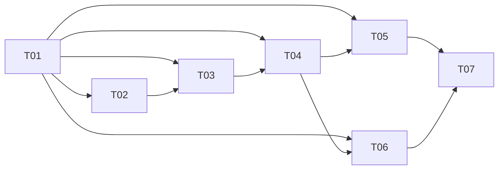

# Plan / 计划：后端三层职责审视与业务组织调整
最后修改时间: 2026-11-11 16:34:20

## Review status / 审查状态

Accepted

## Intent basis / 意图依据

- 总意图：[后端三层职责审视与业务组织调整](../intent/20261111-backend-responsibility-alignment.md)，已依据用户“开始拆分任务”接受并进入 Plan。
- 规划与实施基线：`03b45fd632f25d0a051dc0de76a4035b1035988a`。工作区存在独立 web 修改，不属于本计划；实现及开发检查证据见执行登记和 T07。
- 覆盖意图 R01—R08、A01—A10。目标是调整业务决策、完整用例和技术机制的实际归属，审视 application、domain、infrastructure，并核对必要的 interfaces/bootstrap 接线。
- 原候选资源节点包含可分别验收的房间/话题与成员生命周期，正式拆开；七个节点均只有一个主要交付结果，规则、用例、适配和必要测试随所属业务链路交付。

## Technical decisions / 技术设计与决策

### 分层与业务归属

| 范围 | 目标责任 | 约束与负责节点 |
| --- | --- | --- |
| `domain/rooms` | 聊天室协作业务值、资源/成员约束、接收人、上下文与位置、投递状态语义 | 保持单一紧密业务域；规则按责任组织，不按业务表强行建聚合；T02—T06 分别落实 |
| `application/rooms` | 房间与话题生命周期 | 收回仓储的业务初始化决策；不继续集中成员、发布和上下文主流程；T02 |
| `application/members` | 成员加入、编辑、退出、会话候选及状态观测 | 融合现有 `MemberSessions` 和 RoomService 的成员操作，保留 RPC 前后重查；T03 |
| `application/messages` | 发布、发布身份与幂等、引用校验、队列清理 | 从 RoomService 分出真实用例，Codex 清理仍先提交本地结果再执行外部动作；T04 |
| `application/context` | 提供上下文的完整流程、提供记录与位置更新的编排 | 内部以 `provide` 表达写入语义；公开 HTTP 路径及输入输出保持；T05 |
| `application/delivery` | 单次提交、受保护启动、接收核验与恢复动作的业务语义 | 业务状态与失败处理可独立审查；不承担锁、线程池或进程关闭；T06 |
| `infrastructure/persistence` | 映射、批量读取/投影、原子存储、事务与 SQLite 方言 | 不暴露 ORM/Session 给应用；不因搬移规则删除条件更新、DB 约束或数据库侧筛选 |
| `infrastructure/codex` | RPC、原始结构与身份校验、技能输入绑定、协议状态/异常转换 | 会话部分由 T03、投递部分由 T06 顺序修改，不按方法数再建立碎片模块 |
| `infrastructure/dispatch` | 锁、轮询、并发执行、停止与运行资源 | 业务动作交给应用；成员观测由 T03、投递运行由 T06 接通 |
| `interfaces` / `bootstrap` | 协议适配、provider、实现连接与生命周期 | 各业务节点接通自己的调用链；T07 核对组合，不能把业务迁移全部延迟至集成 |

目录名表达能力归属，具体公共类名和方法签名在 T01 的契约调查交付中固定。T01 是明确的设计节点，不修改产品代码；其输出需覆盖下列设计约束，后续节点取得主会话接受的契约版本后方可实施。涉及本表责任、依赖或验收变化时由主会话递增方案修订，不由执行者自行扩大范围。

### 规则、类型与抽象

- 领域规则决定合法状态、业务默认值和策略；应用读取事实并编排；基础设施翻译成 SQL 或协议动作。成员唯一性、投递身份和位置单调性仍有数据库最终保护。
- 保留有价值的 Pydantic 业务值。不整体复制 Domain/DTO/ORM 三套同义模型；视图特有字段和原始协议字段只有在语义不同且能说明实际消费者时才分离。camelCase 编码、`TopicPosition` 统计字段、回执事实及 `RoomChange` 分别由 T01 给出保留/调整/删除决定及理由。
- 不建设通用 CRUD、BaseService、命令总线或完整 CQRS。只读投影继续使用 Query/Reader 端口，内部 loader 只对持久化实现可见；无业务编排的查询不增加转发 Service。
- `Store` 只有在提供事务作用域或独立短动作边界时才独立存在。`MemberContext(ContextRepository)`、`DeliveryStore(DeliveryRepository)` 等重复 Protocol 由 T01 逐项说明保留角色或合并方式，不能只更名而保持责任不清。
- 不预设必须让所有仓储产生领域事件对象。事件必须显式、与事实同事务；未使用的 `RoomChange` 要么接入真实且必要的流程，要么移除，不能保留空概念。

### 事务与上下文提供

- 继续复用 `Database` / `SQLAlchemyTransaction` 的统一机制；请求中间件是请求写事务的唯一提交者，独立短作用域由其所有者提交。不按房间、成员或上下文目录增加专用 UoW。
- 用例通过中立作用域访问所需仓储/读取能力。同一作用域可绑定多个仓储；应用不取得 Session，也不调用 commit。现有 RoomStore 可逐步演进为明确的能力作用域，不为更名同时重写所有技术基础。
- 上下文提供在一个短写作用域内：读取有效成员/订阅 → 依据明确可见性在 SQL 中筛选及分页 → 应用确定实际提供结果 → 领域计算位置更新 → 仓储写提供记录、条件推进位置和事件 → 共同提交。越过分页的 lookahead 不记账，空结果不新建提供记录。
- 自己发布、实际 Delivery、当前有效订阅的三种可见性保持独立；human 接收人列表不等价于 Delivery。不能先取全量或一页数据后在 Python 中过滤权限。
- 成员 inspect/list、Codex 清队列、投递 RPC 和 WebSocket 等待不占用数据库事务；本地提交与远程结果不能伪装为可一起回滚。

### 兼容与渐进接线

- 保持当前 schema/head、公开字段/路径、时间与回执格式、排序、软删除、幂等、事件和资源所有权。以当前提交中的房间改名及 Topic 字段为基线，不恢复历史字段。
- 各节点完成自己业务范围的领域/应用/基础设施调整，并同步正式入口、调用者与测试；新能力接通后删除对应旧实现，不保留长期双路径或空兼容类。
- 尚未迁移的其他 RoomService 职责在所属节点处理前保留；T02 不越界一次性迁走成员和消息。T07 负责组合核验和剩余接线，不承担尚未实现的核心用例。

## Implementation steps / 实现步骤

1. T01 静态核对全部 R 项，交付可审查的三层职责表、类型/端口签名、事务调用示例和删除清单；主会话接受版本并同步必要方案修订。
2. T02 整理房间/话题生命周期与初始化规则，在原子保存和正式入口下闭环。
3. T03 统一成员生命周期与观测策略，顺序调整会话适配、短事务与 presence 接线。
4. T04 建立消息用例和队列管理，固定消息读取及投递身份边界，供上下文与投递消费。
5. T05 调整上下文提供；T06 调整投递链路。二者逻辑上无相互产物依赖，但共享工作区默认先 T05 后 T06。
6. T07 核对全部有效交付、正式装配、架构对应和完整开发检查，形成整体 Verification 的输入；不自动进入整体 Verification。

## Files to change / 需修改文件

| 节点 | 主要区域及预计新增 | 配套修改与共享约束 |
| --- | --- | --- |
| T01 | 本节点 task 的设计交付章节 | 只读源码与测试；方案变化由主会话更新总计划，不写产品代码 |
| T02 | `domain/rooms/{models,state,rules}.py` 的房间/话题部分；`application/rooms/{service,contracts,ports}.py`；资源仓储及读取 | 房间/话题 HTTP 接线、`tests/fakes/rooms.py` 和对应资源测试；共享资源契约后续顺序演进 |
| T03 | `application/members/{service,sessions}.py` 及预计 `contracts.py`、`ports.py`；成员规则、资源仓储观测部分 | RoomService 成员方法、HTTP 成员 provider/路由、Codex 会话方法、presence runner/工厂及成员测试 |
| T04 | 预计 `application/messages/{service,contracts,ports}.py`；消息规则、仓储、消息与组合查询 | 移除 RoomService 对应方法和旧 DTO 定义，迁移调用方、消息/队列 HTTP provider、夹具及消息测试 |
| T05 | 预计 `application/context/{service,contracts,ports}.py`；领域上下文/位置规则；上下文仓储与短作用域适配 | 删除或合并旧 `application/members/context.py` 及 `MemberContext` 空抽象；成员路由/provider 与上下文测试 |
| T06 | `application/delivery/{service,ports}.py`；领域投递规则；delivery 仓储与短动作适配；Codex 投递和 dispatch | driver 共享部分建立在 T03 交付上，消费 T04 固定的身份/队列契约；投递测试与 fake 同步 |
| T07 | `bootstrap/http.py`、相关 provider/能力工厂、`docs/design/backend-architecture.md` 和必要集成测试/夹具 | 只处理组合与遗漏；新核心职责或共享契约变更回到主会话评估，不接管独立 design/web 工作 |

上述为预期责任区域，不是任意重写整文件的许可。`models.py`、`rules.py`、rooms contracts/ports/service、Codex driver、HTTP rooms routes/provider、公共 fake/fixture 都是共享文件；执行者只修改本节点责任，交付时明确实际文件与偏差。

## Tasks and coordination / 子任务与协调

### Coordination / 协调信息

- 方案修订：1。
- 权威协调根：`D:/SourceCodes/mywork/agent-relay`；权威总计划为本文件。
- 仲裁会话：当前主会话，唯一维护任务定义、授权、分配、执行登记与交付审查。
- 阶段授权：用户随后要求“自行推进实施，避免沟通成本”，据此接受本计划及全部 task 方案，授权主会话依赖序自主完成 T01—T07 Implementation 与必要开发检查。不包含 Git 写入、真实环境操作或自动进入整体 Verification。
- 执行与通信：由主会话直接串行实施，不启动副手或其他会话。按实际前置接受后逐项登记编号、接收、检查和交付，不反复请求确认；必要结论在当前会话克制同步，不向聊天室自动发布。
- 协议入口：`C:/Users/wangm25/.codex/plugins/cache/specflow-local/specflow/0.2.1/skills/specflow/SKILL.md` 及其 `references/task-coordination.md`。执行者只写其 task 的接收、进展、交付章节及最后修改时间；T01 另可写本文约定的 task“设计交付补充”章节。方案正文由主会话维护。

### Task definitions / 任务定义表

本表是执行依赖的唯一来源。依赖版本均须为主会话已接受且可访问的当前有效交付；过时快照或仅方案 Accepted 不满足条件。

| ID | 任务文档 | 直接前置任务与要求 | 预期交付与验收 | 意图验收归属 |
| --- | --- | --- | --- | --- |
| T01 | [三层审视与契约基线](../task/20261111-backend-responsibility-alignment/T01-responsibility-contracts.md) | 无；以派发时核实的当前提交和实际工作区调查 | R01—R08 决策表、目标调用链及类型/端口契约、每项保留/迁移/删除理由；不改产品，不以悬空问题放行 | A01、A02、A04、A07、A10 的设计基础 |
| T02 | [房间与话题生命周期](../task/20261111-backend-responsibility-alignment/T02-room-topic-lifecycle.md) | T01：已接受的资源类型、初始化、事件及统一作用域契约版本 | 房间/话题规则与用例闭环；仓储不决定固定用户/默认话题；原子写入及入口/测试保持 | A02—A04、A07—A09；R01、R03—R06、R08 的资源部分 |
| T03 | [成员生命周期与观测](../task/20261111-backend-responsibility-alignment/T03-member-lifecycle.md) | T01：已接受的成员/会话/观测契约；T02：已接受、可运行的资源和初始化实现 | 成员加入/编辑/退出/观测有统一责任；策略与 SQL 条件分离，RPC 分段、会话协议及 presence 接线完整 | A02—A04、A06—A09；R01、R03、R05—R08 的成员部分 |
| T04 | [消息发布与队列管理](../task/20261111-backend-responsibility-alignment/T04-message-use-cases.md) | T01：已接受的消息/查询/状态契约；T03：已接受的发布成员、绑定和资源能力实现 | 消息用例、只读投影及队列清理边界；身份/幂等/序号/回执及事件原子性不退化；正式入口迁移 | A02—A09；R01、R03、R05、R06、R08 的消息部分 |
| T05 | [上下文提供](../task/20261111-backend-responsibility-alignment/T05-context-provision.md) | T01：已接受的提供流程、可见性及记账契约；T04：已接受的消息值和数据库侧读取实现 | 应用组织提供流程，领域明确规则，仓储原子记账与位置推进；视图查询不写入，提供路径不残留整用例仓储 | A02—A05、A07—A09；R02—R04、R06、R08 的上下文部分 |
| T06 | [投递与运行边界](../task/20261111-backend-responsibility-alignment/T06-delivery-boundaries.md) | T01：已接受的状态/协议/运行责任契约；T04：已接受的投递身份、队列和清空实现（含其前置会话适配版本） | 领域状态、应用动作、SQL 竞争保护、Codex 协议和 runner 职责闭环；未知不重发及生命周期保持 | A02—A04、A06—A09；R03—R08 的投递部分 |
| T07 | [集成与职责核验](../task/20261111-backend-responsibility-alignment/T07-integration.md) | T05、T06：均为已接受的当前有效实现及局部检查；其传递前置版本与最终工作区一致 | 正式接线、旧路径清理、R01—R08 结果、架构说明与完整开发检查；全部 A 项有集成证据 | A01—A10 |

### Execution registry / 执行登记表

| ID | 执行状态 | 执行者 | 分配编号 | 工作基线 / 交付位置 | 仲裁结论 / 当前阻塞 |
| --- | --- | --- | --- | --- | --- |
| T01 | accepted | 主会话 | ALIGN-T01-20261111-01 | ALIGN-contracts-v1.1 | 静态审查覆盖 R01—R08；v1.1 去除可见性 scope 已携带的冗余 member 参数 |
| T02 | accepted | 主会话 | ALIGN-T02-20261111-01 | ALIGN-resources-v1；HEAD 03b45fd 的工作区差异 | 9 unit + 77 定向 integration 通过；初始化事实与资源规则审查通过 |
| T03 | accepted | 主会话 | ALIGN-T03-20261111-01 | ALIGN-members-v1；当前工作区 | 5 unit、83 integration、mypy127 通过；成员/观测及协议边界审查通过 |
| T04 | accepted | 主会话 | ALIGN-T04-20261111-01 | ALIGN-messages-v1；当前工作区 | 11 unit、181 integration 通过；子进程夹具问题修复后 room_store 8 通过；mypy132 通过 |
| T05 | accepted | 主会话 | ALIGN-T05-20261111-01 | ALIGN-context-v1；当前工作区 | 80 定向 integration、12 组合 unit、mypy140 通过；统一作用域与原子提供审查通过 |
| T06 | accepted | 主会话 | ALIGN-T06-20261111-01 | ALIGN-delivery-v1；当前工作区 | 102 定向 integration 通过；状态/协议/runner 职责核对，新增纯规则随集成检查 |
| T07 | accepted | 主会话 | ALIGN-T07-20261111-01 | ALIGN-integrated-v1；当前工作区 | 47 unit、488 全后端、mypy/Ruff/依赖方向检查通过；文档和正式接线审查通过 |

只有主会话按实际记录更新执行状态。接受方案时同步接受 task 方案，不将执行登记直接改为 accepted；每次派发、接收、提交、返工和接受均保留时间、编号和证据。上游版本改变时先复核受影响下游，不凭旧 accepted 结果放行。

### DAG and parallelism / DAG 与并行安排

- 合法执行顺序：T01 → T02 → T03 → T04 → T05 → T06 → T07。前四节点逐步固定契约及资源/身份事实；T05 与 T06 是无相互依赖的两个分支。
- 当前共享工作区默认按上述顺序串行。即使 T05/T06 依赖满足，仍可能同时触及模型、端口、provider、夹具；未协调隔离与集成责任前不得同时写入。
- 如以后需要并行，先确认冻结契约、互斥文件、隔离目录及集成所有者；改变任务边界或依赖须修订方案。当前不创建 worktree、分支或其他执行会话。
- 派发前核对方案、阶段、唯一分配、已接受且可访问的前置、检查结果和共享写入；T01 的设计交付还需明确后续节点实际签名，不留下阻塞性占位决定。

### Assignment history / 分配历史

2026-11-11 15:24:29 完成拆分时七项均为 unassigned；未沿用前一 SQLAlchemy 任务的分配或实施授权。后续授权和当前状态如下及上方登记。

- 2026-11-11：用户授权主会话自主实施；接受全部方案，为主会话分配 T01，编号 ALIGN-T01-20261111-01，实际 HEAD 03b45fd632f25d0a051dc0de76a4035b1035988a，独立 web 修改保留。接收已记录；后续节点在接受前置后串行登记。
- 2026-11-11：依赖就绪后主会话串行接收 T02—T07，编号 ALIGN-T02—T07-20261111-01；T05 对上下文读取签名做无业务边界变化的 v1.1 补正。每节点的输入、检查、交付及审查记录见对应 task。

## Verification plan / 验证计划

- 本轮 Plan：核对文档引用、ID 唯一、DAG 无环、表图一致、验收归属、每节点责任及共享修改说明；不运行产品测试、lint、类型检查或数据库操作。
- T01：静态核对 R01—R08 的实际源码与消费者，给出保留/迁移/合并/删除理由及下游可用签名；无产品变更时产品检查注明不适用。
- T02—T06：局部 task 列出相关现有测试入口；新增用例规则须在纯业务测试中验证决策与失败路径，DB 条件、竞争/回滚和协议转换由对应 integration 验证。不增加只复述代码结构的测试。
- T07：`uv run --locked pytest tests/unit -q`；`uv run --locked pytest -o addopts=-ra tests -q`；`uv run --locked mypy src tests`；`uv run --locked mypy migrations`；`uv run --locked ruff check .`；`uv run --locked ruff format --check .`；暂存/未暂存 `git diff --check`。按届时最新授权执行并记录实际版本、结果和未运行原因，不预填通过。
- 前端未列入改动范围，不为本任务强制运行会受独立工作影响的整仓 `make test/check`；如果公开契约被迫调整，则重新评估范围与消费方检查。
- 集成核对应用/领域无具体基础设施或协议导入，追踪代表调用链：创建房间、成员绑定、消息发布、上下文提供、领取/清空竞争、未知结果、WebSocket 等待与关闭。
- 交付版本可为可访问工作区或已授权的提交。记录实际改动和检查结果，保留无关修改及原暂存状态；节点完成不自动等于整体验收。

## Risks / blockers / assumptions / 风险 / 阻塞项 / 假设

- 当前没有阻止方案编写的需求问题。类型与事件、作用域接口等设计未知项明确由 T01 交付解决，属于真实前置，后续不能绕过接受条件开工。
- T01 若证明目标目录或切分不成立，应由主会话先更新本计划和对应 task；不能要求执行者遵守已被事实推翻的设计，也不能隐式扩大下游。
- 上下文授权后分页、回执条件和队列清空关联紧密；必须保持 SQL 最终保护，不能通过 Python 预检查替代数据库竞争条件。
- 资源/成员分拆与协议/运行边界可能引发共享模型和夹具连续演进，默认串行并在派发前核对实际前置版本。
- 本计划以保持当前业务与 schema 为约束；发现行为缺陷时单独说明，不把修复悄悄混入目录和职责变更。
- 不操作正在使用的开发数据库、服务或真实 Codex 会话；未来必要集成检查使用临时库与模拟协议环境，遵守届时用户要求。

## Rollback / recovery / 回滚 / 恢复

- 以各已接受交付的文件清单和前置版本追踪改动，接线与所属节点同步完成；失败时先定位并修正本节点，不自动恢复整仓或覆盖他人变更。
- 不改 schema 或历史数据，因此无需设计真实数据回填/降级操作；不建立长期旧/新实现并行开关。
- 如确需撤回某节点，主会话核对文件归属和依赖影响后安排精确恢复，重审受影响下游；不使用 reset、clean 或删除工作区来代替恢复方案。

## User review notes / 用户审查记录

- 2026-11-11：用户要求记录任务，明确应用、领域和基础设施均需审视。
- 2026-11-11 15:24:29：用户要求“开始拆分任务”；接受意图，完成方案修订 1 和七个 Draft task。当前仅规划，没有产品实施、测试、执行分配或 Git 写入。
- 2026-11-11 15:32:56：完成文档一致性核对：9 份过程文档、26 个相对引用、7 个唯一任务、11 条依赖边，任务表与 DAG 一致且无环，A01—A10 均有归属，执行登记均为 unassigned；未运行产品检查，src/tests/migrations 无本轮差异。
- 2026-11-11：按用户自主实施授权完成各节点与组合开发检查；实际测试、类型、格式、依赖方向和版本清单见 T07，整体 Verification 尚未启动。
- 2026-11-11 16:30:47：用户要求完成整体 Verification，已复跑完整后端并形成[验证报告](../verification/20261111-backend-responsibility-alignment.md)；报告待用户审阅。
