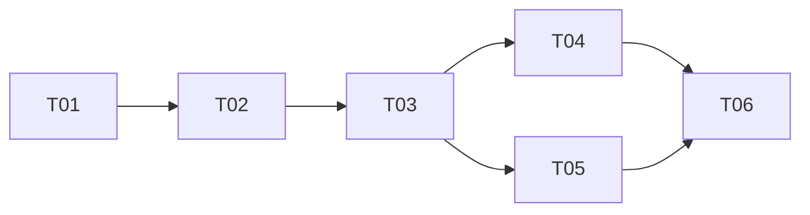

# Plan / 计划：SQLAlchemy 与 Repository 数据访问重构
最后修改时间: 2026-11-11 15:00:42

## Review status / 审查状态

Accepted

## Intent basis / 意图依据

- 依据[意图 A01—A12](../intent/20261111-sqlalchemy-repositories.md)。用户要求开始推进实现，计划及其覆盖的任务方案已接受，进入 Implementation。
- 记录基线：`be8accd90d4ae24a8aa9b8b225d8e77f8d709e96`；已有独立未暂存文件 `docs/design/codex-integration-capabilities.md`，不读取其差异或修改它。
- 延续[项目架构说明](../design/backend-architecture.md)的依赖方向、显式事件和请求事务切面。历史架构 task 仅作事实背景，不继承其中的数据库、服务或 Git 操作授权。

## Technical decisions / 技术设计与决策

### 1. 技术与兼容边界

- 使用已有 SQLAlchemy `>=2.0,<2.1` 和 Alembic 依赖，保持同步访问。ORM 使用 DeclarativeBase、Mapped 和 mapped_column，运行时查询/批量写入使用 2.x select/insert/update/delete 表达式。
- 默认数据库仍是现有 database.path 指定的 SQLite 文件；Engine URL 在持久化工厂由路径构造，首版不增加 URL/密码等未使用配置。
- 保持当前 `queue_deleted_20261110` 的 14 张表、列、复合键、索引、CHECK 和 SQL-first Alembic 链。ORM 是访问映射，不是建库入口；不调用 create_all，不重写历史 revision，不升级不在当前链上的旧库。
- 首版保留 SQLite 的 rowid 顺序，在方言模块提供固定列引用供资源、投递及关联装配使用。显式排序字段、跨数据库序号分配和其他数据库迁移留在后续任务。

### 2. 仓储与查询契约

| 位置 / 类型 | 职责与边界 |
| --- | --- |
| application/rooms/ports.py 的 RoomRepository | 房间、话题、成员、会话、订阅和观测事实读写，保留资源差异保存，返回现有业务值 |
| 同文件的 MessageRepository | 发布查找、序号、消息与路由关联、按消息范围清空及保存回执目标选择；一次写入覆盖相关表和事件 |
| 统一事务作用域 | 同一请求或用例的仓储借用同一 Session；由入口或短作用域统一收尾，不新增按模块划分的 UoW 或提交边界 |
| 现有 RoomQueries | 保留组合视图、分页、队列、统计和事件契约；SQLAlchemy 查询实现可绑定当前写 Session，也可通过工厂短读 |
| application/delivery/ports.py 的 DeliveryRepository | 领取、回执、启动尝试、备注、接收核验等条件持久化；既有 DeliveryStore 继续作为单次短动作契约 |
| application/members/context.py 的 ContextRepository | 上下文选择、提供记录和位置写入；既有 MemberContext 继续作为原子查阅能力契约 |

- T01 定义能力仓储契约及统一事务基础，不新增 `RoomUnitOfWork` 或 `RoomUnitOfWorkFactory`。RoomService/MemberSessions 使用不暴露 Session 的现有中立端口；跨仓储协作由装配层绑定同一请求或用例的事务，应用不调用 commit。DeliveryStore 和 MemberContext 的 SQLAlchemy 适配在内部使用短事务，不增加只转发的应用服务。
- 运行时 SQLAlchemy 实现位于 infrastructure/persistence；应用/领域不导入 ORM、Session 或 SQL 表达式。仓储按能力划分，不按 14 张表创建 14 套仓储和 Service。
- RoomState 差异仍由业务值比较表达，仓储将差异映射为 ORM/批量写入；不让业务对象依赖 ORM dirty tracking。
- metadata、snapshot、消息关系等使用专用投影和批量加载，结果在会话内转换为现有 DTO，禁止依靠响应序列化触发懒加载。

### 3. 事务切面与生命周期

- SqlAlchemyDatabase 拥有 Engine 和 sessionmaker；bootstrap 创建并在 runner 关闭后 dispose。派生的读写连接策略共享资源工厂，不保存全局可变 Session。
- 继续使用 RequestTransactionMiddleware 和中立的 RequestTransaction.finish 契约。SqlAlchemyTransaction 惰性创建写 Session；同一请求的所有仓储借用该 Session，只有中间件在响应开始前统一提交/回滚并关闭。
- provider 只绑定请求作用域，不 begin/commit；Repository 可在需要约束检查或结果读取前 flush，但不 commit/rollback/close 借入的 Session。提交失败必须在成功响应发送前进入既有错误处理。
- 请求首次写入前的 read 作用域取得独立短读 Session，结束即关闭；写事务已开启后，同请求后续读写使用同一 Session。单个 read 作用域内的组合读取共享快照，不将 Session 的隐式 autobegin 延续到外部等待。
- 后台 DeliveryStore 每个原子方法自行取得独立短作用域，仓储借用其中 Session；领取提交后才 enqueue，回执保存后才尝试外部启动，输入读取后再短写确认。
- MemberSessions.add 保持短读、外部 inspect、短写重验；状态刷新先完成 RPC 再逐房间短写。clear_queue_with_codex 使用独立短写完成清理并取得回执，提交后才外部 delete，保留部分成功/未知结果。
- WebSocket 每次补取使用短读 Session，send/receive/等待期间不持有会话。进程对象只保存 Engine/工厂，不保存请求 Session。
- 不用线程局部 scoped_session 绑定 FastAPI 请求。当前同步路由与中间件收尾允许顺序切换 worker，Session 必须始终串行使用；SQLite 连接线程设置、请求取消和重复 finish 由 T01 的实际回归证明。并行任务分别取会话。

### 4. SQLite 策略与映射

- 连接事件集中配置 foreign_keys、busy_timeout 和显式事务控制。读作用域使用 BEGIN；写作用域在任何序号/幂等检查前使用 BEGIN IMMEDIATE，保持现有并发保障。读写模式在首次 SQL 前确定，不能在 autobegin 后补写 BEGIN。
- BEGIN/PRAGMA 和 rowid 固定表达式只允许出现在专用 sqlite.py 方言模块；其他运行时 CRUD 不使用 raw SQL 或将原语句整体包进 text()。历史迁移 SQL 不受运行时表达式限制。
- 时间列使用兼容现有 ISO 文本的类型映射，保留时区、精度和空值；不直接用 SQLite 的普通 DateTime 替换后假设时区保持。JSON 回执仅保存额外 metadata，标识仍由原列重建并验证一致。
- 关键词使用保持现有字面子串与大小写语义的表达式；若保留 SQLite instr，函数构造集中在方言边界。不能直接换为未转义 LIKE，改变 `%`、`_` 或大小写行为。
- 状态观察的时间窗口比较使用保持已有时间语义的表达式；必要的 SQLite 函数集中隔离，不扩散到应用。
- sessionmaker 采用显式 flush 策略；仓储在依赖数据库可见性、约束或事件 ID 前 flush。批量条件更新后不得使用 identity map 中的旧状态生成响应。
- 已知唯一约束冲突按业务语义转换为现有冲突错误；其他 SQLAlchemy 异常沿用现有脱敏错误路径并回滚，不依赖解析驱动英文错误文本判断业务结果。

### 5. 关键不变量

- 发布幂等查询、MAX(seq)+1 和消息/路由/投递/事件插入在同一写作用域；不使用 SQLite 不支持的 FOR UPDATE 代替写锁。
- 投递领取和回执更新保留 status、deleted_at、client_message_id、会话绑定及 activation_attempted_at 条件；根据实际更新结果写事件，清空后的记录不能被迟到结果复活。
- message 级清空与 delivery 级后台更新共用表映射和筛选构造，职责不同但条件保持一致；clear_codex 仍只按保存回执操作，数据库事务不覆盖外部 RPC。
- 上下文实际结果、提供记录、位置和事件同事务；位置只向更大 seq 推进。订阅可见性与历史实际路由按原有不同契约实现，不混为一种全局过滤。
- 不启用会自动过滤所有 deleted_at 的全局 ORM 策略，避免隐藏必须保留的历史投递与消息事实。

## Implementation steps / 实现步骤

1. T01 交付共享映射、仓储契约、Session/事务作用域及 SQLite 策略，以隔离的临时数据库验证基础，不切换生产装配。
2. T02 交付房间资源 Repository 及资源读取，验证资源/订阅/观测/事件的原子性和约束。
3. T03 交付消息 Repository、共享筛选/批量装配和 RoomQueries，验证序号、幂等、分页、队列及事件读取。
4. T04/T05 分别完成后台投递和成员上下文适配；使用已接受的共享消息读取，不重复实现消息关系装配。
5. T06 统一切换应用/provider/bootstrap/runner/fixture，删除旧 sqlite3 运行时实现及失效导入，执行完整开发回归并更新架构说明。
6. 实现交付审查完成后按用户届时授权进入整体 Verification；开发检查和 task accepted 不自动表示整体验收通过。

## Files to change / 需修改文件

- T01：application/rooms/ports.py、application/delivery/ports.py、application/members/context.py；新增 persistence/database.py、models.py、types.py、mappers.py、sqlite.py，演进 transaction.py；新增针对性集成测试。共享契约与映射由 T01 单一维护。
- T02：新增 persistence/repositories/rooms.py 与 resource_queries.py；保留现有单元业务值，新增或适配资源仓储集成测试。
- T03：新增 persistence/repositories/messages.py、message_queries.py、room_queries.py；复用 T02 资源查询；适配消息/队列/事件测试。
- T04：新增 persistence/repositories/deliveries.py、delivery_store.py；使用既有投递端口，适配投递与条件竞争测试。
- T05：新增 persistence/repositories/context.py、member_context.py；保留领域位置函数，适配查阅与并发位置测试。
- T06：RoomService、MemberSessions、HTTP persistence/rooms/members provider、bootstrap/http.py、persistence/dependencies.py、dispatch/dependencies.py、必要的应用测试替身与 tests/room_fixtures.py；更新 subprocess 消费方和相关集成测试。
- 旧 persistence/store.py、rooms.py、queries.py、context.py、positions.py、records.py 中已被替代的代码由 T06 删除或收敛；不留下两套可选择的正式运行时实现或旧内部路径兼容代理。
- 文档：本功能记录、docs/design/backend-architecture.md；如实际使用说明变化，仅更新 README/migrations README 的对应说明。pyproject/uv.lock 仅在发现现有依赖无法满足既定方案时由主会话调整，不预设升级。
- 新文件名是本版责任划分；必要的改名由主会话统一记录，不能由并行执行者各自创建重复模型/工厂。

## Tasks and coordination / 子任务与协调

### Coordination / 协调信息

- 方案修订：2；移除房间专用 UoW 契约，统一请求或用例事务边界，任务依赖不变。
- 权威协调根：`D:/SourceCodes/mywork/agent-relay`。
- 仲裁会话：当前主会话，唯一维护总计划定义、分配和交付审查。
- 阶段授权：2026-11-11 用户要求“已加入 高级开发 作为副手，开始推进实现，实现过程通信保持克制”，授权 Implementation；随后要求“进入验证，无须再跑测试”，授权整体 Verification，沿用既有测试证据，不重新运行测试。不含真实环境操作或 Git 写入。主会话维护总计划和方案状态；执行者仅在其 task 的接收、进展和交付章节写入过程记录。
- 协议入口：本次 SpecFlow skill 及其 references/task-coordination.md；每份 task 链接权威计划并指定本文件的接收/进展/交付章节。
- 用户已安排“高级开发”作为副手；通过 Agent Relay 定向交接，按任务依赖逐项审查与分配。

### Task definitions / 任务定义表

| ID | 任务文档 | 直接前置任务与要求 | 预期交付与验收 | 意图验收归属 |
| --- | --- | --- | --- | --- |
| T01 | [映射与事务基础](../task/20261111-sqlalchemy-repositories/T01-foundation.md) | 无；实施前核对实际 HEAD、当前 schema 和共享文件归属 | 类型化模型、契约、工厂和事务实现；临时库及请求收尾检查通过，交付版本经主会话接受 | A01、A02、A03、A04、A05、A10、A11 |
| T02 | [房间资源仓储](../task/20261111-sqlalchemy-repositories/T02-room-resources.md) | T01：模型、房间契约、事务/映射已接受且版本可访问 | 资源读写、约束、观察检查点与同事务事件可用；给出资源读取调用入口 | A02、A05、A06、A07 |
| T03 | [消息与查询](../task/20261111-sqlalchemy-repositories/T03-messages-queries.md) | T02：资源 Repository/读取已接受且版本可访问，包含其冻结的 T01 基础 | 发布、序号、消息范围、队列、批量装配和 RoomQueries；共享消息查询接口与回归证据已接受 | A02、A05、A06、A07、A08、A10 |
| T04 | [投递仓储](../task/20261111-sqlalchemy-repositories/T04-deliveries.md) | T03：共享消息装配/筛选及其资源基础已接受且版本可访问 | 条件领取、回执、启动和接收短动作实现，清空竞争及 RPC 分段检查通过 | A04、A07、A08、A11 |
| T05 | [成员上下文](../task/20261111-sqlalchemy-repositories/T05-member-context.md) | T03：共享消息装配/筛选及其资源基础已接受且版本可访问 | 可见性、提供记录和位置复合事务实现，双向分页与并发单调性检查通过 | A04、A07、A09 |
| T06 | [集成切换与开发回归](../task/20261111-sqlalchemy-repositories/T06-integration.md) | T04、T05：有效交付均经接受且可集成，包含全部上游版本；共享文件改动已协调 | 应用/入口/后台全部使用新实现，旧 sqlite3 产品依赖移除；完整开发证据及文档准确 | A01、A02、A03、A04、A05、A06、A07、A08、A09、A10、A11、A12 |

### Execution registry / 执行登记表

| ID | 执行状态 | 执行者 | 分配编号 | 工作基线 / 交付位置 | 仲裁结论 / 当前阻塞 |
| --- | --- | --- | --- | --- | --- |
| T01 | accepted | 高级开发 | T01-20261111-01 | T01-workspace-v2；集成后清单 SHA256 da36ac0bae8c5c33fc49f79d1d303ce4a4f1529fe5898d62122e982a836f4240 | 审查通过，集成演进见 T06 和验证记录 |
| T02 | accepted | 高级开发 | T02-20261111-01 | T02-workspace-v1；集成后清单 SHA256 58fd2acc2a6b151ccd989d5ed69af7c164d1fc097ba31767b87b9ebebeb7b56f | 审查通过，集成演进见 T06 和验证记录 |
| T03 | accepted | 高级开发 | T03-20261111-01 | T03-workspace-v1，清单 SHA256 9afcc7396062619de5ece2cec190cc8b65252e4d639f73b4e42ec5acf69de7ae；共享工作区 | 审查通过，见分配历史 |
| T04 | accepted | 高级开发 | T04-20261111-01 | T04-workspace-v1，清单 SHA256 5a3c031a54bc2a3add8882aec01d0510bc0afb4c20a48955a9984e48149999e5；共享工作区 | 审查通过，见分配历史 |
| T05 | accepted | 高级开发 | T05-20261111-01 | T05-workspace-v1，清单 SHA256 40b9e09f30cdc50787a2bacbf7f49b490d3f523c5f63344da35112c44eabb25a；共享工作区 | 审查通过，见分配历史 |
| T06 | accepted | 高级开发 | T06-20261111-01 | T06-workspace-v1，清单 SHA256 83d18308ac286111379e4ae8aa653acfdb0664fb0ddc685258f380b49755c6aa；组合清单 SHA256 18f64536138a34f360a4554bc5a96db26623f813641c07a7df4c6d83d0c12edb | 集成交付审查通过；整体 Verification 结果见验证记录 |

### DAG and parallelism / DAG 与并行安排

下图仅为任务定义表的视图。



合法批次：T01、T02、T03、T04/T05、T06。默认串行执行；T04/T05 仅在实际文件隔离且用户安排执行者时才可并行，同一个工作树不因图上无依赖就并行写入。

- T01 独占 ports/models/types/mappers/sqlite/transaction；下游需要改变契约时回报主会话修订，不能同时修改基础定义。
- 共享 tests/room_fixtures.py、tests/fakes、bootstrap、provider、旧实现移除和最终文档由 T06 统一维护。局部任务通过新适配器的专用 fixture 验证，不能提前全局替换公共夹具。
- T02/T03 的混合存储测试文件有共享区，按依赖串行合并。T04/T05 如需改同一个 delivery/context/query fixture，仍串行。
- 集成与总体验收负责人为当前主会话；派发前核对实际版本、检查结果及前置接受记录，上游变化后重审受影响下游。

### Assignment history / 分配历史

- 2026-11-11 12:48:29：T01，编号 `T01-20261111-01`，分配给高级开发；用户授权开始实现并指定副手，方案修订 1，HEAD `be8accd90d4ae24a8aa9b8b225d8e77f8d709e96`，无前置任务。代码工作区及权威协调根均为 `D:/SourceCodes/mywork/agent-relay`；执行者可写 T01 task 的接收、进展及交付章节和最后修改时间。保留独立修改 `docs/design/codex-integration-capabilities.md`，不读取其差异或修改它。
- 2026-11-11 12:52:37：核对 T01 接收记录及有效编号，执行状态更新为 running。
- 2026-11-11 13:01:37：用户提出模块专用 UoW 与跨模块协作的疑虑，经协调将方案修订为 2，撤销新增房间专用 UoW 契约；T01 保留现有有效编号继续，执行者同步其 task 和实现。T02—T06 尚未分配，后续以修订 2 和 T01 接受版本为准。
- 2026-11-11 13:04:42：收到 T01-workspace-v1 交付及检查记录，登记为 submitted；交付版本与行为待主会话审查。
- 2026-11-11 13:05:35：复核交付清单 SHA256 一致，定向检查 26 passed；发现 `sqlite.time_before` 使用严格小于，旧观察检查点使用小于等于，边界相等时语义不同。退回 T01 按原编号修复并补充等值及时间偏移回归，暂不放行 T02。
- 2026-11-11 13:09:07：收到 T01-workspace-v2 完整返工记录，登记 submitted 并审查：清单 SHA256 与记录一致，检查 `time_at_or_before` 含等号及跨时区测试，独立运行 `uv run --locked pytest -o addopts=-ra tests/integration/test_sqlalchemy_foundation.py tests/integration/test_request_transaction.py tests/unit/test_persistence_records.py -q` 结果 34 passed。结合模型、事务及局部检查证据接受 T01-workspace-v2；不代表系统整体迁移或 Verification 完成。
- 2026-11-11 13:09:07：T02，编号 `T02-20261111-01`，分配给高级开发；方案修订 2，已接受前置 T01-workspace-v2，HEAD `be8accd90d4ae24a8aa9b8b225d8e77f8d709e96`，代码工作区和权威协调根均为 `D:/SourceCodes/mywork/agent-relay`。执行者可写 T02 task 的接收、进展及交付章节和最后修改时间；T01 基础与公共夹具保持冻结，变更需求先回报协调。
- 2026-11-11 13:10:53：核对 T02 接收记录、有效编号和前置哈希，执行状态更新为 running。
- 2026-11-11 13:21:59：收到 T02-workspace-v1 交付及检查记录，登记为 submitted；交付版本与行为待主会话审查。
- 2026-11-11 13:23:44：复核 T01 和 T02 清单 SHA256 均与交付记录一致，对照原资源读取、写入及位置语义并检查事务与软删除处理；独立运行 T02 记录中的完整定向命令，90 passed。接受 T02-workspace-v1，正式装配和完整回归仍待 T06。
- 2026-11-11 13:23:44：T03，编号 `T03-20261111-01`，分配给高级开发；方案修订 2，前置为已接受 T01-workspace-v2 与 T02-workspace-v1，HEAD `be8accd90d4ae24a8aa9b8b225d8e77f8d709e96`，代码工作区和权威协调根均为 `D:/SourceCodes/mywork/agent-relay`。执行者可写 T03 task 的接收、进展及交付章节和最后修改时间；T01/T02 基础与公共夹具保持冻结，变更需求先回报协调。保留独立 design 和 web 修改。
- 2026-11-11 13:25:59：核对 T03 接收记录、有效编号和前置哈希，执行状态更新为 running。
- 2026-11-11 13:42:51：收到 T03-workspace-v1 交付及检查记录，登记为 submitted；以工作区内容审查，不变更现有暂存区。
- 2026-11-11 13:44:04：复核 T01、T02 和 T03 工作区清单 SHA256 均与交付记录一致；对照原消息范围、队列清空、事件和查询语义，独立运行交付记录中的完整定向命令，168 passed。接受 T03-workspace-v1；保持现有暂存区不变，后台、上下文和整体装配仍待后续节点。
- 2026-11-11 13:44:04：T04，编号 `T04-20261111-01`，分配给高级开发；方案修订 2，前置为已接受 T01-workspace-v2、T02-workspace-v1 和 T03-workspace-v1，HEAD `be8accd90d4ae24a8aa9b8b225d8e77f8d709e96`，代码工作区和权威协调根均为 `D:/SourceCodes/mywork/agent-relay`。执行者可写 T04 task 的接收、进展及交付章节和最后修改时间；前置交付与公共夹具保持冻结，变更需求先回报协调。保留现有暂存区和独立 design/web 修改。
- 2026-11-11 13:46:22：核对 T04 接收记录、有效编号和前置哈希，执行状态更新为 running。
- 2026-11-11 13:55:59：收到 T04-workspace-v1 交付及检查记录，登记为 submitted；记录范围外 `tests/integration/test_room_api.py` 的全仓格式检查异常，未修改该文件。
- 2026-11-11 13:57:18：复核 T01—T04 工作区清单 SHA256 均与交付记录一致；对照原投递条件、事务和事件语义，独立运行交付记录中的定向命令，239 passed。当前工作区 `uv run --locked ruff format --check .` 已通过（188 files），未修改范围外文件。接受 T04-workspace-v1；整体装配和验收仍待后续节点。
- 2026-11-11 13:57:18：T05，编号 `T05-20261111-01`，分配给高级开发；方案修订 2，直接前置为已接受 T03-workspace-v1，工作区亦包含已接受 T01/T02/T04，HEAD `be8accd90d4ae24a8aa9b8b225d8e77f8d709e96`。代码工作区及权威协调根均为 `D:/SourceCodes/mywork/agent-relay`；执行者可写 T05 task 接收、进展及交付章节和最后修改时间，冻结已接受交付及公共夹具，变更需求先回报。保留暂存区和独立修改。
- 2026-11-11 13:58:59：核对 T05 接收记录、有效编号和前置哈希，执行状态更新为 running。
- 2026-11-11 14:13:54：收到 T05-workspace-v1 交付及检查记录，登记为 submitted；以工作区内容审查，不变更现有暂存区。
- 2026-11-11 14:16:01：复核 T01—T05 工作区清单 SHA256 均与交付记录一致；对照原上下文可见性、位置及查询记录语义，独立运行交付记录中的定向命令，307 passed。接受 T05-workspace-v1；整体装配和 Verification 仍未完成。
- 2026-11-11 14:16:01：T06，编号 `T06-20261111-01`，分配给高级开发；方案修订 2，直接前置 T04-workspace-v1 和 T05-workspace-v1 已接受，工作区同时包含已接受 T01—T03，HEAD `be8accd90d4ae24a8aa9b8b225d8e77f8d709e96`。代码工作区和权威协调根均为 `D:/SourceCodes/mywork/agent-relay`；执行者可写 T06 task 接收、进展及交付章节和最后修改时间，按 T06 范围集成并更新架构说明。现有 `application/rooms/service.py`、HTTP 路由与相关测试等含独立修改，实施前读取并融合，不回退或覆盖；保留暂存区、独立 design/web 修改及其他无关变更。共享改动无法安全合并时先回报协调。
- 2026-11-11 14:20:10：核对 T06 接收记录、有效编号和前置哈希，执行状态更新为 running。
- 2026-11-11 14:51:10：收到 T06-workspace-v1 交付及开发检查记录，登记为 submitted；以工作区内容审查，不变更现有暂存区。
- 2026-11-11 14:53:43：复核 T06 30 项清单和 T01—T06 去重后 53 项组合清单 SHA256 均与交付记录一致；审查请求/短事务装配、生命周期、锁路径及 RPC 边界。独立运行 `uv run --locked pytest -o addopts=-ra tests -q` 为 474 passed，`uv run --locked mypy src tests`、`uv run --locked mypy migrations`、`uv run --locked ruff check .`、`uv run --locked ruff format --check .` 及暂存/未暂存 diff 空白检查均通过。接受 T06-workspace-v1；T01 transaction/测试及 T03 局部夹具的集成后版本以 T06 记录为准。整体 Verification 尚未授权或执行。
- 2026-11-11 15:00:42：用户授权整体 Verification 且要求不再运行测试。核对 53 项组合哈希及四项背景文件哈希仍与开发检查时一致；更正 T06 记录中 T01/T02 集成后子清单误记，见 T06 与验证记录。独立 Topic 字段变更及其适配已包含在上述组合中，不视为本重构单独授权改变公开契约。

## Verification plan / 验证计划

- T01—T05 使用临时 SQLite 文件和现有 fake 驱动开发检查，不访问 data/ 下的真实数据库、运行服务或真实 Codex。
- T01 强化多仓储同事务、响应前提交、错误/提交失败回滚、惰性读取、取消清理、跨 worker 顺序收尾和当前 head 历史值往返。
- T02/T03 保留并发项目创建/成员绑定、消息序号与幂等、复合外键、资源回滚、关键词特殊字符、分页/队列/事件和无 N+1 的批量读取检查。
- T04/T05 保留回执关联、清空与迟到结果竞争、一次启动、unknown 不重发、位置并发最大值与提供记录原子性。外部 fake 在 RPC 时检查无数据库作用域占用。
- T06 执行下列现有工具入口；集成命令覆盖默认 addopts 中的 `-m 'not integration'`，避免漏掉显式 integration 标记的迁移测试。

```powershell
uv run --locked pytest tests/unit -q
uv run --locked pytest -o addopts=-ra tests/integration/test_request_transaction.py tests/integration/test_room_store.py tests/integration/test_room_queries.py tests/integration/test_member_sessions.py tests/integration/test_member_context.py tests/integration/test_delivery_service.py -q
uv run --locked pytest -o addopts=-ra tests -q
uv run --locked mypy src tests
uv run --locked mypy migrations
uv run --locked ruff check .
uv run --locked ruff format --check .
git diff --check
```

- 默认单元测试仍不建库、不启动 HTTP/协议进程；不为此次重构强加新的测试框架或前端检查。
- 源码 AST/导入检查确认 src 无直接 sqlite3 依赖，domain/application 无 SQLAlchemy；迁移 SQL 专用测试可继续直接检查 SQLite，明确为历史 DDL 验证例外。
- 约束与索引使用 Alembic 创建的临时库检查；已有数据兼容使用当前 head 的历史格式 fixture，不能只测试新 ORM 写入后的自读。
- 检查以最终工作区及有效前置版本为准，记录未执行原因，不沿用其他任务的历史通过数量。整体记录见[验证文档](../verification/20261111-sqlalchemy-repositories.md)。

## Risks / blockers / assumptions / 风险 / 阻塞项 / 假设

- 当前没有需要用户选择才能继续实施的已知未决事项。首版保留 SQLite/schema/同步访问。
- 最危险的替换是默认事务代替立即写锁、跨 RPC 的 autobegin、ORM 无条件回写覆盖软删除、全局软删除过滤隐藏历史、普通 DateTime 丢失时区；对应节点必须提供定向证据。
- 第一阶段会暂时保留未接线的新适配器和旧实现，T06 必须完成单一运行时切换；中间节点交付不能宣称系统已经整体迁移。
- 当前文件锁基于数据库文件路径，T06 必须保留相同路径身份；Session 池化不改变锁的业务范围或派发并发额度。
- 计划基线可能继续变化；实际派发时重新记录版本与独立修改，不覆盖其他会话成果。

## Rollback / recovery / 回滚 / 恢复

- 首版不改 schema 或历史数据格式，代码回退可继续读取相同 current-head 数据；回退方案不包含重建数据库或重置迁移 head。
- T06 切换前保留原装配可运行；切换交付需用完整回归确认后才移除旧实现。失败时修正本任务差异，不执行 stash/reset/rebase 或覆盖无关修改。
- 不把 ORM 回滚当作撤销 Codex 外部动作；外部未知结果沿原策略报告，不因回退代码重放消息。

## User review notes / 用户审查记录

- 2026-11-11：按用户“记录任务，开始计划”创建本方案修订 1 和六个 Draft task。意图 Accepted，全部执行登记为 unassigned，未进行产品实施或动态检查。
- 2026-11-11：用户安排高级开发作为副手并要求开始推进实现；接受本计划及其六个 task 方案，进入 Implementation。
- 2026-11-11：针对用户提出的跨模块事务疑虑，将方案修订为 2，采用统一请求或用例事务，不引入房间专用 UoW。
