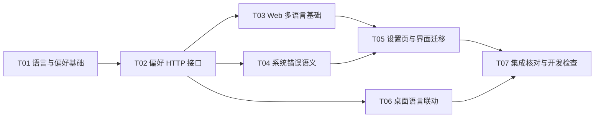

# Plan / 计划：中英多语言与用户偏好设置
最后修改时间: 2026-11-13 10:07:54

## Review status / 审查状态

Accepted

方案修订 4。用户委托独立会话实施，接收会话核对意图、任务定义、依赖和现有测试方式后接受方案及七份 task；不代表实现交付已接受。修订 2 适配现有 Node 单元测试边界；修订 3 调整设置页呈现；修订 4 按用户最新要求改为右上角菜单切换语言、关于展示品牌和版本，独立设置页列为后续 TODO。实施交付不等同整体 Verification。

## Intent basis / 意图依据

- [总意图](../intent/20261112-i18n-preferences.md)，验收 A01–A09。
- 用户硬约束：配置可定义语言，不增加启动参数，默认跟随系统，中文系统用中文、其他情况用英文；最新要求改为菜单保存选择，独立设置页面延期。
- 调查基线：`3f8097acf376c565ed8ceef19306e14887a0413e`。工作区原有 `pyproject.toml`、`uv.lock` 暂存修改不属于本功能；派发时重新核对基线与共享变更。

## Technical decisions / 技术设计与决策

### D01 配置、策略与系统来源

在 `bootstrap/settings.py` 增加不可变的 `PreferencesSettings`，在两个默认 YAML 中增加：

```yaml
preferences:
  language: system
```

配置缺省字段也默认 `system`，兼容现有构造 Settings 的调用。策略类型为 `system | zh-CN | en`，解析后语言仅为 `zh-CN | en`，配置非法值由现有 Pydantic 加载入口拒绝。配置仍沿用 YAML → profile `.env` → 环境覆盖的既有机制；不增加启动参数或单独的语言环境加载入口。

有效策略为“已保存用户选择，否则配置默认值”；显式保存 `system` 也覆盖固定配置，不能把 `system` 当成未设置。选择策略与解析结果分别建模，只保存前者。

首期是本地单用户应用，系统语言由 Relay 进程统一识别。Windows 使用当前用户 UI language，不用区域日期格式；识别中文主语言或中文语言标签时返回 `zh-CN`，其他及读取失败返回 `en`。非 Windows 后端依次使用 `LC_ALL`、`LC_MESSAGES`、`LANG` 的首个有效值，规范化下划线、编码和修饰后判定；`C`、`POSIX` 归英文。不因次选语言包含中文而改变判定。

系统语言在进程初始化时取得快照，选择 `system` 时复用；下次进程启动重新识别，不增加实时 OS 语言监听。网页使用后端返回的解析结果，因此原生窗口和页面使用同一规则，不另读 `navigator.language`。

### D02 存储与分层

- 用户覆盖保存为 `~/.agent-relay/preferences.json`，格式仅为 `{"language":"system"}`、`{"language":"zh-CN"}` 或 `{"language":"en"}`。适用于桌面和独立本地服务；同一用户的开发／桌面实例共享该用户级文件，实例间不推送更新。
- 缺省文件使用配置，不在读取时创建文件。损坏 JSON、未知字段／非法枚举按无有效用户覆盖处理并记录日志，不自动覆盖原文件；真正的读取 I/O 错误向调用者报告。
- 写入先校验，在同目录临时文件完整写入后使用原子替换；失败保留既有有效文件并清理本次临时文件。服务返回成功前必须完成持久化，不先更新内存或界面。
- `application/dto/preferences.py` 定义策略、解析语言及读写 DTO；`application/preferences/ports.py` 定义存储端口与读写异常；`application/preferences/service.py` 负责默认／覆盖选择及解析。
- `infrastructure/preferences/store.py` 和 `system_language.py` 负责文件及 OS 适配，路径／检测结果由 `bootstrap/preferences.py` 工厂注入，不反向依赖 bootstrap。
- 服务每次读取／保存后读取有效值，避免把配置加载缓存当成用户偏好。现有 Settings、配置缓存与数据库不承担可变偏好，不新增数据库表或迁移。
- `bootstrap.http` 在 `app.state.preferences` 保存应用服务实例；提供可注入参数供桌面装配和测试复用。桌面原生提示与 HTTP 使用同一实例。

### D03 HTTP 契约

新增 `/api/preferences`，只暴露语言偏好，不暴露服务器、数据库、命令或任意文件路径。

| 操作 | 请求 | 成功响应 | 失败约束 |
| --- | --- | --- | --- |
| `GET /api/preferences` | 无 | 200，`{"language":"system","resolvedLanguage":"zh-CN"}`，值按实际结果 | 存储读取失败为 503／`preferences_read_failed` |
| `PATCH /api/preferences` | `{"language":"en"}`；language 必填，拒绝未知字段 | 200，保存后的同形对象，如 `{"language":"en","resolvedLanguage":"en"}` | 枚举或请求错误为 422／`validation_error`；写失败为 503／`preferences_save_failed` |

两个字段分别表示有效策略和解析结果，不向文件写入 `resolvedLanguage`。错误沿用 `{code,error,requestId}`、`X-Request-Id` 及现有 5xx 安全摘要。偏好文件 I/O 不加入聊天室 SQLite 事务；接口不触发 Codex 查询或投递。没有“重置为配置默认”的额外 API，用户可以明确保存“跟随系统”。

### D04 前端基础与切换

- 使用 Vue I18n 11 的 Composition API（`legacy: false`），通过 pnpm 更新并锁定前端依赖；不更改 Python 依赖。
- `web/src/i18n/` 提供工厂、类型、词典及消息描述渲染；词典采用 `zh-CN.ts`、`en.ts`，按 `common/settings/room/member/message/queue/errors` 分组。两种资源随包，英文为缺词防御性回退；完整性检查禁止交付缺 key 或参数不一致的词典。
- `web/src/services/preferencesApi.ts` 对接 D03，`stores/preferences.ts` 持有服务端策略、解析语言、加载／保存／错误状态。初始加载和写请求使用 5 秒超时，不自动重试写入；请求结果未知时先重读确认，不能显示虚假成功。
- `main.ts` 在挂载主内容前尝试读取偏好，成功后使用解析语言。读取失败以英文挂载，并保留可重试的非阻断提示；不偷偷创建用户偏好。Vue I18n、文档 `lang`、日期格式由同一响应式语言更新，不刷新整页或重建应用。
- 错误、校验和 Toast 保存语义描述 `MessageDescriptor {key, params?, requestId?}`，渲染时调用翻译，避免切换后继续显示旧字符串。`describeApiError` 改为产生描述；已知 code 映射词条，未知 code 使用调用场景的通用错误，5xx 不展示内部诊断，保留本地化的请求 ID 后缀。
- `utils/time.ts` 按当前语言选择／缓存 `Intl` formatter，保留当前时区和 24 小时时间策略；日期／分钟分组按日期事实比较，不用本地化标签决定业务分组。
- 测试使用独立的 i18n 实例；现有中文行为测试默认 `zh-CN`，英文只覆盖代表性行为及切换，不复制整套测试。

### D05 设置页面与聊天室生命周期

全局导航右上角菜单提供“跟随系统 / System”“简体中文”“English”，选择后直接保存并切换，成功显示 Toast；保存中防止重复提交，失败保留已生效值并显示可重读反馈。关于对话框展示 Agent Relay 和 `/api/app` 返回的已安装应用版本，读取失败时显示版本不可用。`/settings` 暂时重定向首页，已有设置页代码保留；**TODO：后续需要更多设置项时重新设计并启用独立设置页**。

使用 `KeepAlive` 仅缓存一个 `RoomPage` 实例，保留其完整草稿、引用、筛选、详情及发送中的异步状态。相比仅移动 draft，这也覆盖在途发布和 pending publication。应用菜单不改变路由或页面缓存 key；房间切换继续复用现有页面逻辑，不按 room ID 创建多个缓存页。

为 `RoomPage` 保留停用／激活处理：停用时暂停订阅、搜索计时器和只读查询，失效旧响应；激活时补取当前房间数据并恢复订阅。菜单和语言切换不触发发布或待确认恢复动作。独立设置页重新启用时再核对其往返生命周期。

### D06 系统错误与显示身份

业务异常增加稳定的 `code` 属性，保留 `str(exc)`、异常种类及 HTTP 状态；消息常量不是查找错误码的索引。产品抛出点显式给码，未指定的旧调用保留状态类默认码。响应仍为 `{code,error,requestId}`，不增加 params 字段；本期错误均可用无动态参数的词条表达。

T04 按以下分组冻结语义码，具体抛出点与检查记录写入 task：

| 语义组 | 公开 code |
| --- | --- |
| 查找与范围 | `room_not_found`、`topic_not_found`、`member_not_found`、`message_not_found`、`publication_not_found`、`message_not_visible`、`topic_not_subscribed` |
| 冲突与资源限制 | `project_room_exists`、`topic_name_conflict`、`member_name_conflict`、`session_already_joined`、`publication_id_conflict`、`publication_cleared`、`human_member_edit_forbidden`、`human_member_delete_forbidden` |
| 输入与路由 | `project_path_not_absolute`、`member_topic_not_found`、`message_topic_not_found`、`message_member_not_found`、`no_other_recipients`、`no_recipients`、`self_recipient_forbidden`、`reply_message_not_found` |
| 会话与能力 | `session_not_joined`、`session_metadata_unavailable`、`session_identity_mismatch`、`session_project_mismatch`、`session_binding_not_found`、`session_unavailable`、`session_archived`、`session_error`、`session_not_connected`、`member_mcp_unsupported`、`capability_metadata_unavailable` |

现有 `skill_load_failed`、`mcp_authentication_required`、`mcp_status_unknown`、`mcp_server_unavailable`、`mcp_tools_unavailable` 继续复用。`SessionCandidate` 只新增可空的 `unavailableReasonCode`，从 archived／status 事实产生，保留 `unavailableReason` 原始文本；不为此更改持久化 member.activity。

`deliveryStage` 返回稳定聚合状态 `received/receiving/sending/failed/unknown`，样式及分支比较状态，标签最后翻译。固定用户按 `id === 'user'` 的身份显示“你 / You”，集中覆盖名字、作者、引用和 aria 文本；不修改规范名、ID、SQL 约束或 MCP instructions。普通名称、默认话题及原始诊断不按中文内容猜测翻译。

失败投递使用本地化状态摘要，原始 error 如需展示明确标注“原始诊断 / Original diagnostic”；历史 error/note 和业务正文允许保留原文。默认话题模板语言与历史原因码迁移属于后续范围。

### D07 桌面装配与消息

桌面入口先创建偏好服务，将同一实例传入 `LocalApiServer`／HTTP；不依赖页面 JS 或新增原生桥接。退出确认每次读取当前偏好，因此设置页保存后无需重启。

`bootstrap/desktop_messages.py` 提供少量 Python 中英文原生词条，供退出标题／正文、启动失败摘要、日志路径标签及离线通知使用，词典不进入领域层。启动错误处理可在服务未就绪时按用户文件、可读取的配置默认值和 OS 快照解析语言；偏好读取失败时回退配置／系统并记录日志，错误框保留原始异常作为诊断，不能再次抛错掩盖启动问题。

已核对当前 PyWebView 6.2.1 的 WinForms 实现，`create_confirmation_dialog` 使用系统 `MessageBoxButtons.OKCancel`；应用能控制标题／正文，系统按钮标签遵循 Windows 语言。本期保留这一平台行为，不增加自制原生确认窗或 JS 关闭桥接，验收不将系统按钮当成遗漏词条。

离线通知中文仍为“管理端已离线。”，英文为“The management app is offline.”。bootstrap 将选定正文显式传给应用用例；`DesktopExitNotificationService.publish` 增加带现有中文默认值的可选 content 参数，保留其他调用的行为。通知目标、publication ID、一次性关闭、提交机会与不等待模型回复的语义不变，不更新历史通知。

Python 原生词条作为模块代码随现有 PyInstaller Analysis 收集；Vue 词典进入现有 web 构建。无需新增资源下载、修改安装脚本或单独打包翻译文件。

## Implementation steps / 实施步骤

1. T01 建立配置、系统快照、用户文件和独立应用服务，对应 A01–A03。
2. T02 接入偏好 API、HTTP 错误与可注入的进程服务实例，对应 A03、A04、A08。
3. T03、T04、T06 在 T02 接受后按各自文件范围并行：前端基础、业务错误语义、桌面提示。
4. T05 消费 T03／T04 已接受交付，实现设置、界面迁移和页面生命周期，对应 A04–A06、A08。
5. T07 核对全部输入，完成必要开发检查与说明，提交 Implementation 交付摘要；整体 Verification 另按有效授权进入。

## Files to change / 修改范围

- T01：`bootstrap/settings.py`、`bootstrap/paths.py` 的必要复用、`bootstrap/preferences.py`、两个默认 YAML；新增 application preferences／DTO、infrastructure preferences 及对应单元。
- T02：`bootstrap/http.py`、`interfaces/http/routes.py`、`exception_handlers.py`、偏好 routes／dependencies 和对应单元。
- T03：`web/package.json`、`web/pnpm-lock.yaml`、`main.ts`、`index.html`、新 i18n／偏好 API／store、`utils/time.ts` 与测试装配。
- T04：领域错误与抛出点、application 会话／能力错误与 DTO、持久化查询的错误抛出点、HTTP 异常映射及对应单元；不修改 ORM、DDL、migration head。
- T05：`App.vue`、router、公共组件、room 页面／composable／store、`services/api.ts`、词典、设置页面与样式、对应前端测试。
- T06：`bootstrap/desktop.py`、新原生词典、`application/desktop/service.py` 与对应单元；不碰 T04 的业务异常文件。
- T07：README、桌面指南、术语说明中必要的语言约定、全局词典／跨交付回归核对与本功能交付记录。产品修复按责任返回所属 task 记录。

## Tasks and coordination / 子任务与协调

### Coordination / 协调信息

- 方案修订：4；修订 1 为原规划，修订 2 适配现有 Node 单元测试边界，修订 3 调整设置页，修订 4 改为应用菜单并延期独立设置页。
- 权威协调根：`D:\SourceCodes\mywork\agent-relay`；本总计划是任务定义、分配和审查的唯一权威记录。
- 仲裁会话及执行者：`independent-20261112-225606`，本次独立 Codex 会话自行协调并串行实施；该标识不是系统会话 UUID。
- 阶段授权：用户通过 `logs/1.log` 委托本会话实施 T01–T07、必要开发检查与局部交付审查。整体 Verification、Git 提交、发布、其他执行会话及真实 Agent 通知未获授权。
- 协议入口：`C:\Users\wangm25\.codex\plugins\cache\specflow-local\specflow\0.2.1\skills\specflow\SKILL.md` 及其 `references/task-coordination.md`，均已读取。
- 接收核对：2026-11-12 22:56:06，HEAD `e57ede19377476aec41317ac00a04aa02e9b5778`，`git status --short` 无输出；协调文档可读取，写入以本记录为证。任务 ID 与路径唯一、依赖无环，A01–A09 有归属；串行顺序 T01→T02→T03→T04→T05→T06→T07。只分配满足前置条件的任务。

### Task definitions / 任务定义表

| ID | 任务文档 | 直接前置任务与要求 | 预期交付与验收 | 意图验收归属 |
| --- | --- | --- | --- | --- |
| T01 | [语言与偏好基础](../task/20261112-i18n-preferences/T01-language-preferences.md) | 无；总计划 D01／D02 及实际配置基线 | typed config、可注入系统解析、原子存储、服务和检查；策略／解析值分离 | A01、A02、A03 |
| T02 | [偏好 HTTP 接口](../task/20261112-i18n-preferences/T02-preferences-api.md) | T01 已接受的 DTO、服务、工厂及可访问版本 | D03 两接口、共享实例装配、503／422 契约和 I/O 失败检查 | A03、A04、A08 |
| T03 | [Web 多语言基础](../task/20261112-i18n-preferences/T03-web-i18n-foundation.md) | T02 已接受的接口、解析字段、错误和装配版本 | Vue I18n、偏好 store、启动装配、日期和测试基础，不另判浏览器语言 | A02、A05 |
| T04 | [系统错误语义](../task/20261112-i18n-preferences/T04-system-error-codes.md) | T02 已接受的 HTTP 异常处理版本，避免同时改写 handler | D06 稳定 code、会话原因码与兼容检查；无 DB 迁移 | A08 |
| T05 | [设置页与界面迁移](../task/20261112-i18n-preferences/T05-settings-and-ui.md) | T03 已接受的 i18n／store／日期；T04 已接受的 code／DTO；使用二者集成版本 | 菜单语言保存与关于、完整界面翻译、身份显示及发布状态保留检查；设置页延期 | A04、A05、A06、A08 |
| T06 | [桌面语言联动](../task/20261112-i18n-preferences/T06-desktop-language.md) | T02 已接受的服务注入和 HTTP 实例契约，包含已接受的偏好基础 | 原生提示、离线新消息与页面同源语言，关闭语义保持 | A02、A07 |
| T07 | [集成核对与开发检查](../task/20261112-i18n-preferences/T07-integration-checks.md) | T05、T06 已接受且可访问的集成交付，包含其全部已接受上游版本 | A01–A09 开发检查矩阵、使用说明与实施交付摘要，注明实际运行边界 | A01–A09 |

### Execution registry / 执行登记表

| ID | 执行状态 | 执行者 | 分配编号 | 工作基线 / 交付位置 | 仲裁结论 / 当前阻塞 |
| --- | --- | --- | --- | --- | --- |
| T01 | accepted | independent-20261112-225606 | T01-20261112-225606 | HEAD `e57ede1` 加工作区 T01 文件 | 已审查实现及 34 项定向测试、Ruff、mypy；详见 T01 交付记录 |
| T02 | accepted | independent-20261112-225606 | T02-20261112-230230 | HEAD `e57ede1` 加 T01、T02 工作区文件 | 已审查实现、17 项定向测试、Ruff、mypy；详见 T02 交付记录 |
| T03 | accepted | independent-20261112-225606 | T03-20261112-231610 | HEAD `e57ede1` 加 T01–T03 工作区文件 | 已审查实现、6 项定向测试、构建及 lint；详见 T03 交付记录 |
| T04 | accepted | independent-20261112-225606 | T04-20261112-232315 | HEAD `e57ede1` 加 T01–T04 工作区文件 | 已审查抛出点及 41 项定向测试、Ruff、mypy；详见 T04 交付记录 |
| T05 | accepted | independent-20261112-225606 | T05-20261112-232904 | HEAD `e57ede1` 加 T01–T04 及 T05 工作区文件 | 已核对菜单、关于、界面迁移与前端 76 项测试；详见 T05 交付及验证文档 |
| T06 | accepted | independent-20261112-225606 | T06-20261113-100557 | HEAD `e57ede1` 加 T01–T05 及 T06 工作区文件 | 已核对共享偏好、原生中英提示、离线正文及 16 项定向测试；详见 T06 交付 |
| T07 | accepted | independent-20261112-225606 | T07-20261113-100557 | HEAD `e57ede1` 加 T01–T06 工作区集成版本 | 全量检查与验证文档齐备；详见 T07 交付及验证文档 |

### DAG and integration / DAG 与集成



合法批次：T01 → T02 →（T03／T04／T06）→ T05 → T07；T06 与 T05 可重叠。批次仅为依赖视图，不构成分配授权。

共享修改安排：T02 先完成 HTTP 装配／异常接线，T04 后续修改异常映射；T06 在 T02 后仅消费已冻结的注入参数，不并发改 `bootstrap/http.py`。T03 独占前端依赖、i18n 框架、日期和测试装配，T05 在其接受后接续词典／界面修改。T07 在前置接受后统一检查和文档收口。所有执行者只更新自己的 task 回报，主会话维护总计划；共享工作区不以“不同任务”替代文件写入协调。

### Assignment history / 分配历史

| 时间 | ID | 分配编号 | 执行者 | 动作与依据 |
| --- | --- | --- | --- | --- |
| 2026-11-12 21:28:02 | T01–T07 | 无 | 无 | 按用户要求建立七份方案和 DAG；未分配、未启动实施 |
| 2026-11-12 22:56:06 | T01 | T01-20261112-225606 | independent-20261112-225606 | 用户委托独立实施；修订 2 已接受，无前置依赖，登记 assigned，接收后转 running |
| 2026-11-12 23:02:30 | T01 | T01-20261112-225606 | independent-20261112-225606 | 交付记录与检查齐备，submitted；核对实际代码和检查后 accepted |
| 2026-11-12 23:02:30 | T02 | T02-20261112-230230 | independent-20261112-225606 | 授权覆盖，T01 交付已接受且工作区可访问，登记 assigned，接收后转 running |
| 2026-11-12 23:16:10 | T02 | T02-20261112-230230 | independent-20261112-225606 | 交付记录与检查齐备，submitted；核对实际代码和检查后 accepted |
| 2026-11-12 23:16:10 | T03 | T03-20261112-231610 | independent-20261112-225606 | 授权覆盖，T02 已接受且可访问，登记 assigned，接收后转 running |
| 2026-11-12 23:23:15 | T03 | T03-20261112-231610 | independent-20261112-225606 | 交付记录与检查齐备，submitted；核对实际代码和检查后 accepted |
| 2026-11-12 23:23:15 | T04 | T04-20261112-232315 | independent-20261112-225606 | 授权覆盖，T02 已接受且可访问，登记 assigned，接收后转 running |
| 2026-11-12 23:29:04 | T04 | T04-20261112-232315 | independent-20261112-225606 | 交付记录与检查齐备，submitted；核对实际代码和检查后 accepted |
| 2026-11-12 23:29:04 | T05 | T05-20261112-232904 | independent-20261112-225606 | 授权覆盖，T03／T04 已接受且可访问，登记 assigned，接收后转 running |
| 2026-11-13 09:05:29 | T05 | T05-20261112-232904 | independent-20261112-225606 | 用户调整设置页呈现与成功反馈，方案修订 3；原分配继续有效，T05 仍为 running |
| 2026-11-13 09:13:18 | T05 | T05-20261112-232904 | independent-20261112-225606 | 用户要求菜单切换语言和关于，设置页列 TODO；方案修订 4，原分配继续有效，T05 仍为 running |
| 2026-11-13 10:05:57 | T06 | T06-20261113-100557 | independent-20261112-225606 | 授权覆盖，T02 已接受；审查发现桌面文案未实现，登记 assigned 并完成补遗 |
| 2026-11-13 10:05:57 | T07 | T07-20261113-100557 | independent-20261112-225606 | T05／T06 交付可访问，登记 assigned 并执行全量检查与验证收口 |
| 2026-11-13 10:06:01 | T05–T07 | 对应编号 | independent-20261112-225606 | 核对实际代码、检查与验证文档后均置为 accepted |

## Verification plan / 检查与验证安排

| 验收 | 主要开发检查 | 交付／审查归属 |
| --- | --- | --- |
| A01 | YAML 缺省／固定值／非法值，现有配置覆盖顺序，无新增 CLI 参数 | T01；T07 核对入口 |
| A02 | 中文语言变体、非中文、异常／未知、Windows UI 与区域格式差异替身；策略原值不丢失 | T01、T03、T06；T07 跨端核对 |
| A03 | 缺文件、损坏／非法 JSON、原子替换失败、读取失败、重建服务读取已保存值；仅临时用户目录 | T01／T02；T07 核对持久化 |
| A04 | 空房间可使用应用菜单，保存成功／失败／超时后重读、重复提交抑制，语言立即生效；关于的版本来自应用包元数据 | T02、T05 |
| A05 | 两词典 key／参数一致；英文代表组件与日期；运行中切换现有错误／Toast；不以文字判断状态 | T03、T05 |
| A06 | 菜单与语言切换不影响草稿／引用／目标、发布 ID 和订阅；真实浏览器行为另记观察结果 | T05 |
| A07 | fake WebView／API server／通知服务覆盖当前语言、取消、确认、失败和离线通知正文；不向真实 Agent 发消息 | T06 |
| A08 | 业务 code 与状态，requestId、安全 5xx、未知 code 回退、固定用户显示、原文不改写 | T04、T05、T06 |
| A09 | `make check`、`make test`、前端 production build、文档／diff 核对；GUI／冻结包按实际环境另记 | T07；主会话审查，整体 Verification 另授权 |

定向检查采用 `uv run --locked pytest tests/unit/...` 和在 `web/` 下 `corepack.cmd pnpm exec vitest run ...`；全量复用 `make check`、`make test`，前端构建使用 `corepack.cmd pnpm build`。不新增测试框架、独立 smoke 脚本、真实 SQLite／HTTP／Codex 集成测试或远端 workflow。词典检查放在现有 Vitest 内。

文档阶段只检查链接、任务定义、DAG、方案／执行状态和 diff，不运行产品测试来冒充实现证据。实施后如未运行源码窗口、英文窄窗或冻结制品，交付中列明；整体 Verification 对照最终 diff 继续核对与修复，另建同名 verification 文档。

## Risks and recovery / 风险与恢复

- 全局偏好文件属于本机用户，设置会影响同一实例的其他窗口；首期不引入账户隔离或实时广播，其他窗口重新读取后生效。
- CLI/MCP 可能观察到更细的业务 code；保留 HTTP 状态及结构并回归客户端已知分支，不让 code 变化触发盲目重试。
- KeepAlive 必须同时处理停用／激活，不能只缓存组件而遗留订阅；在途写入继续沿用原 publication 身份及既有结果未知语义。
- 原始诊断、业务名称和默认话题保留原文；不能以扫描到中文为由批量改写数据或把用户名称当词条。
- 偏好读写错误不覆盖旧文件；临时文件只在核对的同目录范围清理。实现与检查只使用注入的临时用户根，不写真实用户偏好或数据库。
- 本功能无数据库迁移。回退产品代码不删除用户目录；新偏好文件可保留，不影响旧代码。恢复设置通过菜单选择或人工备份后编辑，不提供自动删除用户文件操作。
- 不扩大已有依赖变更：T03 只维护前端依赖及锁；本轮不将已有 Python 暂存修改混入交付。
- 2026-11-12 21:44:48 文档校验时检测到其他工作并发修改房间清空／消息软删除、投递、前端组件及测试，并新增 `0004_message_soft_delete`、`RoomClearDialog.vue` 等。它们不属于本轮文档交付，全部保留；不能把初始 HEAD 当作当前完整产品快照。派发时重新核对这些修改的交付归属及实际版本，特别是 T04 的异常抛出点、T05 的全部产品文案与聊天室生命周期。若边界或契约受影响，先修订本计划再实施。

## User review notes / 用户审查记录

- 2026-11-12：按用户补充要求记录配置、默认跟随系统、中文／其他语言分流与设置页保存。
- 2026-11-12：当前授权仅为任务记录与拆分；本计划和全部 task 为 Draft，执行登记均为 unassigned，未向其他会话派发。
- 已确定本首期的实现与检查安排；CLI 帮助全量翻译、历史诊断结构化、远程用户各自系统语言与多窗口实时推送不属于本方案。
- 2026-11-13 10:06:01：用户确认 i18n 实现验证通过并要求暂存工作、准备提交及验证文档。审查补齐 T06 桌面语言后完成全量检查，登记 T05–T07 accepted。

## Planning checks / 文档阶段检查

- 2026-11-12 21:44:48：本功能共 9 份文档（1 Intent、1 Plan、7 task），23 个本地 Markdown 链接均有效，标题时间与方案状态正确。
- 任务 ID 唯一，任务定义表与 Mermaid 同为 8 条依赖边，拓扑无环；A01–A09 均有检查映射，7 项执行状态均为 unassigned，task 模板章节齐全。
- `specflow status` 识别本功能 Intent Accepted、Plan Draft、Verification missing；当前尚未进入实现／验证阶段，未创建虚假的验收记录。
- 新文档无行末空白，`git diff --check` 通过；未运行产品测试、构建或 GUI。本轮只新增本功能过程文档，既有暂存和并发产品变更未作处理。
