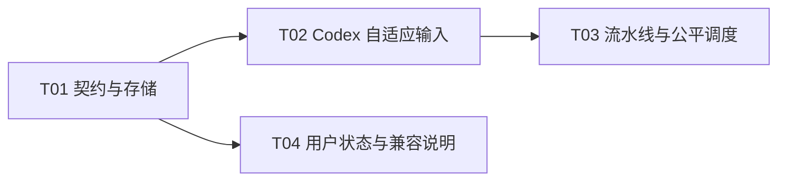

# Plan / 计划：提高消息投递时效
最后修改时间: 2026-11-12 10:13:33

## Review status / 审查状态

Accepted

用户已要求“开始实现”，接受本计划和四项局部方案。T01–T04 已在当前窗口完成，实现与必要开发检查已审查接受；依据后续“进入验证，可以使用 jev-ultrafast-mcp 自测”完成整体验证，见[验证记录](../verification/20261112-timely-message-delivery.md)。产品未返工，原有效交付保持 accepted。

## Intent basis / 意图依据

- [意图](../intent/20261112-timely-message-delivery.md) A01–A08：用户照常发送，系统自动提高消息进入目标会话的时效。
- 记录基线：`a5c06099632f9ad1d17ecfbab3318fddea700666`，工作区原本干净；实际派发必须重查 HEAD 和用户改动。
- 保留 [Skill/MCP 方案](20261111-chat-skill-mcp.md)的原生输入、能力校验与轻量检查约束；本计划在新消息投递路径上替代其“不改变排队/启动”的范围限制，不回写历史交付结论。

## Technical decisions / 技术设计与决策

### 1. 调查事实及其限度

现有 `DeliveryService` 总是 `enqueue`，`CodexDriver` 使用 `thread/queue/add`；成功后尝试空闲队首启动，随后观察 `thread/items/list`。`DeliveryRunner` 先填满提交槽位，再在剩余槽位中每约 2 秒安排观察。前者解释忙碌时为何等待后续轮次；后者存在观察饥饿风险，不等于已证明现场延迟由它导致。

| 公开资料 | 本次会话检索得到的解释 | 本项目采用的结论 |
| --- | --- | --- |
| [Codex app-server 官方文档](https://developers.openai.com/codex/app-server/) | `turn/steer` 追加活动轮次输入，要求 `expectedTurnId`，返回 `turnId`；无活动轮次时失败，不产生新的 `turn/started` | 使用原线程与当前轮次，不把 steer 当作创建轮次或中断工具 |
| [#48928](https://github.com/openai/codex/issues/48928) | 自动化调用 queue 等待活动轮次结束；桌面输入框的 steer 偏好未覆盖外部 queue 调用 | 与用户现象相符，不能靠桌面偏好修复本项目 queue 路径 |
| [#60138](https://github.com/openai/codex/issues/60138) | 程序发送在 Queue 偏好下等待下一轮，空闲时可立即开始 | 区分队列接纳与活动轮次输入 |
| [#54683](https://github.com/openai/codex/issues/54683) | 外部 Agent 消息讨论涉及原宿主连接所有权、queue/steer 和 admission receipt | 复用共享 daemon proxy，不启动第二个执行宿主 |
| [#58759](https://github.com/openai/codex/issues/58759) | 讨论嵌入 CLI 服务空闲时外部队列轮询约 10 秒的问题 | 不能解释所有忙碌时的长等待，也不是本项目观察调度间隔 |
| [#54964](https://github.com/openai/codex/issues/54964)、[#54396](https://github.com/openai/codex/issues/54396) | 另有队列/Windows steer 偶发停滞反馈，尚无已核实根因 | 保留上游限制，不将社区反馈写成维护者已确认的修复结论 |

以上 issue 是先前检索时的用户报告与讨论，不作为上游行为保证或当前关闭状态的声明。

本轮重新读取官方页面并导出本机 `codex-cli 0.167.1` 的实验性 schema：`codex app-server generate-json-schema --experimental --out <临时目录>`。命令不连接工作会话，也不创建输入。

- `TurnSteerParams` 必填 `threadId/input/expectedTurnId`，另有可选 `clientUserMessageId`；输入联合类型包含 `text`、`skill`、`mention`。
- `TurnSteerResponse` 只有必填 `turnId`，没有队列 ID 或逐消息接收凭证。
- `ThreadTurnsListParams` 支持 `limit/sortDirection/itemsView`；`Turn.status` 包括 `inProgress`；`thread/items/list` 的 `userMessage` 包含可空 `clientId`。
- 官方页面说明 `thread/read(includeTurns=true)` 全量历史已弃用，因此采用摘要读取与分页轮次查询，不扫描全部历史来找活动轮次。
- schema SHA-256：`TurnSteerParams.json` = `ba7034e96620c999cf0164f08bc753f58ff2b214f2025ab409f8ce42dc4cc708`；`TurnSteerResponse.json` = `866ba9a77c12b5d570c837d58f73bf40b24e50fa93404bdf792dd984d313b1aa`；`ThreadTurnsListParams.json` = `2a8b93d7d4437cc25e16a1dde16d8db3c338d39e16c5eece2a56e943a21577d7`。

计划时尚未进行真实 steer 或新版历史关联实验；后续整体验证确认本机 0.167.1 在原活动轮次保留客户端 ID 与原生能力输入，详见验证记录。协议不保留客户端 ID 时仍保持待确认，不以正文相似、轮次结束或超时推断已接收。

### 2. 固定的输入路由与防重复规则

adapter 增加 `submit(thread_id, client_message_id, QueueRequest) -> QueueReceipt | SteerReceipt`。保留 `QueueRequest` 的历史名称及现有 `enqueue` 队列操作以便增量接入；`submit` 是唯一自动选择入口。application 不直接操作 app-server 字典。

1. 在一次现有 `ProxyRpc` 连接中完成目标身份、项目目录和全部能力校验。公共输入构造保留 envelope、必需 Relay Skill 和去重后的所选原生 `skill/mention`，任一确定能力失败在输入写入前结束。
2. 完成能力查询后重新 `thread/read(includeTurns=false)` 核对目标与最新状态。空闲则 `thread/queue/add`；不可用/异常则确定拒绝，不恢复或创建会话。
3. active 则查询 `thread/turns/list`，参数为原 `threadId`、`limit=1`、`sortDirection=desc`、`itemsView=notLoaded`。最新轮次必须有非空 ID 且为 `inProgress`，然后以它作为 `expectedTurnId` 调用 `turn/steer`，同时传原 `clientUserMessageId` 和完整输入。
4. active 但最新轮次无法定位时尚未写入输入，退回 queue/add 并记录原因。轮次查询明确 `-32601` 不支持时同样回退；其他读取错误结束为确定的提交前失败，不循环查询或全量读历史。
5. steer 响应 `turnId` 必须非空且等于 `expectedTurnId`；匹配只表示本次输入已接纳。不得伪造服务端未返回的客户端标识回显或队列回执。

为处理读写竞态，`RpcRejected` 保留结构化 `code/message/data`，保持现有异常兼容构造。steer 的回退仅允许以下有限情形：

| 发生点 / 结果 | 后续动作 |
| --- | --- |
| steer 返回 `-32601` 方法不存在 | 未执行该方法，一次 queue/add；记录版本降级 |
| steer 返回 `-32600` 或 `-32602`，随后只读复核为同一可用目标且已 idle，或已换成另一个有效活动轮次 | 原请求确定无效且状态已变化，一次 queue/add；不再向新轮次重试 steer |
| 同样的参数类拒绝，但复核仍是原活动轮次，或目标不可用/复核失败 | 记录 rejected，不掩盖参数、权限或目标问题，不补投 |
| 其他 steer 服务端错误码 | 保守记录 unknown，不因内部错误推断未接纳 |
| steer 超时、断连、响应身份不符或回执损坏 | unknown，禁止 queue fallback、重试 steer、queue/start |
| queue/add 明确拒绝或结果未知 | 延续当前 rejected / unknown 分类；不反向补投 steer |

一个 delivery 最多出现一次成功输入写入；唯一允许出现 steer 后 queue 的序列是上述可证明未接纳的拒绝。`clientUserMessageId` 只用于关联，不提供上游幂等保证。观察、进程恢复和重连均不能调用 `submit/enqueue/steer`。

### 3. 端口、状态与持久化契约

- 新增 typed `SteerReceipt(turn_id)`，与现有 `QueueReceipt(id, metadata)` 构成提交结果联合；新增 `DeliveryDriver` 协议扩展现有 `QueueDriver` 并增加 `submit`。T01 仅加契约，T02 实现 adapter，T03 将 service 切换到新端口，保证可增量检查。
- 新增 `SubmissionRejected(method: queue | steer | None)`、`SubmissionUnknown(method: queue | steer | None)`；后者可保留安全诊断，不能携带需直接展示的原始协议敏感信息。提交前失败 method 可空，已尝试写入后保留最后实际方法。
- `Delivery` 及数据库新增可空 `submission_method`（`queue | steer`）、`steered_turn_id`，对应 API `submissionMethod/steeredTurnId`。方法由服务记录，发布请求不接收用户指定方法。
- 保留状态枚举兼容：`pending/submitting/queued/received/rejected/unknown`；`queued` 的内部通用含义扩展为“已提交接纳、待输入核验”。queue 成功仍填 `queued_at/queued_submission_id/receipt`；steer 成功填 `submission_method=steer/steered_turn_id`，状态为 queued，queue 专有字段和 `activation_attempted_at` 全部为空，`updated_at` 记录接纳时间。
- steer 成功 note 为“已送入当前轮次，等待输入接收确认”；不能直接填 `received_at/item_id/turn_id`。历史精确匹配后两种方法都按现有方式写入 received 事实；`received_turn_id` 表示实际历史轮次，独立保留提交响应的 `steered_turn_id`。
- 超时的 steer 可在没有成功回执时被历史确证：这种 received 记录保留空 `steered_turn_id`，要求真实历史 item/turn/时间，不反向伪造提交响应。只有成功接纳待核验的 steer queued 必须有响应 turn ID。
- 响应未知、提交中断均保留 unknown；崩溃前尚未保存方法时允许 method 为空，仍可按唯一客户端 ID 核验。两种方法均进入现有 queued/unknown 历史核验集合，无需为 steer 另建接收状态或连接订阅。
- 约束：steer 记录不能有队列凭证、入队时间或启动尝试；`steered_turn_id` 只能出现在 method=steer 且有成功接纳证据的记录。queue 回执仍校验两个原标识；mapper 不把 steer 结果写入 queue 专有 `receipt_metadata`。
- T01 新建 `0003_delivery_steering`，revision=`delivery_steer_20261112`，down_revision=`capabilities_json_20261111`，SQL-first 增加两列与约束。旧非 pending 记录回填 method=queue；旧 pending 保持空，后续提交时选择新路径。同步 `MIGRATION_HEAD`，不修改原 0001/0002、不操作开发库。
- `claim_activation` 与队列删除目标显式排除 steer；真正 queue 的单次精确 FIFO 启动不变。清空仍软删待办，steer 输入不可撤回；已删除提交的晚到结果不触发任何后续写入或启动。

### 4. 流水线、观察公平性与顺序

- `DeliveryService` 调用 `driver.submit`，按结果映射领域转换并短事务条件保存；只有保存成功的 QueueReceipt 才尝试原有 activation。SteerReceipt 与任何失败分支都不激活队列。
- 保留单 dispatcher 文件锁、同一目标不并发 submitting、全局有界 executor、冻结接收人及 RPC 不持数据库事务。
- `DeliveryRunner` 将“观察到期”作为与提交同级的待办，在空闲槽位分配时公平选择。两类同时待办时交替安排一个观察与一个提交；只有一类时使用可用容量。观察按 session 轮转，同一 session 至多一个观察在途；总在途数量始终不超过 concurrency。
- 每约 2 秒刷新未确认 session 快照，将未在途的会话去重加入到期待办集合；实际安排后才移除相应待办。未安排完的会话保留资格，不能因刷新覆盖而丢失，也不能每安排一个观察就把其余会话整体推迟 2 秒。
- 观察仍以约 2 秒为到期节奏，且继续最新页加每轮一页旧历史；不是外部 RPC 完成的 2 秒 SLA。没有空槽时保留已到期资格，不能先用新提交再次填满所有槽位，也不能在未实际调度观察时把到期时间不断推后。
- 单并发配置下，两类都待办时也交替；不允许长耗时观察结束后立刻重复观察而永久不提交。关闭等待、异常回收和跨会话轮转沿用现有有界行为。
- 同一目标的新提交维持本地 FIFO；已有 queue 积压不升级成 steer。新消息与旧队列的跨轮次顺序可能改变，产品说明不保证全局输入处理顺序。

### 5. 用户状态与兼容

- 页面将“入队中”统一为“发送中”，“入队失败 / 入队待确认”统一为“发送失败 / 发送待确认”；“接收中 / 已接收”仍由接纳/历史输入证据区分。
- 不在发送界面展示 queue/steer 选择，不加入自动重试按钮；详情可读取新增事实字段，正文区不呈现协议步骤。
- 队列面板仍展示 pending/submitting/queued 的未删除待办，包含尚待核验的 steer；它是 Relay 待办视图，不等同于 Codex 原生队列。空列表提示和清空反馈说明“移除待办记录不会撤回已送入会话的内容”，不把 steer 计为可删除的上游队列项。
- API 字段只增不删，CLI 状态筛选枚举不变；旧请求无需提供新字段。`queuedCount/queuedAt` 保留旧字段名，前者文档说明为已接纳待确认计数，后者只记录真实 queue 接纳时间，不伪造 steer 入队时间。

## Implementation steps / 实施步骤

1. T01 固定 typed outcome、领域转换、两列持久化及队列操作边界，交付兼容迁移和 mapper 单测。
2. T02 依 T01 实现同连接输入预检、当前轮次定位、steer/queue 选择和受限竞态回退，交付 adapter 单测。
3. T03 依 T02 切换服务入口，贯通回执保存、精确观察、queue-only activation，完成调度公平性及不重发检查。
4. T04 依 T01 并行调整前端类型/文案、清空说明和协议说明，不改 product routing；与 T03 集成后由主会话复核整体结果。

## Files to change / 修改范围

- T01：`application/delivery/ports.py`、`domain/rooms/models.py`、`domain/rooms/delivery.py`；persistence models/mappers/repositories 的新增事实、激活与删除过滤；`0003_delivery_steering`、迁移 head 和迁移指南。
- T02：`infrastructure/codex/driver.py` 及 Codex adapter 单层单测；保留现有 proxy 传输和 Skill/MCP 目录实现。
- T03：`application/delivery/service.py`、`infrastructure/dispatch/delivery.py`、必要的 bootstrap/Codex/dispatch dependencies 类型接线及相应单层单测。共享契约/存储的修复由 T01 原分配串行处理。
- T04：`web/src/services/roomApi.ts`、`deliveryStage.ts`、`MessageTimeline.vue`、`MessageQueue.vue`、必要的 `MessageDetails.vue/useMessageQueue.ts`；`docs/design/codex-session-chat-collaboration.md` 与 `codex-integration-capabilities.md` 的现行行为说明。
- 不包含依赖升级、插件安装、用户配置、现场队列或数据库操作；所有 task 不覆盖用户已有改动。

## Tasks and coordination / 子任务与协调

### Coordination / 协调信息

- 方案修订：1。
- 权威协调根：`D:\SourceCodes\mywork\agent-relay`。
- 仲裁会话：本次用户调用 SpecFlow 的当前主会话；唯一负责分配、状态与交付审查。
- 阶段授权：用户在记录与拆分完成后明确“开始实现”，覆盖 T01–T04 Implementation 及必要开发检查；不授权 Git 写操作、现场队列/数据库操作或部署。
- 验证追加授权：用户明确进入验证并允许 jev-ultrafast-mcp 自测；允许以当前代码启动隔离临时数据库与独立测试会话，检查真实 UI 和投递链路，并运行既有相关前端断言。原有现场数据、工作会话及 Git 写操作仍不在范围内。
- task 只写各自记录；总计划由主会话唯一维护。不启动子 agent 或聊天室协作。

### Task definitions / 任务定义表

| ID | 任务文档 | 直接前置任务与要求 | 预期交付与验收 | 意图验收归属 |
| --- | --- | --- | --- | --- |
| T01 | [投递契约与存储](../task/20261112-timely-message-delivery/T01-delivery-contracts.md) | 无；消费本计划修订 1 固定字段与结果联合 | typed contracts、领域转换、mapper、队列边界过滤和前滚迁移；单测及离线 SQL 检查通过 | A02、A03、A06、A08 |
| T02 | [Codex 自适应输入](../task/20261112-timely-message-delivery/T02-codex-steering.md) | T01 已接受且可访问的契约、领域/存储版本；新增 outcome 可用于 adapter | 原生 steer/queue adapter，能力与竞态/异常检查通过 | A01、A02、A04、A08 |
| T03 | [流水线与公平调度](../task/20261112-timely-message-delivery/T03-delivery-pipeline.md) | T02 已接受且可访问的 `submit` adapter，包含其已接受前置基线，相关单测通过 | 服务路由贯通、queue-only activation、精确观察与无饥饿调度；单测通过 | A01、A02、A03、A05、A06、A08 |
| T04 | [用户状态与兼容说明](../task/20261112-timely-message-delivery/T04-delivery-feedback.md) | T01 已接受且可访问的 wire 字段、状态语义和清空契约；检查通过 | 类型/文案/清空说明一致，静态检查与 build 通过，形成用户验收步骤 | A06、A07、A08 |

### Execution registry / 执行登记表

| ID | 执行状态 | 执行者 | 分配编号 | 工作基线 / 交付位置 | 仲裁结论 / 当前阻塞 |
| --- | --- | --- | --- | --- | --- |
| T01 | accepted | 本窗口 | TIMELY-T01-01 | 当前工作区；ports SHA-256 `20f472debc23ce6e1bd5919d0da0e7eb8e68dd2b28c9b6b61295ede0f3b09b02` | 09:44 复核接受；含 unknown 后历史确证修复，纳入 222 单测、全量检查和更新离线 SQL |
| T02 | accepted | 本窗口 | TIMELY-T02-01 | driver SHA-256 `80924437a3035056fb9b9ee7d32225191778a8621eca9129d1b6676ea14cca4d` | 防重复、能力和错误分类已审查；纳入最终开发检查 |
| T03 | accepted | 本窗口 | TIMELY-T03-01 | service SHA-256 `fdcc5ca4aff17893f9787aec6e0449994fae993481d627a6136959d7147d8400`；runner 指纹见 task | 有界公平调度、saved-only/queue-only 激活已审查；纳入最终开发检查 |
| T04 | accepted | 本窗口 | TIMELY-T04-01 | 当前 web 与现行设计说明 diff；基线含已接受 T01–T03 | 09:44 类型、lint、格式、build 通过；现有 UI 断言已同步但未运行，真实界面待用户验收 |

### DAG and integration / DAG 与集成

合法顺序：T01；随后 T02 与 T04 可并行；T02 接受后 T03 可与尚未结束的 T04 并行。T01 独占共享领域、ports、持久化和迁移；T02 独占 driver 与 adapter 测试；T03 独占 service、runner 及对应测试；T04 独占 web 与两份现行设计说明。共享 fixture 若必须变化由其原任务串行交付，不跨任务同时修改。

主会话在 T03、T04 均接受后集成并对照 A01–A08 检查；独立分支副本不产生分配权。任务自报完成不放行下游，需核对实际 diff、有效基线和检查证据。

### Assignment history / 分配历史

| 时间 | ID | 分配编号 | 执行者 | 动作与依据 |
| --- | --- | --- | --- | --- |
| 2026-11-12 09:30:21 | T01 | TIMELY-T01-01 | 本窗口 | 用户“开始实现”；核对方案、基线、无前置后接收 |
| 2026-11-12 09:33:00 | T02 | TIMELY-T02-01 | 本窗口 | T01 交付检查与审查通过，依既有实施授权接收 |
| 2026-11-12 09:36:44 | T03 | TIMELY-T03-01 | 本窗口 | T02 交付检查与审查通过，依既有实施授权接收 |
| 2026-11-12 09:39:00 | T04 | TIMELY-T04-01 | 本窗口 | T01 前置已接受；本窗口完成后端后串行接收，避免额外协调 |

## Verification plan / 检查与验证安排

- T01：领域转换及 mapper 对象单测；`uv run --locked alembic history`、`alembic heads` 和 `uv run --locked alembic upgrade capabilities_json_20261111:head --sql`，只核对离线 SQL，不连接数据库。
- T02：单层 RPC 替身覆盖活动/空闲、原生能力、轮次竞态、版本回退、写入后未知；断言实际输入写入调用次数与客户端 ID。
- T03：service 使用端口 Mock，runner 使用可控时钟、executor/future 替身；检查并发 1 和 4、持续提交及多 session 观察、保存失败、恢复/关闭/未知不重放，不依靠真实 sleep。
- T04：前端 typecheck、lint、变更文件格式和 build；不新增或运行组件/UI/浏览器测试。用户手工核对忙碌/空闲、能力消息、状态和清空提示。
- 开发收尾：`uv run --locked pytest tests/unit`、`uv run --locked mypy src tests`、`uv run --locked ruff check .`、`uv run --locked ruff format --check .`；web 在其目录运行 `corepack pnpm typecheck`、`lint`、`format`、`build`。只在实现后记录实际结果，不把历史通过数写成当前结果。
- A01/A04 归 T02/T03，A02/A03/A06 归 T01–T03，A05 归 T03，A07 归 T04，A08 贯穿各节点。真实时效验收分别记录消息创建、提交接纳和历史接收时间；不把 mock/schema 检查写成真实低延迟证明。
- 初始文档阶段已检查链接、ID、DAG、验收覆盖与空白；实施阶段已执行上述开发检查。整体 Verification 及真实用户时效验收尚未进行，不生成伪完成的验证文档。
- 上条为 Implementation 收尾时的历史检查状态；用户随后授权的整体验证现已完成，以验证记录和本节追加结果为准。
- 追加整体验证：使用独立临时目录、端口 19080 和当前生产构建，以 jev-ultrafast-mcp 检查空态、建房、发送、状态、详情与清空说明；真实输入仅针对本次新建测试会话。记录当前轮次、客户端 ID、创建/接纳/历史确认时间；不能用接纳时间代替处理时间。检查记录见后续验证文档。

### Development check results / 实际开发检查

- 后端：222 项单层单测通过；mypy src tests（138 files）、全仓 Ruff lint、格式（229 files）通过。包括 steer 超时后由历史确认但不伪造响应回执的回归。
- 前端：typecheck、lint、全仓 Prettier 和生产 build 通过；保留现有 `v-html` lint warning 和构建包体积 warning，未扩大范围整改。仅同步三份现有组件测试断言，未新增或运行 UI 测试。
- 迁移：`capabilities_json_20261111:head --sql`、history、heads 通过，新 head 为 `delivery_steer_20261112`；未连接或修改运行数据库。
- 审查：接纳/历史事实分离、queue-only 删除/激活、未知不重投、活动/空闲路由、能力与客户端 ID 保留、并发 1/4 公平调度均有单层证据。真实忙碌时效、审批/工具等待表现及界面由用户验收。
- 交付版本为 `a5c0609` 上当前共享工作区 diff；未暂存、提交或部署。运行前需通过项目迁移入口升级数据库，新旧版本不可混跑。

## Risks and recovery / 风险与恢复

- 上游 schema 与共享 daemon 版本可能不同；方法缺失按明确规则降级，未知响应不补投。没有证据表明新版会话立即生成带客户端 ID 的历史时，保留接收中或 unknown，由用户验收确认。
- 现有已入队积压继续等待消费，不能把“新消息更及时”宣传成“历史积压自动解决”。steer 不代答审批、不发中断，也不定时唤醒已停止会话；新消息的空闲启动保持既有规则。
- 公平调度只能消除本地调度饥饿，不能克服所有 RPC 都挂起的情况；沿用现有 RPC 超时和全局并发上限。
- 迁移仅增加事实列，采用正式前滚。不做降级/删列；若须恢复旧版本，应停派发并以前滚兼容修复保留事实，不能把 steer 记录变成待重投消息。旧程序不能正确保留新字段，不能与新程序混跑。
- 当前未操作真实用户会话、数据库、暂存区或提交历史。后续检查也不自动扩大到这些操作。

## User review notes / 用户审查记录

- 2026-11-12：按用户请求完成 Intent/Plan 和 T01–T04 局部设计。意图依据已明确；方案修订 1 为 Draft，四项任务均 unassigned，没有执行交付或实现完成结论。
- 2026-11-12 09:30：用户授权开始实现，接受修订 1 及全部 task 方案；仅派发当前可执行 T01，后续依实际交付审查放行。
- 2026-11-12 09:44：四项实现与开发检查接受。复核中修正 unknown steer 的历史接收约束，原 T01 分配串行修复并复验，相关下游重新核对通过；依赖、目标及验收未改变，无需另行拆分。
- 2026-11-12 09:54：按用户“进入验证，可以使用 jev-ultrafast-mcp 自测”追加授权进入整体验证；使用隔离环境，不重启原用户服务或迁移原数据库。
- 2026-11-12 10:13：整体验证通过，T01–T04 有效产品指纹不变，维持 accepted；补充真实 Skill/MCP/客户端 ID/清空、旧库前滚及 UI 证据，无需返工。服务与测试连接已停止，唯一测试会话已归档；未暂存、提交或部署。
