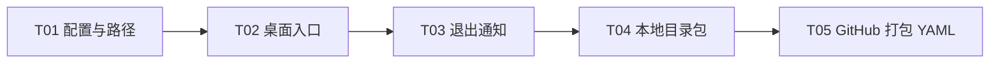

# Plan / 计划：浏览器与 WebView 桌面双模式
最后修改时间: 2026-11-12 14:25:53

## Review status / 审查状态

Accepted

用户消息 `room-94f73433cde7-msg-0119` 授权五项 Implementation；消息 `room-94f73433cde7-msg-0123` 明确不添加集成测试，代码完成后真实构建制品。方案修订 2 已实施，T01–T05 代码交付完成。本会话用户“继续推进主任务”后的整体代码核对和单元/静态复验已通过，记录见[Verification](../verification/20261112-webview-desktop.md)；真实制品与远端运行尚未验证，整体验收保持 Draft。

## Intent basis / 意图依据

依据[总意图](../intent/20261112-webview-desktop.md)及[收敛后的评估](../design/20261112-webview-integration-assessment.md)。五项 Implementation 已完成，现按本会话继续指令核对整体代码、单元与静态检查；不新增集成测试，不运行真实制品或远端 workflow。

## Technical decisions / 技术设计与决策

- app 入口显式使用 `app` profile 和 `Path.home() / ".agent-relay"`；读取该目录唯一的 `.env` 覆盖文件，优先级为内置默认 YAML、用户 `.env`、系统环境变量。相对数据/日志路径以用户根目录为基准，资源从包位置解析。
- `make webapi`、`make web` 保持既有开发流程。新增桌面入口，GUI 主线程、Uvicorn 后台线程，复用 `bootstrap.http.build_app`；页面打开 `http://127.0.0.1:9080/static/`。
- GUI 只负责交互和装配；配置/路径在 bootstrap，消息发布及通知编排在 application，迁移和 Codex 仍由基础设施实现。继续复用现有领域与 DTO。
- PyWebView 作为 desktop extra，PyInstaller 为开发依赖；非桌面入口不加载 GUI。保留 WebView2、Windows SelectorEventLoop 和已有 lifespan。
- 关闭确认后，对本次 app 运行已成功发送管理端消息的聊天室，用固定人类成员“你”定向发布“管理端已离线。”至当前 Agent 成员。正常调用现有提交链路，通知失败记录后继续退出，不等待模型回复。
- 用 `private_mode=False` 和 `~/.agent-relay/webview/` 持久化桌面偏好；SQLite、日志放入该用户根目录的对应子目录。
- PyInstaller 采用 `onedir`，同目录交付 `agent-relay-gui.exe`（GUI）和 `agent-relay.exe`（console CLI/MCP）；默认配置、前端和完整迁移资源随包。`make binary` 为唯一打包入口。
- `.github/workflows/build-desktop.yml` 支持 `workflow_dispatch` 与 `v*` tag push；Windows x64 runner 配置 Python、uv、Node/Corepack 和 GNU Make，通过项目 Makefile 检查、构建、验证并上传完整 ZIP artifact。PyInstaller 参数只维护在本地构建入口。

## Implementation steps / 实施步骤

1. T01 收敛 app 配置、客户端变量边界、用户/资源根和迁移定位。
2. T02 新增桌面入口与窗口、服务装配，提供关闭确认接入点，保持浏览器开发。
3. T03 接入退出确认后的离线通知与正常关闭，验证取消、无消息和投递失败场景。
4. T04 实现 GUI/CLI 目录包 spec 与 `make binary`；不添加产品测试入口或集成测试，最终制品由用户构建。
5. T05 实现 GitHub 打包 YAML、完整目录 ZIP 入口与静态检查；不在本轮触发远端。

## Files to change / 需修改文件

- T01：`bootstrap/config.py`、`bootstrap/settings.py`、新的 bootstrap 路径解析模块、默认配置、persistence 迁移加载及对应单元测试。
- T02：新 `desktop.py`、`bootstrap/desktop.py`、必要的 `bootstrap/http.py` 装配、Makefile 桌面启动入口及对应测试。
- T03：桌面关闭接线、application 消息/房间查询与通知用例、必要的 persistence query、对应测试；具体模块见 task。
- T04：Makefile、pyproject、uv.lock、受版本管理的 PyInstaller spec、构建/运行说明，必要的非业务资源布局。
- T05：`.github/workflows/build-desktop.yml`、README 中的构建与下载说明。
- 文档进展只更新本父任务记录；共享文件按任务顺序串行修改。

## Tasks and coordination / 子任务与协调

### Coordination / 协调信息

- 方案修订：2。用户消息 `room-94f73433cde7-msg-0123` 调整检查边界：移除本轮集成测试、独立 smoke 脚本和产品内测试开关，保留单元/静态检查与正式构建入口；实现完成后真实构建制品。
- 权威协调根：`D:\SourceCodes\mywork\agent-relay`。
- 仲裁会话：当前架构师会话，Agent Relay 房间 `room-94f73433cde7`，成员 `member-d8bc7b2eec9a`。
- 阶段授权：用户消息 `room-94f73433cde7-msg-0119` 授权五项 Implementation，`room-94f73433cde7-msg-0123` 收敛为单元与静态检查，后续真实构建由用户执行。本会话串行实施，不操作现有用户数据库、真实 Codex 会话/投递或远端 GitHub Actions，不执行 Git 提交。
- 协议入口：当前 SpecFlow skill 与 `references/task-coordination.md`。本会话维护总计划并审查前置交付；当前执行者在各自 task 记录接收、进展和交付。

### Task definitions / 任务定义表

| ID | 任务文档 | 直接前置任务与要求 | 预期交付与验收 | 意图验收归属 |
| --- | --- | --- | --- | --- |
| T01 | [配置与路径](../task/20261112-webview-desktop/T01-app-config-paths.md) | 无；以 `0e12906` 和当前方案为输入 | app profile、用户 `.env`、绝对运行路径、包内迁移定位及单层检查 | A02、A03、A08 |
| T02 | [桌面入口](../task/20261112-webview-desktop/T02-desktop-entry.md) | T01 已接受的配置/路径实现及可访问版本 | 可打开共用前端的桌面窗口、后台装配、关闭确认接入点，保留浏览器入口 | A01、A04、A08 |
| T03 | [退出通知](../task/20261112-webview-desktop/T03-exit-notification.md) | T02 已接受的窗口/服务生命周期及关闭接入点版本 | 确认取消行为、相关聊天室离线通知、正常退出及提交证据 | A05、A08 |
| T04 | [本地目录包](../task/20261112-webview-desktop/T04-desktop-package.md) | T03 已接受的完整桌面运行版本及其资源与入口 | `make binary`、GUI/console 目录包 spec 和资源清单；真实制品后续构建 | A03、A06、A08 |
| T05 | [GitHub 打包 YAML](../task/20261112-webview-desktop/T05-github-packaging.md) | T04 已接受的 `make binary`、包结构和资源约定 | `.github/workflows/build-desktop.yml`、完整 ZIP 入口及静态检查证据 | A07、A08 |

### Execution registry / 执行登记表

| ID | 执行状态 | 执行者 | 分配编号 | 工作基线 / 交付位置 | 仲裁结论 / 当前阻塞 |
| --- | --- | --- | --- | --- | --- |
| T01 | accepted | 当前架构师会话 (`member-d8bc7b2eec9a`) | `WEBVIEW-T01-20261112-01` | HEAD `0e12906754eb84e9dd0a3c09fd1d9849081fd4ea`；最终工作区 | 配置/路径与 mock Alembic 定位检查；当前全量 264 项 Python 单元与 mypy 通过 |
| T02 | accepted | 当前架构师会话 (`member-d8bc7b2eec9a`) | `WEBVIEW-T02-20261112-01` | 同一 HEAD；最终工作区 | socket/Uvicorn/thread/WebView 使用替身；取消、确认、一次性回调及导入隔离通过 |
| T03 | accepted | 当前架构师会话 (`member-d8bc7b2eec9a`) | `WEBVIEW-T03-20261112-01` | 同一 HEAD；最终工作区 | 通知编排与等待边界单元通过；无临时库/真实 runner 测试；实际投递待真实制品阶段 |
| T04 | accepted | 当前架构师会话 (`member-d8bc7b2eec9a`) | `WEBVIEW-T04-20261112-01` | 同一 HEAD；最终 spec、Makefile 和 console 入口 | 旧中间版本曾构建通过；修订 2 移除产品测试入口，最终制品待用户重建 |
| T05 | accepted | 当前架构师会话 (`member-d8bc7b2eec9a`) | `WEBVIEW-T05-20261112-01` | 同一 HEAD；workflow、archive 脚本和 README | actionlint 1.7.7、版本读取、Python 静态检查通过；不执行实际 workflow/ZIP 构建 |

### DAG and parallelism / DAG 与并行安排

任务定义表的依赖视图：

合法顺序为 T01 → T02 → T03 → T04 → T05。第一批是 T01–T03 的运行功能，第二批是 T04–T05 的制品链路。bootstrap、Makefile 和 README 有共享修改，按此顺序串行集成，不分配并发写入。

仲裁会话审查前置交付与集成版本后再放行下游，并负责整体验收覆盖核对。派发前重新核对计划接受、阶段授权、前置检查和可访问版本。

### Assignment history / 分配历史

| 时间 | 任务 | 分配编号 | 执行者 | 动作与依据 |
| --- | --- | --- | --- | --- |
| 2026-11-12 12:47:45 | T01 | `WEBVIEW-T01-20261112-01` | 当前架构师会话 (`member-d8bc7b2eec9a`) | 用户消息 `room-94f73433cde7-msg-0119` 授权五项 Implementation；按串行 DAG 接收 T01，基线 HEAD `0e12906754eb84e9dd0a3c09fd1d9849081fd4ea` |
| 2026-11-12 12:56:20 | T02 | `WEBVIEW-T02-20261112-01` | 当前架构师会话 (`member-d8bc7b2eec9a`) | T01 当前工作区交付已接受；同一 HEAD，串行接收 T02，继续源码桌面入口 |
| 2026-11-12 13:08:43 | T03 | `WEBVIEW-T03-20261112-01` | 当前架构师会话 (`member-d8bc7b2eec9a`) | T02 当前工作区交付已接受；同一 HEAD，串行接收 T03，继续关闭通知 |
| 2026-11-12 13:23:36 | T04 | `WEBVIEW-T04-20261112-01` | 当前架构师会话 (`member-d8bc7b2eec9a`) | T03 提交与失败语义、关闭接线已复核接受；同一 HEAD，接收完整目录包实现 |
| 2026-11-12 13:37:33 | T05 | `WEBVIEW-T05-20261112-01` | 当前架构师会话 (`member-d8bc7b2eec9a`) | T04 实际目录包和隔离 smoke 已复核接受；同一 HEAD 接收 workflow，协调 Makefile 增加纯压缩入口 |
| 2026-11-12 13:40:55 | T01–T05 | 沿用各有效分配编号 | 当前架构师会话 (`member-d8bc7b2eec9a`) | 按用户消息 0123 接受方案修订 2，移除集成测试与 smoke 入口，复核最终单元/静态检查；五项代码交付接受，正式制品由用户后续构建 |
| 2026-11-12 13:55:35 | T01–T05 | 沿用各有效分配编号 | 当前架构师会话 (`member-d8bc7b2eec9a`) | 用户要求继续主任务；核对整体代码与开发检查，补充关闭失败/通知等待边界的纯替身单元，真实制品与远端执行仍后置 |

所有任务方案现为 Accepted，五项 Implementation 完成。早期构建/临时库检查记录仅属于中间版本历史，不表示最终制品已验证。

## Verification plan / 验证计划

- 开发检查复用 `make check`、`make test`；单元测试聚焦配置、迁移路径装配和消息/窗口行为，使用 fake/mock，不增加临时 SQLite、真实 HTTP/runner 或 stdio 集成测试。
- 源码桌面验证：页面、历史路由、复制、WebSocket 更新、重开后排序及用户目录配置生效。
- 退出验证：取消、确认但无消息、多聊天室、无 Agent、正常通知提交、通知失败；核对实际提交与本地保存的区别。
- 制品验证：脱离仓库且工作目录不同的完整目录包启动；新库迁移、升级保留数据、两个入口、console `--help` 与 stdio MCP initialize/tools list。
- YAML 检查使用解析器与 actionlint；核对 Windows 工具准备、Makefile 命令、ZIP 路径和 artifact。workflow 只运行现有静态/单元入口及正式构建/压缩，不附加集成测试。实际 Actions run/下载检验后续执行。
- 整体代码审查已在用户继续指令后开始；同名验证记录将源码/单元检查与真实制品运行结果分开登记，不将未执行的 GUI、冻结包或 Actions 标成运行通过。

## Risks / blockers / assumptions / 风险 / 阻塞项 / 假设

- 桌面 extra、打包入口和 workflow 已形成；T05 直接复用 `make binary`，不复制 PyInstaller 参数。最终真实制品尚待用户构建。
- 离线通知按本次运行中已提交的管理端用户消息确定房间；发布成功与实际送入 Codex 分开记录。
- hosted runner 负责单元/静态检查和完整目录构建；真实窗口、迁移及 CLI/MCP 在制品阶段验证。

## Rollback / recovery / 回滚 / 恢复

保留独立 HTTP/CLI 入口；代码回退时不删除用户目录，不改写已执行迁移。构建失败保留日志和中间诊断，修复相同构建入口后重建；已发布消息沿用既有恢复与回执机制。

## User review notes / 用户审查记录

- 已纳入用户四点反馈及 `~/.agent-relay/.env` 的明确路径要求。
- GitHub 打包 YAML 以 T05 交付，代码已完成；没有远端工作流运行结果。
- 用户消息 0123 明确不添加集成测试；已移除新增集成测试与产品 smoke 开关，最终真实构建留给用户。

## Additional script cleanup / 追加脚本清理

2026-11-12 13:48:11，用户在本会话要求说明 scripts 各脚本作用，并删除可由单元/集成测试承担的脚本。按此明确授权直接完成维护清理，不改变五项 DAG。

- 删除 `scripts/probes/` 下 8 个独立验证脚本：Codex 协议/能力、队列恢复、原会话投递、成员发现与绑定、成员发布、Relay 入队、Relay 完整投递与 HTTP/CLI 重启联调。
- 保留 `scripts/install.py`：实际插件/skill 安装、同步和状态管理；保留 `scripts/binary.py`：实际完整目录压缩、版本/tag 与 artifact 输出。二者均被正式 Makefile/CI 入口使用，不是测试替代入口。
- 清理现行设计文档中的探针链接与执行命令；历史交付记录和脱敏证据保留原版本事实。运行代码、tests、Makefile、README 和 workflow 没有残留 probe 引用，不新增集成测试。
- 最终检查：`make check test` 通过，Python 259 项/前端 156 项单元通过，mypy 156 文件、Ruff、vue-tsc、Prettier 通过；只有既有 vue/no-v-html warning。actionlint 1.7.7、spec/脚本语法、workflow 结构、锁文件和 diff 空白检查通过。
- 最终代码未再次构建，远端 workflow 未运行，Git 未提交。`dist/AgentRelay/` 留有此前中间版本，清理该生成目录的命令被自动审批以 `blocked by policy` 拦截；它不作为最终制品，后续由用户 `make binary` 重建。

## Continued code review / 主任务继续核对

2026-11-12 14:00:31：用户要求继续主任务后，完成五项交付的整体源码/依赖/入口核对。新增 5 个纯单元场景，覆盖通知异常仍退出、pending 到 submitting 不等待回执、领取超时、空目标和查询失败；不增加集成测试，不运行真实制品或远端。

`make check test` 当前通过：Python 264 项、前端 156 项；mypy、Ruff、vue-tsc、Prettier 通过。actionlint 1.7.7、spec/脚本语法、YAML 结构、锁文件与 diff 空白检查通过。详细依据、A01–A08 结果和未运行范围见同名 Verification；当前阶段代码检查已完成，真实制品构建仍为下一步。

用户消息 `room-94f73433cde7-msg-0127` 要求统一 binary 命名：正式压缩脚本改为 `scripts/binary.py`，目录构建与 ZIP 压缩合并到 `make binary`，workflow 使用同一入口并读取该步骤的 artifact 输出。README、T05 和验证记录同步；脚本 Ruff/mypy、版本读取、actionlint、Make dry-run、旧名检索及 diff 空白检查通过，不运行实际构建。
