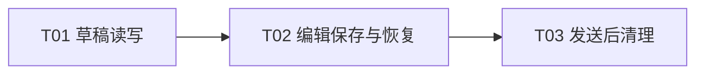

# Plan / 计划：刷新后恢复未发送消息草稿

最后修改时间: 2026-11-13 12:56:59

## Review status / 审查状态

Accepted

## Intent basis / 意图依据

依据已接受的 [Intent](../intent/20261113-message-drafts.md) A01–A06、A08。用户要求拆分任务，并明确排除浏览器存储故障；A07 已撤销。消息 `room-a2493e542ba3-msg-0113` 要求开始实施，据此接受方案修订 2 及三份 task，进入 Implementation。

首期解决同源、同标签页刷新后的未发送草稿恢复，使用 sessionStorage，保存完整编辑上下文。已提交到模型的中英文、空格和换行属于范围；输入法尚未提交的候选字、关闭应用后恢复及跨设备同步不属于范围。

## Technical decisions / 技术设计与决策

### D01 草稿读写

- 使用 sessionStorage 的 `relay-draft:<roomId>` 键，直接保存 MessageDraft JSON；没有记录时使用空白草稿。
- 保存正文原值、topicIds、mentionedMemberIds、capabilities、replyToMessageId，提供按房间读取、同步保存、删除三个操作。
- 不加 version、revision、pendingPublicationId 等字段；浏览器存储故障不新增捕获、降级、提示或测试。复用既有存储代码时不改其原有行为。

### D02 编辑模型与恢复顺序

- 正文通过现有 AppInput 的 input／compositionend 更新模型；在模型变化时同步保存，不能等待失焦、卸载或默认异步 watcher，不加固定防抖窗口。
- 统一以每个房间草稿中的 replyToMessageId 表达引用意图；完整引用消息仅作为显示数据，不建立第二份可独立变化的持久化状态。
- 先读取有效缓存，再让编辑器开始自动保存；用恢复阶段与房间加载版本保护，防止空白初始化、旧房间回调或旧查询覆盖当前编辑。
- 话题、成员与能力在有效元数据就绪后校验；加载中的空数组不能被当成已删除列表。失效选择提示用户处理，不静默改成其他发送目标。
- 引用通过现有消息查询能力解析；明确不存在时移除引用并提示、保留正文，临时网络失败时保留引用 ID。切换房间要隔离异步解析结果。
- 正文原值非空（含空白）、引用、能力或用户主动编辑的发送上下文构成草稿；只有默认路由选择时不必保存为空消息草稿。取消引用或清空正文仍应保存剩余有效上下文。
- 自动保存不增加 Toast 或保存状态 UI；沿用既有发送校验和反馈。

### D03 编辑草稿与冻结请求

恢复优先级为有效待确认发布 → 编辑草稿 → 空白编辑器。草稿恢复不发送消息、不创建 publicationId，待确认请求继续锁定并由用户主动核对。

| 状态／事件           | 行为约束                                                              |
| -------------------- | --------------------------------------------------------------------- |
| 普通编辑             | 同步保存本房间草稿                                                    |
| 点击发送             | 保留草稿，沿用既有待确认请求及编辑锁定行为                            |
| 明确拒绝             | 按现有行为释放待确认状态，保留可编辑正文和上下文                      |
| 超时／断网／结果未知 | 保留原冻结请求及 ID；不后台重发，不以恢复校验改写 payload             |
| 确认成功             | 按发送所属 roomId 清除草稿；协调 reset 与同步保存顺序，不把旧正文写回 |
| 刷新后发现两个记录   | 优先恢复现有待确认请求，继续原主动核对流程                            |
| 删除房间             | 仅在服务端删除确认成功后清理该房间草稿                                |
| 清空历史             | 保留未发送正文，重查引用有效性；不把清空历史等同于丢弃草稿            |

当前发送及待确认期间编辑器已锁定；复用这一行为，不为尚未出现的并发编辑新增修订或关联机制。

### D04 实施边界

复用现有 Vue、MessageDraft、消息查找和 Vitest Node，不增加后端接口、数据库、第三方依赖或测试框架。需要时提取简单草稿函数／composable，不建立通用缓存或容错系统。

## Implementation steps / 实现步骤

1. T01 提供按房间读、写、删草稿及正常读写检查。
2. T02 在已接受的 T01 基线上接入输入同步保存和完整上下文恢复。
3. T03 在包含 T01 的 T02 基线上衔接发布及房间生命周期，完成集成开发检查，交由主会话审查。

T01、T02 为中间交付，不能据此声明整项功能可发布。整体 Verification 仍按后续用户授权进入。

## Files to change / 需修改文件

| 任务     | 预期范围                                                                                                          |
| -------- | ----------------------------------------------------------------------------------------------------------------- |
| T01      | 简单草稿读写模块，暂定 `web/src/stores/messageDrafts.ts`，及必要的正常读写测试                                    |
| T02      | `RoomPage.vue`、`RoomComposer.vue` 的编辑与恢复区域；需要时提取 `useRoomDraft.ts` 及对应 Node 测试                |
| T03      | `RoomPage.vue` 的发布／清理区域、`RoomComposer.vue` 的 reset 衔接、`stores/rooms.ts` 的删除成功边界及必要行为测试 |
| 过程记录 | 本意图、总计划及三份 task；整体验证文档留待授权后创建                                                             |

实际路径可在不改变边界的前提下沿用仓库惯例。新增共享契约或任务边界变化时，由主会话修订计划后安排下游。

## Tasks and coordination / 子任务与协调

### Coordination / 协调信息

- 方案修订：2。
- 权威协调根：`D:/SourceCodes/mywork/agent-relay`；本计划及 `docs/task/20261113-message-drafts/` 为权威记录。
- 仲裁会话：本次架构师会话，Agent Relay 房间 `room-a2493e542ba3`，成员 `member-7f64b8ac8c83`；唯一维护分配与交付审查。
- 阶段授权：消息 `room-a2493e542ba3-msg-0113` 授权按修订 2 实施全部三个节点并运行必要开发检查；由本会话串行执行。允许修改各 task 约定的产品范围及接收／进展／交付记录；不含整体 Verification、暂存或提交。
- 后续授权：消息 `0138` 确认“测试有效”，授权将已完成工作按功能拆分暂存并提交。草稿提交保留独立可用的页面、编辑器和测试；行内 Skill 及联动测试在后续提交加入。
- 规划基线：`09556edc00750526ec54da94192f5cd5c31b4bb3`。实施分配时重新核对实际基线和工作区；该提交中的面板及编辑器改动属于已有成果。
- 协作协议：`C:/Users/wangm25/.codex/plugins/cache/specflow-local/specflow/0.2.1/skills/specflow/references/task-coordination.md`。

用户后续授权实施或交接时，先在本计划登记执行者、唯一分配编号、授权范围、实际基线和允许写入的 task 章节。接收、进展和交付记录写在权威 task；跨工作区只读副本不授予执行权。

### Task definitions / 任务定义表

| ID  | 任务文档                                                                   | 直接前置任务与要求                                                                     | 预期交付与验收                                                    | 意图验收归属                         |
| --- | -------------------------------------------------------------------------- | -------------------------------------------------------------------------------------- | ----------------------------------------------------------------- | ------------------------------------ |
| T01 | [草稿读写](../task/20261113-message-drafts/T01-draft-storage.md)           | 无；派发时固定工作基线                                                                 | 按房间读、写、删 MessageDraft；正常读写及房间隔离检查通过         | 为 A01、A02、A05、A06 提供基础       |
| T02 | [编辑保存与恢复](../task/20261113-message-drafts/T02-editor-recovery.md)   | T01：主会话已接受、检查通过且可访问的读写实现；实际使用版本记入分配记录                | 模型更新时同步保存，恢复正文及上下文，初始化不清掉已有选择        | A01、A02、A03；支撑 A08              |
| T03 | [发送后清理](../task/20261113-message-drafts/T03-publication-lifecycle.md) | T02：主会话已接受、检查通过且包含其已接受 T01 版本的完整基线；实际使用版本记入分配记录 | 待确认请求优先、成功清理、发送失败保留、reset／删除／清空历史一致 | A04、A05、A06、A08；集成复核 A01–A03 |

表中验收归属表示实现责任；真实浏览器／WebView 的体验证据由父级整体 Verification 汇总，不由 Node 检查推定通过。

A07 已依据用户指令撤销，不再分配实现、提示或测试责任。

### Execution registry / 执行登记表

| ID  | 执行状态 | 执行者       | 分配编号                                 | 工作基线 / 交付位置                                        | 仲裁结论 / 当前阻塞                                                                    |
| --- | -------- | ------------ | ---------------------------------------- | ---------------------------------------------------------- | -------------------------------------------------------------------------------------- |
| T01 | accepted | 本会话架构师 | T01-80a27839-41df-45d9-9d51-7826716366e5 | 工作区 T01-v1：messageDrafts.ts 及对应测试                 | 11:29:40 审查三个操作及独立键；定向 2 tests passed，见 T01 交付记录                    |
| T02 | accepted | 本会话架构师 | T02-99fbdd8b-bd77-4802-a80f-539daa09b90f | 工作区 T02-v1：useRoomDraft、页面／编辑器及测试，含 T01-v1 | 11:32:31 定向 6 tests 和 typecheck 通过，审查恢复顺序与引用来源，见 T02 交付           |
| T03 | accepted | 本会话架构师 | T03-7ea4c9b2-d505-49d7-a8bf-300a4b3aa848 | 工作区 T03-v1：发布／reset／删除／清理集成，含 T01／T02    | 11:36:39 审查实际 diff 及 93 tests、lint、格式和 build，接受开发交付；GUI 项待人工验证 |

执行状态仅由主会话按实际证据更新；方案 Accepted 不代表执行交付 accepted。主会话恢复协调时先读取 task 回报，再同步登记；完整接收落盘后，执行者可按有效授权工作，无需等待 running 同步。

### DAG and parallelism / DAG 与并行安排

任务定义表是依赖唯一来源。执行批次为 1：T01，2：T02，3：T03；每一批需前置交付由主会话接受且版本可用。T03 通过 T02 的完整基线使用 T01，不另建重复依赖边。

T02 与 T03 共享 RoomPage、RoomComposer 及可能提取的草稿 composable，串行写入。其他需求同时修改这些文件时，先协调 hunk 和基线。拆分不表示自动启动多个会话。

主会话负责接受各节点、核对输入版本、协调集成及父级验收；T03 的执行者负责汇集功能集成证据，不替代主会话仲裁。

### Assignment history / 分配历史

- 2026-11-13 11:28:14：依据消息 0113，将 T01 分配给本会话，编号 `T01-80a27839-41df-45d9-9d51-7826716366e5`，方案修订 2，基线 09556ed 加当前并行工作区。允许写草稿读写模块、对应测试及 T01 执行记录。T01 无前置；接收事实落盘后置为 running。
- 2026-11-13 11:29:40：读取 T01 完整交付，登记 submitted；审查工作区 T01-v1 与定向检查后 accepted。按消息 0113 为本会话登记 T02，编号 `T02-99fbdd8b-bd77-4802-a80f-539daa09b90f`，允许修改编辑保存／恢复及对应 task，输入为可访问的 T01-v1；接收后 running。
- 2026-11-13 11:32:31：读取 T02 交付，登记 submitted 并审查后 accepted；6 项定向测试及 typecheck 通过，修正一处 watch 数组换行。为本会话登记 T03，编号 `T03-7ea4c9b2-d505-49d7-a8bf-300a4b3aa848`，依据消息 0113 实施发布／清理和必要开发检查，输入为可访问 T02-v1（含 T01-v1）；接收后 running。
- 2026-11-13 11:36:39：T03 完整记录落盘后 submitted；主会话核对发布成功才清理、失败保留、reset 顺序及房间删除边界，结合开发检查接受工作区 T03-v1。三个节点均 accepted，表示开发交付接受，不表示整体验证完成。

## Implementation result / 实施结果

- 新增 messageDrafts 的按房间 load／save／remove，以及 useRoomDraft 的同步保存／恢复；只存普通 MessageDraft JSON。
- RoomPage 接入草稿和引用恢复，RoomComposer 等待元数据就绪并保护锁定请求；输入法仍沿用现有 compositionend 提交模型。
- 成功发布按发送所属房间清理；发送失败保留，未知结果继续原核对；reset 清引用且不把正文写回。删除成功清草稿，删除失败和清空历史保留正文。
- 没有缓存版本、草稿修订、额外发送关联、存储故障处理或新增保存提示；无后端、依赖、数据库变更。
- 保留并行技能引用／视觉工作；11:35 通过 Relay 消息 0118 告知高级开发 RoomComposer 草稿修改结束，可接入其独立功能。以下检查为该交接时点的工作区结果。

| 检查／验收 | 开发证据与限制                                                                                              |
| ---------- | ----------------------------------------------------------------------------------------------------------- |
| A01、A02   | Node 检查同步保存、原文／空白、多房间和新 editor 恢复；真实刷新、独立标签页及中文输入法未实测               |
| A03        | 引用 ID／能力恢复有 Node 证据；页面引用查询、房间版本保护和元数据就绪门控经代码审查，未做 DOM／真实服务测试 |
| A04        | Node 检查 pending 原 ID／payload 不被编辑改写；恢复路径只读取房间与消息，主动核对流程沿用既有实现           |
| A05、A06   | Node 检查锁定后继续编辑、成功清理与 reset、删除成功／失败及历史清空不删草稿；页面网络结果衔接经代码审查     |
| A07        | 已按用户要求撤销；未增加存储故障处理或测试                                                                  |
| A08        | 无新增业务订阅、路由刷新或后端接口；Node 与 GUI 证据分开记录                                                |
| 单元测试   | `corepack.cmd pnpm test`：15 files、93 tests passed；新增 8 项草稿测试，扩展既有删除／清空历史断言          |
| 类型／构建 | T02 `pnpm typecheck` 通过；最终 `pnpm build` 再次完成 vue-tsc 并构建成功，保留既有大于 500 kB chunk 提示    |
| Lint       | `pnpm lint`：0 errors、20 条既有 warning，均不在本次新增逻辑中                                              |
| 格式       | 最终 `pnpm format` 通过；修正 RoomPage 一处解构换行                                                         |
| Diff       | `git diff --check` 通过；未暂存、未提交                                                                     |

最终代码位置为当前共享工作区；T03-v1 在 T02-v1 上增量完成清理。交接时 RoomComposer SHA256 为 `7E5D7F188F195F9EE4C22C37D0A8165DAAA4901EF43DF9838E227F26BB45EF74`，用于区分后续技能引用改动。未进入整体 Verification，未创建验证报告或宣称 GUI 实测通过。

## Verification plan / 验证计划

开发检查沿用项目现有入口，以下命令在 `web` 下运行：

- T01 定向：`corepack.cmd pnpm test tests/stores/messageDrafts.test.ts`。
- T02 定向：`corepack.cmd pnpm test tests/stores/messageDrafts.test.ts tests/domains/room/useRoomDraft.test.ts`。
- T03 集成开发检查：`corepack.cmd pnpm test`、`corepack.cmd pnpm typecheck`、`corepack.cmd pnpm lint`、`corepack.cmd pnpm format`、`corepack.cmd pnpm build`；仓库根运行 `git diff --check`。
- 只添加有意义的正常读写、模型保存、恢复和成功／失败清理行为测试；不新增存储故障、缓存损坏、容量或权限异常测试。
- 后续父级验证逐项记录 A01–A06、A08：真实刷新、输入法提交后立即刷新、房间隔离、上下文恢复、发送失败保留、成功后不复活。人工浏览器／WebView 结果与 Node 替身结果分栏记录；本轮均未执行。
- 不启动真实浏览器、WebView、后端服务或数据库集成自动化，不引入测试环境／框架。无法用现有 Node 入口证明的交互如实列为待人工验证。

## Risks / blockers / assumptions / 风险 / 阻塞项 / 假设

- sessionStorage 仅承诺正常同源同标签页刷新；复制标签页可能继承初始快照，后续各自独立。不能把固定 WebView profile 当成跨进程保存承诺。
- 同一 origin 切换后端没有额外服务身份隔离；端口／主机名变化也不会共享草稿。
- 正常路径要处理初始化、元数据加载和 reset 顺序，避免用空白编辑器覆盖保存内容；发送完成按发送所属房间清理。
- 浏览器存储正常可用为本次前提，存储故障与坏缓存不扩展为本功能责任。
- RoomComposer 等文件含并行的视觉／技能引用改动；仅修改草稿相关逻辑，保留其他 hunk，已通过 Relay 同步共享范围。

## Rollback / recovery / 回滚 / 恢复

移除草稿集成即可恢复既有编辑行为；不改变后端数据或既有 `relay-publication` 键，回退不批量删除浏览器存储。

## User review notes / 用户审查记录

- 2026-11-13 11:11:06：依据消息 `room-a2493e542ba3-msg-0094` 完成三个任务的方案修订 1；全部未分配。仅进行文档结构、引用、依赖与验收覆盖核对，不宣称功能已实现或实测通过。
- 2026-11-13 11:23:18：方案修订 2，按用户反馈删除缓存版本、草稿修订及发送关联设计，撤销 A07 和存储故障处理／提示／测试。三个任务仍为 Draft、unassigned。
- 2026-11-13 11:36:39：消息 0113 授权后的实施完成，三个开发交付 accepted；真实刷新、输入法与 WebView 人工证据尚未补充。保留全部并行修改，未做 Git 写操作。
- 2026-11-13 12:54:18：消息 `0138` 确认“测试有效”，并要求拆分暂存和提交；本次依据该后续授权执行 Git 写入。此前开发检查结果保留为各交付时点的证据，不据此补写未提供的逐项人工结果。
