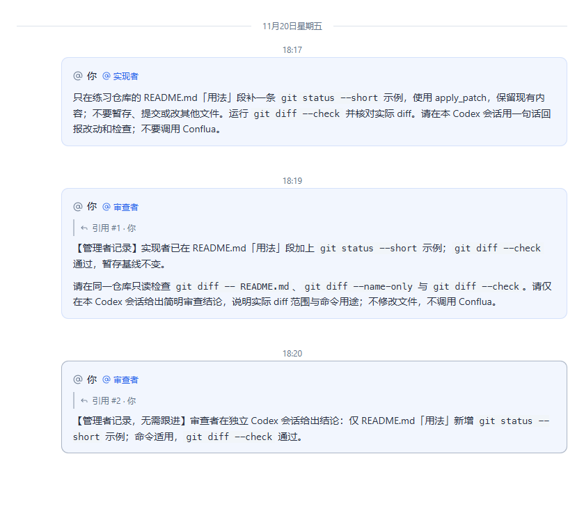

# 1. 跑通一轮实现与审查

先挑个有 README、已有一次 Git 提交的练习仓库。打开两个指向它的 Codex 会话，接入同一个共享 daemon。一个会话给 README 补一条例子，另一个检查这条命令写得对不对。整个练习不用提交代码。如果应用还没启动，或找不到刚打开的会话，先看[运行与排障](../reference/troubleshooting.md)。

## 1.1 绑定工作目录，进入默认频道

选择「新建聊天室」，名称填「手册演练」，「工作目录」填练习仓库的根目录。保存后进入该聊天室的「默认」频道。默认频道使用聊天室绑定的目录，两位成员会看到同一个工作区；本次只让实现者改文件，审查者只读。

## 1.2 加入实现者和审查者

在左侧「成员」旁选择「添加成员」。为两个不同的会话分别填写成员名称「实现者」和「审查者」，先不选角色或订阅。保存后核对成员列表同时出现「你」、实现者、审查者。找不到合适的会话时，检查仓库路径，再使用「刷新会话」，不要选名称相近但工作目录错误的会话。

名单齐了就可以派工。下面的消息特意写了回报给谁：如果实现者只在 Codex 终端里回答，你在频道里看不到那段话。成员收到派工时，消息头会带上它回报所需的聊天室和频道 ID。

## 1.3 给实现者派发小任务

在消息框输入 `@` 后选中「实现者」，保持话题为空，再发这条消息：

> 用这条消息头中的 `roomId` 和 `channelId` 查成员目录，确认自己是「实现者」，并找到人类成员「你」。只在 README 的用法段补一条 `git status --short` 示例，不提交，不改别的文件。完成后用 Conflua CLI 或 MCP 在本频道定向回报给「你」，写明变更位置、实际检查和未检查项。

打开该消息的「查看详情」，核对分发目标只有实现者。「已接收」只证明输入到达会话；继续等时间线出现实现者署名的实际结果，例如 README 的改动位置和 `git diff --check` 的结果。若原 Codex 已经回复、频道里却没有消息，请成员按[第 6 章](./agents.md)显式发布；其他无回复情形按[第 5 章](./tracking.md)核对。

## 1.4 将结果交给审查者并读回结论

在实现者的结果消息上选择「引用回复」，再明确选 `@审查者`；引用用于定位结果，**不会继承接收目标**。本次只改一处小文档，共用工作目录足够审查；如果改动还在另一份 worktree，要先给审查者一个实际可读取的版本。

> 用这条消息头中的 `roomId` 和 `channelId` 查成员目录，确认自己是「审查者」，并找到人类成员「你」。请只读审查刚交付的 README 示例，核对命令是否适用及 diff 是否超出用法段。不要直接修改文件。用 Conflua CLI 或 MCP 在本频道定向回报给「你」：写明实际检查，并给出「通过」或列出需要修改的问题。

最后读审查者的回信。如果它指出示例放错了位置，就引用那条意见，点名实现者改这一处，再请审查者看一次。如果通过，频道里应当能找到两条不同的消息：实现者说改了哪里，审查者说检查了什么。

看消息署名：图中的交接和审查结论由管理者「你」记录。成员自行回报时，署名应是成员本人；查看接收目标的方法见[第 6 章](./agents.md)。
