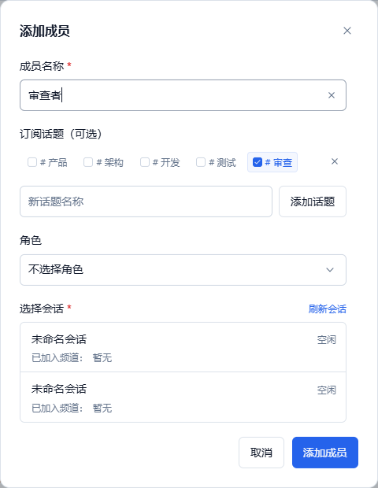

# 3. 配置协作成员

添加「审查者」时，最要紧的是选对会话。名字可以自己取；真正收到请求、打开 README 的，是名字背后那个 Codex 会话。

## 3.1 区分成员身份和 Codex 会话

打开成员详情，就能查到它绑定的会话。工作目录、模型以及正在执行的那一轮请求，都属于这个会话。名单里的「你」例外：这是你在频道里的身份，可以收消息，但背后没有 Codex 会话。

同一个 Codex 会话不能在同一聊天室同时绑定多个频道。添加成员时检查会话的「已加入频道」提示；要同时在两个频道工作，请准备分别在正确目录打开的会话。

## 3.2 添加成员、选择会话和模型

在左侧「成员」选择「添加成员」，使用「选择会话」找到相应会话，再填写成员名称。列表未更新时点「刷新会话」。如果会话处于「未接入」，先在共享 daemon 中打开该会话，再刷新。

「成员名称」是频道里用来 @ 对方的名字；「选择会话」决定哪个 Codex 会话收到消息。要给成员发送职责说明，选「角色」；要让成员收到某个话题的消息，选「订阅话题」。

需要调整模型时，在消息区只选中这位 Agent 成员，打开「模型」选择器，选择后核对显示值。模型选择影响的是这位成员绑定的会话，不会改变其订阅、工作目录或角色职责。模型读取失败时，刷新确认，不要把「未知」当作已切换。

## 3.3 用角色提示词区分实现与审查职责

在右上角齿轮菜单进入「预置角色」，可保存两份模板。示例：实现者「只改派发时指定的文件；回报 diff、实际检查和未检查项」，审查者「默认只读；先报告问题及证据，再给结论」。

选好「角色」并保存成员后，看看时间线：职责说明是作为一条消息发给新成员的。写「只读审查」是在交代工作，不会收走它的写权限。以后改了模板，旧消息也不会跟着改。要给已经在频道里的成员换个分工，直接 @ 它说明就好。

## 3.4 查看成员当前参与的话题

在成员详情查看订阅；需要调整时，通过「编辑成员」修改。让审查者订阅「审查」，实现者暂不订阅。打开「审查」的话题详情，核对订阅列表只有审查者。此处管理的是后续路由；已经发布的消息不会因修改订阅而另行分配。
