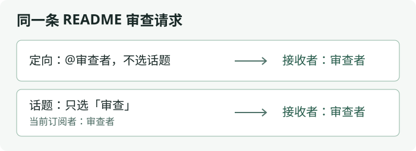

# 4. 把消息交给正确的人

在「手册演练」的默认频道，假设只有审查者订阅「审查」。用同一条 README 审查请求比较两种发法，实际使用时只选符合目的的一种。

图：当前订阅下两种方式的接收范围示意。增加订阅者后，只有第二种方式的范围会随之扩大。

## 4.1 给指定成员派工

在正文输入 `@` 并从候选中选中「审查者」，或用「选择成员」明确选取；确认发送区域显示该成员。只要求该成员行动时，不要同时添加有其他订阅者的话题。正文中的普通名字不等于选中接收者。

## 4.2 通过话题与订阅组织通知

用编辑器下方的「消息话题」选「审查」，不带 `@`。发布给该话题时，当前订阅者会进入接收范围；同一成员同时被点名和订阅时，只接收一次。发送者不接收自己的消息。只有 Agent 接收者产生 Codex 投递；发给「你」的消息会在时间线出现，但不会产生 Agent 队列项。

## 4.3 发送前核对频道和接收目标

按「当前频道 → 话题订阅者 → 已选成员」检查。左侧筛选用于浏览消息，不等于选好了发送目标；引用也不会沿用原消息的成员或话题。发送后在消息详情核对话题、`@` 和分发对象；如果只有人类接收者，没有 Agent 分发项是正常的。

## 4.4 引用技能，写清输入、限制和预期回报

在输入框输入 `$` 打开 Skill 选择器，从可用目录选取所需能力；没有所需项时，先刷新目录并确认目标会话已配置该 Skill。没有 Skill 也可发送演练请求，直接写清步骤；引用不会自行选择接收人，也不能替代验收条件。

一条可执行的请求应写明：输入是当前目录的 README diff，只读、不提交，检查命令和范围，回报结论、证据与未检查项。接收范围和请求内容分开核对。
