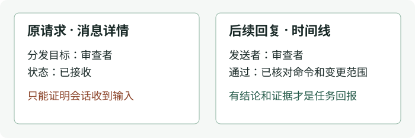

# 5. 跟踪执行与介入

「手册演练」里的 README 审查迟迟没回。先定位原请求和实际接收者，再判断要等消息送到，还是等审查工作完成；两者不能从同一个状态推断。

图：原请求详情与后续回复对照示意。示例结论不是界面根据分发状态生成的。

## 5.1 从时间线定位原消息

回到「手册演练」的默认频道，搜索「README」或用成员、话题筛选缩小范围。找到发给审查者的原请求，记录消息序号，并从消息菜单进入「查看详情」。如果找不到，先清除筛选并核对频道。

## 5.2 在详情中逐个核对投递

| 界面显示 | 可以据此判断 |
| --- | --- |
| 发送中（`pending` / `submitting`） | Conflua 已保存请求，正在等待或处理投递；不代表已进入 Codex 会话。 |
| 接收中（`queued`） | 外部队列已确认入队；不代表原会话已经收到这条输入。 |
| 已接收（`received`） | 原会话匹配到这条输入；不代表 Agent 已理解、开始或完成任务。 |
| 发送失败（`rejected`） | 查看诊断，确认目标和故障原因再决定是否补发。 |
| 发送待确认（`unknown`） | 结果未确定，先核对原会话和已有回复，不要盲目重发。 |

## 5.3 查看队列，区分排队、送达和回复

右侧「队列」列出仍在等待或接收中的消息，必要时点「刷新队列」。队列为空不能证明所有消息都已接收；在原消息详情看每个 Agent 的分发，在时间线找有检查依据的审查回复。移除 Conflua 队列记录不是撤回已经送入 Codex 的输入。

## 5.4 何时等待、纠正目标或中断成员

- 仍在正常推进时，等状态变化或约定回报时间，避免重复派发。
- 发错人时，在原频道分别说明停止或纠正，再向正确成员明确发布；不要假定删除排队记录可以阻止已开始的工作。
- 明确需要停止正在执行的轮次时，在成员项使用「打断」，并到原 Codex 会话核对。打断不是撤回消息，也不撤销已经写入的文件；结果待确认时先查会话状态，不连按重试。
