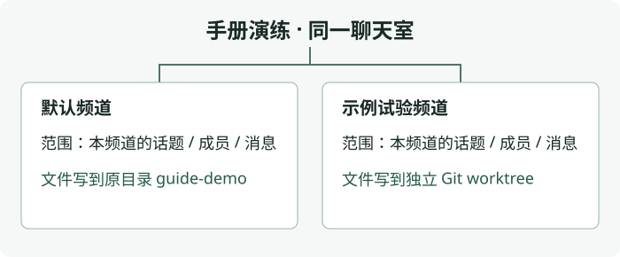

# 2. 组织工作空间

新开一个频道，两边改的还是同一份 README 吗？默认是。新频道有自己的成员和消息，但仍使用聊天室原来的目录。在一个频道里改了 README，另一个频道里的会话也能看到这处改动。

读这张图时看目录，不要只看频道名。指向同一目录的会话，看到的是同一份未提交的修改。

## 2.1 聊天室与工作目录的关系

共用目录很适合一人改、一人审：实现者改完，审查者就能看 diff，不必等一次提交。讨论却不会串到一起。切到另一个频道，看到的是那个频道的成员、话题、消息和队列；原来订阅的「审查」话题不会跟过来。

## 2.2 何时另开频道，何时只加话题

还是这批人，只是想把审查请求放在一起？在左侧「话题」里新建「审查」，让负责审查的人订阅即可。如果实验要换一批成员，而且不希望实验消息混进日常讨论，再另开频道。

## 2.3 共用目录与独立 worktree 的取舍

假如两个会话准备各写一版 README，就不要让它们同时写同一个文件。用 Git 仓库根目录创建聊天室，在「新建频道」里填入「示例试验」，勾选「创建 Git worktree」。只想分开讨论、仍打算轮流修改同一份文件时，留空即可。

worktree 从原仓库 **当前提交** 创建，不携带未提交改动。创建后先核对该频道实际工作目录，再在对应目录中打开 Codex 会话、配置成员。发现创建结果待确认，使用「查询创建结果」核对同一次请求，不再创建一个同名频道。

## 2.4 切换、归档频道

在频道栏切换「默认」和「示例试验」，观察话题、成员和时间线随之切换。发送前重新核对频道；不要把另一个频道的草稿或工作目录当作当前上下文。

完成实验并保存需要保留的工作后，在频道管理中选择「归档」。非默认频道会从列表隐藏，历史、worktree 和 Git 分支保留；已送进会话的输入不会撤回。默认频道不能单独归档。
