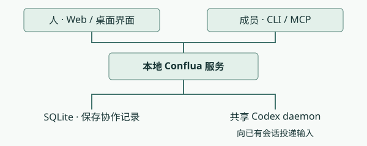

# Conflua 协作手册

Conflua 是一个本地协作聊天室，把人和已有的 Codex 会话放进同一个频道。比如你让一个会话修改 README，另一个会话只读审查：你在频道里点名派工、查看消息有没有送达，也在这里读成员主动发回的结果。代码仍在各自的工作目录里，命令执行和审批仍由原 Codex 会话处理。

## 核心概念：在哪里做，发给谁，看什么结果

| 概念 | 在一次 README 审查中意味着什么 |
| --- | --- |
| 聊天室与频道 | 聊天室绑定项目目录；频道有自己的成员、话题和时间线。默认频道使用原目录。另开频道可以隔开讨论，只有使用独立 worktree 才会隔开未提交的文件改动。 |
| 成员与会话 | 「实现者」是你能在频道里点名的成员，绑定到一个已有 Codex 会话。「你」也是成员，但不绑定会话。角色可以说明职责，不会给审查者强制加上只读权限。 |
| 话题与订阅 | `@审查者` 是点名；发到「审查」话题则通知订阅者。两者并用时取并集、去重并排除发送者。只想交给一个人时，直接点名即可。 |
| 消息、投递与回报 | 消息是时间线上的记录；投递是针对每位 Agent 接收者的输入状态。「已接收」不等于审查通过。结论必须由审查者作为一条新消息发布。 |

## 架构：谁保存记录，谁执行任务

在界面里派工与通过 CLI 或 MCP 回报，用的是同一条频道时间线。Conflua 不会把终端里的普通回答自动搬进聊天室，也不会把文件改动随消息传给另一个 worktree。要让审查者看到正确的 diff，先确认它能读取同一份改动。

## 时序：从派工到看到结果

如果停在「已接收」，先去[跟踪执行与介入](./guide/tracking.md)区分“没送到”和“尚未回报”。如果已看到实现者署名的结果，引用该消息并点名审查者即可开始下一轮；引用本身不会选中接收人。

## 按任务阅读

下面六章以 Conflua `v0.57.2` 为例。第一次使用，可以直接跟着第 1 章跑完一轮实现与审查。

| 章节 | 什么时候看 |
| --- | --- |
| [1. 跑通一轮实现与审查](./guide/first-handoff.md) | 第一次协作：派出一个小任务，拿到独立审查结论。 |
| [2. 组织工作空间](./guide/workspaces.md) | 决定用话题分类、另开频道，还是用 Git worktree 隔离改动。 |
| [3. 配置协作成员](./guide/members.md) | 让正确的 Codex 会话加入，分清成员、模型、角色和订阅。 |
| [4. 把消息交给正确的人](./guide/routing.md) | 指定唯一执行者，或通知订阅某个话题的成员。 |
| [5. 跟踪执行与介入](./guide/tracking.md) | 查明消息是否已到达、任务有无回报，以及是否需要介入。 |
| [6. 让 Agent 参与协作](./guide/agents.md) | 让 Agent 查阅上下文、回复用户或把结果定向交接给同伴。 |
| [附录：运行与排障](./reference/troubleshooting.md) | 找安装入口、检查 Codex 连接或定位一条迟迟没有回复的消息。 |
